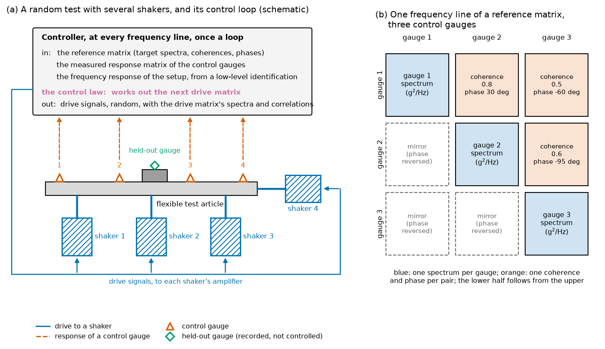
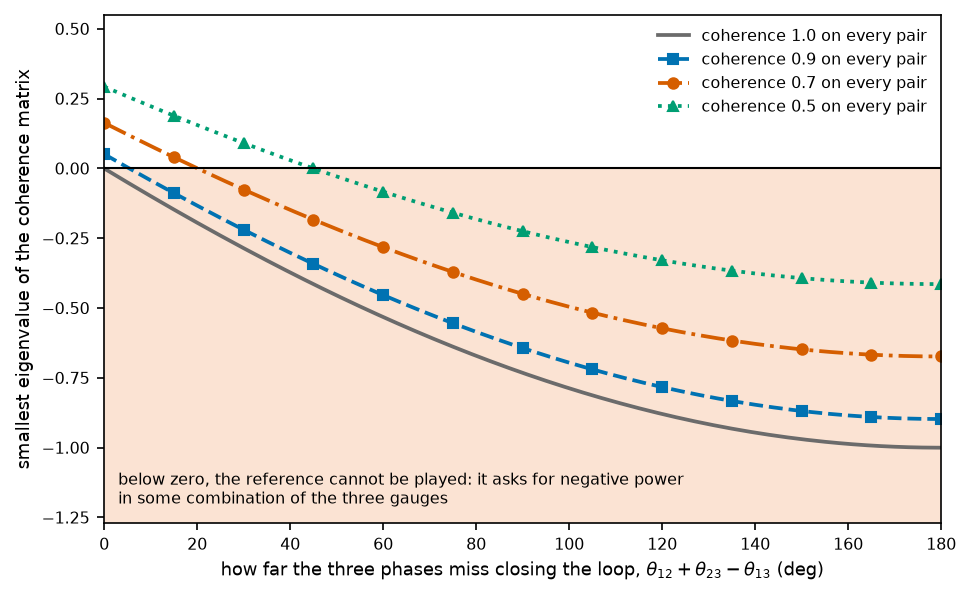

---
# Filled in by the editors at publication.
id: "2026-005"
version: 1
date: 2026-11-15
doi: "10.5281/zenodo.24254415"
doi_latest: "10.5281/zenodo.24254414"   # always resolves to the latest version
note: First published.

# Filled in by the authors.
title: "Multi-Shaker Random Vibration Control: What Is Published, and Where It Stops"
type: Survey
evidence: published sources
evidence_note: "Published papers, reports, standards, a patent and controller makers' public pages, each read to the extent stated in its reference. The few numbers of its own are arithmetic and a Monte Carlo of the spectral estimate, shown in full and marked as the article's own; no new experiments or test simulations."
authors:
  - name: "Kevin Cross"
    orcid: "https://orcid.org/0009-0002-6608-9426"
implemented_in: ""
benchmarks: ""
contents: true
abstract: >
  This survey maps what is published on controlling a random vibration test with several shakers,
  in which accelerometers on one test article are held to target spectra and, for every pair, a
  target coherence and phase. It covers the standards (MIL-STD-810H Method 527.2, IEC 60068-2-86,
  AECTP-400 Method 421), where targets come from and how their cross terms are chosen when the
  measured ones cannot be met, the closed-loop laws in print (Smallwood's factor correction and the
  matrix power law), identification and estimation, limits and notching, shaker placement and the
  points not controlled, structures that change with level, what controller makers and an
  open-source controller publish, and newer work. Each source is described as far as it was read.
  Within the sources read, the published work stops short of a tolerance for points not
  controlled, a comparison of closed-loop laws on one setup, any reported control of a structure that changes with level, and
  any learning-based controller with results. Two results are the article's own arithmetic: how far
  spectra, coherence and phase estimated from a finite number of averages scatter, set against the
  standard's tolerances, and how little the phases of a three-gauge target may disagree before it
  cannot be played. Nothing here was run on a shaker.
---

## Summary

A random vibration test with several shakers drives one test article from several points at
once, so that a set of accelerometers on the article reads a target: a spectrum at each
accelerometer and, for every pair of them, how closely their motions are tied and in what phase. This
article maps what has been published on how such a test is specified, how the shaker drives are
worked out before it starts and corrected while it runs, and where the published work stops. It
draws on the standards, about fifty years of papers, the controller makers' public pages and the
published documents of one open-source controller. A source is described only as far as it was read,
and those that could not be had are named as such.

**What the survey found:**

- **A shared method.** Every source read that describes the start of a test measures the setup at
  a low level with uncorrelated random drives, inverts that measurement to get a first drive, and
  corrects the drive from loop to loop.
- **Two closed-loop laws in print.** One, Smallwood's correction of a factor of the target, is
  printed in full with its safeguards and code; a second, the matrix power law, is known here
  through a restatement. The standard describes other forms in a few lines, and the makers describe
  theirs by feature.
- **Several ways to choose the target's cross terms** when the measured ones cannot or should not be
  met: uncorrelated drives, the least drive, the article's own response to uncorrelated drive (the
  "buzz test"), and drives restricted to the patterns the setup responds to most.
- **Starting tolerances** in MIL-STD-810H Method 527.2: spectra within ±3 dB to 500 Hz and ±6 dB
  above, overall level within ±15 percent, and, where the coherence is 0.5 or more, coherence within
  ±0.1 and phase within ±10 degrees.
- **Placement studies** showing that a setup with as many shakers as control points can match the
  controls and still hold other points badly.

**Where it stops:**

- No standard read sets a tolerance for points that are not controlled.
- No comparison of different closed-loop laws on the same setup was found.
- No published test was found of control on a structure that changes with level, and no published
  rule for how far below full level to measure the setup.
- No learning-based controller with results was found.

Two pieces of arithmetic are this article's own. A controller that is exactly right still sees its
measured spectra scatter: keeping all of 400 lines within ±1 dB nine times in ten takes about 260
averages, and a ±10 degree phase tolerance at a coherence of 0.5 is about the scatter of an estimate
from 64 averages. And a target for three gauges can ask for the impossible: with a coherence of 0.9
on every pair, the three phases may disagree by only about 5 degrees before no test can meet it.
Nothing here was run on a shaker.

## 1. What a Random Test With Several Shakers Is

### 1.1 Why Several Shakers

A random vibration test reproduces in a laboratory the broadband shaking a piece of hardware sees
in service: on a launch vehicle, in an aircraft bay, on a truck. On one shaker the article is bolted
to a fixture, an accelerometer near the fixing points is the control, and the controller raises or
lowers the drive at each frequency until that accelerometer reads its target spectrum. The article
is shaken in one direction at a time.

MIL-STD-810H gives the reasons for using several exciters instead (Method 527.2, 1.2.1): to spread
the energy over a long or slender article "without relying on the dynamics of the materiel"; to
supply more force to a large article than one exciter can; and because several exciters allow "more
degrees-of-freedom in accounting for both the impedance matches and the in service boundary
conditions". The published tests fall into two families. In the first, the article is mounted on a
table driven by several exciters, often in all six rigid-body directions at once: a six-degree-of-
freedom table. In the second, the article hangs free on soft supports, bare or on a fixture, and
several shakers push on it at chosen points (Schultz and Avitabile 2020). That second family started
with Daborn and co-authors, who reproduced a wind-tunnel environment on a freely supported article
with small shakers (Daborn, Ind and Ewins 2014, known here from a secondary report of its
abstract), in what Daborn named the
**impedance-matched multi-axis test (IMMAT)** (Daborn 2017, title only). A related method,
**intrinsic connection excitation (ICE)**, uses at least as many shakers and controls as the article
has connection degrees of freedom. Zwink, Cross and Fowler (2023) say it "is similar to" IMMAT, except that "no
attempt is made to match the impedance of the next level assembly and instead the vibration fixture
is designed to be as light and stiff as possible". In a twelve-shaker ICE test of an aerospace component, Larsen,
Schultz and Zwink (2022) found "a much more accurate replication of system field test response
compared with single degree of freedom testing". Tuman and co-authors (2024) control only at a
fixture that stands in for the next assembly, a transmission simulator.

Mayes and Rohe (2016) used six shakers in place of an acoustic test of an industrial structure
(Section 3.1). Rohe, Schultz and Hunter (2021) describe a six-degree-of-freedom table with two modal
shakers added, 14 drives controlling 21 accelerometers (Rohe 2022), where "Initial attempts using
commercial vibration control software were unsuccessful" and the added shakers "improved the match
to flight data over just the 6-DoF shaker".

### 1.2 What the Controller Is Asked to Hold

A random vibration target is a **spectrum**: how much vibration there is in each narrow slice of
frequency, in units such as g²/Hz. The controller works on a grid of these slices, called
**lines**, typically a fraction of a hertz to a few hertz apart; a group of neighbouring lines, such
as a third of an octave, is a **band**. The accelerometers the controller reads and brings to their
targets are the **control gauges**.

On one shaker the target is one spectrum. With several shakers and several control gauges it is
more. Two gauges can each read their target spectrum while moving together, in opposition, or
independently of each other, and the article is stressed differently in each case. Two more
numbers per pair of gauges and per line describe how they move relative to each other. The
**coherence**, from 0 to 1, is the share of the motion at one gauge that is tied, at that frequency,
to the motion at the other. The **phase** says whether the tied part moves in step (0 degrees), in
opposition (180 degrees) or somewhere between. The spectrum of one gauge is its **autospectrum**;
the quantity that carries a pair's coherence and phase is their **cross spectrum**.

All of these, for every gauge and every pair, make one square table per line, the **spectral
density matrix** (@fig-setup b). Its diagonal holds the autospectra and the entries off the
diagonal the cross spectra; the lower half mirrors the upper. The target of a multi-shaker random
test is one such matrix per line, the **reference**. The drive to the shakers is described the same
way: one matrix per line whose diagonal is each shaker's drive spectrum and whose off-diagonal
entries say how each pair of drives is correlated.

A spectral density matrix measured from real signals can never ask for negative power in any
combination of its channels. A matrix with that property is called **positive semi-definite**. A
reference without it cannot be met by any test, and a drive matrix without it cannot be played
(Section 2.3).

{#fig-setup fig-alt="Panel a is a side view of a long flexible test article held up by three shakers underneath and pushed sideways by a fourth at one end. Four control gauges sit on top of the article, drawn as orange triangles numbered 1 to 4, and a held-out gauge, a green diamond, sits on a component in the middle. Dashed orange arrows carry each control gauge's response up to a box labelled Controller, at every frequency line, once a loop. The box lists its inputs (the reference matrix of target spectra, coherences and phases; the measured response matrix of the control gauges; the frequency response of the setup from a low-level identification), the control law, which works out the next drive matrix, and its output, random drive signals with the drive matrix's spectra and correlations. Solid blue lines carry the drive signals from the controller to each shaker's amplifier. Panel b is a three by three grid for three control gauges. The diagonal cells, blue, hold each gauge's spectrum in g squared per hertz. The cells above the diagonal, orange, hold a coherence and a phase for each pair: 0.8 and 30 degrees, 0.5 and minus 60 degrees, 0.6 and minus 95 degrees. The cells below the diagonal are dashed and read mirror, phase reversed." data="data/fig1_setup.csv"}

A **held-out gauge** is recorded but never shown to the controller; it is used to judge whether the
article responded as it should away from the control points. A **rig** is the article on its
supports or fixture with a given set of shakers and control gauges, as the controller sees it.
These terms are the ones the first article in this journal uses (Cross and Zwink 2026).

### 1.3 The Loop

The controller's picture of the rig is its **frequency response**: on each line, a matrix $H$ with
one row per control gauge and one column per shaker, giving the acceleration at each gauge per volt
of drive at each shaker. It is measured before the test, in a step called **identification**, by
driving the shakers at a low level with random noise that is uncorrelated from shaker to shaker and
recording the gauges. If the drive matrix is $G_{uu}$, the response matrix at the control gauges is

$$
G_{yy} = H \, G_{uu} \, H^{H}
$$ {#eq-forward}

where $H^{H}$ is the conjugate transpose of $H$ (each entry's phase reversed, rows and columns
swapped). A multi-shaker random controller has to choose $G_{uu}$ on every line so that $G_{yy}$
matches the reference, $G_{rr}$, as closely as the rig allows. The rule that chooses it is the
**control law**. The controller then turns the drive matrix into random time signals with those
spectra and correlations, plays them, estimates the response matrix from what the gauges read, and
corrects the drive. One pass of play, estimate and correct is a **loop**.

The control literature writes a spectral density matrix as $G = E[X X^{H}]$, which Smallwood (1999)
notes is the complex conjugate of the textbook cross spectrum; MIL-STD-810H prints both layouts
(Method 527.2, Annex B 3.3). A phase moved from one convention to the other changes sign.

### 1.4 What a Rig Can Reach

On a rig with as many control gauges as shakers (a **square** rig) and an exact frequency
response, @eq-forward can be inverted line by line and any playable reference can in principle be
met. With more control gauges than shakers it cannot: four shakers cannot set the spectra,
coherences and phases of twelve gauges independently. With fewer control gauges than shakers many
drives meet the reference and one of them has to be chosen.

The tool used for all three cases is the **pseudo-inverse** $H^{+}$ of the frequency response.
The drive

$$
G_{uu} = H^{+} \, G_{rr} \, H^{+H}
$$ {#eq-pinv}

meets the reference exactly on a square rig, gives the response closest to it in the least-squares
sense when there are more gauges than shakers, and gives the drive of least total power when there
are fewer (Smallwood 1999; Smallwood 2005).
Smallwood put the limit plainly: with more responses than drives, "it will not be possible to match
more than n autospectra, where n is the rank" of the matrix, the number of independent patterns of
motion the shakers can make. With more gauges than shakers, the
response the rig can reach is the reference projected onto the responses the shakers can make; the
distance between that and the reference is a property of the rig, not of the control law (Cross and
Zwink 2026).

The pseudo-inverse is computed from the **singular value decomposition** of $H$ on each line. In
plain terms, it splits the rig into patterns of shaker drive, ordered from the one the gauges
respond to most strongly to the one they barely feel, and gives how strongly they respond to each
(the singular values). The ratio of the largest to the smallest is the line's **condition number**.
A large one means that some pattern of drive barely moves the gauges, so a reference that asks for
motion in that pattern takes a large drive, and a small error in the measured $H$ becomes a large
error in the drive. **Regularization** limits this by dropping or damping the weakest patterns
before inverting (Section 4.5).

## 2. How a Random Test With Several Shakers Is Specified and Judged

### 2.1 What the Standards Say

Three standards have a method of their own for tests with several exciters. **MIL-STD-810H**
(with Change 1, 2022) has Method 527.2, "Multi-Exciter Test". It names the configurations by how
many exciters drive how many axes: several exciters in one axis (multi-exciter single-axis,
**MESA**) and several exciters in more than one axis (multi-exciter multi-axis, **MEMA**), with the
hexapod, the multi-axis shaker table and the cube named as common six-exciter examples and systems
of "more than 6 exciters" as over-actuated ones (1.2.2). Its random procedure (Procedure II)
extends the single-axis random method, 514.8, and the drives it synthesizes are stationary and
Gaussian (2.2). It says what it leaves out: it "does not address aspects of vendor-supplied
software control strategy" (1.3 a), and it "generally does not provide specific test tolerance
information" (1.3 e). Its body says only that "The question of reasonable tolerances in a MET is
not simple for either MET procedure" and that they "will often need to be addressed on a test by
test basis" (4.2.2).

Its annexes do give numbers. Annex D 3 makes the single-axis autospectrum tolerances of Method
514.8 applicable to each control and allows the cross-spectral tolerances to be relaxed. Annex E
5.2 offers, as "a reasonable starting point", the only numbers in the method for a random test with
several exciters (@tbl-standards). The same paragraph warns that "the expected statistical
variation imposes a lower limit on how tight the respective tolerance can be"; Section 5.2 puts
numbers on that.

**IEC 60068-2-86:2024**, "Test Fx: Vibration, Multi-exciter and multi-axis method", covers MESA and
MEMA with fixed-base shakers and with shakers attached directly to the article through flexible
couplings, a setup "quite similar to that used for modal testing, but using environmental test
severities" (clause 1). Unless specified otherwise, the spectra of a random test "shall be within
±3 dB of the specified values" (6.2); clause 6 sets no tolerance on coherence or phase. Its annexes
on control strategies and on choosing tolerances were not read for this survey (Section 12).

**NATO AECTP-400 Method 421**, "Multi-Exciter Vibration and Shock Testing" (read in its third
edition, 2006), has three procedures (MESA, a multi-output procedure and MEMA) and says that
"Specific multi-axis test severities are currently not defined in this test method due to the
dependence of the test on the measured environment" (3). It sets abort limits of ±3 dB to 500 Hz
and ±6 dB above, points to AECTP 401 (not read) for its tolerances, and where coherence and phase
are specified says "it will be necessary to determine the optimum control limits from experiment"
(5.2.4).

A recommended practice, IEST-RP-DTE022, "Multi-Shaker Test and Control" (2014), is meant to be used
with Method 527; its contents were not available to this survey.

| Source | Spectrum at each control | Overall level | Coherence and phase | Points not controlled |
|---|---|---|---|---|
| MIL-STD-810H Method 527.2, Annex E 5.2 ("a reasonable starting point") | ±3 dB to 500 Hz, ±6 dB above | rms of each controlled degree of freedom within ±15 % | coherence ±0.1 where it is 0.5 to under 1; phase: any where the coherence is under 0.5, otherwise ±10°, or ±40° near a steep change of the reference phase | none |
| MIL-STD-810H Method 514.8, Table 514.8-II (one axis, for comparison) | composite of the controls (average, maximum or minimum) ±3 dB to 500 Hz, ±6 dB above; each control under average control ±6 dB and ±9 dB | ±10 % (average); ±25 % (each control) | not applicable | none |
| IEC 60068-2-86:2024, 6.2 | ±3 dB | none in clause 6 | none in clause 6 | none in clause 6 |
| AECTP-400 Method 421 (Edition 3) | AECTP 401 5.1 (not read); abort ±3 dB to 500 Hz, ±6 dB above | AECTP 401 5.1 (not read) | "from experiment" | none |

: Tolerances the standards give for a random test with several exciters, with the single-axis
random tolerances of MIL-STD-810H for comparison. MIL-STD-810H with Change 1 (2022). {#tbl-standards}

None of these sets a tolerance for a point that is not a control, although the response away from
the controls is what most of the article lives with. Method 527.2 says that when the rigid-body
motion is controlled, "The elastic modes are not controlled, since often the control authority over
these modes does not exist" (Annex E 4.4 a). Hale and co-authors (2024), reproducing a 16-channel
field matrix on an 1,800-pound pod with five shakers, wrote that applying classical single-axis
tolerances to every channel and cross spectrum is "simply not feasible". The first article in this
journal proposes a practice for judging these tests, including at held-out gauges (Cross and Zwink
2026).

### 2.2 How the Reference Is Written

Smallwood (1999) defined the reference of a random test with several shakers by "the auto spectra
of the m responses, the ordinary coherence between pairs of responses, and the phase relationship
between pairs of responses", because "Defining the reference in this manner removes the burden from
the user of determining if the cross-spectrum is realizable and improves insight into the
specification." Method 527.2 says most commercial systems take the cross terms in this form, as
relative phase and coherence (Annex D 2.1.1). It adds that a coherence of exactly 1 "results in a
singular SDM" and that a value "slightly less than 1.0, (γ_ij = .95 to .98), greatly reduces the
numerical concerns".

Without measured cross terms, Method 527.2 says, "it almost always needs to be assumed that
excitation environments are independent of one another (coherence values are near zero)" (Annex D
2.2.2). It calls independent references "typically a conservative approach" that "may be overly
conservative near frequencies dominated by a single mode" (Annex E 4.6). It recommends, "If possible",
specifying the test "in terms of the rigid body motion" (Annex E 4.7 a). AECTP-400 Method 421 adds a further choice: where the cross terms measured in
service and those of the laboratory setup differ, the test may take its cross terms from the
laboratory setup (5.2.5). Section 3 follows that idea and the others the literature offers.

### 2.3 A Reference That Can Be Played

"Any specified spectral density matrix must be positive semi-definite to be physically realizable.
In practice it must be positive definite" (Method 527.2, Annex E 4.5.2 a). A coherence between 0 and
1 on every pair is necessary for that and, for two gauges, enough. For three gauges or more it is
not enough. Raising or lowering one gauge's autospectrum does not change whether the matrix is
positive semi-definite, so the coherences and phases alone decide it, and at high coherence the
phases have to agree with each other: if gauge 1 leads gauge 2 by 30 degrees and gauge 2 leads
gauge 3 by 30 degrees, a fully coherent reference must have gauge 1 leading gauge 3 by 60 degrees.
Musella and co-authors (2018) print the condition for three channels and show that choosing each
pair's phase on its own "could result in the reference matrix being negative definite".
@fig-realizable shows how much disagreement is allowed. With a coherence of 0.9 on every pair, a
reference whose three phases miss closing the loop by more than about 5 degrees asks for negative
power in some combination of the three gauges and cannot be played; at 0.7 the allowance is about
20 degrees, and at 0.5 about 45. These numbers are this article's arithmetic from that condition.

{#fig-realizable fig-alt="A line plot. The horizontal axis is how far the three phases miss closing the loop, theta 1 2 plus theta 2 3 minus theta 1 3, from 0 to 180 degrees. The vertical axis is the smallest eigenvalue of the coherence matrix, from about minus 1.2 to plus 0.5, with the region below zero shaded and labelled as references that cannot be played. Four falling curves: coherence 1.0 on every pair starts at zero and falls to minus 1 at 180 degrees; coherence 0.9, with square markers, starts at 0.05 and crosses zero near 5 degrees; coherence 0.7, with circles, starts at 0.16 and crosses near 20 degrees; coherence 0.5, with triangles, starts at 0.29 and crosses at 45 degrees." data="data/fig3_realizable.csv"}

A reference built pair by pair from separate estimates, or edited by hand, can fail this way
without any single entry looking wrong. Hunter, Cross and Nelson (2018) note that a matrix computed
from measured signals is positive semi-definite but that "field data are often noisy, modified, or
enveloped. In these cases, it is easy to violate the positive definite requirement." Method 527.2
says the same of combining several field records: "Any type of enveloping operation should be
avoided as it is highly likely to yield a non-positive definite result"; it averages the matrices
instead, and where the result is still not positive definite it reduces every cross term's
magnitude equally "until the Cholesky decomposition is possible" (Annex E 6, Steps 6 and 7). Even
rounding can break a reference. Paripovic and Mayes (2020) report a controller that truncated every
term at the sixth decimal place, which could turn a positive definite reference into one that was
not, or push a coherence above 1; their workarounds were to round in advance while keeping the
matrix positive definite, or to multiply the coherence by 0.9999, "which is undesirable".

## 3. Where the Reference Comes From

### 3.1 From Measurements in Service

When the motion was measured in service at the points that will be controlled, the reference is
the measured matrix, processed as in Section 2.3. Often it was measured elsewhere: inside the
article, or on a structure that is not part of the test. The drives that would reproduce it then
have to be worked out through a model of the article, a step the literature calls **input
derivation** or **input estimation**. Ross and co-authors (2017) compared four ways of deriving
inputs for a six-degree-of-freedom shaker from flight measurements at ten internal gauges, among
them a plain inverse and an iterative method with Tikhonov regularization, which damps every
pattern of the inverse by a set amount (the Smallwood-Cap method), and found inputs in three translations alone under-drove the responses; Jacobs and
co-authors (2017) then ran the derived tests with no cross terms in the reference, with coherence
only, and with coherence and phase. Mayes and Rohe (2016) worked out the voltages for six shakers
to reproduce, at 37 internal accelerometers, an acoustic test of an industrial structure, from "a
regularized inverse of the square of the amplitude of the frequency response function matrix and
the power spectral density responses"; "No cross power spectral density responses are utilized."
The sum of the 37 spectra followed the acoustic test's over most of the band to 4 kHz, less well
above 3.5 kHz.

### 3.2 When the Rig Cannot Reach It

A reference measured in service may ask for motion the rig cannot make, or for cross terms that
take far more drive than the autospectra do. Hunter, Cross and Nelson (2018) list six ways a test
can treat the cross terms: let the structure set them; choose them to need the least drive; control
them to the measured values (which works best where the controls move nearly independently);
control the coherence but not the phase; force them near zero; or control autospectra at more
points than there are drives and let the cross terms follow. The published methods are these.

**Independent drives.** Assume the drives are uncorrelated, solve for the drive spectra that give
the reference autospectra, set any negative drive spectrum to zero, rescale the predicted response
to the reference autospectra keeping its coherence and phase, and solve for the drive again.
Method 527.2 prints these steps (Annex E 4.5.5.1) and credits them to a Smallwood paper at the
Shock and Vibration Symposium of 2010; Schultz (2019) describes the same method from an undated
Sandia report. Hunter, Cross and Nelson (2018) print a version they call the Nearly Independent
Drive Algorithm, which "couples the drives 'just enough' to achieve the desired" autospectra; in
their three-gauge example the resulting cross terms "have unity coherence". Their printed form
works on vectors of spectra and ends in a drive spectrum rather than a matrix; the matrix form of
the steps is Method 527.2's.

**Least drive.** Smallwood (2005) found the cross terms that make the total drive power smallest
for given autospectra: each pair's phase is set against the corresponding term of the inverse, and
the inputs become fully coherent. He sets each pair's phase on its own and, in his worked example
with more outputs than inputs, notes that "the method gives the minimum input that will control
the trace of the outputs." With more than two outputs, setting the phases pair by pair can produce
a reference that cannot be played (Section 2.3), and Method 527.2 notes that the technique "does not
always guarantee the resulting SDM to be positive semi-definite" (Annex E 4.5.5). Musella and
co-authors (2018) published that problem with a fix, setting some phases by the least-drive rule and
computing the rest from the consistency condition, and tested it on a two-channel electronic simulator
of a rig and on square, well-conditioned rigs of three and six drives. D'Elia and co-authors (2020) review techniques
for reducing drive power and add one for the case where one drive takes most of it (read as an
abstract). Method 527.2 says that "general techniques to address minimum drive criteria have not
been formally established at the time of this publication" (Annex E 4.5.5.1 a).

**Cross terms from the rig (the buzz test).** Drive every shaker with uncorrelated noise with the
article in its test setup, and take the coherence and phase of the response as the reference's
cross terms, keeping the specified autospectra. The idea is Daborn's (Daborn 2014, his thesis, not
read for this survey); Schultz (2019) and Schultz and Avitabile (2020) describe it
and credit him. On a simulated plate with nine inputs, ten control gauges and two held-out gauges,
under an acoustic field as the truth, Schultz found the buzz test "had the best balance of response
accuracy and low input forces in this case"; the full-matrix inverse matched the control spectra but
needed "much more force" and had "quite a lot of error" at a held-out gauge, and "Phase is not
captured well by any of the methods." He concluded that comparing spectra at the control gauges
alone "is not a sufficient metric". AECTP-400 Method 421 allows the same choice (5.2.5), and one
controller maker describes it as its practice (Section 9).

**A constraint on the drive shapes.** Schultz and Avitabile (2020) restrict the drive to the few
patterns the rig responds to most strongly at each line (the leading right singular vectors of
$H$), calling it "an extreme form of regularization". The number of patterns is set at each line
by how many singular values, divided by the largest, exceed a threshold "chosen by the test
engineer"; they show thresholds of 0.05 to 0.5. On a simulated plate with four shakers the mean rms
force fell 46 percent against the full inverse, and with eight shakers 80 percent, so that "a test
using shape-constrained input estimation could be run at 12 dB higher levels ... assuming that input
force is the main limiting factor". On a plate in an acoustic field with three shakers the rms input
fell 10, 33 and 50 percent. With one pattern, every response is fully coherent with every other.

**Pareto targets.** Coletti, Davis and Schultz (2026) derive open-loop inputs from the diagonal of
the reference by weighing input energy against control error, giving a set of best compromises
rather than one answer. They also point out that a dB error "tends to infinity" as a response goes
to zero, so that a dB metric "may be significantly skewed", where a residual of the matrix trace
stays bounded.

## 4. The Published Control Laws

### 4.1 The Open-Loop Solve and Where It Came From

Every published law starts from @eq-pinv: measure $H$, invert it, and compute the drive that would
give the reference if $H$ were exact. Smallwood (1999) records the lineage. The first random
algorithms (Fisher 1973; Smallwood
1978; Smallwood, Woodall and Buksa 1986) needed a square $H$; Smallwood (1982) made "some
provision" for one that is rank deficient; Paez, Smallwood and Buksa (1987) made "some effort" to
control more points than drives; and "the use of the Moore-Penrose pseudo inverse is superior." The
1982 paper's abstract says its algorithm "corrects both the auto spectra and the cross spectra of
the control points in closed loop". None of these earlier papers was obtained for this survey.
Smallwood also notes that since 1978 at least four companies had sold such controllers and that they
"rarely discuss the technical aspects of their systems in detail for competitive reasons."

Underwood and Keller (2001), writing from the controller-maker side, give the same start: the
initial drive is $H^{-1} R H^{-H}$, with $H^{-1}$ called the "system impedance matrix". Because $H$
can be close to singular, the ratio of its smallest to largest singular value is compared with a
user's "singularity threshold", and below it a pseudo-inverse is used, which "mitigates the tendency
for the actuators to 'fight' and also limits the magnitude of the drives". On a plate of about two
feet square on four shakers they show the impedance matrix singular from about 6 Hz to almost
40 Hz. Their closed loop is "a proprietary MIMO-random control method", and they do not print it.

### 4.2 Correcting a Factor of the Reference

The one closed-loop law printed in full, with its safeguards and code, is Smallwood's (1999). It
does not correct the drive matrix directly. It factors the reference as $G_{rr} = R R^{H}$ with $R$
lower triangular (a Cholesky factor "with zeros", after Dodds and Robson 1975 as Smallwood cites them, so that a reference
that is only semi-definite can still be factored), plays independent random sources through a
coupling matrix $Z$ that starts as $R$, and through the inverse $G = H^{+}$ to the shakers. The
drive matrix is then $H^{+} Z Z^{H} H^{+H}$, which is positive semi-definite whatever $Z$ is: a drive
built this way can always be played. After each loop the error between the reference and the
measured response, $E = G_{rr} - G_{yy}$, gives a lower-triangular correction $\Delta$ from

$$
\Delta Z^{H} + Z \Delta^{H} = E, \qquad Z_{new} = Z + e\,\Delta
$$ {#eq-factor}

solved column by column, with a convergence factor $e$ (Smallwood 1999, Eqs. 11 and 12). The rules
around it carry most of its practical knowledge. The autospectra are corrected first, in order of
the channels' importance; a cross term "will be increased only if the affected power spectral
densities are not above their respective references"; and when they are above, a second form
corrects the size of the term but not its phase. The appendix code limits each diagonal correction
to half the larger of the term and the first diagonal, keeps diagonal terms from going to zero or
negative, stops off-diagonal terms from sticking at zero, and keeps the number of nonzero rows and
columns of $Z$ no larger than the rank of $H$, "as determined by a tolerance". The paper's worked
example is a rigid rig of three shakers whose $H$ has rank one, asked for three independent
responses: after 60 loops at $e = 1$ the autospectra match and the drive is shared equally, but
"the cross-spectra will be much different than originally desired. We cannot make the responses
independent." (The printed Eq. 12 divides one term by the row's diagonal where the paper's own code and the
algebra use the column's; the code is the reliable statement.)

Manring and co-authors (2023) give the name Difference Control Algorithm to Smallwood's 1982
correction, which they restate in the same additive form, and note "a potential numerical issue
where it is possible for the algorithm to require the shaker to output negative power"; their 2021
slides make the same point about the correction step (Manring, Mann and Schultze 2021).

### 4.3 The Matrix Power Law

Cui, Chen, He and Jiang (2011) proposed a matrix power control algorithm (MPCA). Their paper was not obtained for this survey; its update
is known here as Manring and co-authors (2023) restate it for a square rig. With $L_d$ a factor of
the reference and $L_{s,k}$ a factor of the response measured at loop $k$,

$$
E_k = L_d \, L_{s,k}^{-1}, \qquad L_{k+1} = E_k^{\,\varepsilon} \, L_k, \qquad 0 < \varepsilon \le 1
$$ {#eq-mpca}

and the drive is $H^{-1} L_k$ times a matrix of random phases. The correction multiplies rather
than adds, and an exponent $\varepsilon$ sets how much of it is taken each loop. Manring and
co-authors credit it with removing the negative-power problem "while maintaining the ability to
control the full CPSD matrix", and their slides attribute to the same paper a simpler law that
corrects the autospectra only.

Manring and co-authors (2023) then worked on how fast it converges, which they say "has received
little attention". Smoothing the measured response matrix over neighbouring lines lets each loop use
fewer frames, and they tuned the exponent and the smoothing in simulation by Bayesian optimization
("All optimization was done in simulation, as it would be infeasible to perform this type of
optimization in experiment due to needing to run hundreds of tests"). They report convergence
"within 12 drive-frames" on a simulated fixed-fixed beam with two base inputs and two outputs, and
ran it on a free-free box-and-plate assembly with two shakers through their own controller. A
constant exponent of 0.25 did as well as a scheduled one.

Later papers by the same authors and their colleagues at Nanjing University of Aeronautics and
Astronautics, read here only as titles or abstracts, extend multi-shaker random control: a
Tikhonov filter for noise (Cui and co-authors 2016), a time-domain approach (Cui, Chen and He 2017),
a limit strategy (Zheng and co-authors 2023), references with set kurtosis and non-stationary
references, and a correction that handles the autospectra and the cross terms with two separate
factors, whose abstract states that with more than two control channels "the coherence coefficient
and phase difference in the cross spectral densities cannot be controlled independently" under the
existing matrix power correction (Zheng and co-authors 2024).

### 4.4 What the Standard Says About the Update

MIL-STD-810H does not give an algorithm ("the various MET control system vendors do not always
approach control in the same manner", Annex B 3), but describes the update in a few lines: the drive
is $D = Z \hat{R} Z^{H}$, with the impedance $Z$ updated as new information comes in or a modified
reference $\hat{R}$ computed from the error; or an additive drive error $D_e = Z (R - C) Z^{H}$ is
computed; "Sometimes an adaptive correction is used. Sometimes a combination of all methods is
used" (Annex E 3.2 a). It names two families, updating the transfer function every loop (which is
not possible at "any frequencies for which the drive signals are fully correlated") and correcting
the coupling matrix from the error, where "Typically, some fraction of the error is applied" (Annex
B 3.5). It records a change in priorities: earlier algorithms corrected the autospectra first and
the cross terms "to the degree possible without corrupting the ASD terms", while "In modern MET
algorithms, the drive signals are updated such that the SDM matrix has minimal mean-squared error"
(Annex D 2.2). It gives no gain, no rule for keeping the additive form positive semi-definite, and
no comparison of the forms.

### 4.5 More Controls Than Shakers, Transformations and Regularization

With more control gauges than shakers, older practice split the responses into "primary" responses,
as many as the drives, and "secondary" ones (Smallwood 1999). Method 527.2 calls the square case
"the most common control method", says that with more control channels than exciters the
pseudo-inverse gives a least-squares answer and with fewer "exact control of the control SDM is
often not possible. In such cases, some kind of average control is usually implemented", and that
transformations are often used "to force square control" (Annex E 3.2 d). A **transformation** is a
fixed matrix that turns the measured accelerations into the quantities controlled (for example the
six rigid-body motions of a table from twelve accelerometers) or a few control signals into the
drives of many shakers (Annex E 4.4); Method 527.2 builds it from the gauges' positions and
directions and recommends more control channels than rigid-body degrees of freedom (Annex A 2.2).
Underwood and Keller wrote on rectangular control (2004, read as an abstract) and on coordinate
transformations (2003; Method 527.2 cites it as a Sound and Vibration article of 2006), the latter
not obtained here.

**Regularization** is the published answer to a poorly conditioned $H$. Schultz (2019) compared
truncating the small singular values, raising them, and Tikhonov regularization with a value scaled
on each line. On a simulated plate with nine inputs and twelve outputs, input estimation errors "seem
to correspond to condition numbers above around 1000"; too little regularization does not help and
too much changes the form of the matrix. Placement mattered more than count: "It is not simply the
number of gages which determines the condition number." Schultz and Rohe (2026) give the trade in
one sentence: "more regularization results in poorer response accuracy at the control locations but
lower input levels and potentially more reasonable results at uncontrolled locations", so "using
regularization of some kind is generally recommended." In practice, Paripovic and Mayes (2020) ran a
twelve-control test on a six-degree-of-freedom table with a condition-number limit of 1,000, and
with a higher limit "the controller could not run the environment"; Tuman and co-authors (2024)
found their simulations "consistently more predictive" of their tests once they added the
condition-number threshold the commercial controller applies.

| Law | What it corrects each loop | Model used | Where printed | Shown on |
|---|---|---|---|---|
| Open-loop pseudo-inverse | nothing | $H$ from identification | Smallwood 1999; Underwood and Keller 2001; MIL-STD-810H 527.2 Annex B | the starting drive of every law below |
| Factor correction (Smallwood's; Manring and co-authors call the 1982 form the Difference Control Algorithm) | a factor of the reference, by addition; autospectra first; a second form for size only | $H^{+}$, fixed or updated | Smallwood 1999, Eqs. 11 to 13 and code; Smallwood 1982 (abstract) | a rigid three-shaker rig of rank one (printed numbers) |
| Matrix power (MPCA) | a factor of the reference, by multiplication, with an exponent | $H^{-1}$, square rig | Cui and co-authors 2011, as restated by Manring and co-authors 2023 | a simulated beam and a box-and-plate assembly, two shakers |
| Autospectra-only ratio | the diagonal only | $H^{-1}$ | attributed to Cui and co-authors 2011 in Manring, Mann and Schultze 2021 | not stated |
| Additive drive error | the drive, by $Z(R - C)Z^{H}$ | $Z = H^{+}$ | MIL-STD-810H 527.2 Annex E 3.2 a | not stated |
| Separate auto and cross corrections | two factors, one for each | not stated in the abstract | Zheng and co-authors 2024 (abstract) | simulation (abstract) |
| Adaptive impedance update | the impedance matrix every loop | $Z$ updated | Underwood and Keller 2001 (not printed; "proprietary") | two shakers; a plate on four shakers |

: The closed-loop laws for multi-shaker random control found in the published record, and how much
of each is printed. {#tbl-laws}

## 5. Identification, Averages and the Drive Signals

### 5.1 Measuring the Rig

The sources read that describe it measure $H$ the same way: drive every shaker at a low level with
random signals that are uncorrelated from shaker to shaker, and fit $H$ from the drive and response
spectra; Smallwood (1999) notes that driving one shaker at a time also works. The drives must be at least partly uncorrelated because the fit needs the drive matrix to
be invertible ("This is why the inputs must be at least partially uncorrelated", Smallwood 1999).
Method 527.2 asks that the starting signals be "statistically independent and form vectors that are
linearly independent with respect to the DOFs to be tested" (4.5.2 b). How low the level is, no
source read gives as a rule: Method 527.2 says "very low level" (Annex D 3), AECTP-400 Method 421
calculates "the impedance matrix at low level" and equalizes "up to -3dB" (5.7), and a 2007 maker's
data sheet offers -30 to 0 dB relative to the maximum reference rms (Spectral Dynamics 2007).

The **multiple coherence** of a control gauge is the share of its response that the drives
explain. Method 527.2 uses it to decide whether $H$ may be updated during the test: "the multiple
coherence function will be evaluated to ensure a specific threshold is achieved, (i.e. γ² ≥ 0.7). If
the user-defined threshold has not been achieved, the transfer function for that spectral line will
not be updated" (Annex B 3.4.3). AECTP-400 Method 421 does the same for the correction itself, with
no number (5.7). Smallwood (1999) keeps a flag per line for the same purpose. Updating $H$ from the
test's own drive works only where the drives are not fully correlated with each other (Method 527.2,
Annex B 3.5).

### 5.2 How Many Averages, and What They Allow

Each loop estimates the response matrix from a finite number of averaged frames, and the estimate
scatters about the truth. For Gaussian noise the scatter of one line of an autospectrum depends only
on the number of independent averages, and @fig-statistics (a) shows it. With 60 averages (120
statistical degrees of freedom, the number Method 514.8 asks for "If possible"), 90 percent of
estimates of a perfectly controlled line fall within -0.98 and +0.87 dB of the truth; with 30, within
-1.43 and +1.20 dB. A 2007 maker's figure of 1 dB either way for control "Assumes ... 120 DOF, 90%
statistical confidence" (Spectral Dynamics 2007); that is about the width of the estimate's own
scatter at that number of averages.

{#fig-statistics fig-alt="Three panels. Panel a plots, against the number of independent averages from 4 to 1,024 on a log scale, the band containing 90 percent of estimates of one line's spectrum, in dB about the truth, as two solid blue curves, and the 99 percent band as light shading. Dashed lines mark plus and minus 3 dB and dotted lines plus and minus 1 dB. The 90 percent band narrows from about minus 4.6 and plus 2.9 dB at 4 averages to within 1 dB near 60 averages and about 0.2 dB at 1,024. Panel b plots the chance that every line is inside the band against the number of averages per line, for 100 lines (solid, circles), 400 lines (dashed, squares) and 1,600 lines (dotted, triangles), orange for plus or minus 3 dB and pink for plus or minus 1 dB. The 3 dB curves rise from near 0 to near 1 between about 10 and 40 averages; the 1 dB curves rise between about 100 and 400 averages. Panel c plots the phase error not exceeded by 90 percent of estimates, in degrees, against the true coherence of the pair from 0 to 1, for 16, 32, 64 and 128 averages. All curves fall as coherence rises; at coherence 0.5 they read about 17, 12, 8 and 6 degrees. A dashed line marks plus or minus 10 degrees, and the region below coherence 0.5 is shaded as the region where MIL-STD-810H Annex E allows any phase." data="data/fig2a_autospectrum_interval.csv"}

A tolerance applied to every line at once is harder to meet than it looks, even for a perfect
controller (@fig-statistics b). With 400 independent lines and 32 averages, every line falls within
±3 dB 89 percent of the time; with 16 averages, 3 percent of the time. Keeping all 400 lines within ±1 dB
nine times in ten takes about 260 averages. Method 527.2 expects this: "The portion of the spectrum
that actually reaches the maximum tolerance limits is anticipated in narrow bandwidths" (Annex E
5.2 a).

The cross terms scatter more where the coherence is lower (@fig-statistics c). At a true coherence
of 0.5, 90 percent of phase estimates from 64 averages fall within 8.4 degrees of the truth and from
32 averages within 12.0 degrees, so a ±10-degree phase tolerance (Method 527.2, Annex E 5.2) sits at
the edge of what the estimate itself allows. The coherence estimate at a true 0.5 spans 0.40 to
0.60 (5th to 95th percentile) at 64 averages and 0.36 to 0.64 at 32: the Annex's ±0.1 is about the
scatter at 64 averages. Annex E also advises a reference coherence "near zero" where the desired
coherence is under 0.2, because such estimates are biased, and "If the coherence is small the phase
is not important" (4.7). Beyond these remarks, the sources read give two numbers: Method 514.8's 120
degrees of freedom, and AECTP-400 Method 421's statistical degrees of freedom "characterised at the
99% confidence level to achieve a result within 5% of the defined value" (5.1). Neither ties a
cross-term tolerance to the number of averages.

More averages mean a slower loop. Each frame lasts one over the line spacing, so at 1 Hz lines 64
frames overlapped by half take about half a minute (this article's arithmetic). Controllers therefore carry
averages over from loop to loop (one 2007 data sheet quotes under 0.7 s a loop for four channels and
200 lines with four new frames a loop and 120 degrees of freedom; Spectral Dynamics 2007), and
Manring and co-authors' smoothing over lines (Section 4.3) is a way of correcting from fewer frames. The open controller described in Section 9 goes on using the
most recent estimate of $H$ if its computation falls behind the output (Rohe 2022).

### 5.3 Turning a Drive Matrix Into Signals

The drive matrix becomes time signals by factoring it, giving each independent source random phase
in the frequency domain, coupling the sources through the factor, transforming each frame to time,
and overlapping and adding the frames (Smallwood and Paez 1993, not read here, as Smallwood 1999
cites it). When the loop cannot finish within one output frame, Smallwood (1999) makes new frames
from old ones by "Random circular shifts of the columns of the drive matrix ... windowing, overlap,
and add", time-domain randomization, which "cannot be used if non-Gaussian responses are desired."
One detail decides whether the output is stationary: for random frames, the windows' squares must sum
to a constant across the overlap, not the windows themselves. A Hann window at 50 percent overlap
gives a variance that swings by 3 dB at the frame rate (this article's arithmetic); the open controller's
manual applies the square root of the window "which will result in a signal with constant variance"
(Rohe, Schultz and Hunter 2024).

## 6. Limits, Notching and Drive Limits

A single-axis test limits the response at chosen points and notches the drive where it would exceed
it. With several shakers the question is which drives to reduce. Method 527.2 allows notching
"across all actuators with equal weighting or by weighting notching at each actuator as a function
of coherence between the actuators and the location of interest", and limiting on stress or force
(Annex E 4.5.4). It notes that while most systems check each exciter's limits, "the feasibility of
exciter reproduction relative to cross-spectral information is generally not checked" (4.5.1), and
that differences in impedance "may result in excessive drive signals" which makers "address ... in
varying degrees" (Annex E 5.1.1 d). From single-axis practice it carries the rule that drive clipping
should not be used unless needed, and "the limiting threshold should never be set to less than three
standard deviations" (Method 514.8, 4.2.2.1). Hunter, Cross and Nelson (2018) add that specifications
enveloped with straight lines already drive laboratory force to unrealistic levels at resonances,
and that multi-shaker testing "exacerbates this problem".

The makers' pages describe more than they explain: dropping all drives in proportion or "only the
drives which will affect the Notch channel", and predictive notching from the pretest (Data Physics,
2026); limit channels that "override defined control method on spectral line by line basis" (Spectral
Dynamics 2007); drive clipping at 3 to 10 standard deviations and a maximum drive voltage (Crystal
Instruments, 2026). D'Elia and co-authors (2020, abstract) note that excess drive power can stop a
test before full level. The open controller's manual says its warning and abort limits work on the
autospectra only and "It is not currently possible to set a limit based on, for example, the
coherence between two channels" (Rohe, Schultz and Hunter 2024). Underwood wrote on response
limiting in multi-shaker tests (2007, as listed in Underwood, Keller and Ayres 2017) and the Nanjing
group on a limit strategy (Zheng and co-authors 2023); neither was obtained.

## 7. Rigs, Shaker Placement and the Points Not Controlled

What a test can do is set largely before the controller starts: by where the shakers and control
gauges are. Rohe, Nelson and Schultz (2019) studied a rig with 19 control channels and two
validation channels, and 54 candidate shaker locations. The error at the validation channels
"reaches a local minimum at 10 or 11 shakers, but then proceeds to grow to a very large value when
the problem becomes square", and they concluded that "Even if large shakers are available so that
force is not a limiting factor in the test setup, performing square control is not advisable."
Schultz and Avitabile (2020) likewise advise "more outputs than inputs". Schultz (2019) found input
locations chosen to minimize the condition number gave one lower than a poor choice "by around an
order of magnitude over the entire bandwidth". Tuman and co-authors (2024) state the limit plainly, "Given Ns
shakers, one can only guarantee that the response will be matched at Ns points", and conclude that "it seems
to be much more important to limit the number of modes active in the transmission simulator for a
fixed set of shakers rather than to try to match the flight boundary condition a little more
closely."

Method 527.2 says the same from the other side: "no control scheme will force motion of a structure
in an unnatural manner" (Annex B 1). The modes of the rig itself set limits too: Paripovic and Mayes
(2020) could not hold a fixed-base resonance of the article near 1140 Hz, which "could not be notched
enough", nor a twisting mode of the table near 1900 Hz. Schultz and Rohe (2026) note that controlling the table's motion at a virtual point assumes
a rigid path from that point to the table's gauges. The first article in this journal measures, in
simulation, what happens at held-out gauges when the control gauges are matched exactly (Cross and
Zwink 2026).

## 8. Structures That Change With Level

A bolted structure's resonances move and its damping changes as the level rises. On a structure joined
by one bolt, driven by one shaker with band-limited random from 0.14 to 18 lbf rms, Khan and
co-authors (2021) report an axial mode near 1250 Hz moving down toward a bending mode near
1130 Hz, about 10 percent, with the damping first rising and then falling (read in their
presentation slides). Every law in Section 4 uses an $H$ measured at a low level.

What the multi-shaker random literature read here says about this is brief. Smallwood (1999), in the
section on waveform control, writes that the frequency responses are "a linear least squares fit. The
fit is usually acceptable for inputs near the excitation level used to measure the frequency response
functions", and that "If the system is significantly nonlinear, the full level test may not be
acceptable"; in the random section he suggests a nonlinear element between the sources and the
drives "to correct for some" of the nonlinearities. Ross and co-authors (2017), deriving inputs rather
than controlling them, advise measuring "with inputs as close to the environment that is being
replicated as possible." Method 527.2 says of its two assumptions, a linear time-invariant system and a kinematically
consistent reference, "Clearly, neither assumption holds for the majority of laboratory vibration
tests, even in the SESA case", SESA being one exciter in one axis (Annex B 3.3.2), and that "It is almost always necessary to make an initial run at less than full
level" (4.5.2 b), and that the low-level transfer function "may be updated for higher level testing"
to account for "certain vibration system amplitude nonlinearities" (Annex D 3). AECTP-400 Method 421
calls on-line modal analysis "essential" to evaluate "non-linear effects caused by the specified
vibration and shock operational levels" (2.3.1). The open controller offers to update the
identification during control, "useful for nonlinear systems", with two cautions: drives that become
too correlated leave the update unable to separate the shakers, and if something in the setup "breaks
or comes loose" the controller may keep raising the drive (Rohe, Schultz and Hunter 2024).

No published multi-shaker random test reporting control on a structure measured to change with
level was found in the Crossref, OSTI, Semantic Scholar and web searches made in November 2026. The
standards and the controllers' documentation say only that the transfer functions are measured at a
low level and may be updated as the level rises, and none gives a rule for how far below full level
to identify or when to identify again.

## 9. What Controller Makers and the Open Controller Publish

Makers' public pages and data sheets describe features, not methods, and their figures are their
own claims under their stated conditions. One maker's pages say its multi-shaker controller was
"Developed Around Mil-810 Method 527", drives 2 to more than 24 shakers, chooses "Over-constrained or
square control" by configuration, offers transformations to rigid-body motion and "Mode shape
Nulling", and lets the number of controlled degrees of freedom change with frequency (Data Physics,
2026). A 2007 data sheet from another describes an "Adaptive inverse frequency response matrix" with
an "Adaptive gain ... selectable from 0.0 to 1.0", a singularity threshold for the pseudo-inverse,
rectangular control that "produce[s] a form of average control", and a hybrid of rectangular control
at low frequency and square control above (Spectral Dynamics 2007). A third gives up to 512 inputs and
8 shakers, with a weight for each control channel in its multi-exciter single-axis mode (Crystal
Instruments, 2026), and a fourth 2 to 4 drive loops controlled as independent, by magnitude and
phase, by magnitude only, or as equal outputs (Vibration Research, 2026). Another
describes building the reference from the specified autospectra and the cross terms measured
during identification, with "equal weighting of these target functions", the drives updated "in a
least-squares sense" (Siemens, 2026): the buzz-test reference of Section 3.2 as a maker's practice.
Others list multi-shaker random among their products without public method pages that could
be read (m+p international, HBK, IMV). Method 527.2 says the tolerance analysis "is usually
performed within the MET software" and that understanding it will "In most cases ... require direct
contact with the vendor" (4.4.3 a).

One controller is open source. Rohe, Schultz and Hunter (2021) describe it: the reference is a
cross-power spectral density matrix; the control law is a user's Python function, "generally
reasonably short (<20 lines of code)", that "must return an output CPSD matrix from which time
histories will be generated", with closed loop available by using the previous drive or response.
Its manual and a short-course talk list the laws it supplies as examples: the pseudo-inverse with
optional truncation of small singular values, a closed-loop correction to the trace of the
specification, the shape constraint of Schultz and Avitabile, and the buzz test "by Daborn" (Rohe,
Schultz and Hunter 2024; Rohe 2022). Its application in the 2021 paper is the six-degree-of-freedom
table with added modal shakers of Section 1.1, where the talk says a custom law combined the shape
constraint and the buzz test. It is described here only from those published documents.

## 10. Newer and Learning-Based Work

The newest closed-loop work read in full is the convergence study of the matrix power law
(Section 4.3), which tuned its settings offline by Bayesian optimization in simulation. A 2021 talk
by the same authors proposes reinforcement learning to choose the exponent, with simulations of the
plain law and no learning result yet (Manring, Mann and Schultze 2021). The Nanjing group extends
multi-shaker random control to references with set kurtosis and to non-stationary references
(titles; also a Chinese patent listed as active, Ren, Zheng and Chen 2026). On the reference side, Proner and Mucchi (2024)
fix the coherence and phase that give the largest response and solve for the smallest reference
spectra that reproduce a target response at a component; on a three-axis shaker with a cantilever and
tip mass, the response came within -0.03 to +0.16 dB of target, and the total drive fell 1.06 dB, where
a minimum-drives reference reduced it by 0.16 dB.

No neural network or reinforcement-learning controller for multi-shaker random testing with results
was found in the searches made for this survey.

## 11. Where the Published Work Stops

Each statement is worded to the searches and reading behind this survey (Section 12).

1. **No tolerance for points that are not controls.** No standard read sets one, and the published
   studies that judge tests at held-out points set no pass value.
2. **Few numbers for the cross terms.** Method 527.2's Annex E gives "a reasonable starting point";
   AECTP-400 Method 421 leaves the limits to experiment; IEC 60068-2-86 sets none in its clause 6.
3. **Few printed closed-loop laws.** Smallwood's factor correction is printed in full; the matrix
   power law is known here through a restatement; makers describe theirs as proprietary or by
   feature. Manring and co-authors say convergence "has received little attention".
4. **No comparison of closed-loop laws on the same rig** was found. The comparisons read are of
   references and input estimates (Schultz 2019; Schultz and Avitabile 2020; Musella and co-authors
   2018; Proner and Mucchi 2024), or of one law's settings (Manring and co-authors 2023).
5. **The least drive with more than two controls is open.** Method 527.2 says minimum drive
   techniques "have not been formally established"; Musella and co-authors' fix for three or more
   channels sets phases by a rule, and they call a general derivation "unfeasible at the authors'
   knowledge".
6. **Structures that change with level** are not addressed by any published multi-shaker random
   test found (Section 8), and no published rule was found for the identification level or for when
   to identify again.
7. **Statistics and tolerances are not tied together.** The standards note that estimation scatter
   limits how tight a tolerance can be; MIL-STD-810H gives 120 degrees of freedom and AECTP-400
   Method 421 a confidence rule, and neither ties a cross-term tolerance to the number of averages.
8. **No learning-based controller with results** was found.

## 12. Limits of This Survey

The search was made in November 2026 over open sources: OSTI, NASA's technical reports server,
Crossref, Semantic Scholar (often rate-limited), patent pages, makers' public pages and general web
search. No subscription database was used, Chinese-language databases included. The reading records hold
96 entries: 20 read in full, 32 in part, 10 as abstracts only, 30 not obtained beyond their
bibliographic record, and 4 background references recorded only. Sources named in the text but not
read are marked as such where they are named. The ones whose content would
matter most and could not be had are Cui and co-authors 2011 (the matrix power law in its own
words), Smallwood's papers of 1978, 1982 and 1986 and Paez and co-authors 1987, Fisher 1973,
Smallwood 2007, Daborn's papers and thesis, Underwood and Keller's papers on rectangular control and
transformations, D'Elia and co-authors 2020, the Nanjing group's later papers, the annexes of IEC
60068-2-86, and IEST-RP-DTE022. The open-source controller is described from its published paper,
slides and manual only.

This survey describes published work. It does not present, rank or score any control law of its
own; laws developed for Hertzforge and the ideas tried and set aside are the subject of separate
articles.

## How This Was Made

AI tools were used in this work. The literature search, the reading of the sources and the checking
of each record, the arithmetic, the figure code and the drafting of the text were done with Claude Code, an AI coding assistant running Anthropic's Claude Opus models,
under Kevin Cross's direction. The author is responsible for every word, number and line of code.

## Acknowledgments

Much of the published work on multi-shaker random control is the work of Sandia National
Laboratories, and it is credited to Sandia National Laboratories: the control algorithms, their
lineage and the minimum-drive and independent-drive references of David Smallwood with Paez,
Woodall and Buksa; the cross-spectrum study of Hunter and co-authors; the input-estimation,
regularization, shape-constraint, placement and test-method studies of Schultz, Avitabile (of the
University of Massachusetts Lowell), Rohe, Nelson, Mayes, Paripovic and their co-authors; the
six-degree-of-freedom input derivation and test work of Ross, Jacobs and co-authors; and the open-source controller of Rohe, Schultz
and Hunter. The convergence work on the matrix power law is that of Manring, Schultze, Zimmerman and Mann, of
Duke University and Los Alamos National Laboratory. The matrix power law is the work of Cui, Chen, He and Jiang, and its later extensions that of Cui,
Chen, Zheng and their colleagues at Nanjing University of Aeronautics and Astronautics. The minimum-drives target and the drive-power reduction work are those of Musella,
D'Elia, Mucchi, Proner and co-authors at the University of Ferrara, Siemens and other universities. The buzz test and the impedance-matched multi-axis test are Daborn's, with Ind,
Ewins and Roberts. Intrinsic connection excitation is the work of
Zwink and co-authors; the transmission-simulator test is that of Tuman, Allen and co-authors; the Pareto targets are those of Coletti, Davis (University of Georgia)
and Schultz. The industry view is Underwood's, with Keller and Ayres. MIL-STD-810H Method 527.2, IEC
60068-2-86 and AECTP-400 Method 421 are the work of their committees.

## References

Access is noted where a source was not read in full for this survey: "abstract only", "title only"
(record checked, text not obtained) or "not obtained" (cited as another source cites it).

- Coletti, Davis, Schultz (2026). Pareto-optimal target definition for multi-axis random vibration
  testing. Mechanical Systems and Signal Processing 249, 114075. DOI 10.1016/j.ymssp.2026.114075.
  Read in part.
- Cross, Zwink (2026). What Is a Good Multi-Shaker Test? A Proposed Practice for Judging MIMO
  Vibration and Shock Tests on Flexible Articles. Hertzforge Journal 1, 2026-001, version 2.
  DOI 10.5281/zenodo.24252422.
- Crystal Instruments (2026). MIMO Random, MESA Random and MIMO overview pages. Maker's public pages,
  read November 2026.
- Cui, Chen, He (2017). Time-domain approach for multi-exciter random environment test. Journal of
  Sound and Vibration 398, 52-69. DOI 10.1016/j.jsv.2017.03.008. Title only.
- Cui, Chen, He, Jiang (2011). Matrix Power Control Algorithm for Multi-input Multi-output Random
  Vibration Test. Chinese Journal of Aeronautics 24(6), 741-748.
  DOI 10.1016/S1000-9361(11)60087-3. Not obtained; its update is cited as Manring and co-authors
  (2023) restate it.
- Cui, Chen, He, Zheng (2016). Multi-input multi-output random vibration control using Tikhonov
  filter. Chinese Journal of Aeronautics 29(6), 1649-1663. DOI 10.1016/j.cja.2016.10.016. Title
  only.
- Daborn (2014). Smarter Dynamic Testing of Critical Structures. PhD thesis, University of Bristol.
  Not obtained.
- Daborn (2017). Scaling up of the Impedance-Matched Multi-Axis Test (IMMAT) Technique. IMAC XXXV,
  1-10. DOI 10.1007/978-3-319-54735-0_1. Title only.
- Daborn, Ind, Ewins (2014). Enhanced ground-based vibration testing for aerodynamic environments.
  Mechanical Systems and Signal Processing 49(1-2), 165-180. DOI 10.1016/j.ymssp.2014.04.010.
  Known from a secondary report of its abstract.
- Daborn, Roberts, Ewins, Ind (2014). Next-Generation Random Vibration Tests. IMAC XXXII, 397-410.
  DOI 10.1007/978-3-319-04774-4_37. Title only.
- Data Physics (2026). 900 Series multi-shaker control pages (product, advanced control,
  over-determined control). Maker's public pages, read November 2026.
- D'Elia, Musella, Mucchi, Guillaume, Peeters (2020). Analyses of drives power reduction techniques
  for multi-axis random vibration control tests. Mechanical Systems and Signal Processing 135,
  106395. DOI 10.1016/j.ymssp.2019.106395. Abstract only.
- Dodds, Robson (1975). Partial Coherence in Multivariate Random Processes. Journal of Sound and
  Vibration 42(2), 243-249. DOI 10.1016/0022-460X(75)90219-9. Not obtained; cited as Smallwood
  (1999) cites it.
- Fisher (1973). Theoretical and Practical Aspects of Multiple-Actuator Shaker Control. 43rd Shock
  and Vibration Bulletin, Part 3, 153-174. Not obtained.
- Hale, Davis, Barber, Akers (2024). Use of Spectral Analysis of Singular Values as a Test Metric
  for IMMAT Trials. 94th Shock and Vibration Symposium. NASA Technical Reports Server 20240010959.
  Read in part.
- Hunter, Cross, Nelson (2018). The Cross Spectrum in Multiple Input Multiple Response Vibration
  Testing. IMAC XXXVI, 91-102. DOI 10.1007/978-3-319-74700-2_10. SAND2017-11431C, OSTI 1479219.
  Read in part (read in full by an earlier reading for this project).
- IEC (2024). IEC 60068-2-86:2024, Environmental testing, Part 2-86: Tests, Test Fx: Vibration,
  Multi-exciter and multi-axis method. Edition 1.0. Read in the publisher's preview, clauses 1 to 6.
- IEST (2014). IEST-RP-DTE022, Multi-Shaker Test and Control. First printing, October 2014. Public
  page only.
- Jacobs, Nelson, Ross, Harvie, Cross, Hunter (2017). Experimental Execution of 6DOF Tests Derived
  from Field Tests. IMAC XXXV. SAND2016-11089C, OSTI 1420144. Read in part.
- Khan, Hunter, Pacini, Roettgen, Schoenherr (2021). Evaluation of Joint Modeling Techniques Using
  Calibration and Fatigue Assessment of a Bolted Structure. In Nonlinear Structures and Systems,
  Volume 1, 33-52. DOI 10.1007/978-3-030-77135-5_4. Presentation slides read, OSTI 1836908.
- Larsen, Schultz, Zwink (2022). Multi-Shaker Testing at the Component Level. IMAC XL.
  DOI 10.1007/978-3-031-05415-0_11. SAND2021-13080C, OSTI 1899439. Read in part.
- Manring, Mann, Schultze (2021). Applying Reinforcement Learning to Vibration Testing.
  Presentation slides, LA-UR-21-22451, OSTI 1771083.
- Manring, Schultze, Zimmerman, Mann (2023). Improving convergence of the Matrix Power Control
  Algorithm for random vibration testing. Mechanical Systems and Signal Processing 182, 109574.
  DOI 10.1016/j.ymssp.2022.109574. Read as the accepted manuscript, LA-UR-22-23191, OSTI 2448313.
- Mayes, Rohe (2016). Physical Vibration Simulation of an Acoustic Environment with Six Shakers on an
  Industrial Structure. IMAC XXXIV, 29-41. DOI 10.1007/978-3-319-30087-0_4. SAND2015-6983C,
  OSTI 1306100. Read in part (read in full by an earlier reading for this project).
- Musella, D'Elia, Carrella, Peeters, Mucchi, Marulo, Guillaume (2018). A minimum drives automatic
  target definition procedure for multi-axis random control testing. Mechanical Systems and Signal
  Processing 107, 452-468. DOI 10.1016/j.ymssp.2018.01.039. Read in part, as the repository
  preprint.
- NATO (2006). AECTP-400, Mechanical Environmental Tests, Edition 3. Method 421, Multi-Exciter
  Vibration and Shock Testing.
- Paez, Smallwood, Buksa (1987). Random Control at n² Points Using n Shakers. Proceedings of the
  Institute of Environmental Sciences, 271-275. Not obtained.
- Paripovic, Mayes (2020). Reproducing a Component Field Environment on a Six Degree-of-Freedom
  Shaker. IMAC XXXVIII. DOI 10.1007/978-3-030-47630-4_6. SAND2019-12792C, OSTI 1642977. Read in
  part.
- Proner, Mucchi (2024). A novel MIMO random control strategy for efficient response replication at
  the component level. Proceedings of ISMA2024, 796-806. Read in part.
- Ren, Zheng, Chen (2026). Multi-input multi-output non-stationary random vibration environment test
  system and control method. Chinese patent CN 115791052 B, listed as active. Abstract and part of
  claim 1 read in Google Patents' machine translation.
- Rohe (2022). Rattlesnake: A Custom Combined-Environments Vibration Controller with Flexible Control
  Strategies. IMAC XL MIMO Vibration Short Course. SAND2022-1034C. DOI 10.2172/2001671.
- Rohe, Nelson, Schultz (2019). Strategies for Shaker Placement for Impedance-Matched Multi-Axis
  Testing. IMAC XXXVII, 195-212. DOI 10.1007/978-3-030-12676-6_18. OSTI 1592379. Read in part
  (read in full by an earlier reading for this project).
- Rohe, Schultz, Hunter (2021). Rattlesnake: An Open-Source Multi-Axis and Combined Environments
  Vibration Controller. SAND2021-13012C, OSTI 1893280. Proposed for IMAC XL (2022).
- Rohe, Schultz, Hunter (2024). Rattlesnake User's Manual, Version 3. SAND2024-14378.
  DOI 10.2172/2480206. Chapter 12 read, prose only.
- Ross, Jacobs, Tipton, Nelson, Cross, Hunter, Harvie (2017). 6-DOF Shaker Test Input Derivation from
  Field Test. IMAC XXXV, 11-22. DOI 10.1007/978-3-319-54735-0_2. OSTI 1420802.
- Schultz (2019). A Demonstration of Force Estimation and Regularization Methods for Multi-Shaker
  Testing. IMAC XXXVII, 229-243. DOI 10.1007/978-3-030-12676-6_21. SAND2018-10773C, OSTI 1568956.
- Schultz, Avitabile (2020). Shape-constrained Input Estimation for Efficient Multi-shaker Vibration
  Testing. Experimental Techniques 44(4), 409-423. DOI 10.1007/s40799-020-00361-0. Read as the
  accepted manuscript, OSTI 1617298.
- Schultz, Rohe (2026). Understanding 6DOF Test Methods and Their Impacts on Results. IMAC 2026.
  SAND2025-12387C, OSTI 17086461. Read in part.
- Siemens (2026). Simcenter community articles "Multi Input Multi Output MIMO Testing" and "Vibration
  Control System Identification and Verification". Maker's public pages, read November 2026.
- Smallwood (1978). Multiple Shaker Random Control with Cross-coupling. Proceedings of the Institute
  of Environmental Sciences, 341-347. Not obtained.
- Smallwood (1982). Random Vibration Testing of a Single Test Item with a Multiple Input Control
  System. Proceedings of the Institute of Environmental Sciences. SAND-81-2011C, OSTI 5187352.
  Abstract only. Also: A Random Vibration Control System for Testing a Single Test Item with Multiple
  Inputs. SAE 821482, DOI 10.4271/821482. Not obtained.
- Smallwood (1999). Multiple Shaker Random Vibration Control: An Update. Institute of Environmental
  Sciences and Technology Annual Meeting. SAND98-2044C, OSTI 3874.
- Smallwood (2005). Extreme Inputs/Outputs for Multiple Input Multiple Output Linear Systems.
  SAND2005-5307. DOI 10.2172/875611. Read in part (read in full by an earlier reading for this
  project).
- Smallwood, Paez (1993). A Frequency Domain Method for the Generation of Partially Coherent Normal
  Stationary Time Domain Signals. Shock and Vibration 1(1), 45-53. DOI 10.1155/1993/537658. Not
  obtained; cited as Smallwood (1999) cites it.
- Smallwood, Woodall, Buksa (1986). Minimum Drive Requirements for a Multiple Input Multiple Output
  Linear System. Proceedings of the Institute of Environmental Sciences, 295-301. Not obtained.
- Spectral Dynamics (2007). JAGUAR Multiple-Exciter Random and Advanced Features data sheets.
- Tuman, Behling, Allen, DeLima, Hower, Mayes (2024). Balancing Impedance and Controllability in
  Response Reconstruction with TS-IMMAT. Experimental Techniques 48(1), 51-68.
  DOI 10.1007/s40799-023-00645-1. Read in part.
- Underwood, Keller (2001). Recent System Developments for Multi-Actuator Vibration Control. Sound
  and Vibration, October 2001.
- Underwood, Keller (2003). Applying Coordinate Transformations to Multi Degree of Freedom Shaker
  Control. 74th Shock and Vibration Symposium. Not obtained.
- Underwood, Keller (2004). Rectangular Control of Multi-Shaker Systems: Theory and Practical
  Results. Journal of the IEST 47(1), 80-86. DOI 10.17764/jiet.47.1.u8558668l644n166. Abstract
  only.
- Underwood, Keller, Ayres (2017). Multi-Shaker Control: A Review of the Evolving State-of-the-Art.
  Sound and Vibration 51(8), 8-16. Read in part.
- US Department of Defense (2022). MIL-STD-810H with Change 1, Environmental Engineering
  Considerations and Laboratory Tests. Method 514.8, Vibration (read in part); Method 527.2,
  Multi-Exciter Test.
- Vibration Research (2026). 3-axis Control. Maker's public page, read November 2026.
- Zheng, Liu, Feng, Wei, Chen (2024). Spectral decoupled correction algorithm for multi-input
  multi-output random vibration control. Journal of Vibration and Control 30(17-18), 3797-3805.
  DOI 10.1177/10775463231201991. Abstract only.
- Zheng, Xie, Wei, Chen (2023). Limit strategy for multi-input multi-output random vibration
  control. Mechanical Systems and Signal Processing 195, 110293. DOI 10.1016/j.ymssp.2023.110293.
  Title only.
- Zwink, Cross, Fowler (2023). MIMO Vibration Test Design for BARC Challenge Problem. IMAC XLI.
  SAND2022-14308C, OSTI 2005532 (the OSTI record lists Zwink only; the paper's title page lists all
  three). Read in part.