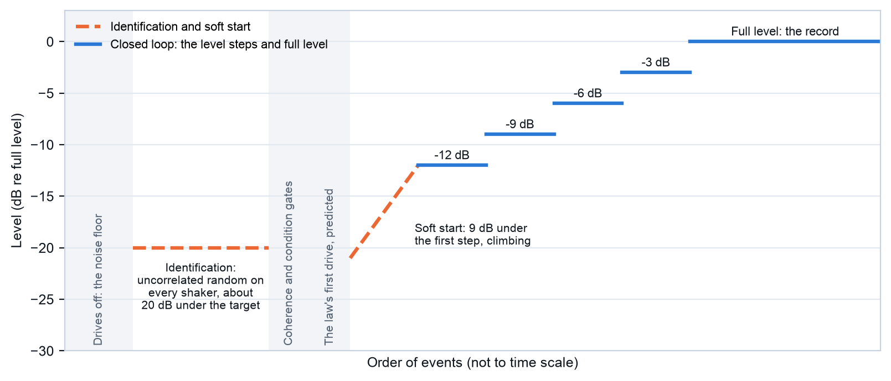
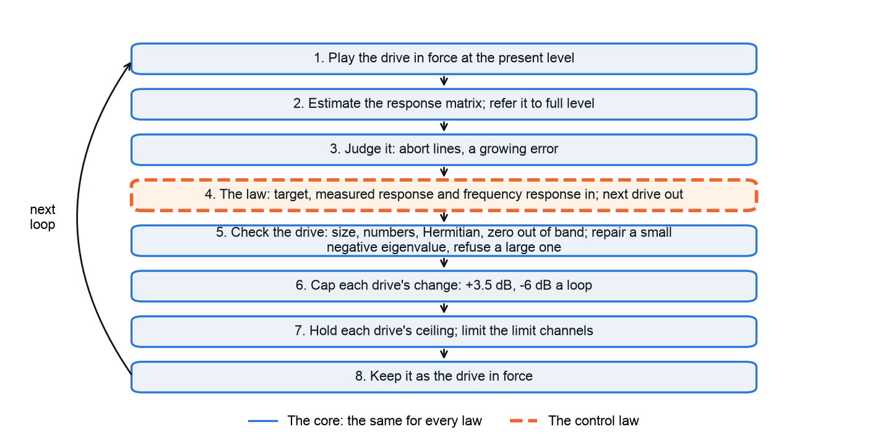
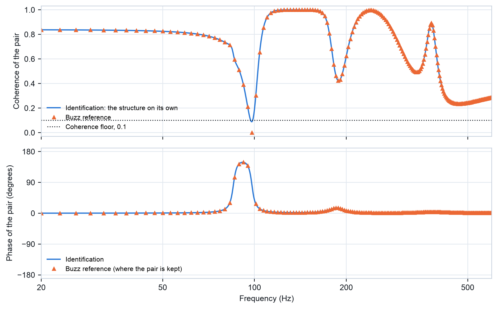
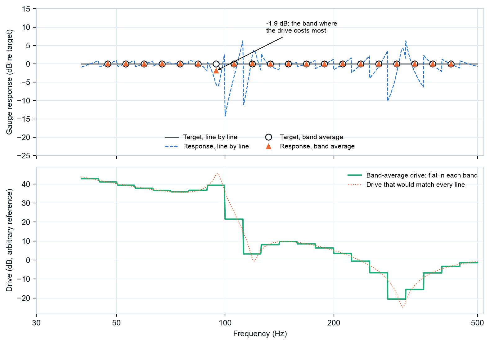

---
# Filled in by the editors at publication.
id: "2026-007"
version: 2
date: 2026-11-17
doi: "10.5281/zenodo.24310228"
doi_latest: "10.5281/zenodo.24291981"
note: "The layout of the tables is changed: column widths are set to fit what each column holds. No word and no number of the text changed."

# Filled in by the authors.
title: "Six Control Laws for Multi-Shaker Random Vibration: What Each Does and How It Is Built"
type: System Description
evidence: simulator
evidence_note: "Hertzforge's code at main commit b587d5a1, read for every law, the shared closed loop and the protections; the published sources, each read to the extent stated; and a numerical check of the article's own equations against the shipped laws on small made-up structures. No hardware, and no result about how any law scores."
authors:
  - name: "Kevin Cross"
    orcid: "https://orcid.org/0009-0002-6608-9426"
    roles: ["Conceptualization", "Methodology", "Software", "Validation", "Writing: original draft", "Writing: review and editing"]
implemented_in: ""
benchmarks: ""
abstract: >
  A multi-shaker random vibration test drives several shakers at once so that a set of
  accelerometers on the test article follow target spectra and, for every pair of them, a target
  coherence and phase. The rule that turns the targets and a measurement of the system into shaker
  drives is the control law. Hertzforge, an open-source structural dynamics suite, ships six: the
  pseudo-inverse with a closed-loop correction of a factor of the target (the default), the same
  pseudo-inverse without feedback, a shape-constrained law that drives only the directions the system
  responds to most, a law that takes its cross terms from the article's own response to
  uncorrelated drive, a law that chooses the cross terms needing the least drive, and Brandon
  Zwink's band-average law, which matches averages over fractional-octave bands rather than single
  frequency lines. This article explains in plain terms what a multi-shaker controller does, and
  for each law states what it does, the problem it solves as an equation, the derivation, the
  algorithm step by step with the file and function that does each step, every setting with its
  default and range, how it handles the edge cases, what it gives up by design, and where the build
  differs from its published source. It describes the protections that can stop a run whatever the
  law asks for, and how a reader can plug in a law of their own. Each law's equations, as written
  here, were implemented again without Hertzforge and compared with the shipped law on small
  made-up structures: the largest difference is 5e-10 dB in the pseudo-inverse laws' errors and
  2e-7 relative in the minimum-drive law's solve, except in the closed loop after 22 loops, where a
  change of one part in 10^15 moves single lines as far. The article reports no score. A companion article reports how each law scores on the
  Open Benchmark Set.
---

## Summary

A random vibration test on one shaker has one control signal and one target spectrum. The control
signal may be one accelerometer or a combination of several, an average for example; the controller
raises or lowers the drive at each frequency until that signal reads its target. With several shakers
on one article the controller has more to decide. Each shaker's drive reaches every control
accelerometer, each control accelerometer has a target spectrum of its own, and the target says not
only how strong the vibration is at each of them but how the motion at one point is related to the
motion at another. The rule that
decides the drives is the control law.

Hertzforge ships six control laws for this kind of test. Five come from the published literature
and are Kevin Cross's implementations; the sixth, the band-average law, is Brandon Zwink's. They
differ in what they ask the shakers to do, how they use the measured response, and what they give
up when the target cannot be met exactly.

This article describes each law as it is built, to the standard of a journal article: the problem
it solves, its derivation, its algorithm in the order the code runs it, its settings, its edge
cases, its design intent, and its published source with each place the build departs from it.
Section 1 explains the control problem without equations beyond the one that defines it. Section 2
describes the closed loop four of the laws share, then each law. Section 3 describes the
protections the controller applies to every law. Section 4 says how to plug in a new law. Section 5
reports how the descriptions were checked against the code, including a numerical check. Section 6
says what the article does not claim and the known limits of the build. Appendix A gives the
derivations in full, and Appendix B carries one frequency line of a made-up structure through every
law, with numbers a reader can reproduce from the article's code.

Nothing here says how well a law does. That is the subject of the companion study
[@randomlaws2026], which cites this article for the laws.

## 1. The Control Problem in Plain Words

### 1.1 From One Shaker to Several

A random vibration target is a **spectrum**: how much vibration there is in each narrow slice of
frequency, in units such as g²/Hz. The controller works on a grid of such slices, called
**lines**, typically a fraction of a hertz to a few hertz apart. A range of lines grouped together,
for example a one-third octave, is a **band**. A test on one shaker has one control signal, which
may be one accelerometer or a combination of several (an average, for example), and one target
spectrum for it.

With several shakers, each control accelerometer has a target spectrum of its own, and a spectrum
per accelerometer is not the whole story. Two
accelerometers can each read their target spectrum while moving together, in opposition, or
independently. Two more numbers per pair and per line describe that relation. The **coherence**,
from 0 to 1, says how much of the motion at one point is linearly tied to the motion at the other.
The **phase** says whether, at that frequency, they move together (0 degrees), in opposition
(180 degrees), or somewhere between. The spectrum of one accelerometer is its **autospectrum**;
the quantity that carries the coherence and phase of a pair is their **cross spectrum**.

All of these, for every accelerometer and every pair, form one square table per line: the
**spectral density matrix**. Its diagonal holds the autospectra and its off-diagonal entries the
cross spectra. The same holds for the shaker drives: the drive is not one voltage spectrum per
shaker but a matrix per line, whose off-diagonal entries say how correlated each pair of drives is.
A spectral density matrix of real signals can never ask for negative power in any combination of
its channels. A matrix with that property is called **positive semi-definite**, and a drive matrix
without it cannot be played.

Four terms from the first article in this journal [@cross2026] are used throughout. The **article**
is the test article, the hardware under test. A **gauge** is an accelerometer on it. The gauges the
controller reads and brings to their targets are the **control gauges**. A **held-out gauge** is
recorded but never shown to the controller; it is used only to judge the test. A **system** is the
article on its suspension or fixture with a given set of shakers and control gauges, as the
controller sees it (the first article of this series calls it the rig). Systems fall into three
classes: as many shakers as control gauges (a **square system**), more control gauges than shakers,
and fewer. A system is written shakers by control gauges: a 6 x 12 system has six shakers and twelve
control gauges.

What the controller knows of the system is the **measured frequency response**: on each line, a matrix
$H$ with one row per control gauge and one column per shaker, giving the acceleration at each gauge
per volt of drive at each shaker (g/V), measured at the start of the run. If the drive matrix is
$G_{uu}$ (V²/Hz), the response matrix at the control gauges (g²/Hz) is

$$
G_{yy} = H \, G_{uu} \, H^{H}
$$ {#eq-forward}

where $H^{H}$ is the conjugate transpose of $H$ (Appendix A.1). A multi-shaker controller's task is
to choose $G_{uu}$ on every line so that $G_{yy}$ matches the target, $G_{ref}$, as closely as the
system allows. Everything that follows is a way of doing that. The convention $G = E[X X^{H}]$ for a
spectral density matrix is the one Smallwood uses for multi-shaker control [@smallwood1999]; as he
notes, it is the complex conjugate of the cross spectrum as Bendat and Piersol define it. The published
methods this article draws on are mapped in a survey in this journal [@survey2026], which this
article cites for the prior work instead of repeating it.

### 1.2 A Run From Start to Finish

@fig-run shows the order of a run at the software's defaults. The settings named here are in
`config.rs` of `crates/hertzforge-mimo-random` (`Identification`, `Gates`, `Caps`, `Estimation`,
`Protections`), and the order is `MimoRandomService::run_auto` in `service.rs`.

{#fig-run fig-alt="A level-against-order diagram, not to time scale. On the left, three shaded columns mark steps with no level on the axis: drives off for the noise floor, then the coherence and condition gates, then the law's first drive predicted. Between them an orange dashed line at minus 20 dB marks the identification, uncorrelated random on every shaker about 20 dB under the target. After the prediction an orange dashed line climbs from minus 21 dB to minus 12 dB, the soft start. Blue solid steps then rise at minus 12, minus 9, minus 6 and minus 3 dB, and a long blue line at 0 dB marks full level, labeled the record." data="data/fig1_run_sequence.csv"}

1. **The noise floor.** With the drives off, the controller records what the gauges read on their
   own (32 averaged frames by default).
2. **Identification.** Every shaker is driven at once with random noise that is uncorrelated from
   shaker to shaker. The level starts at 0.01 V RMS and is stepped, at most eight times, until the
   control gauges sit within 1 dB of 20 dB under the target (RMS over the band, averaged over the
   gauges). From the drives and the responses, averaged over ten frames per shaker and at least 64,
   the controller computes the measured frequency response $H$ on every line. It also computes each
   control gauge's **multiple coherence**, the share of the gauge's response that the drives
   explain (1 when nothing but the drives moves it), and each line's **condition number**, defined
   in Section 1.4.
3. **The gates.** By default every control gauge's multiple coherence, averaged over the band,
   must reach 0.5, and every line's condition number must stay under 1,000. A run that fails a gate
   waits for the operator.
4. **The prediction.** The control law computes its first drive from the identification, and the
   controller predicts what it will do before anything is played. A first drive over a shaker's
   voltage ceiling waits for the operator.
5. **The soft start and the level steps.** The loop starts 9 dB under the first level step and
   climbs to it over 5 s, then steps up, by default from -12 dB to full level in 3 dB steps held
   3 s each.
6. **Full level.** The loop runs at the target level until the test time is up or the operator
   stops it.

### 1.3 One Loop

From the soft start to the end, the controller repeats one loop (@fig-loop), `loop_tick` in
`service.rs`. It plays the drive in force, estimates the response matrix over the loop from 64
averaged frames (Hann window, half overlap), blends it into a running estimate with a memory of
about four loops (a plain mean over the first two loops, then an exponential average that gives the
newest loop a weight of 0.4), and refers it to
full level: a response measured at -6 dB is scaled up by 6 dB before anything is judged or handed
on. Every matrix the control law sees, and every drive it returns, is at full level. The controller
owns the level, and a law cannot raise it.

Two kinds of loop are not handed to the law. The first loop after the loop engages is a settling loop:
its estimate is discarded, and neither the abort lines nor the growing-error check of Section 3 judge
it. A loop during which the level moved (the soft start's climb) is not judged against the abort lines
or for a growing error, and is not handed to the law; the drive in force is played at the moving level.
The drive-voltage, kinematic and limit-channel aborts apply in every loop. A level step of the schedule is made between loops and does not count as a moving
level.

{#fig-loop fig-alt="A column of eight boxes joined by downward arrows, with a curved arrow from the last back to the first labeled next loop. The boxes read: 1, play the drive in force at the present level; 2, estimate the response matrix and refer it to full level; 3, judge it against the abort lines and for a growing error; 4, the law, with the target, the measured response and the frequency response in and the next drive out, drawn with an orange dashed outline; 5, check the drive for size, numbers, Hermitian form and zero out of band, repair a small negative eigenvalue and refuse a large one; 6, cap each drive's change at plus 3.5 dB and minus 6 dB a loop; 7, hold each drive's ceiling and limit the limit channels; 8, keep it as the drive in force. The other seven boxes have blue solid outlines. A legend says blue solid is the core, the same for every law, and orange dashed is the control law." data="data/fig2_one_loop.csv"}

On each call the law is given the target with its alarm and abort lines, the measured response
matrix, the measured frequency response, each gauge's multiple coherence, the estimate's degrees of freedom, the line spacing, the band
and the loop count. A law may also ask for the last drive played, the loop's cross spectrum between
response and drive, the identification's response or drive, or the noise floor. It returns the next
drive matrix and whatever diagnostics it declared. The interface is `MimoControlLaw` in
`crates/hertzforge-sdm` (`law` module): `seed` for the first drive, `iterate` for every one after.

The measured frequency response the law is given is, by default, the one from identification:
measured once before the run and kept. The test may instead have it measured again during the run:
every loop the controller forms a new estimate from the played drive and the measured response and
blends it with the identification's by a weight the test sets (`FrfMode::Update` in `config.rs`).

### 1.4 What a System Can Reach

With as many shakers as control gauges and an exact frequency response, @eq-forward can be inverted
line by line, and any target can in principle be met. With more control gauges than shakers it
cannot: four shakers cannot set the spectra and cross spectra of twelve gauges independently. With
fewer control gauges than shakers there are many drives that meet the target, and one has to be
chosen.

The tool for all three cases is the **pseudo-inverse** $H^{+}$ of the frequency response (V/g). The
drive

$$
G_{uu} = H^{+} \, G_{ref} \, H^{+H}
$$ {#eq-pinv}

gives, with more gauges than shakers, the response closest to the target in the least-squares
sense, which is the target projected onto what the system can produce, $P G_{ref} P^{H}$ with
$P = H H^{+}$; with fewer gauges than shakers it gives, of all drives that meet the target exactly,
the one of least total power (both derived in Appendix A.2). Smallwood uses the Moore-Penrose
pseudo-inverse for both cases [@smallwood1999]. The distance between
the target and what the system can reach is the **declared deviation** of the first article
[@cross2026].

The pseudo-inverse is computed from the **singular value decomposition** of $H$ on each line,
$H = U S V^{H}$. In plain terms, the columns of $V$ are the patterns of shaker drive the system responds
to, ordered from strongest to weakest, the diagonal of $S$ (the singular values $s_1 \ge s_2 \ge
\ldots$, g/V) says how strongly it responds to each, and the columns of $U$ are the responses those
patterns produce at the gauges. The ratio $s_1 / s_{min}$ is the line's **condition number**. A
large one means some drive pattern barely moves the gauges, so meeting a target in that direction
takes a large drive, and a small error in $H$ becomes a large error in the drive.
**Regularization** limits that: it drops or damps the weakest directions before inverting. With
filter factors $f_i$ (V/g), the regularized pseudo-inverse is

$$
H^{+} = V \operatorname{diag}(f) \, U^{H}, \qquad
f_i = \begin{cases} 1/s_i & \text{truncation, } s_i > \alpha s_1 \\ 0 & \text{truncation, } s_i \le \alpha s_1 \\ s_i / (s_i^2 + (\alpha s_1)^2) & \text{Tikhonov damping} \end{cases}
$$ {#eq-filter}

with $\alpha$ the regularization amount, relative to the largest singular value [@schultz2018]. A
truncation amount of $10^{-3}$ keeps the inverse's condition number under 1,000. Schultz found input
estimation errors growing large where the condition number exceeded about 1,000, and that too little
or too much regularization both add error [@schultz2018]. In the code, @eq-filter is `filter` and
`inverse` in `crates/hertzforge-mimo-laws/src/support.rs`. Every rule first drops singular values
at or below $\max(n_c, n_d)\,\epsilon\, s_1$, with $n_c$ and $n_d$ the numbers of control gauges and shakers and $\epsilon$ the machine precision, so an exactly
singular line inverts nothing it cannot.

## 2. The Six Laws

Table 1 lists the six laws. Four of them (the default, the shape-constrained, the buzz-test and
the minimum-drive laws) run the same closed loop and differ in what they feed it. That loop is
described first. Unless a path is given, files are in `crates/hertzforge-mimo-laws/src/` of
Hertzforge at main commit b587d5a1.

```{=typst}
#block(breakable: false, width: 100%)[
```

**Table 1.** The six control laws Hertzforge ships for multi-shaker random vibration.

| Id | Law | Source | What it changes | File |
|:-----------------------------------------|:-----------------------------------------------------|:-----------------------------------------------------------------------|:-----------------------------------------------------------------|:-----------------------------------------------------------------|
| `pinv_closed` | Pseudo-inverse, closed loop (the default) | Smallwood [@smallwood1999]; regularization after Schultz [@schultz2018] | The shared closed loop on the full system | `pinv.rs` |
| `pinv_open` | Pseudo-inverse, open loop | The same | No feedback: @eq-pinv every loop | `open_loop.rs` |
| `shape_svd` | Shape-constrained | Schultz and Avitabile [@schultz2019; @schultz2020] | Drives only the system's strongest directions on each line | `shape.rs` |
| `buzz_match` | Buzz-test matched | Daborn [@daborn2014], as stated by Schultz [@schultz2018] | Takes the target's coherence and phase from the identification | `buzz.rs` |
| `min_drive` | Minimum drive | Coletti, Davis and Schultz [@coletti2026]; Smallwood [@smallwood2007; @smallwood2013] | Chooses the cross terms that need the least drive | `min_drive.rs`, `pareto.rs` |
| `band_average` | Band average | Brandon Zwink | One flat drive per fractional-octave band, matched on band averages | `band_average.rs`, `crates/hertzforge-law-band-average-math` |

```{=typst}
]
```

### 2.1 The Shared Closed Loop

**What it does.** A closed loop measures what the last drive produced and corrects the next one.
Correcting the drive matrix directly can make it ask for negative power, which cannot be played.
Smallwood's method avoids that by never correcting the drive matrix itself [@smallwood1999]. It
splits the target into a triangular factor, keeps a running copy of that factor, and corrects the
copy from the error each loop; the drive is always formed from the copy in a way that cannot ask for
negative power.

**The problem.** On each line, find a drive $G_{uu}$ that can be played and whose response matches
the target:

$$
G_{uu} = A \, Z Z^{H} A^{H}, \qquad H A Z Z^{H} A^{H} H^{H} = G_{ref}
$$ {#eq-loop-drive}

where $Z$ is a lower-triangular matrix with real, non-negative diagonal (g/√Hz) and $A$ maps the
factor's sources to the drives (V/g). At the start $A = H^{+}$ and $Z = R$, the factor of the target,
$G_{ref} = R R^{H}$, so the first drive is @eq-pinv. A matrix of the form $B B^{H}$ never asks for
negative power (Appendix A.3), so every drive the loop makes can be played.

**The derivation.** Each loop compares the measured response with the target,
$E = G_{ref} - G_{yy}$ (g²/Hz), and looks for the change $\Delta$ in the factor that would remove
that error. When the measured frequency response is exact and the system has as many independent directions as gauges, $G_{yy} = Z Z^{H}$, and
$(Z + \Delta)(Z + \Delta)^{H} = G_{ref}$ to first order in $\Delta$ is

$$
\Delta Z^{H} + Z \Delta^{H} = E
$$ {#eq-linearized}

With $\Delta$ lower triangular and its diagonal real, @eq-linearized is solved one column at a time,
the diagonal first [@smallwood1999] (Appendix A.4):

$$
\Delta_{jj} = \frac{E_{jj} - 2\sum_{m<j} \operatorname{Re}(\Delta_{jm} \overline{Z_{jm}})}{2 Z_{jj}},
\qquad
\Delta_{kj} = \frac{E_{kj} - \sum_{m<j}(\Delta_{km}\overline{Z_{jm}} + Z_{km}\overline{\Delta_{jm}}) - Z_{kj}\Delta_{jj}}{Z_{jj}}, \; k > j
$$ {#eq-first-form}

This is the **first form** of the correction, which changes the size and the phase of each term.
Columns are solved in channel order, so autospectra come before the cross terms they feed, and the
first control gauge has the highest priority. The update is $Z \leftarrow Z + e\,\Delta$, with the
convergence factor $e$ between 0 and 1.

A cross term of the factor is not allowed to grow when its gauge is already above its target. In
that case the **second form** replaces the first: it changes only the term's size, toward zero,

$$
\Delta_{kj} = \begin{cases} Z_{kj} \, E_{kk} / (2\, G_{ref,kk}) & \text{when } -E_{kk} < G_{ref,kk}/2 \\ -Z_{kj}/2 & \text{when } -E_{kk} \ge G_{ref,kk}/2 \end{cases}
$$ {#eq-second-form}

so a gauge more than half again over its target has the term moved halfway to zero before the
convergence factor applies. This is the rule the build uses, not a derived step: if every term of the
row were scaled by $1 + \delta$, the gauge's response would scale by about $1 + 2\delta$, and
$\delta = E_{kk} / (2 G_{ref,kk})$ would remove the relative excess to first order; the build applies
that $\delta$ to each cross term the second form governs, while the row's diagonal takes the first
form of its own column (Appendix A.4). Smallwood gives the second form as his Equation 13, with
twice the row index times the column gauge's target in the denominator and the column gauge's error in
the numerator. His appendix follows that form in the first column, and in the other columns uses the
column index and the row gauge's error and target; it moves the term by half of itself when the gauge is
half again off its target, and uses the second form only for a cross term that is not zero
[@smallwood1999]. Which of the two forms is used in the first column changes the result on the case of
Figure 3 (Section 6). The build divides by $2\, G_{ref,kk}$ in every column
and applies the second form to a cross term at zero as well (Table 2).

The factorization allows a zero on its diagonal, which Smallwood calls a Cholesky factorization with
zeros, citing Dodds and Robson [@smallwood1999; @dodds1975]: a gauge whose target is fully coherent
with gauges before it adds no source of its own. Smallwood sets the whole row and column of such a
pivot to zero. The build counts a pivot at or below $10^{-10}$ of its gauge's target autospectrum as
zero and sets only that column to zero for the whole run, so the gauge keeps the part of its target
it shares with the gauges before it.

**The coordinates.** When the system carries fewer independent directions than there are control
gauges (more gauges than shakers, or directions dropped by regularization or by the shape
constraint), only part of the error can be corrected. The shipped loop then runs in the coordinates
of what the system can produce. With $q$ the number of directions kept, $T = U_q^{H}$ reduces a
gauge-space matrix to $q$ by $q$, and $A = V_q \operatorname{diag}(f_q)$ maps the reduced sources to
the drives. The loop factors and corrects $T G_{ref} T^{H}$ against $T G_{yy} T^{H}$. That reduced
loop is square, so on a system whose measured frequency response is exact it settles at the least-squares response $P G_{ref} P^{H}$, the
response the open-loop pseudo-inverse gives (Appendix A.5). $q$ counts the singular values the
inverse kept that are also above the rank tolerance (by default $10^{-6}$) times the largest. In
reduced coordinates, "gauge $k$" in the rules below reads "source $k$": $E_{kk}$, $G_{ref,kk}$ and the
hold act on the diagonal of the reduced matrices.

**The algorithm as built.** `FactorLoop` in `factor.rs`:

1. `FactorLoop::seed`: form the inverse (`support.rs`, `inverse`); per line, choose the coordinates
   (`LineMap::new`), reduce and factor the target (`factor_with_zeros`), set $Z = R$, and return
   $G_{uu} = (AZ)(AZ)^{H}$ (`FactorLoop::drive`, a Gram matrix by `gram_packed`).
2. `FactorLoop::iterate`, per line: if the measured frequency response changed since the last call,
   rebuild the coordinates and carry the factor over by factoring the law's own last drive in the new
   coordinates, $A^{+} G_{uu} A^{+H}$, so the correction made so far is kept (`FactorLoop::refresh`).
3. Reduce the measured response and form $E$. A line with no target is skipped.
4. Solve @eq-first-form column by column, replacing a cross term by @eq-second-form where its gauge
   is over target and the first form would grow it. The divisor is $\max(Z_{jj}, Z_{min})$.
5. **Diagonal limit.** No diagonal term of the factor may move by more than the per-loop limits of
   power, by default +3.5 dB and -6 dB (a factor element moves by half as many decibels). A column
   whose diagonal would move more has its first-form terms scaled down by the diagonal's own ratio;
   second-form terms are applied as they are.
6. **Hold on a source that does not answer.** When a source's measured response, in the loop's
   coordinates, is below 0.03 (-15 dB) of what its row of the factor commands, $(T G_{yy} T^{H})_{kk}
   < 0.03\,(Z Z^{H})_{kk}$, no element of that row may grow in that loop; each may still shrink.
7. Update $Z \leftarrow Z + e\Delta$.
8. **Bound on what a source commands.** No row may command more than ten times (+10 dB) its
   source's target, $(Z Z^{H})_{kk} \le 10\,(T G_{ref} T^{H})_{kk}$, or more than it commanded the
   loop before where that was already higher; a row over the bound is scaled down to it.
9. **Floor.** No diagonal term falls below $Z_{min} = 10^{-4}\sqrt{\max_k (T G_{ref} T^{H})_{kk}}$;
   when one would, it is set to the floor, and the rest of its column is set to its values before this
   loop's update, scaled by the ratio of the new diagonal to the old (clamped to 0 to 1); this loop's
   correction to them is dropped.
10. **Drive limit.** The step is halved, line by line, until no shaker's drive autospectrum moves by
    more than the per-loop limits from the law's last drive (a drive under $10^{-6}$ of the line's
    largest is measured against that floor). After 30 halvings the line's factor is held where it was.
11. Return $G_{uu} = (AZ)(AZ)^{H}$, with the diagnostics `condition`, `kept`, `correction_db` (the
    largest change of any drive autospectrum, dB) and `clamped` (diagonals held by step 5).

**Settings.** The convergence factor, the two per-loop limits and the rank tolerance are settings of
the default law (Table 3); the other three laws that use this loop fix the limits at +3.5
and -6 dB and the rank tolerance at $10^{-6}$ (`ShapeConstrainedLaw::new`, `BuzzMatchedLaw::seed`,
`MinimumDriveLaw::seed`).

**Edge cases.**

- *As many shakers as gauges, or fewer, at full rank:* the loop runs in the gauges' own
  coordinates with $A = H^{+}$, exactly as the source states it.
- *More gauges than shakers, or a line where the inverse dropped directions:* the reduced
  coordinates above; the error outside what the system can produce is not corrected.
- *A rank-deficient or nearly singular line:* the directions the inverse dropped are not sources;
  if no direction is kept, $q = 0$ and the line's drive is zero.
- *A tiny singular value that survives truncation:* the hold (step 6) and the bound (step 8) stop
  the loop from raising the drive without limit where the structure does not answer.
- *A line with no target:* skipped; its drive is zero.
- *The first loop:* the seed is the pseudo-inverse drive; the first correction uses the first
  measured response the controller hands on, after the settling loop and the soft start's climb.

**Source and differences.** D. O. Smallwood, "Multiple Shaker Random Vibration Control: An Update"
[@smallwood1999], read in full, with its Appendix A, the correction as a MATLAB function, read line by
line from the scan. Table 2 lists every place the build differs from that appendix, from
`factor.rs` at b587d5a1. His paper also describes rescaling the diagonal corrections when they become
small against $Z_{jj}$, because division by a large $Z_{jj}$ had left it stuck high, and warns that a
term of the factor at zero can stay stuck there. The code's documentation gives the measurements behind
the build's changes (`factor.rs`, module documentation).

```{=typst}
#block(breakable: false, width: 100%)[
```

**Table 2.** Where the shared loop as built at b587d5a1 differs from the correction in Smallwood's Appendix A and his factorization with zeros (Equation 8), read from the scan of SAND98-2044C.

| Item | Smallwood's appendix | The build |
|:-----------------------------------------------|:-----------------------------------------------------------------------------------------------------------------------------------------|:-----------------------------------------------------------------------------------------------------------------|
| Floor | 10⁻⁴ times the largest element of the target, a power | 10⁻⁴ times the square root of the largest target autospectrum, in the factor's units |
| Convergence factor | One value, or one per element | One value |
| Rank | Rows and columns of the factor past the rank of the measured frequency response are zeroed | The loop runs in the reduced coordinates of the directions kept |
| First diagonal | Divided by the first diagonal term, with no floor | Divided by the term, never below the floor |
| Divisors | The larger of the first and the column's diagonal term | The column's diagonal term, never below the floor |
| Second-form step | First column, as Equation 13: twice the row index times the first gauge's target, with the first gauge's error; other columns: twice the column index times the row gauge's target, with its error | Twice the row gauge's target, with its error, every column |
| Second form on a zero term | Not used: only for a cross term that is not zero | Used, so a term at zero stays there |
| Zero cross term | Set to the floor after the update | Left at zero |
| Order of the forms | The first form is solved whole; the second replaces terms after the update, and later columns use first-form values | The second form replaces terms inside the solve, and later columns use its values |
| Diagonal limit | Each diagonal correction at most half of the larger of its own and the first diagonal term, alone | +3.5 dB and -6 dB of its own term, with the column's first-form terms scaled alike |
| Diagonal at zero | Set to the floor when zero or negative, from the second column on; a negative first term stops the solve | Every live diagonal under the floor is set to it |
| Column collapse | A column whose diagonal is under the floor has its cross terms set to a hundredth of the floor, phase kept | Its cross terms are set to their previous values times the ratio of the new diagonal to the old |
| Zero pivot | Its whole row and column are zero at the factorization (Equation 8) | Its column only, below 10⁻¹⁰ of the gauge's target |
| Dead column | The next correction gives the zeroed pivot and its column values again | Held at zero for the whole run |
| Large correction | A warning above 10⁶ | No check |
| Not in the source | | The hold, the bound, the drive limit with halving, the carry-over on a new measured frequency response, weighting and regularization of the inverse |

```{=typst}
]
```

The hold and the bound are not in the source. They were added
for a case the code's documentation records: a lightly damped plate with 48 control gauges and 12
shakers, identified through measurement noise, whose drive rose loop after loop in directions the
measured frequency response held and the structure did not answer.

**What it gives up by design.** The drive can change only by the per-loop limits, so a large
correction takes several loops. Where the system answers less than $-15$ dB of what a source commands,
the loop stops raising that source, and no source commands more than +10 dB over its target, so a
direction in which the structure is more than 10 dB less sensitive than measured is not fully
corrected.

@fig-loop-demo shows the loop at work on a made-up structure with two gauges and two shakers, whose
measured frequency response has every mode 3 percent too high, against the open-loop drive of
@eq-pinv. It was made by running the shipped `pinv_closed` and `pinv_open`, at their defaults, with
an exact measurement of the response and no noise (`code/shipped_laws`).

{#fig-loop-demo fig-alt="Three panels. The left and middle panels plot error against the target in decibels from 20 to 600 Hz on a log axis, for gauge 1 and gauge 2. An orange dashed line, the open loop, swings by up to about 5 dB at gauge 1 and 7 dB at gauge 2 around four resonances near 90, 160, 260 and 410 Hz. A green dotted line, the closed loop after 5 loops, is near zero except for narrow dips at the resonances. A blue solid line, after 30 loops, lies on zero at gauge 1 and at gauge 2 except for two narrow peaks of about 5 and 3 dB near 90 and 160 Hz. The right panel plots RMS error over the band against loop number from 0 to 30: the open loop is flat at about 1.5 dB for both gauges, drawn as orange dotted and dash-dot lines; gauge 1 closed loop, blue with filled circles, falls to near zero by loop 20; gauge 2 closed loop, green dashed with open squares, falls to about 0.4 dB by loop 10 and stays there." data="data/fig3_closed_loop_lines.csv data/fig3_closed_loop_rms.csv data/toy_structures.csv"}

At gauge 1 the loop removes the error. At gauge 2 it removes most of it and stops short on a few
lines near two resonances, where the gauge stays a few decibels high. On those lines the measured
frequency response is off near a mode, so the drive meant for gauge 1 reaches gauge 2 as well, and
gauge 2 reads above its target. The one term of the factor that could cancel that leak is the cross
term $Z_{21}$, and cancelling it means making the cross term larger. The second form forbids exactly
that: a cross term whose gauge is above its target may only shrink. The loop then cuts gauge 2's own
diagonal term by the per-loop limit, loop after loop, until it reaches the floor, and gauge 2 is left
reading the leak alone. Appendix B.8 follows this on the line at 91 Hz, where gauge 2 ends 4.87 dB
high. Smallwood's second form, as published, can hold a gauge high in the same way: a port of his
Appendix A run on the same case (`code/smallwood_port`) holds gauge 2 at the build's levels from 90.5 to
93 Hz when the target has cross terms (coherence 0.64, phase 30 degrees), and at 91.5 and 92 Hz with the
independent target of Figure 3 (+5.04 and +4.61 dB at loop 30). With the independent target it releases
the line at 91 Hz (+0.40 dB at loop 30, against the build's +4.87 dB), and any one of four of the build's
departures from his appendix holds it again: the second form on a cross term at zero, the second-form
step, the order of the two forms, or the limit on the diagonal (Table 2, Section 6). Near 160 Hz the hold
is the build's own departure: the cross term starts at zero and the build applies the second form to a
term at zero, so it never moves. Appendix B.3 follows a line where the
term is held at zero for three loops and released when the gauge dips below its target.

### 2.2 Pseudo-Inverse, Closed Loop (`pinv_closed`, the Default)

**What it does.** It starts from the regularized pseudo-inverse drive and corrects it every loop by
the shared closed loop of Section 2.1, on the full system. It is the law a run uses unless another is
chosen (`DEFAULT_MIMO_LAW_ID` in `crates/hertzforge-mimo-laws/src/lib.rs`).

**The problem and its derivation.** @eq-loop-drive with $A$ the regularized pseudo-inverse of
@eq-filter. With error weighting on, the least-squares inverse is $(W H)^{+} W$ with
$W = \operatorname{diag}(1 / \sqrt{G_{ref,kk}})$, so each gauge's error counts relative to its own
target; a gauge with no target is weighted as one with $10^{-12}$ of the line's largest
(`support.rs`, `weights`). On a system with as many shakers as gauges, weighting changes nothing when no
singular value is dropped or damped, since then $(WH)^{-1} W = H^{-1}$; when some are, it changes
which directions are dropped.

**The algorithm as built.** `PseudoInverseLaw` in `pinv.rs` builds the inverse rule from its
settings (`PseudoInverseConfig::rule`) and hands every call to `FactorLoop` (Section 2.1).

```{=typst}
#block(breakable: false, width: 100%)[
```

**Table 3.** The settings of `pinv_closed` (`support.rs`, `regularization_params`, `convergence_param`, `cap_params`, `rank_tolerance_param`, `weighting_param`).

| Parameter | Default | Range | What it changes |
|:-----------------------------------------------------------|:-----------------------------|:--------------------------------------------------|:--------------------------------------------------------------------------------------------------------------------------------------------------------------|
| `regularization` | truncated | truncated, tikhonov, none | How weak directions are treated (@eq-filter) |
| `regularization_amount` | 10⁻³ | 0 to 1 | The amount of @eq-filter, relative to the largest singular value |
| `convergence` | 0.5 | 0.1 to 1 | The convergence factor: the share of each correction applied |
| `cap_up_db`, `cap_down_db` | 3.5 dB, 6.0 dB | 0.1 to 3.5 dB, 0.1 to 6.0 dB | The per-loop limits of steps 5 and 10 |
| `rank_tolerance` | 10⁻⁶ | 0 to 0.1 | Singular values counted as sources; above the truncation amount it drops sources truncation kept, at or below it nothing |
| `weighting` | none | none, reference | Each gauge's error equal, or relative to its target |

```{=typst}
]
```

**Edge cases.** As Section 2.1. With `regularization` set to none, every singular value above the
numerical floor is inverted, and the rank tolerance alone decides which directions are sources.

**What it gives up by design.** It asks for the full target, cross terms included, wherever the system
can produce it; it spends drive in weak directions up to the regularization's limit to do so. Where
the structure changes with level, the measured frequency response, taken about 20 dB under the
target and kept by default, is no longer the system at full level; the loop treats the difference as an
error in the measured frequency response and corrects it within its per-loop limits, the hold and
the bound.

**Source and differences.** D. O. Smallwood, "Multiple Shaker Random Vibration Control: An Update"
[@smallwood1999], read in full: the closed-loop correction, its appendix and its safeguards. The
regularization choices are from Schultz [@schultz2018], read in full. The differences are those of
Section 2.1.

### 2.3 Pseudo-Inverse, Open Loop (`pinv_open`)

**What it does.** It plays @eq-pinv every loop, computed from the measured frequency response and the
target alone. The measured response is not used. With the frequency response measured once and
kept, the drive is the same every loop; with it measured again during the run, the drive follows the
new measurement.

**The problem and its derivation.** @eq-pinv with the inverse of @eq-filter and the weighting of
Section 2.2. With more gauges than shakers it minimizes the distance between target and response; with
fewer it is the least-power drive that meets the target (Appendix A.2).

**The algorithm as built.** `OpenLoopLaw::step` in `open_loop.rs`: the cached inverse
(`InverseCache::get`, formed again only when the measured frequency response changes), the
congruence $H^{+} G_{ref} H^{+H}$ on the in-band lines, zero outside the band.

```{=typst}
#block(breakable: false, width: 100%)[
```

**Table 4.** The settings of `pinv_open`.

| Parameter | Default | Range |
|:---|:---|:---|
| `regularization` | truncated | truncated, tikhonov, none |
| `regularization_amount` | 10⁻³ | 0 to 1 |
| `weighting` | none | none, reference |

```{=typst}
]
```

**Edge cases.** A rank-deficient line inverts only the directions kept; a line with no target gets
no drive. There is no first-loop special case: the seed and every loop are the same computation.

**What it gives up by design.** Any error in the measured frequency response, including a structure
that has moved with level, passes straight to the test (@fig-loop-demo, dashed). In exchange it has
no memory and cannot wind up, and on a system whose measured frequency response is exact it reaches what the system can reach and no more. It is
the baseline against which the closed-loop laws can be read, and the simplest law to reason about. It
is also the worked example of a complete law in the law kit (Section 4).

**Source and differences.** As `pinv_closed` [@smallwood1999; @schultz2018]. No differences.

### 2.4 Shape-Constrained (`shape_svd`)

**What it does.** On each line it drives only the $m$ patterns the system responds to most, the leading
columns of $V$, and gives up the rest. The weak directions are where a pseudo-inverse spends the most
drive for the least response, so constraining the drive to the strong ones trades match between modes
for drive. In the authors' simulation of a beam with four shakers, two directions matched the target
response closely, three needed much more force than two, and the method was nearly as accurate as the
standard inverse with much lower forces [@schultz2019].

**The problem.** With $C = V_m$, the first $m$ columns of $V$ on a line, the constrained system is
$H_c = H C$, the constrained drive is $G_c = H_c^{+} G_{ref} H_c^{+H}$, and the shaker drive is
$G_{uu} = C G_c C^{H}$ [@schultz2019].

**The derivation.** Because $H C = U_m S_m$, the drive's inverse is $C H_c^{+} = V_m S_m^{-1}
U_m^{H}$, the pseudo-inverse truncated to exactly $m$ directions (Appendix A.6), which the authors
point out themselves [@schultz2019]. The law is therefore the shared loop of Section 2.1 with an
inverse that keeps $m$ directions, so no more than $m$ independent sources are ever driven, in the
seed or in any loop.

**The algorithm as built.** `ShapeConstrainedLaw` in `shape.rs` hands `FactorLoop` the rule
`InverseRule::Shape`; `filter` in `support.rs` keeps, by default, the singular values at or above 0.2
times the largest, at most `max_shapes`, and at most the numerical rank (@fig-shape). With selection by
count it keeps `shapes` directions, fewer where the rank is lower. The loop then runs in the reduced
coordinates of the $m$ kept directions whenever $m$ is less than the number of gauges.

```{=typst}
#block(breakable: false, width: 100%)[
```

**Table 5.** The settings of `shape_svd`. The per-loop limits (+3.5 dB, -6 dB) and the rank tolerance (10⁻⁶) are fixed.

| Parameter | Default | Range | What it changes |
|:-----------------------------------------------------|:-----------------------------|:--------------------------------------------------|:--------------------------------------------------------------------------------------------------------------------------------------------------------------------|
| `selection` | ratio | ratio, count | How the number of directions is set on each line |
| `ratio` | 0.2 | 0.1 to 0.5 | Keep singular values at or above this times the largest |
| `max_shapes` | 1,024 | 1 to 1,024 | Most directions kept, with selection by ratio |
| `shapes` | 2 | 1 to 1,024 | Directions kept, with selection by count |
| `convergence` | 0.5 | 0.1 to 1 | The shared loop's convergence factor |

```{=typst}
]
```

{#fig-shape fig-alt="Two panels sharing a log frequency axis from 20 to 600 Hz. The top panel plots the system's four singular values on a log scale: the first, blue solid, peaks near 100 at six resonances; the second, orange dashed, runs between about 1 and 10; the third, green dash-dot, lower still; the fourth, pink dotted, lowest, around 0.01 to 2. A black dotted line at 0.2 times the largest follows the first singular value's shape 14 dB lower. The bottom panel is a yellow step line of the directions kept, between 1 and 3: one direction at most resonances and from about 50 to 80 Hz, two or three between modes, never four." data="data/fig4_shape_directions.csv data/toy_structures.csv"}

**Edge cases.** At least one direction is always kept on a line with any response, since the largest
singular value passes the ratio. On a rank-deficient line, $m$ is at most the rank. Where two
singular values cross from one line to the next, the kept direction can swap between neighboring
lines. The condition number reported is that of the whole system, not of the constrained one.

**What it gives up by design.** Between modes, where several singular values are of similar size, a
small $m$ leaves out response the target needs; in the authors' example a single direction matched
well near the peaks and poorly between them [@schultz2019]. It does not try to meet cross terms
outside the kept directions.

**Source and differences.** R. Schultz and P. Avitabile's conference paper, "Shape-Constrained Input
Estimation for Multi-Shaker Vibration Testing" [@schultz2019], read in full; the journal version
[@schultz2020] was not obtained, and nothing is said here of its content. The ratio rule for $m$ is
Hertzforge's. The
closed loop inside the constraint is Hertzforge's addition; the source states the open-loop drive.

### 2.5 Buzz-Test Matched (`buzz_match`)

**What it does.** It keeps the target's autospectra and replaces the target's cross terms with the
coherence and phase the article shows on its own, under the uncorrelated drive of the
identification. Those cross terms are ones the structure produces of itself. The modified target is
formed once, at the start, and the closed loop of Section 2.1 then holds it.

**The problem.** With $B$ the identification's response matrix on a line, the coherency of a pair
is $C_{jk} = B_{jk} / \sqrt{B_{jj} B_{kk}}$ and the modified target is

$$
G_{jk} = \sqrt{G_{ref,jj} \, G_{ref,kk}} \; C_{jk}
$$ {#eq-buzz}

that is, $G = D C D$ with $D = \operatorname{diag}(\sqrt{G_{ref,jj}})$. A pair whose identification
coherence $|C_{jk}|^2$ is under a floor is left independent, $G_{jk} = 0$ (@fig-buzz).

**The derivation.** $C$ is positive semi-definite because $B$ is, so $D C D$ is too (Appendix A.7).
Leaving pairs out can break that and make a line ask for negative power, so each line is then
repaired by clamping its negative eigenvalues, after the repair of Hunter, Cross and Nelson
[@hunter2017], and then restoring the autospectra by a scaling of rows and columns.

**The algorithm as built.** `BuzzMatchedLaw::seed` in `buzz.rs`: `buzz_reference` forms
@eq-buzz on the in-band lines from the identification response the controller hands the law (it
declares the input `SysidResponse`), leaves a pair independent when either autospectrum of the
identification is zero or the coherence is under the floor, then repairs every negative eigenvalue
however large (`linalg::psd_repair` in `crates/hertzforge-sdm`). It then builds `FactorLoop` on the
modified target with truncation at $10^{-3}$, no weighting, and the fixed per-loop limits.
`iterate` hands every later call to the loop.

```{=typst}
#block(breakable: false, width: 100%)[
```

**Table 6.** The settings of `buzz_match`. The loop's regularization is truncation at 10⁻³ and its per-loop limits are the default law's.

| Parameter | Default | Range | What it changes |
|:-----------------------------------------------------------|:--------------------------|:-----------------------------------|:--------------------------------------------------------------------------------------------------------------------------------------------------------------------------------|
| `coherence_floor` | 0.1 | 0 to 1 | Pairs whose identification coherence is under this are left independent |
| `convergence` | 0.5 | 0.1 to 1 | The shared loop's convergence factor |

```{=typst}
]
```

{#fig-buzz fig-alt="Two panels sharing a log frequency axis from 20 to 600 Hz. Top: coherence of the pair from 0 to 1. A blue solid line, the identification, runs near 0.83 at low frequency, dips to about 0.09 near 98 Hz, rises to 1 between about 110 and 160 Hz, dips to about 0.42 near 185 Hz, returns to 1 near 245 Hz and falls to about 0.25 above 450 Hz. Orange triangles, the buzz target, lie on the blue line everywhere except at the dip near 98 Hz, where the coherence is under the black dotted floor at 0.1 and the triangle is at 0. Bottom: phase of the pair in degrees; the blue identification line is near 0 except for a rise to about 145 degrees near 92 Hz, and the orange triangles of the buzz target follow it where the pair is kept." data="data/fig5_buzz_reference.csv data/toy_structures.csv"}

**Edge cases.** The target is formed from the identification as measured, at about 20 dB under the
target, and is not formed again if the frequency response is measured again during the run. A pair
left independent starts its factor's cross term at zero, so the behavior of a cross term at zero in
Section 2.1 and Section 6 applies to this law by design. The law declares that it needs the identification response, and the controller supplies
it; called without it, `seed` returns an error.

**What it gives up by design.** It does not try to meet the specified cross terms. It asks only for
the coherence and phase the structure shows on its own under uncorrelated drive. The drive this needs
is not in general uncorrelated (Appendix B.5). Where the
structure changes with level, the coherence and phase it holds are those of the structure at the
identification's level.

**Source and differences.** The method is known here as Schultz states it [@schultz2018] (read in
full): the target's cross terms are replaced by the coherence and phase the structure shows under
uncorrelated white noise on the shakers, a method he describes as used by P. M. Daborn and for which he
cites Daborn's thesis [@daborn2014], not read. Coletti and co-authors describe the same method as the
independent drives method, also called the buzz method, which they attribute to Smallwood (their
reference 16) [@coletti2026]. The repair is after Hunter,
Cross and Nelson [@hunter2017], read in full, who set a negative eigenvalue to a small positive number
and rebuild the matrix; the build clamps every negative eigenvalue and then restores the autospectra,
which is Hertzforge's. Holding the modified target fixed and
running the full closed loop on it is Hertzforge's; Schultz uses the modified target in an open-loop
estimate of the inputs.

### 2.6 Minimum Drive (`min_drive`)

**What it does.** When the specification fixes only autospectra, the cross terms are free, and some
choices need far less drive than others. This law chooses them. On each line it finds the drive that
best trades two things against each other, the error in the autospectra and the total drive power,
and makes the response the system would produce under that drive its target. The closed loop of
Section 2.1 then holds that target.

**The problem.** On each line, with $y_k$ the specified autospectra (g²/Hz) and $w_k$ their weights,
the drive $X$ (V²/Hz) minimizes

$$
\sum_k w_k \left| \, y_k - (H X H^{H})_{kk} \, \right| \; + \; \lambda \operatorname{tr} X
\quad \text{over positive semi-definite } X
$$ {#eq-pareto}

where $\operatorname{tr} X$ is the total drive power and $\lambda$ the price of a unit of drive
[@coletti2026]. The target is then $H X H^{H}$, the full matrix, cross terms included. By default the
weights are $w_k = 1/y_k$, so each gauge is judged by the fraction of its spectrum it misses, and the
weighted error is dimensionless. As $\lambda$ falls toward zero the solution becomes Smallwood's
minimum input trace: of all drives that meet the autospectra exactly, the one of least total power
[@smallwood2007; @smallwood2013]. @fig-mindrive (left) shows the principle on one line: with the
autospectra held, the drive power depends on the cross term's coherence and phase, and the least lies
at full coherence and one phase (Appendix A.8).

**The derivation.** @eq-pareto is convex. Writing each weighted absolute value
as $w_k |r_k| = \max_{|\nu_k| \le w_k} \nu_k r_k$ and exchanging the minimum and the maximum gives its dual
(Appendix A.8): maximize $\sum_k \nu_k y_k$ over real $\nu$, subject to
$S(\nu) = \lambda I - H^{H} \operatorname{diag}(\nu) H$ positive semi-definite and
$|\nu_k| \le w_k$. The dual has one real unknown per gauge where the primal has the square of the
number of shakers. With a logarithmic barrier of weight $\mu$, the minimizing drive is
$X = \mu S^{-1}$, and the barrier's residuals vanish as $\mu$ does.

The trade-off is given relative to the line, $\lambda = \lambda_{rel}\, r_0 / d_0$, with
$r_0 = \sum_k w_k y_k$ the weighted error of no drive at all and $d_0 = \sum_k y_k / \lVert h_k
\rVert^2$ a drive power scale ($h_k$ is gauge $k$'s row of $H$; $y_k / \lVert h_k \rVert^2$ is the
least drive power that puts $y_k$ on gauge $k$ alone), so the same $\lambda_{rel}$ means the same on
every system.

By default $\lambda_{rel}$ is chosen automatically. The grid $\lambda_{rel} = 10^{-6}, 10^{-5},
\ldots, 10^{6}$ is solved on a sample of the band's lines, and for each grid point $g$ the drive
power $D_g = \sum \operatorname{tr} X$ and weighted error $R_g$ are summed over the sample. A grid
point is left out when $D_g$ or $R_g$ is above nine tenths of its largest value over the grid, when
its target leaves the specification's alarm lines on any sampled gauge and line, or when its target
keeps, on any one gauge, less than $10^{-\text{shortfall}/10}$ of the specified autospectrum on average
over the sampled lines, each line counted at most at its specification. Of the points left, the one
with the smallest

$$
(D_g + \varepsilon)(R_g + \varepsilon), \qquad \varepsilon = 10^{-12}(\max D + \max R)
$$ {#eq-knee}

is taken [@coletti2026, section 3.1, with the product in place of a sum of logarithms]. If no point is
left, the smallest trade-off is taken. The **largest shortfall** (`shortfall_db`, 3 dB by default) is
a floor for every gauge, so no gauge is given up for the others.

**The algorithm as built.** `MinimumDriveLaw::seed` in `min_drive.rs` calls `pareto::target`:

1. `Lines::new` (`pareto.rs`): per in-band line, the measured frequency response, the specified
   autospectra (negative values read as zero), the weights (`residual_weights`: $1/y_k$, a gauge with
   no target weighted as $10^{-12}$ of the line's largest), the scales $r_0, d_0$ (`scales`) and the
   alarm lines.
2. `choose_tradeoff` (automatic only): the sample is every $\lceil N / 64 \rceil$-th of the $N$ in-band lines,
   from the first, at most 64 lines; each sampled line is solved at every grid point, each solve
   started from the last one's dual point; then the rule of @eq-knee.
3. `solve_line`, every in-band line at the chosen $\lambda_{rel}$: the dual by damped Newton steps on
   the barrier (step $1/(1 + \text{decrement})$, halved until the point stays inside), $\mu$
   divided by 8 between stages, stopping when the barrier's bound on the duality gap, $\mu (n_d + 2 n_c)$, is under $10^{-7}$ of
   the objective;
   then $X = \mu S^{-1}$.
4. `clean_rank`: the drive's eigenvalues under $10^{-3}$ of its largest are set to zero, so the target
   has the rank of its solution and the loop's factor has no small, arbitrary sources.
5. The target $H X H^{H}$ on every in-band line, with the diagnostics `tradeoff`, `drive_power` (per
   line) and `target_ratio` (the target's autospectrum over the specified one, per gauge and line: what
   the trade-off gave up).
6. `FactorLoop` on that target, truncation at $10^{-3}$, no weighting, fixed per-loop limits; every
   later call goes to the loop.

```{=typst}
#block(breakable: false, width: 100%)[
```

**Table 7.** The settings of `min_drive`. The loop's regularization is truncation at 10⁻³ and its per-loop limits are the default law's.

| Parameter | Default | Range | What it changes |
|:-----------------------------------------------------|:-----------------------------|:--------------------------------------------------------|:--------------------------------------------------------------------------------------------------------------------------------------------------------------|
| `tradeoff` | auto | auto, fixed | Chosen by @eq-knee, or set |
| `tradeoff_value` | 1 | 10⁻⁶ to 10⁶ | The relative trade-off, when fixed |
| `shortfall_db` | 3 dB | 0 to 20 dB | The largest shortfall, when automatic |
| `residual` | relative | relative, absolute | Each gauge's error relative to its specification, or in its own units |
| `convergence` | 0.5 | 0.1 to 1 | The shared loop's convergence factor |

```{=typst}
]
```

![The minimum-drive target on one line (200 Hz) of a made-up structure with two gauges and two shakers. Left: the drive power a target needs, its autospectra held, as its cross term's phase and coherence change. Right: drive power against the error in the autospectra along the trade-off grid, with no alarm lines, the point the knee of the curve alone would pick, and the point the automatic rule picks with its default largest shortfall of 3 dB. Checked against the shipped law. An illustration, not a result.](figures/fig6_min_drive.png){#fig-mindrive fig-alt="Two panels. Left: drive power, the trace of the drive matrix, against the phase of the cross term from minus 180 to 180 degrees. A black dotted flat line at about 0.96 is coherence 0. A green dashed curve, coherence 0.5, runs from about 0.4 at plus and minus 180 degrees to about 1.5 at 0. A blue solid curve, coherence 1, runs from about 0.17 at plus and minus 180 degrees to about 1.74 at 0. Right: relative drive power on a log scale against the error in the autospectra from 0 to 2, with open blue circles joined by a line. Five grid points from 10 to the minus 6 to 0.01 sit together at zero error and the highest drive, labeled autospectra met with the least drive that meets them; the first of them, at 10 to the minus 6, is marked with a large orange star as picked by the rule with the 3 dB largest shortfall; a point at 0.1 sits at error 0.63; the point at 1, marked with an open black diamond as the knee alone, sits at error 0.72 and about one fortieth of the highest drive; points from 10 up sit at error 2 with no drive." data="data/fig6a_min_drive_phase.csv data/fig6b_min_drive_pareto.csv data/toy_structures.csv"}

**Edge cases.** A line with no target, or whose measured frequency response is zero at every gauge,
gets no drive ($r_0$ or $d_0$ is zero and the line is not solved). With fewer gauges than shakers the
exact-control end is the minimum-norm drive; with more, the autospectra are met where the system can
and the error term takes the rest. The target is formed once, from the identification's measured
frequency response; it is not formed again if the frequency response is measured again during the
run, though the loop's coordinates follow the new measurement. The rank cut of step 4 applies only to
the target; the automatic choice reads the uncut solutions.

**What it gives up by design.** With the trade-off above its exact-control end, the target's
autospectra sit below the specification where the system makes them costly, by the ratio
`target_ratio` reports. The largest shortfall is an average over the sampled lines, so a gauge may sit
up to 3 dB under its specification on average by default, and further on single lines; the alarm
lines, where a test gives them, bound single lines. Without alarm lines, the knee of the curve leaves
out the grid points whose drive power is near the largest, and on a line where every exact-control
point needs about the same drive that leaves out all of them: on the line of @fig-mindrive the knee
alone takes a point that keeps 28 percent of gauge 1's specified spectrum. The largest shortfall
leaves that point out, and the rule takes the exact-control end. The code's documentation records the
case the largest shortfall was added for: on the 48-gauge plate of Section 2.1, with no alarm lines,
the knee alone chose a target keeping 15 percent of the specification (`pareto.rs`,
`choose_tradeoff`).

**Source and differences.** K. Coletti, R. B. Davis and R. Schultz, "Pareto-optimal target definition
for multi-axis random vibration testing" [@coletti2026], read in full in its preprint form
(SAND2026-18747J): the problem (their Equation 2, unweighted), its special cases and the automatic
choice (their Section 3.1: the least sum of the logarithms of residual and drive power over a logarithmic
grid such as $\{0, 10^{-6}, \ldots, 10^{6}\}$, after leaving out the highest 10 percent of each). D. O. Smallwood's extreme inputs and outputs [@smallwood2007], read in its
report form; his minimum input trace paper [@smallwood2013], not read. The minimum drives method of
Musella and co-authors [@musella2018], known through Coletti and co-authors, not read. The residual
weights, the dual form, the damped Newton solve, the relative scaling of the trade-off, the product in
@eq-knee, the alarm-line and largest-shortfall rules and the rank cut are Hertzforge's.

### 2.7 Band Average (`band_average`)

**What it does.** It matches averages over fractional-octave bands, one-sixth octave by default,
instead of single lines. In each band it solves for one drive matrix, the same on every line of the
band, whose band-averaged response matches the band-averaged target. The matrix is fitted whole, cross
terms and all, so the drives come out correlated, uncorrelated or partly correlated as the fit needs.
Averaging the frequency response over a band before inverting it keeps the noise in the identification
from being amplified line by line. A threshold per band, chosen once at the first solve, sets how far
each band's inverse is regularized. After that a gain correction, band by band and gauge by gauge,
moves each band's target by the ratio of predicted to measured response. The law is Brandon Zwink's.

**The problem.** For band $b$ (edges $f_l$, $f_u$, width $f_u - f_l$ in Hz) and control gauge $p$, the
response to a drive matrix $P_b$ (V²/Hz) held flat across the band, averaged over the band, is

$$
\bar{y}_{b,p} = \frac{1}{f_u - f_l} \sum_{k \in b} w_k \, h_p(k) \, P_b \, h_p(k)^{H}
$$ {#eq-band}

where $h_p(k)$ is gauge $p$'s row of $H$ on line $k$ and $w_k$ (Hz) is how much of line $k$'s bin
lies inside the band. @eq-band is linear in the entries of $P_b$; its coefficients are the **band
sensitivity**. Stacking the gauges (and, when cross terms are fitted, the band-averaged cross terms)
gives a set of linear equations $A_b \operatorname{vec}(P_b) = t_b$, with $t_b$ the band-averaged target
$t_{b,p} = \sum_k (w_k / (f_u - f_l))\, G_{ref,pp}(k)$.

**The derivation.** The equations are solved through the singular value decomposition of $A_b$ with the
Tikhonov filter

$$
\operatorname{vec}(P_b) = V \operatorname{diag}(\phi_i)\, U^{H} t_b, \qquad \phi_i = \frac{s_i}{s_i^2 + (s_1/\kappa_b)^2}
$$ {#eq-band-solve}

where $\kappa_b$ is the band's threshold: the larger it is, the closer the solve is to the plain
pseudo-inverse. The solution is made Hermitian and then positive semi-definite by dropping negative
eigenvalues. When only autospectra are fitted and that moves a predicted response by more than 0.1 dB,
the band is fitted again over drives that ask for no negative power.

The thresholds are chosen at the first solve by a sweep. Every band is solved at 81 values of
$\kappa$ from 1 to 10⁵ (65 values from 10 to 10⁵ for the knee rule), and each band's predicted mean
decibel error over its gauges, $\bar{e}_b(\kappa)$, and drive energy, $\mathcal{E}_b(\kappa) =
\operatorname{tr} P_b \times \sum_k w_k$, are recorded. By default ("front") one common price $\rho$ on
drive energy is set for every band: each band takes the $\kappa$ that minimizes
$n_b \bar{e}_b(\kappa) + \rho\, \mathcal{E}_b(\kappa)$, with $n_b$ its number of gauges with a
target, so each band spends drive where it buys the most reduction in error. The price is swept over
241 values from $10^{-6}$ to $10^{6}$ times a reference price, and of the prices whose mean error over
every gauge in every band is within 0.1 dB of the best, the one needing the least total energy is kept. The thresholds
are then held for the run.

The gain correction compares, band by band and gauge by gauge, the measured response with the response
the band sensitivity predicts from the drive actually played, and smooths the logarithm of their
ratio,

$$
\ell_{b,p} \leftarrow (1 - r)\,\ell_{b,p} + r \ln\frac{\hat{y}_{b,p}}{y_{b,p}}, \qquad
|\ell_{b,p}| \le \ln 10^{0.6}
$$ {#eq-gain}

where $\hat{y}_{b,p}$ is the band average the band sensitivity predicts from the drive played and
$y_{b,p}$ the measured band average, at a rate $r$ of 0.25 per call, capped at ±6 dB. The band's target for that gauge is multiplied by
$e^{\ell_{b,p}}$, and the bands are solved again when any multiplier has moved by more than 0.05 dB
since the last solve. Comparing with the prediction rather than with the target means a change of
drive the law made on purpose is never fought.

@fig-band shows the first solve on one gauge and one shaker: the band averages meet the target, the
lines inside a band do not, and in the one band where the drive is costliest the common price leaves
the band 1.9 dB under its target.

{#fig-band fig-alt="Two panels sharing a log frequency axis from 30 to 500 Hz. Top: gauge response in decibels relative to the target. The target is a black line at 0 dB from 40 to 500 Hz. The response line by line, a blue dashed line, swings by up to about plus 6 and minus 14 dB around resonances near 120 and 310 Hz and stays within about 1 dB elsewhere. Open black circles mark the target's one-sixth-octave band averages at 0 dB, and orange triangles the response's band averages, which sit on the circles in every band except one near 94 Hz, at minus 1.9 dB, labeled the band where the drive costs most. Bottom: drive in decibels on an arbitrary reference. A green solid step line, the band-average drive, is flat within each band and follows an orange dotted line, the drive that would match every line, falling from about 43 dB at 40 Hz to about minus 20 dB near 310 Hz, without its narrow peak near 95 Hz or its narrow dips near 120 and 330 Hz." data="data/fig7_band_average_drive.csv data/fig7_band_average_lines.csv data/fig7_band_average_bands.csv data/toy_structures.csv"}

**The algorithm as built.** `BandAverageLaw` in `band_average.rs` carries the inputs across the law
boundary; the arithmetic is `BandAverage` in `crates/hertzforge-law-band-average-math/src/lib.rs`:

1. `BandAverage::initialize`, at the seed: the band edges, base ten, referred to 1 kHz
   (`bands.rs`, `nth_octave_edges`); each band's target averages $t_b$ over every line whose bin
   overlaps the band; each band's lines for the sensitivity are those whose bin center lies in it and
   where some gauge has a target, each weighted by its overlap $w_k$. With cross terms on, every pair
   whose target cross spectrum is non-zero on some line becomes a row.
2. `build_sensitivity` and `band_sensitivity`: $A_b$ of @eq-band from the measured frequency response.
3. `solve_octave`: at the first solve, the sweep (`sweep.rs`, `resolve_auto_kappa`); if no band can be
   scored, a threshold of 300 for every band. Then `solve_bands`, per band `solve_band`: `fit_band`
   (@eq-band-solve with `filter`), `projected` (negative eigenvalues dropped), `realizable` (the
   re-fit, `fit.rs`, `psd_fit`, when only autospectra are fitted and the drop moved a response by more
   than 0.1 dB). `expand` writes $P_b$ on each of the band's lines; other lines get no drive.
4. On each later call (`BandAverage::control`): `measured_predicted` (band averages of the measured
   autospectra and of the response the band sensitivity predicts from the played drive),
   `check_channels`, `update_gain` (@eq-gain), and a new solve when a multiplier moved more than
   0.05 dB; otherwise the last drive is returned.
5. With the frequency response update on, and the controller's estimate holding at least
   `estimate_frames` frames: the band sensitivity is formed again from the controller's updated
   frequency response and averaged into the old one, the drive is conditioned with a diagonal load so
   the estimate sees every drive direction (bounded by `drive_condition_number` and
   `min_drive_fraction`, and capped at half of the smallest ratio of a target to its band sensitivity's
   trace), and the bands are solved again.

```{=typst}
#block(breakable: false, width: 100%)[
```

**Table 8.** The settings of `band_average` for the solve and the gain correction (`band_average.rs`, `parameters`). The knee rule takes the first threshold within 0.1 dB of the band's best error.

| Parameter | Default | Range | What it changes |
|:--------------------------------------------------------------|:--------------------------|:-----------------------------------------------------|:-----------------------------------------------------------------------------------------------------------------------------------------------------------|
| `oct_order` | 6 | 1 to 48 | Bands per octave |
| `kappa_rule` | front | front, knee, lcurve | How the sweep picks each threshold: the common price, each band's knee, or its L-curve corner |
| `drive_reduction` | 0 | 0 to 0.99 | Share of the drive energy to give up, along the front |
| `regularization` | auto | auto, none | The sweep, or the plain pseudo-inverse in each band |
| `condition_number` | 0 | 0 to 10¹² | A fixed threshold for every band; 0 runs the sweep |
| `constrained_solve` | on | on, off | The re-fit over drives that ask for no negative power |
| `gain_correction` | on | on, off | The gain correction of @eq-gain |
| `gain_correction_rate` | 0.25 | 0 to 1 | Its rate |
| `channel_check_db` | 20 dB | 0 to 200 dB | How far from its prediction a gauge is left out of the correction and the update; 0 is off |
| `drive_rms_limit` | 0 (off) | 0 to 10⁹ V | Hold each drive under this RMS by moving along the front |
| `cross_terms` | off | off, reference, buzz | Fit the autospectra only, the target's cross terms too, or the buzz-test cross terms |
| `coherence_floor` | 0.1 | 0 to 1 | The buzz-test floor of Section 2.5 |

```{=typst}
]
```

```{=typst}
#block(breakable: false, width: 100%)[
```

**Table 9.** The settings of `band_average` for the frequency response update.

| Parameter | Default | Range | What it changes |
|:-----------------------------------------------------------------|:-----------------------|:-----------------------------------------|:-----------------------------------------------------------------------------------------------------------------------------------------------------------------------|
| `use_tf_update` | off | on, off | Solve again from the controller's updated frequency response; the test's update mode must be on too |
| `estimate_frames` | 20 | 1 to 100,000 | Frames the controller's estimate must hold before an update is used |
| `drive_condition_number` | 100 | 1 to 10¹² | The largest condition number of a band's drive under the update |
| `min_drive_fraction` | 0.02 | 0 to 1 | Each drive's least share of the band's mean drive under the update |
| `hold_capped_bands` | off | on, off | Leave a band out of the update when its conditioning was capped |
| `min_coherence` | 0 | 0 to 1 | Leave a gauge's line out of the update below this multiple coherence; 0 is off |
| `tf_update_blend` | 0 | 0 to 1 | The weight of each update; 0 is a cumulative average |
| `n_e_seed` | 0 | 0 to 10⁹ | Frames the identification counts for; 0 is its own count |

```{=typst}
]
```

**Edge cases.** A band whose lines carry no target gets no drive, and lines inside the band where no
gauge has a target get none either. With more gauges than shakers the band's equations are solved by least squares;
with fewer, the filtered minimum-norm solution. A rank-deficient band sensitivity is regularized by
the threshold; under `regularization` none, singular values at or below the numerical floor are
dropped. The first call returns the first solve; the gain correction starts at the second, with the
drive the controller actually played (the law declares the input `LastDrive`). A gauge left out by the
channel check stays in the solve with its gain multiplier reset to 1 until it comes back within the
check.

**What it gives up by design.** It does not shape the response inside a band: inside a band with a
resonance, a flat drive cannot follow the resonance (@fig-band), so line-by-line error stays where the
band averages are met. The common price can leave a costly band short of its target. In exchange it
does not chase line-by-line noise in the measured frequency response, and a small shift of a mode
inside a band changes a band average less than it changes the lines. Decibel errors in
fractional-octave bands are how multi-shaker tests are judged in parts of the published literature
[@jacobs2017] and how the first article in this journal proposes a test be judged [@cross2026].

**Source and differences.** The method and its Python implementation are Brandon Zwink's; they are not
published elsewhere. This section rests on the shipped port and its documentation at commit b587d5a1
(`band_average.rs`, whose law declaration names him as its author, the math crate and
`docs/control-laws.md`); his Python law was not read for it. Hertzforge ships a Rust port of the Python law, held to it call for call by a
parity example in the math crate. The port leaves limit channels and the drive ceilings to the
controller (its own RMS limit is off unless set), and differs from the Python law's inputs in two
ways the code records: the last drive is the drive as the controller played it, and an update is
accepted once the controller's exponentially averaged estimate holds `estimate_frames` frames
(`band_average.rs`, module documentation). The shipped documentation records the first solve's sweep
taking 0.5 to 3 s on a test of 48 gauges, 12 shakers and 8,193 lines, over the time a law is allowed
on a 2 s loop (`docs/control-laws.md`). The L-curve, one of the threshold rules, is a known way of
choosing a regularization amount, as Coletti and co-authors note [@coletti2026]; Hansen's book on it
[@hansen2010] was not read, and the rule as built is the code's (`sweep.rs`, `l_curve_corner`).

## 3. The Protections Around Every Law

The law proposes and the controller disposes. Whatever law runs, the controller applies the same
checks to its drive and the same protections to the run. Some of them change the drive without
stopping anything (Table 10); some end the run (Table 11). A stop is recorded with which
check made it, at which loop and level, and with the message listed after Table 11.

```{=typst}
#block(breakable: false, width: 100%)[
```

**Table 10.** The protections that change a law's drive without stopping the run (`guards.rs` of `crates/hertzforge-mimo-random`).

| Protection | What it does | Default |
|:-----------------------------------------------|:-----------------------------------------------------------------------------------------------------------------------------------------------------------------------------|:-----------------------------------------------------------------------------|
| Drive check | Refuses a drive of the wrong size, with a value that is not a number, not Hermitian (within 10⁻⁹), or not zero outside the band. Repairs, and counts, a negative eigenvalue between 10⁻⁶ and 10⁻³ of the line's largest by clamping it and restoring the diagonal; refuses a larger one (`guards.rs`, `check_output`) | As stated |
| Change cap | Holds each drive's autospectrum to a largest rise and fall per loop, by a scaling that keeps every coherence and phase (`cap_change`) | +3.5 dB, -6 dB; settable to 6 dB and 20 dB |
| Drive ceiling | Scales each drive down to its RMS voltage ceiling (`apply_ceilings`) | Set per shaker |
| Limit channels | Scales a line's whole drive down where a limit channel's predicted response would pass its ceiling (`limit_responses`) | Set per channel |

```{=typst}
]
```

```{=typst}
#block(breakable: false, width: 100%)[
```

**Table 11.** The checks that end a run (`service.rs` and `config.rs` (`Protections`) of `crates/hertzforge-mimo-random`, and `LawGuards` in `crates/hertzforge-random/src/service/config.rs`). "Stop" is a controlled ramp of the drive down by 40 dB over 2 s by default; "abort" takes the drive to zero at once. While the soft start climbs, the alarm and abort lines are widened by 6 dB.

| Check | What it judges | Default | Ends the run |
|:--------------------------------------------------|:-----------------------------------------------------------------------------------------------------------------------------------------------------------------|:-----------------------------------------------------|:--------------------------------|
| Law guards | A law call that errors, fails, is late, or returns a refused drive is not used, and the drive in force is kept | A quarter of the loop's acquisition time; 3 in a row | Stop |
| Abort lines | The lines on which a gauge's autospectrum, from the averaged estimate, is outside its abort lines, once the estimate holds 16 degrees of freedom (`check_envelope`) | 10 lines on one gauge | Abort |
| Growing error | Each gauge's RMS error over the band in decibels, from this loop's own estimate, against what the system can reach with more gauges than shakers and against the target otherwise (`errors_of`). A judged loop at or above the floor that does not improve on the gauge's best by 0.1 dB adds one to a count; a loop under the floor, or an improvement, resets it (`check_divergence`) | 3 dB floor, 5 loops | Abort |
| Change cap held | For each drive, the lines on which the change cap held it back in at least 5 of the last 10 drives the law produced and the controller accepted (`check_cap_divergence`, `accept`) | 10 lines of one drive | Abort |
| Drive voltage | A drive's measured RMS against its abort level | The ceiling plus 1 dB | Abort |
| Limit channel | A limit channel's measured spectrum against its ceiling and a margin | Set per channel | Abort |
| Kinematic limits, faults | A kinematic limit of an input channel, or a fault of the acquisition | Set per channel | Abort |

```{=typst}
]
```

The message each stop gives (`MimoTripKind::words` in `crates/hertzforge-mimo-random/src/report.rs`),
with N, M, C, L, X and Y the numbers of the case:

- Law guards: "The control law did not produce a usable drive for 3 loops in a row (...); the run
  stopped."
- Abort lines: "Control N was outside its abort lines on M lines (worst X dB)."
- Growing error: "Control N's error grew for 5 loops in a row, to X dB."
- Change cap held: "The change cap held drive N back on M lines for 5 loops in a row: the control law
  asked for more change than the core allows."
- Drive voltage: "Drive N (channel C) reached X V rms against its Y V abort."
- Limit channel: "Limit channel C was X dB over its ceiling on line L."
- A kinematic abort names the channel, axis, value and limit; an acquisition fault gives the fault's
  own description.

Two of the aborts judge the law rather than the article. The growing-error abort compares each gauge
with what the system can reach (with more gauges than shakers, the least-squares response
$P G_{ref} P^{H}$ from the identification) rather than with the target, so a law is not stopped for
failing to reach what cannot be reached. It reads each loop's own estimate, because an average over
loops hides a drive that swings from loop to loop. The change-cap abort catches a law that swings the
drive faster than the controller lets it, even when the averaged response looks right.

Two of the messages say more than the checks test. The growing-error check counts loops that do not
improve on the gauge's best by 0.1 dB; its message says the error "grew". The change-cap check counts 5
of the last 10 accepted law drives; its message says "loops in a row". The checks are what is described here; the messages
are quoted as the code has them.

The defaults are protective and conservative on purpose. They exist to protect the shakers, the
amplifiers and the article; a default that stops a good run costs time, and one that lets a bad run go
on can cost hardware. Widening one for a real test is the test engineer's decision for that test's hardware.
In particular, the growing-error count runs through the level steps, so a law still settling when it
reaches full level can be stopped there. This article recommends no new default. A simulator has no
hardware to protect, and the companion study states how it set these checks and why
[@randomlaws2026].

## 4. Plugging In a Law

A control law is a separate file loaded at run time: a WebAssembly component written against the
interface `hertzforge:control-law@0.1.0`, world `random-mimo` (`wit/control-law/random-mimo.wit`). The
six built-in laws are written once against the same boundary; the controller runs them natively and
builds the same source into law files, and a test holds each law file to its native law within
10⁻¹² relative (`crates/hertzforge-mimo-laws/tests/parity.rs`). The supported language is Rust,
through Hertzforge's law kit.

A law declares its parameters (each becomes an input box in the application, with its range and
default), the system classes it supports, the optional inputs it needs and the diagnostics it reports. It
implements two calls: `seed`, which returns the first drive from the identification, and `iterate`,
which returns the next drive from each loop's measurement. The worked example in the Hertzforge
repository is the open-loop pseudo-inverse of Section 2.3 as a complete law crate to copy
(`crates/hertzforge-law-sdk/template/mimo-open-loop`), built with
`cargo build --target wasm32-wasip2 --release`.

The simulator runs any law. Before an imported law may drive a shaker, it must pass the controller's
check (`crates/hertzforge-random-laws/src/mimo_check.rs`): whole runs on six simulated articles (a
modal article with four shakers and four control gauges, the same with measurement noise 30 dB under
the smallest control gauge's response at full level, a modal article with twelve control gauges and six shakers, the same run up a six-step
level ladder, an ill-conditioned one and a rigid plate), under the controller's own protections. Every
case asks that each call was answered in time with a drive the checks accept and that no protection
tripped (the controller's own growing-error judgement is excused on the ill-conditioned article only).
The four-shaker articles then ask every control gauge to come within 1 dB RMS of its target within 20
loops at full level; the twelve-gauge articles ask for a settled drive, each gauge's error changing by
under 0.5 dB from loop to loop over three loops and within 6 dB; the ill-conditioned article asks only
that the law survive. The pass is recorded against the law file's hash, so a changed file is checked
again. A new law can also be run on the Open Benchmark Set [@obs2026], as the six are in the companion
study [@randomlaws2026].

## 5. How the Descriptions Were Checked Against the Code

**Reading.** Every statement about the build in Sections 1 to 4 was taken from the code at commit
b587d5a1 and names the file and function it comes from. The law crates
(`crates/hertzforge-mimo-laws`, `crates/hertzforge-law-band-average-math`) were read in full; the
controller (`crates/hertzforge-mimo-random`) was read for the run order, the loop, the defaults and the
protections. The settings tables were taken from each law's declared parameters, which are what the
application shows. The law crates are identical at b587d5a1 and at the commit the companion study ran,
646c4ca4, which adds only the study's runner and player.

**A numerical check.** Each law's equations, as this article writes them, were implemented again in
Python without Hertzforge (`code/paper_laws.py`) and compared with the shipped laws, run unchanged on
the same made-up structures by `code/shipped_laws` (Rust, built against the code at 646c4ca4).
`code/check_against_shipped.py` makes the comparison and prints it
(`data/check_against_shipped_output.txt`). The structures are small modal models (Appendix B gives
one line of one), and every measurement in the check is exact: the response is $H G_{uu} H^{H}$ of
the structure, with no noise and no averaging, and no protection of Section 3 is applied.
Table 12 lists what was compared.

```{=typst}
#block(breakable: false, width: 100%)[
```

**Table 12.** The numerical check of the article's equations against the shipped laws. Values in decibels are written by the shipped program to ten significant digits, which sets the floor near 1e-10 dB.

| Law | What was compared | On what | Largest difference |
|:-----------------------------------------|:-----------------------------------------------------------------------------------------------------|:-----------------------------------------------------------------------------|:-----------------------------------------------------------------------------|
| `pinv_open` | Each gauge's RMS error over the band, every loop | 2 gauges, 2 shakers, 1,161 lines, 31 loops, measured frequency response 3 percent off | 3.8e-10 dB |
| `pinv_closed` | Each gauge's error on every line after 0 and 5 loops | The same | 5.0e-10 dB |
| `pinv_closed` | Each gauge's RMS error over the band, loops 0 to 22 | The same | 3.8e-10 dB |
| `pinv_closed` | The same, loops 23 to 30 | The same | 1.1e-3 dB; one line, 0.53 dB (see below) |
| `shape_svd` | Directions kept on each line | 6 gauges, 4 shakers, 1,161 lines | None differ |
| `buzz_match` | The target's coherence and phase of one pair | 2 gauges, 3 shakers, 1,161 lines | 5.0e-11 in coherence, 4.8e-8 degrees |
| `min_drive` | Drive power and the target's autospectra at every point of the trade-off grid, and the automatic choice | One line of a 2 by 2 structure, 13 trade-offs | 9.1e-8 of the largest drive power; 2.4e-7 in a target ratio; same choice |
| `band_average` | The first solve's drive and each band's threshold | 1 gauge, 1 shaker, 921 lines in 40 to 500 Hz | 3.8e-10 relative in the drive; no threshold differs |

```{=typst}
]
```

Wherever the comparison is not limited by rounding, the largest difference is 5.0e-10 dB, at the
precision the shipped program writes. The exception is the closed loop from loop 23. On 12 lines near
75, 87, 155 and 404 Hz, the paper's implementation and the shipped law part from loop 23: by
1.1e-3 dB in the RMS over the band and by up to 0.53 dB on one line after 30 loops. The paper's own
implementation, run again with the measured frequency response changed by one or two parts in 10¹⁵,
parts from itself by the same amounts (1.3e-3 dB in the RMS, 0.50 dB on one line). On those lines gauge 2's autospectrum has reached its target to within rounding while its
cross term is still held at zero by the second form. There the sign of $E_{kk}$, which picks the
second form or the first (`factor.rs`, `FactorLoop::iterate`, the test `ekk < 0.0`, with no dead
band), is set by rounding, and the first form, when picked, moves the cross term by a finite step. A
last-bit difference can therefore flip that one choice; the hold, the limits, the bound, the floor and
the halving do not act on those lines. The difference after
loop 22 is therefore of the size rounding alone produces, and is not a difference between the
equations and the build.

**What the check does not cover.** It covers each law's arithmetic as described, not the controller.
The closed loop was checked on a system with as many shakers as gauges, in the gauges' own coordinates,
with truncation and no weighting; the reduced coordinates, Tikhonov damping, weighting and the carrying
over of the factor when the frequency response changes were read but not checked numerically. The
shape-constrained law was checked on its choice of directions; its loop is the shared loop. The
buzz-test target was checked on one pair, where no repair is needed. The minimum-drive law was checked
on one line of a square system, solved by a different method (Appendix A.8) from the build's dual barrier,
so the agreement checks the result and not the steps. The band-average law was checked on its first
solve with one gauge and one shaker; the gain correction, the constrained re-fit, cross terms and the
frequency response update were read but not checked numerically.

**Two independent checks.** An agent that did not write the article checked each statement about the
build against the code at this commit, wrote its own closed loop from `factor.rs`, ran the numerical
check, and recomputed every number of Appendix B. Its own closed loop matched the shipped law to 4e-11 dB
through loop 22 and parted from it on the same 12 lines by the same amounts. A second check, of the text
changed after the first, ported the correction in Smallwood's appendix line by line and ran it on the
case of @fig-loop-demo. It confirmed every number the article quotes from its own code, and found three
statements to correct, seven to tighten and two omissions. The changes both checks asked for were made
in this version, and the second check's port is in the article's code (`code/smallwood_port`).

## 6. Limits

**What this article does not claim.** It reports no score and no ranking, and says nothing about how
well any law does on any test. Every figure and every number is from small made-up structures, chosen
to show what a law does. Everything is code and simulation; nothing here has run on hardware. Where a
law's design intent is stated, it is intent, not a finding. The companion study [@randomlaws2026]
reports how each law scores on the Open Benchmark Set.

**A gauge held high near a mode.** Where the measured frequency response is off near a mode, the
drive leaks into a gauge, the gauge reads high, and the cross term that could cancel the leak would
have to grow. The second form forbids a cross term to grow while its gauge is high, so the loop cuts
that gauge's diagonal term to the floor and the gauge stays high by the leak. In the build this holds
gauge 2 near 90 Hz in @fig-loop-demo (Appendix B.8): +4.87 dB at 91 Hz at loop 30, with the independent
target, a banded one, and a target with cross terms (coherence 0.64, phase 30 degrees) alike.
Smallwood's second form, as published, can hold a gauge high in the same way. A line-by-line port of his
Appendix A (`code/smallwood_port`, its output in `data/smallwood_port_output.txt`), run on the same case
at the same convergence factor of 0.5, holds 90.5 to 93 Hz at the build's levels when the target has
cross terms, and holds 91.5 and 92 Hz (+5.04 and +4.61 dB) with the independent target. With the
independent target it releases the line at 91 Hz (+0.40 dB at loop 30) and brings gauge 2's RMS error
from 85 to 96 Hz to 1.54 dB, against the build's 2.37 dB. Any one of four of the build's departures,
put alone into the port, holds the 91 Hz line again: the second form on a cross term at zero (+4.87 dB,
and 2.37 dB from 85 to 96 Hz, the build's figures), the second-form step without the index (+4.86 dB),
the order of the two forms (+4.87 dB), or the limit on the diagonal (+4.77 dB); the build's divisor
alone does not (+0.40 dB). The release also depends on how the first-column line of his listing is read
(as printed, +0.40 dB; read like the other columns, +4.86 dB) and on the convergence factor (at 1, his
own example's value, and at 0.25 the port holds the line, at +4.87 and +4.80 dB).

What the build gains from its departures on this case is as plain. Near 160 Hz the port does not hold
gauge 2 steady: at 161 Hz it swings from -5.71 dB (loop 3) to +2.52 dB (loop 15) and ends at -4.23 dB,
where the build holds +2.97 dB from loop 3 on. With the target that has cross terms and a convergence
factor of 1, the port diverges near 413 Hz (+132.7 dB at loop 30, with 103 of its own warnings of a
diagonal correction above 10⁶); the build does not. Near 160 Hz on the independent target the hold is
the build's own departure, the second form on a term at zero: gauge 2's RMS error from 150 to 172 Hz is
1.12 dB with the independent target and 0.40 dB with the target that has cross terms. These are
behaviors on one made-up case, reported as the port gave them; they are no general statement about
Smallwood's method or the build. Reproduction: `code/shipped_laws`, then `code/fig3_closed_loop.py`;
`code/zero_term_trace.py`; `code/smallwood_port/run_fig3_case.py`. How often either hold matters on a
real test is not known.

**Two of Smallwood's rules added to the build's loop.** The article's code adds two of his rules
against a term at zero (the second form only for a term that is not zero; a term at zero set to the
floor) to its own implementation of the build's loop, as an option, without his other differences
(Table 2) (`code/paper_laws.py`, `loop_step`; `code/zero_term_trace.py`). The experiment is in the
article's code, not in Hertzforge, and it does not show what his algorithm does; the port above does. On the structure of @fig-loop-demo with the independent
target, the rules release the lines near 160 Hz (gauge 2's RMS error from 150 to 172 Hz at loop 30,
1.12 dB without them and 0.52 dB with them; over the band, 0.392 and 0.322 dB) but not those near
90 Hz (2.37 and 2.22 dB), and the released term overshoots: at loop 5 the line at 91 Hz reads 17.6 dB
low, where without them no line is more than 7.2 dB off at that loop. With a banded specification
(levels stepping at 150 and 300 Hz) they make gauge 2 worse, 0.923 to 0.983 dB over the band and 4.45
to 5.37 dB near 90 Hz, though better near 160 Hz (2.79 to 2.25 dB); with the target that has cross
terms nothing changes. His whole algorithm, ported, ends the 91 Hz line on the independent target at
+0.40 dB where this graft ends it at +4.74 dB. On this experiment's numbers the shipped loop does not take
the two rules. These numbers describe the loop on one
made-up structure, not how any law scores.

**What is not built.** The leak comes from the error in the measured frequency response; with an exact
one there is none. The controller can measure the frequency response again during the run, blended with the
identification's by a weight the test sets (`FrfMode::Update` in `config.rs`, Section 1.3); nothing here
tests whether that releases these lines. A second form that may grow a cross term on a gauge above its
target is not built.

**Rounding.** As Section 5 shows, on lines where a gauge has reached its target to within rounding
while its cross term is held at zero, the loop's later result depends on the last bits of its inputs. The native law and its law file are held to
each other within 10⁻¹² relative by a test (Section 4); runs that go on longer, on lines like these, can
differ between the two by more.

**The minimum-drive floor.** The largest shortfall (3 dB by default) bounds each gauge's average
shortfall over the sampled lines, not each line, and only the alarm lines bound single lines.

**Messages and help texts.** Two protections' messages say more than their checks test (Section 3).
Some of the software's own help texts and messages describe these behaviors differently from the code
at this commit; the article follows the code.

**Departures from the sources.** Each law's section lists where the build differs from its published
source. Six sources were not read or not obtained: Daborn's thesis
[@daborn2014], credited as Schultz credits it [@schultz2018]; Smallwood's minimum input trace paper
[@smallwood2013] and Musella and co-authors [@musella2018], credited as Coletti and co-authors describe
them [@coletti2026]; Dodds and Robson [@dodds1975], credited as Smallwood credits them
[@smallwood1999]; Hansen's book [@hansen2010]; and the journal version of the shape-constrained method
[@schultz2020]. This article makes no claim about their content beyond what the sources that cite them
say.

**One build.** The descriptions are of main at b587d5a1. A later change to a law changes what is
described here, and the article's code (Section 5) is the way to check a later build against it.

## 7. Appendices

### Appendix A. Derivations

**A.1 The forward relation.** On one line, the response at the gauges is $y = H u$, with $u$ the
drives. Then $G_{yy} = E[y y^{H}] = H\, E[u u^{H}]\, H^{H} = H G_{uu} H^{H}$, which is @eq-forward.

**A.2 The pseudo-inverse drive.** Let $H = U_r S_r V_r^{H}$ be the thin decomposition over its $r$
non-zero singular values, and $H^{+} = V_r S_r^{-1} U_r^{H}$. *More gauges than shakers.* Any response
$H X H^{H}$ lies in $U_r \mathcal{M} U_r^{H}$, with $\mathcal{M} = S_r V_r^{H} X V_r S_r$ an $r$ by $r$
matrix that $X$ can make any positive semi-definite matrix. Write $G_{ref}$ in the basis $[U_r, U_\perp]$; the squared
Frobenius distance $\lVert G_{ref} - U_r \mathcal{M} U_r^{H} \rVert^2$ is $\lVert U_r^{H} G_{ref} U_r
- \mathcal{M} \rVert^2$ plus terms that do not depend on $\mathcal{M}$, so the least distance over all Hermitian
$\mathcal{M}$ is at $\mathcal{M} = U_r^{H} G_{ref} U_r$, which is positive semi-definite and so
reachable, that is $X = V_r S_r^{-1} U_r^{H} G_{ref} U_r S_r^{-1} V_r^{H} =
H^{+} G_{ref} H^{+H}$, and the response is $U_r U_r^{H} G_{ref} U_r U_r^{H} = P G_{ref} P^{H}$ with
$P = H H^{+} = U_r U_r^{H}$. The drive is positive semi-definite when $G_{ref}$ is. *Fewer gauges than
shakers, full rank.* Write a drive in the basis $[V_r, V_\perp]$, with blocks $X_{rr}$, $X_{r\perp}$,
$X_{\perp\perp}$. Since $H V_\perp = 0$, the response is $U_r S_r X_{rr} S_r U_r^{H}$, which equals
$G_{ref}$ only when $X_{rr} = S_r^{-1} U_r^{H} G_{ref} U_r S_r^{-1}$. The total power is
$\operatorname{tr} X = \operatorname{tr} X_{rr} + \operatorname{tr} X_{\perp\perp} \ge
\operatorname{tr} X_{rr}$, with equality when $X_{\perp\perp} = 0$, which for a positive
semi-definite $X$ forces $X_{r\perp} = 0$. The least-power drive is therefore
$V_r X_{rr} V_r^{H} = H^{+} G_{ref} H^{+H}$.

**A.3 Every drive of the loop can be played.** With $B = A Z$, $G_{uu} = B B^{H}$, and for any vector
$x$, $x^{H} B B^{H} x = \lVert B^{H} x \rVert^2 \ge 0$.

**A.4 The first and second forms.** $(Z + \Delta)(Z + \Delta)^{H} = Z Z^{H} + \Delta Z^{H} + Z
\Delta^{H} + \Delta \Delta^{H}$. Setting this equal to $G_{ref}$ with $Z Z^{H} = G_{yy}$ (a measured frequency response that is exact,
in the loop's coordinates) and dropping the second-order term gives @eq-linearized. With $Z$ and
$\Delta$ lower triangular, entry $(k, j)$, $k \ge j$, of $\Delta Z^{H} + Z \Delta^{H}$ is
$\sum_{m \le j} (\Delta_{km} \overline{Z_{jm}} + Z_{km} \overline{\Delta_{jm}})$, which involves column
$j$ of $\Delta$ and columns before it only. For $k = j$ with $Z_{jj}$ and $\Delta_{jj}$ real, the
$m = j$ term is $2 Z_{jj} \Delta_{jj}$; for $k > j$ it is $\Delta_{kj} Z_{jj} + Z_{kj} \Delta_{jj}$.
Solving each for the unknown of column $j$ gives @eq-first-form. The second form is a rule, not a derived step. If every term of row $k$ of
$Z$ were scaled by $1 + \delta$, $(Z Z^{H})_{kk}$ would scale by $(1 + \delta)^2 \approx 1 +
2\delta$, and $\delta = E_{kk} / (2 G_{ref,kk})$ would remove the relative excess $E_{kk} /
G_{ref,kk}$ (negative when the gauge is over) to first order. Changing one term alone changes
$(Z Z^{H})_{kk}$ by about $2\delta |Z_{kj}|^2$ instead. The build takes $\Delta_{kj} = \delta Z_{kj}$
for each cross term the second form governs (the first case of @eq-second-form); the row's diagonal
takes the first form of its own column, whose sum already subtracts the change in the cross terms.
When the gauge is half again over its target or more, the build halves the term instead (`factor.rs`,
`FactorLoop::iterate`). Smallwood's Equation 13 has twice the row index times the column gauge's target in
the denominator and the column gauge's error in the numerator; his appendix follows it in the first
column and uses the column index and the row gauge's error and target in the others [@smallwood1999].
The build divides by $2\, G_{ref,kk}$, with the row gauge's error, in every column (Table 2).

**A.5 The reduced coordinates.** Without weighting and with truncation, $A = V_q S_q^{-1}$ and
$T = U_q^{H}$, so $H A = U_q$ on a system whose measured frequency response is exact. The response is $H A Z Z^{H} A^{H} H^{H} = U_q Z Z^{H}
U_q^{H}$ and its reduced form is $T G_{yy} T^{H} = Z Z^{H}$: the loop in these coordinates is square
and full rank, and drives $Z Z^{H}$ to the reduced target $U_q^{H} G_{ref} U_q$. The response then
settles at $U_q U_q^{H} G_{ref} U_q U_q^{H} = P G_{ref} P^{H}$. The seed, $Z$ the factor of the
reduced target, gives $G_{uu} = V_q S_q^{-1} U_q^{H} G_{ref} U_q S_q^{-1} V_q^{H} = H^{+} G_{ref}
H^{+H}$, the drive of @eq-pinv. With weighting, $H$ is replaced by $W H$ and $T = U_q^{H} W$ (the code's
documentation states $A T = H^{+}$).

**A.6 The shape constraint.** With $C = V_m$, $H C = U S V^{H} V_m = U_m S_m$, whose pseudo-inverse is
$S_m^{-1} U_m^{H}$. Then $C (H C)^{+} = V_m S_m^{-1} U_m^{H}$, and $G_{uu} = C G_c C^{H} =
V_m S_m^{-1} U_m^{H} G_{ref} U_m S_m^{-1} V_m^{H}$, the pseudo-inverse drive truncated to $m$
directions.

**A.7 The buzz-test target.** $B$ is a spectral density matrix, so positive semi-definite. With
$\Lambda = \operatorname{diag}(1/\sqrt{B_{jj}})$, $C = \Lambda B \Lambda$, a congruence, is positive
semi-definite, and so is $D C D$. Setting entries of $C$ to zero is not a congruence, so it can produce a
negative eigenvalue; hence the repair.

**A.8 The minimum-drive problem.** *Its dual.* With $w_k |r_k| = \max_{|\nu_k| \le w_k} \nu_k r_k$, @eq-pareto is

$$
\min_{X \succeq 0} \max_{|\nu_k| \le w_k} \sum_k \nu_k (y_k - h_k X h_k^{H}) + \lambda \operatorname{tr} X
= \min_{X \succeq 0} \max_{\nu} \left[\nu^{T} y + \operatorname{tr}(X S(\nu))\right]
$$

with $S(\nu) = \lambda I - H^{H} \operatorname{diag}(\nu) H$. The problem is convex in $X$ and linear in
$\nu$ over a compact set, so the minimum and maximum exchange; $\min_{X \succeq 0}
\operatorname{tr}(X S)$ is 0 when $S \succeq 0$ and unbounded below otherwise, which gives the dual of
Section 2.6. Adding $\mu [\log\det S + \sum_k \log(w_k - \nu_k) + \sum_k \log(w_k + \nu_k)]$ to the dual
objective and setting its derivative to zero gives $y_k = \mu (H S^{-1} H^{H})_{kk} + \mu/(w_k - \nu_k)
- \mu/(w_k + \nu_k)$, so $X = \mu S^{-1}$ has residuals $y_k - (H X H^{H})_{kk} = 2\mu\nu_k / (w_k^2 -
\nu_k^2)$, which vanish with $\mu$ unless $|\nu_k| \to w_k$ (`pareto.rs`, module documentation).
*Two gauges, two shakers, the check's method.* On a line where $H$ is square and invertible, write the
target $Y = H X H^{H}$; then $\operatorname{tr} X = \operatorname{tr}(F Y)$ with $F = H^{-H} H^{-1}$.
With the target's autospectra $d_1, d_2$ held and cross term $c$, $|c|^2 \le d_1 d_2$,
$\operatorname{tr}(F Y) = F_{11} d_1 + F_{22} d_2 + 2\operatorname{Re}(F_{12} \bar{c})$, least at
$c = -\sqrt{d_1 d_2}\, F_{12} / |F_{12}|$: full coherence, at one phase. So the least drive power for
autospectra $d$ is $F_{11} d_1 + F_{22} d_2 - 2|F_{12}|\sqrt{d_1 d_2}$, and @eq-pareto becomes a problem
in two non-negative unknowns, which `code/paper_laws.py` (`min_drive_line`) solves directly. It is the
curve of @fig-mindrive (left).

### Appendix B. A Worked Example

One line, 150 Hz, of the two-gauge, two-shaker made-up structure of @fig-loop-demo, carried through
the shared loop and each law. Every number below is printed by `code/worked_example.py`
(`data/worked_example_output.txt`), which uses only `code/paper_laws.py`. The target is independent,
with autospectra 1 and 0.5 (made-up units, g²/Hz). The measured frequency response is that of the same
structure with every mode 3 percent high, as if the structure had moved between identification and
test.

**B.1 The line.** Table 13 gives the structure on this line and its measured frequency
response (g/V).

```{=typst}
#block(breakable: false, width: 100%)[
```

**Table 13.** The structure and its measured frequency response at 150 Hz.

| | Shaker 1 | Shaker 2 |
|:---|:---|:---|
| Structure, gauge 1 | -0.4266 - 0.0158i | 0.9147 - 0.3731i |
| Structure, gauge 2 | -0.9198 + 0.0648i | -5.0781 + 1.4474i |
| Measured, gauge 1 | -0.4272 - 0.0080i | 0.5569 - 0.1808i |
| Measured, gauge 2 | -0.8456 + 0.0225i | -3.6657 + 0.6834i |

```{=typst}
]
```

The structure's singular values are 5.4364 and 0.5794 (condition number 9.38); the measured frequency
response's are 3.8540 and 0.5404 (condition number 7.13). Both singular values are far above
$10^{-3}$ of the largest, so truncation keeps both, and the loop runs in the gauges' own coordinates.

**B.2 Pseudo-inverse, open loop.** @eq-pinv gives drive autospectra 3.2445 and 0.1860 V²/Hz with
drive coherence 0.8090. On the measured frequency response this drive gives exactly 1 and 0.5. On the
structure it gives 1.3402 and 1.1514, errors of +1.27 and +3.62 dB, with a response coherence of 0.26
where the target asks for none: the error in the measured frequency response passes straight to the
test.

**B.3 Pseudo-inverse, closed loop.** The target's factor is $R = \operatorname{diag}(1, 0.7071)$ and
$Z$ starts there. Table 14 follows the first eight loops.

```{=typst}
#block(breakable: false, width: 100%)[
```

**Table 14.** The shared loop on one line of the worked example, at the default settings: each gauge's error in dB, the factor's terms $Z_{11}$, $Z_{21}$ and $Z_{22}$, and the drive power in V²/Hz.

| Loop | Gauge 1 (dB) | Gauge 2 (dB) | Diagonal 1 | Cross term | Diagonal 2 | Drive power |
|:--------------------|:--------------------------------------------|:--------------------------------------------|:--------------------------------------------|:-----------------------------------------------------|:--------------------------------------------|:--------------------------------------------|
| 0 | +1.272 | +3.622 | 1.0000 | 0 | 0.7071 | 3.4305 |
| 1 | +0.494 | +0.935 | 0.9150 | 0 | 0.4768 | 2.8487 |
| 2 | +0.175 | +0.037 | 0.8820 | 0 | 0.4138 | 2.6423 |
| 3 | +0.059 | -0.041 | 0.8704 | 0 | 0.4112 | 2.5734 |
| 4 | -0.151 | -2.003 | 0.8664 | 0.2569 - 0.0551i | 0.4141 | 2.7374 |
| 5 | -0.087 | -0.617 | 0.8763 | 0.3119 - 0.0581i | 0.4911 | 2.8494 |
| 6 | -0.045 | -0.264 | 0.8820 | 0.3331 - 0.0566i | 0.5115 | 2.9042 |
| 8 | -0.010 | -0.051 | 0.8862 | 0.3459 - 0.0552i | 0.5239 | 2.9431 |

```{=typst}
]
```

For three loops gauge 2 is above its target, so the second form holds the cross term $Z_{21}$ at zero
and only the diagonal terms move. At loop 3 gauge 2 dips just under its target, $E_{22} > 0$, the first
form applies, and the cross term grows to cancel the leak; the first step overshoots gauge 2 by 2 dB,
and the loop then converges. On a line where gauge 2 never dips below its target the term is never
released (B.8, Section 6).

**B.4 Shape-constrained.** The ratio of the singular values is $0.5404 / 3.8540 = 0.1402$, under the
default 0.2, so one direction is kept. The drive power falls from 3.4305 to 0.0342 V²/Hz, and the
response is 0.0267 and 0.9815 (-15.73 and +2.93 dB): on this line, between modes, one direction cannot
reach both gauges, which is the trade the law makes by design.

**B.5 Buzz-test matched.** Under uncorrelated unit drives, the identification response gives the pair a
coherence of 0.4352 at 170.60 degrees, above the floor of 0.1. The modified target keeps the
autospectra 1 and 0.5 and takes the cross term $\sqrt{1 \times 0.5} \times C_{12} = -0.4602 +
0.0762i$. Its first drive needs 3.0373 V²/Hz against 3.4305 for the independent target, with a drive
coherence of 0.91.

**B.6 Minimum drive, this line alone.** With relative weights, $r_0 = 2$ and $d_0 = 1.9376$
V²/Hz. For trade-offs $10^{-6}$ to $10^{-1}$ the target meets both autospectra exactly with a drive
power of 2.8345 V²/Hz, the least that meets them (against 3.4305 for the independent target); at 1 the
drive falls to 0.0385 and gauge 1 keeps 1.5 percent of its specification; from 100 up there is no
drive. Without alarm lines the automatic rule leaves out the points above nine tenths of the largest
drive power or error, which removes the exact-control points and the no-drive points, and the largest
shortfall removes those that give up gauge 1; nothing is left, and the smallest trade-off, $10^{-6}$,
is taken.

**B.7 Band average.** The made-up one-gauge, one-shaker structure of @fig-band, band 141.254 to
158.489 Hz (34 lines, the one-sixth-octave band that holds 150 Hz). The band target is 1, the band
sensitivity 0.10752, and the sweep's common price gives this band the largest threshold, $10^{5}$. The
flat drive is 9.3007 and the band response 1.0000 (0.000 dB); at 150 Hz itself the response is 0.9972
(-0.01 dB). This band holds no resonance, so its lines sit close to the band average; in the band near
120 Hz they do not (@fig-band).

**B.8 The line at 91 Hz.** The same structure and target, the line at 91 Hz, near the first mode
(90 Hz in the structure, 92.7 Hz in the measured frequency response, whose condition number there is
49.8). Every number is printed by `code/zero_term_trace.py` (`data/zero_term_trace_output.txt`). The
loop's gain on this line, the structure times the inverse the loop uses, has eigenvalues 1.091 and
0.394 - 1.196i: a correction reaches the gauges turned by up to 72 degrees. The leak from source 1 into
gauge 2 has a power gain of 2.77. Table 15 follows the factor's terms ($Z_{11}$, $|Z_{21}|$, $Z_{22}$).

```{=typst}
#block(breakable: false, width: 100%)[
```

**Table 15.** The shared loop on the line at 91 Hz of the worked example: the factor's terms and gauge 2's error.

| Loop | Diagonal 1 | Cross term | Diagonal 2 | Gauge 2 (dB) |
|:---|:---|:---|:---|:---|
| 0 | 1.000 | 0 | 1 | +5.67 |
| 1 | 1.003 | 0 | 0.501 | +4.80 |
| 2 | 1.020 | 0 | 0.251 | +4.69 |
| 3 | 1.033 | 0 | 0.126 | +4.74 |
| 5 | 1.046 | 0 | 0.0316 | +4.82 |
| 10 | 1.051 | 0 | 0.001 | +4.86 |
| 15 | 1.051 | 0 | 0.0001 | +4.87 |
| 30 | 1.051 | 0 | 0.0001 | +4.87 |

```{=typst}
]
```

Gauge 2 is above its target from the first loop. The first form would grow $Z_{21}$; the second form
forbids it, and with $Z_{21}$ at zero it does not move. Gauge 2's own diagonal correction is negative
every loop, the per-loop limit cuts $Z_{22}$ by half each loop, and it reaches the floor, $10^{-4}$, by
loop 15. Gauge 2 then reads the leak from source 1 alone, $2.77 \times 1.051^2 = 3.07$, 4.87 dB over its
target. Cancelling the leak would take a cross term of magnitude about 1.83. With a target that has
cross terms (coherence 0.64, phase 30 degrees) the line ends at the same 4.87 dB. With two of
Smallwood's rules added to the build's loop (Section 6) the cross term is released at the first loop,
grows to 1.48 by loop 5 while the turned correction overshoots (gauge 2 at -17.61 dB), and is then shrunk
by the second form; the line ends at +4.74 dB at loop 30. A port of Smallwood's whole Appendix A releases
this line on the independent target (+0.40 dB at loop 30, from +5.67, +2.04, +1.32, +0.64 and +0.38 dB at
loops 0 to 4); with the target that has cross terms it holds it at +4.87 dB, as the build does
(`code/smallwood_port`, Section 6).

## Contribution Statement

Kevin Cross is the sole author. He chose the five laws from the literature, directed their
implementation in Hertzforge, and directed this description of them and its check. The band-average law
described in Section 2.7 is Brandon Zwink's: he designed it and wrote its Python implementation, which
the shipped law is ported from.

## How This Was Made

The text, the figures, the code that draws them and the code of the numerical check were written with
Claude Code, an AI coding assistant running Anthropic's Claude Opus models, under Kevin Cross's
direction. The author is responsible for every word, number and line of code.

## Acknowledgments

The closed-loop correction of a factor of the target, its safeguards and the minimum input trace are
the published work of D. O. Smallwood; the regularization choices, the statement of the buzz-test
method and the shape-constrained method are the published work of R. Schultz and of R. Schultz and
P. Avitabile; the repair of a target that asks for negative power is the published work of N. Hunter,
K. Cross and G. Nelson; and the Pareto-optimal target is the published work of K. Coletti, R. B. Davis
and R. Schultz. These are works of Sandia National Laboratories, credited here to Sandia National
Laboratories. The shape-constrained method is also the work of the University of Massachusetts Lowell.
The buzz-test method is credited, as Schultz credits it, to P. M. Daborn. The band-average law is
Brandon Zwink's.

## References

## Implemented In

The six laws, the control service and the simulator are in Hertzforge, github.com/Hertzforge/Hertzforge,
main branch at commit b587d5a1: `crates/hertzforge-mimo-laws`, `crates/hertzforge-law-band-average-math`
and `crates/hertzforge-mimo-random`. The numerical check and the worked example are in this article's
`code/`.
