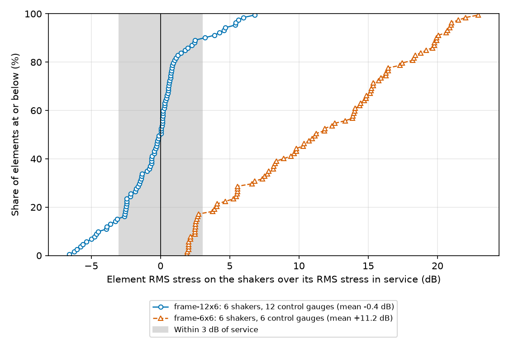

---
# Filled in by the editors at publication.
id: ""                 # assigned by the editors when the article is published
version: 1
date: ""
doi: ""
doi_latest: ""
note: First published.

# Filled in by the authors.
title: "The Open Benchmark Set: Public Test Problems, a Fair Run and a Scorecard for Multi-Shaker Control Laws"
type: Proposed Standard
evidence: simulator
evidence_note: "A specification, with worked examples on one simulated frame article in two stages: as a structure that does not change with level, and as the same structure with joints that soften and a member that hardens; and findings on what the softening and the hardening each do to a test's result, from runs of six control laws on ten simulated structures, pooled over the laws and checked by an independent audit on ten held-back structures. No hardware tests."
authors:               # in order; the author who led the work is first
  - name: "Kevin Cross"
    orcid: "https://orcid.org/0009-0002-6608-9426"
    roles: ["Conceptualization", "Methodology", "Software", "Validation", "Writing: original draft", "Writing: review and editing"]
implemented_in: ""
benchmarks: "Hertzforge Open Benchmark Set, MIMO Random suite, version 0.2 (DOI 10.5281/zenodo.24310742): frame-12x6 and frame-6x6, structure 0 (Section 7); frame-12x6 and frame-6x6 with one effect at a time, structures 0 to 9 and the held-back structures 20 to 23, 26 to 28, 50, 51 and 52 (Section 8)"
abstract: >
  A control law for a multi-shaker vibration test is usually shown working on its author's own
  model, so two laws cannot be compared and a law's weak cases stay out of sight. This article
  proposes a shared set of simulated test problems, the Hertzforge Open Benchmark Set, and the
  rules for using it. A test problem is a structure with shakers and accelerometers, a target
  taken from the structure in service, the limits a run must keep to, and a fixed scorecard. The
  files are public and in plain formats, and a problem can be run and scored with NumPy, without
  Hertzforge. The first suite, MIMO Random, is published as version 0.2 of the set (DOI
  10.5281/zenodo.24310742), with its code under the MIT license and its problems and documents under
  CC BY 4.0. Four things are asked of the set: a target the shakers cannot reach
  exactly; accelerometers kept out of the control and used only for scoring; where the model
  allows it, the stress in every part of the structure in service and on the shakers; and a
  second stage in which the structure changes with level both ways, its bolted joints softening
  and one member hardening, because a real article does both and a law that has only met a
  structure that does neither has not been tested. The hardening member is a tuned mass on two
  thin strips clamped at both ends; a cantilevered mass, the first idea, was found unable to
  harden by a measurable amount before it would yield. The article defines what a problem holds,
  what a fair run is, what the scorer reads and writes, and how problems are grouped, versioned,
  cited and reported on. A worked example on one structure shows a stage 1 reference run, in which six
  shakers matching six controls exactly left the article {{s1.6x6.stress_mean_db:.0f}} dB over its
  service stress on average, what a stage 2 problem states before any law runs, and one
  closed-loop run of one law at its defaults on a stage 2 problem, which compares nothing. Runs of six
  control laws on ten structures with one effect at a time show, pooled over the laws, that both
  effects move the stress more than the gauges in {{eff.stress_largest_both_sets:.0f}} of 24 cases, and that one hardening
  member moved the result less than the softening joints; an independent audit on ten held-back
  structures bore both out. Impacts and rattles are not covered. Everything here is simulation, and the scorecard's numbers are starting
  values.
---

## Summary

A control law is the rule a vibration controller uses to turn its targets into shaker drives. A new
control law for a multi-shaker test is usually shown working on a model its author built. Two laws
shown on two different models cannot be compared, and a model built to show a law working seldom
shows where the law fails.

This article proposes a shared set of test problems, the Hertzforge Open Benchmark Set, and the
rules for using it. A test problem is a simulated structure with shakers and accelerometers on it,
a target for the test, the limits a run must keep to, and a fixed way of scoring the result. The
files are public and in plain formats. A problem can be run in any software, or in Python with
NumPy alone. Hertzforge is not needed.

Four things are asked of the problems:

- The target comes from the structure in service, so the shakers cannot reach it exactly.
- Some accelerometers are kept out of the control and used only to score the test.
- Where the model allows it, the stress in every part of the structure is known, in service and
  on the shakers. The score can then say what the structure went through, and not only what the
  control accelerometers read.
- Every suite has two stages. At stage 1 the structure does not change with level. At stage 2 the
  same structure does, both ways: its bolted joints soften, so their modes fall in frequency as the
  vibration grows, and one member hardens, so its mode rises.

The fourth is there because a real test article changes with level, and a control law has to
measure the article at a low level and then drive it at a higher one. A law that has only been
shown on a structure that stays the same at every level has been shown on an easier problem than
any real test.

The hardening member is a small mass carried at the middle of two thin steel strips clamped at both
ends. As the mass moves, the strips stretch and grow stiffer. A mass on a cantilevered beam was the
first idea; worked through, a cantilever of this size yields long before its frequency rises by a
measurable amount. Section 4 gives both.

The score is a scorecard. It is not a pass or a fail. It follows the practice proposed in the
first article of this journal (Cross and Zwink, 2026): the overall level, the pattern at the
held-out accelerometers and at the controls, the worst over-test, the under-test, what the system
could reach, and whether an exact fit at the controls should be distrusted. At stage 2 it adds how
far each mode moved during the run, beside how far it moves in service.

This article defines the program: what a problem holds, what a fair run is, what the scorer reads
and writes, and how problems are grouped, versioned, cited and reported on. It does not list the
problems. Each kind of test (random, shock, sine) gets its own suite, published as its own versioned
data set. The first, the MIMO Random suite, is published as version 0.2 (Cross, 2026d), and the
scorecards behind Sections 7.4 and 8, with the record of their independent audit, as a separate
record (Cross, 2026e).

Section 7 works through one structure. At stage 1, with six shakers and six control accelerometers, a
reference run matched its six controls to {{s1.6x6.controls_per_channel_db:.2f}} dB RMS and left
the article {{s1.6x6.stress_mean_db:.1f}} dB over its service stress on average. Nothing at the
controls showed it. The held-out accelerometers and the stress did, and the scorecard flags the run.
A closed-loop check of the same point is the subject of a follow-up article (Cross, 2026c).
At stage 2 the example gives what is known before any law runs: in service the member's mode rises
{{s2.12x6.realistic.service_member_change_pct:.2f}} percent and the article's median mode falls
{{s2.12x6.realistic.service_article_change_pct_p50:abs.1f}} percent at the realistic size, and a system
with as many shakers as control gauges (six and six), driven to reproduce the target, would raise the member's mode
{{s2.6x6.realistic.shakers_member_target_change_pct:.1f}} percent. One closed-loop run, of the law
Hertzforge's MIMO Random module uses by default, at its default settings, shows what a stage 2
scorecard holds. It compares nothing.

Section 8 reports what the softening and the hardening each do. Six control laws were run on
{{eff.structures:.0f}} structures with one effect at a time, against the same law on the linear
structure, and the results are pooled over the laws. An independent audit ran the same cases on ten
structures held back until the findings were written down. With either effect the stress moved more
than the control gauges and the held-out gauges in {{eff.stress_largest_both_sets:.0f}} of 24 cases over
both sets, so the gauges a laboratory watches show less of what the change of level does than the
article's stress does. At the strong size with twelve control gauges the softening joints raised the
stress error by a median of {{eff.strong.6x12.soft.stress.median_db:.2f}} dB, and
{{eff.audit.strong.6x12.soft.stress.median_db:.2f}} dB on the held-back structures. One hardening member
moved the result less than the softening joints, in both directions, with signed medians of
{{eff.audit.hard_stress_signed_median_abs_max:.2f}} dB or less. No law is named; the comparison of laws is in
a companion article (Cross, 2026b).

Impacts, and rattles in the shaker or fixture, are not in the set. Everything here is simulation.
The scorecard's numbers are starting values, to be tried and revised.

## 1. Why a Shared Set of Test Problems

A paper on a control law reports the law's results on a model. The model, the target, the number
of shakers and the measure of success are each the author's choice. A reader cannot tell whether a
second law would have done better on the same model, or how the first law would do on a harder one.

The first article of this journal (Cross and Zwink, 2026, Section 6) asked for the missing piece:
control laws graded on a public set of test articles, with targets the system cannot reach exactly and
with outputs that are not controls. It gave the reason. When the target is the structure's own
response to its own shakers, a controller with as many shakers as control accelerometers matches
every control exactly, and the test tells nothing about the rest of the structure.

A second reason concerns level. A controller measures how the system answers its shakers at a low level
before the test, then drives the article at full level. If the article's joints loosen and its
frequencies fall as the level rises, or a stiff member tightens and its frequency rises, the
frequency response the controller measured is wrong at full level, and wrong in a different direction for
different modes. A benchmark whose structures stay the same at every level never asks a law to cope
with that, and would rank laws on a problem easier than the one they will meet.

Test laboratories have shared a test article before. The Boundary Conditions in Environmental
Testing round robin (Skousen and Soine, 2018) is one such program. The Open Benchmark Set does the same for control laws, in simulation, where
every laboratory and every author can hold an identical copy.

The set is for four things: developing a law against known problems, comparing laws on equal
terms, finding the cases where a law fails, and giving an article a reference that other articles
can use too. It is not an acceptance test for a law, and a good scorecard on a simulated problem
does not qualify a law for a real test. Whoever applies a law to a test is responsible for
protecting the equipment.

## 2. Terms

- **Article.** The structure under test.
- **Shaker and drive.** A shaker applies a force to the article. Its drive is the voltage signal
  the controller sends it.
- **Gauge.** An accelerometer channel: one point on the article, one direction.
- **Control gauge.** A gauge the controller reads and tries to bring to a target.
- **Held-out gauge.** A gauge that is recorded and never given to the controller. It is used only
  to score the test.
- **Target.** What the control gauges should read. For a random test it is a set of acceleration
  spectra.
- **System.** The article on its suspension with a given set of shakers and control gauges, as the
  controller sees it. The first article of this series calls it the rig, and the data set keeps that
  word in its field and file names (`rig`). A system with as many shakers as control gauges is called
  square.
- **Control law.** The rule by which the controller turns the target and what it has measured of
  the system into drives.
- **Run.** One test of one control law on one problem, from the first measurement of the system to
  the end of the record.
- **Problem.** One structure, one target and one set of limits, under an identifier.
- **Seed.** A whole number from which a structure is generated. A different seed gives a different
  structure of the same kind. The seed is the structure's label in the data set, so structure 4 is
  the one generated from seed 4. This article counts and names structures, and says "seed" only
  where the data set's field or a file name is meant. A seed is not a level.
- **Measured frequency response.** The frequency response functions from each shaker drive to each
  control gauge, measured by the controller at a low level at the start of a run. A control law
  computes its drives from them.
- **Suite.** The problems for one kind of test, published together as one versioned data set.
- **Scorecard.** The fixed set of measures the scorer computes from a run.
- **Baseline.** The scorecard of a control law that Hertzforge ships, on a problem.
- **Level.** How hard the article is driven. **Full level** is the level of the target; a test
  climbs to it in steps.
- **Small-signal.** The structure as it is at a very low level, where nothing has changed yet.
- **Softening.** Stiffness that falls as the amplitude grows, as in a bolted joint that begins to
  slip. A mode that softens falls in frequency, and its damping rises.
- **Hardening.** Stiffness that rises as the displacement grows. A mode that hardens rises in
  frequency.
- **Stage 1 and stage 2.** At stage 1 the structure is the same at every level. At stage 2 the same
  structure changes with level: some modes soften and one hardens.
- **Member.** The part of the stage 2 article that hardens (Section 4.3).
- **In service.** The article mounted and loaded as it is in use, which is where the target comes
  from.

## 3. What a Test Problem Is

A problem is one folder. It holds six things:

1. the structure, in a plain documented file, with a reference model in Python;
2. the gauges and the role of each;
3. the target;
4. the limits of a fair run;
5. what the scorer needs: the service responses, the stress where the model gives it, and at stage
   2 the state of the article in service;
6. the baselines: the scorecards of the shipped control laws on the problem. In version 0.2 they are
   published as a separate record (Cross, 2026e), not in the problem folders.

@tbl-folder lists the files of one problem from the worked example. Descriptive files are JSON.
Large arrays are raw binary, little-endian, with their type, shape and units stated in
`problem.json`. Units are SI: volts at the drives, m/s² at the gauges, pascals for stress.
Spectral densities are one-sided, per hertz. Every file is listed in `problem.json` with its
SHA-256 hash, so a result can state exactly which problem it was run on.

```{=typst}
#block(breakable: false, width: 100%)[
```

| File | Size | What it holds |
|:---|---:|:---|
| `problem.json` | {{size.problem.json}} | The identifier, the suite and its version, the stage and the effects present, the frequency grid, the roles, what a law may be given, the article's state in service (stage 2), the checks made when the problem was built, and the table of every other file with its type, shape, units and hash |
| `structure.json` | {{size.structure.json}} | The structure as a list of modes, each with its rule for changing with level at stage 2; every drive and gauge with its name, role, point and direction |
| `geometry.json` | {{size.geometry.json}} | Points, beam elements and lumped masses, for drawing the structure |
| `reference_model.py` | {{size.reference_model.py}} | The reference model, in Python with NumPy only |
| `target_banded.json` | {{size.target_banded.json}} | The target as one-third-octave band values at each control gauge |
| `target_line.c16` | {{size.target_line.c16}} | The target as the full spectral matrix at the control gauges, line by line |
| `limits.json` | {{size.limits.json}} | The limits of a fair run |
| `scoring/` | {{size.scoring}} | The service responses at the control gauges, the held-out gauges and the component tips; the stress in every element in service; the matrix that turns a run into stress; at stage 2, the scale of each mode's monitor |

: The files of one problem (`frame-12x6-realistic`, structure 0, stage 2), with the size of each. {#tbl-folder tbl-colwidths="[27,11,62]"}

```{=typst}
]
```

### 3.1 The Structure

The structure is given as its modes of vibration. Each mode has a natural frequency, a damping
ratio, a number for how strongly each shaker drives it and a number for how much each gauge moves
with it. From these the small-signal response of any gauge to any shaker follows at every frequency:

$$
H_{ij}(f) = \sum_{m} \frac{-\omega^{2}\,\phi_{im}\,\psi_{jm}}{\omega_{m}^{2} - \omega^{2} + 2 j \zeta_{m} \omega_{m} \omega}
$$ {#eq-frf}

Here $H_{ij}$ is the acceleration at gauge $i$ for one volt at shaker $j$, $\omega = 2 \pi f$,
$\omega_{m}$ and $\zeta_{m}$ are the natural frequency and damping ratio of mode $m$,
$\phi_{im}$ is the motion of gauge $i$ in that mode and $\psi_{jm}$ is how strongly shaker $j$
drives it.

`reference_model.py` is @eq-frf written out, with the rule of Section 4.2, in about 600 lines that
need only NumPy. It gives the frequency response, the stress response, the response to any set of
drives and the response in time, at stage 2 by stepping the structure sample by sample the way the
software's simulator does. A reader can check their own simulator against it, or use it as the
simulator.

### 3.2 The Gauges and Their Roles

Every gauge has one role.

- **Control.** The control law reads it, and it has a target.
- **Held out.** It is recorded and never given to the law. Held-out gauges on the main structure
  have a target of their own, taken from service. Held-out gauges at the tips of components, and
  at the middle of the hardening member, have a service response to compare with.
- **Monitor.** A scoring device with no physical counterpart, one for each mode, used only at stage
  2. Section 6 says what it is for.

The held-out gauges are the reason the set exists. In the first article, and in the hardware test
it cites (Rohe, Nelson and Schultz, 2019), the gauges left out of the control were the only ones
that showed a test going wrong while the controls read well.

### 3.3 The Target

The target is the response of the article in service, at the control gauges. In the worked example
the article is bolted to a larger host frame, random forces act on the host, and the target is what
the article's gauges read. On the shakers the article hangs free and is driven at a few points.
The shakers push where the service loads did not, so they cannot reproduce the service response
at every gauge.

The target is also taken from a different unit. Unit A is the one measured in service. Unit B, a
second unit of the same design with slightly different stiffness, mass and damping, is the one on
the shakers, and its stress in service is the stress the test is scored against. A real test is in
the same position: the specification comes from one serial number and the test article is another.

At stage 2 the article in service changes with level too, by the same rule as on the shakers: each
unit in service softens and hardens as much as it moves in service. The service response is found
by repeating the calculation until the modes' frequencies and damping agree with the amplitudes they
produce. A stage 2 problem therefore states an absolute level, because the member's hardening depends
on how far it moves, not on a ratio. For each structure the service loads are scaled so that unit B's
member moves {{s2.12x6.realistic.tier_member_rms_mm:.3f}} mm RMS at its middle in a linear service
calculation; the control level then follows from the structure. A structure whose control level would
pass 30 g RMS takes the next placement of the member that keeps it under; where there is none it keeps
the lowest and is flagged as above 30 g RMS, so a few structures are driven harder (Section 7.3 gives the range).

How close a system can come to its target is fixed before any control law runs. The scorer computes
it from the small-signal structure and the target alone and reports it on every scorecard as the
declared deviation (Section 6). A law is not blamed for what the system cannot do.

A problem has one target. Where two kinds of target are wanted for one structure, they are two
problems. The random suite has two: `banded`, a specification of one-third-octave band values
at each control gauge with no relation stated between gauges, and `line`, the full set of service
spectra line by line, including the cross spectrum between every pair of control gauges.

### 3.4 The Limits of a Fair Run

Two runs can be compared only if they were allowed the same things. A problem's limits file fixes:

- the frequency grid and the band;
- how the system may be measured before the test (the identification): how long and at what level;
- the level steps on the way up to full level;
- how long the run stays at full level and which part of it is the record;
- how spectra are estimated within a loop;
- whether the law may measure the frequency response again during the run;
- the measurement noise;
- the ceiling on each drive;
- the protections, meaning the stops the controller applies on its own, and their settings;
- what counts as the outcome.

@tbl-limits gives the limits of the example problems. They belong to the suite, not to this
article, and are shown as an example of what a limits file fixes. They are the same at both stages.
At stage 2 they matter more: the identification at 20 dB under the target sees the small-signal
structure, and every step up the ladder moves the modes away from it.

```{=typst}
#block(breakable: false, width: 100%)[
```

| Item | Value in the example |
|:---|:---|
| Grid | 0.5 Hz lines from 20 to 2000 Hz (3,961 lines), from 16,384-point frames at 8,192 samples per second |
| Identification | 64 frames, or 10 for each shaker if that is more; 32 noise frames; starting at 0.01 V RMS; 20 dB under the target level |
| Level steps | -12, -9, -6, -3 and 0 dB, one loop at each step below full level |
| Full level | 30 loops; the last 15 are the record |
| Estimation | 64 frames a loop (66 s), Hann window, 50 percent overlap, memory of 4 loops |
| The measured frequency response | Measured once before the run and kept. An entry may declare that it measures it again during the run, each new measurement weighted 0.5 against the last |
| Noise | 40 dB under the quietest control gauge's target, in RMS over the band |
| Drive | Ceiling of 5 V RMS on each shaker; 1 V RMS before the test |
| Protections | First pass at the software's defaults: a stop when one control gauge's error stays at or above 3 dB without improving by 0.1 dB for 5 loops; a stop when the change cap holds one drive back on 10 lines in 5 of the last 10 drives the law was allowed to make; an abort at the drive ceiling plus 1 dB (5.61 V RMS); overload fraction 0.9; one settling loop (Cross, 2026a, Section 3). Tolerance alarm and abort lines are off |
| Outcome | Completed, or stopped, with which protection stopped it, at which loop and why |

: The limits of a fair run on the example problems (limits identifier `frames-fair-run/0.1-draft`). {#tbl-limits tbl-colwidths="[20,80]"}

```{=typst}
]
```

The tolerance lines are off because the target cannot be reached. A run that aborts whenever a
control gauge leaves a band around an unreachable target would never finish. Tolerance is a line
on the scorecard.

The protections are the controller's own checks, and their defaults are protective on purpose. The
primer of this journal describes them as the software's code has them (Cross, 2026a, Section 3). In
the software's MIMO Random module two of them judge the control loop. The growing-error check stops a
run when one control gauge's error, over the band, stays at or above 3 dB without improving by 0.1 dB
for 5 judged loops; the loops of the level steps count. The drive-change check stops a run when the
limit on how far a drive may change has held one drive back on 10 or more lines in 5 of the last 10
drives the law was allowed to make. A third check aborts a run when a drive's RMS voltage reaches the
problem's drive ceiling plus 1 dB: with the ceiling of 5.0 V RMS, 5.61 V RMS. It is a rule of the
controller applied to the problem's ceiling, not a separate setting. The first two stop a test early rather than let a growing error reach the shaker, the
amplifier or the article, and widening them in a laboratory test is the test engineer's decision for that
test.

A run that a protection stops has an outcome and may have no scores, and a table of stops says
little about how laws differ. So the limits allow a second pass. When the first pass stops, the run
is repeated with the same noise and with the checks widened so the run completes: no limit on the
lines the drive-change check counts, an error floor of 1,000 dB with 16 loops, so that the
growing-error check does not act, and an overload fraction of 1.0. The drive-voltage abort stays. Its scores are marked
as such. The scorecard then carries both: what happened with the checks at their defaults, and how the
law scored with them widened. A simulator has no hardware to protect, so widening them there costs
nothing; for a laboratory test it is not a recommendation.

Every problem assumes a sound setup. A rattle in a shaker, a stinger or a fixture is a fault in the
test equipment, found and fixed before a test, and no control law is asked to work around one.

### 3.5 What a Control Law Is Given

A law is given three things: the system as it can be measured at the control gauges under the limits,
the target at the control gauges, and the limits. It is never given the structure file, and so it
is never told which modes will soften, which will harden, or by how much.

Everything else is kept for scoring: the held-out gauges, their service responses, the stress in
service, the matrix that turns a run into stress and the article's state in service. These files are
public. "Kept" means that a fair run does not pass them to the law. Nothing but honesty stops an
author from tuning a law on them, and Section 3.6 is the answer to that.

### 3.6 Structures, Seeds and Fresh Draws

A structure identifier names a kind of structure, not one structure. The seed draws the
dimensions, the masses, the damping, the service forces, where the gauges and shakers sit, how much
each joint softens, and where the hardening member goes. A law that does well on structure 0 and
poorly on structure 3 has learned structure 0.

Each version of a suite therefore sets aside a range of seeds as fresh draws. They are published
with the version, nobody develops or tunes a law on them, and a result on them is reported apart
from results on the other structures. Once a version is out its fresh draws have been seen, so each
later version names a new range. A suite may also name tuning structures, on which an author may
choose a law's settings, and which are never scored.

A draw is replaced when the hardening member cannot be placed on it (Section 4.3), or when the
reference simulator refuses it. The simulator refuses a structure if any mode could rise past the
highest frequency it can represent, half the sample rate, 4,096 Hz. In this version structure 24, one
of the structures held back for the independent audit, was refused at the strong size for that reason
(one of its modes could rise to about 4,119 Hz) and was replaced, at every system and size, by
structure 52. The generator of version 0.2 checks this itself: it refuses a structure on which any
mode could rise past the simulator's bound. A replaced draw goes whole and is replaced by the next unused seed above the
named range; the replacement is stated.

## 4. Structures That Change With Level (Stage 2)

### 4.1 What Changes, and What Does Not

At stage 2 two things change with level, in one structure:

- **Joints soften.** The chassis is bolted together. As the vibration grows its modes fall in
  frequency and their damping rises, each by an amount set by how much of the mode's strain energy
  is in the jointed chassis.
- **One member hardens.** A small mass on two thin strips (Section 4.3) stiffens as it moves. Its
  mode rises in frequency.

A mode that lives mostly in the member mostly rises; a mode that lives in the chassis mostly falls;
a mode shared between them does some of each. The effects are smooth: the stiffness changes with
amplitude, and nothing separates, strikes or rattles. Impacts, such as a part tapping its
neighbour, are not hardening in this sense and are not in the set.

Each stage 2 structure comes at two sizes. **Realistic** is sized so that, in service, the
article's median mode falls 1 percent with its damping 1.5 times its small-signal value, and the
member alone rises 1 percent at its design motion. **Strong** is sized for 3 percent, 3 times the
damping and a 4 percent rise. These are the set's choices, made to be in the range of published
measurements of hardening structures (Section 4.3) and well short of their largest values. Each suite
also carries diagnostic problems on two systems, with only the softening or only the hardening turned
on, so that a result can be traced to one effect.

### 4.2 The Rule

Each mode of a stage 2 structure carries its own rule. With $r$ the mode's amplitude over a
reference amplitude stated for that mode, its frequency and damping are

$$
f = f_{0}\left(1 - d\,\min(1, r)^{a} + h\,\min(c_{h}, r)^{b}\right), \qquad
\zeta = \zeta_{0}\left(1 + g\,\min(c_{g}, r)^{e}\right)
$$ {#eq-rule}

where $f_{0}$ and $\zeta_{0}$ are the small-signal values, $d$ is the drop (softening), $h$ the rise
(hardening), $g$ the damping gain, $a$, $b$ and $e$ their exponents, and $c_{h}$ and $c_{g}$ the
amplitude ratios at which the rise and the damping stop growing. The drop stops at $r = 1$. A mode's
amplitude is followed sample by sample by an envelope that holds a peak and lets it decay over five
cycles. The rise has exponent 2, the shape of a stiffness that grows with the square of the
displacement; the drop and the damping gain have exponent 1. The caps keep every mode's highest
reachable frequency known, so a simulator can check it against its sample rate, and keep a mode
driven far past its service amplitude from taking an unbounded damping.

@fig-level shows the rule for the member's mode and for the article's median softening mode of the
worked example. The member's mode rises with the square of its amplitude until its cap; the
article's mode falls in proportion to its amplitude until $r = 1$, and its damping climbs and then
holds.

{#fig-level fig-alt="Two line plots side by side against r, a mode's amplitude over its reference amplitude, from 0 to 2.5. Left panel, frequency change in percent: two orange curves with circle and square markers, the member's mode at about 111 Hz, rise from zero as a parabola and level off at their caps, the strong size higher; two blue curves with triangle and diamond markers, an article mode at about 264 Hz, fall in a straight line to r = 1 and then stay flat, the strong size deeper. Right panel, damping over its small-signal value: all four curves rise in a straight line to r = 1 and then stay flat, the article mode reaching higher than the member mode and the strong size higher than the realistic." data="data/fig_level_rule.csv"}

Every stated change in a problem is the change a reader would measure in a spectrum. Under random
drive a mode's amplitude wanders, and a spectrum weights each moment by its power, so the rule as a
spectrum shows it is the rule averaged over the wandering amplitude. The generator sizes every term
to that average: the rise on a sine amplitude of twice the RMS motion, which is where a cubic spring's
response under random drive matches its response to a sine, and the drop and the damping gain on the
power-weighted average of the envelope (Section 11 states what this does and does not capture).

### 4.3 The Hardening Member

The first idea for the member was one of the article's cantilevered components: a mass on the end of
a tube, tuned into the test band and flexible enough for the tube to stiffen. Worked through, it
cannot. A cantilever's first mode stiffens as its tip swings and is softened by the mass's own
motion along the beam, and the two are closely balanced: measured cantilevers have shown either a
stiffening or a softening first mode (Villanueva and others, 2013). Calculated two ways
for the article's tube components, the frequency rises by a fraction of 2 to 3 percent of the
square of the tip deflection over the length, so a 1 percent rise needs the tip to swing about 0.6 of
the beam's length. At a swing of a tenth of the length the rise is 0.03 percent and the stress at
the root is already 900 to 1,750 MPa, three to six times the yield stress of the aluminum tube. Even
the sign of the change is not dependable on real hardware, where gravity and the clamp can tip it
either way.

A thin strip clamped at both ends does what the cantilever cannot. When the mass at its middle moves,
the strip has to stretch, and the stretching makes a stiffness that grows with the square of the
displacement. The first mode of a beam clamped at both ends, tested by Renson and others (2016), fell a
little at low amplitude and then rose from 15.67 Hz to about 16.4 Hz, about 4.7 percent, as the
bending stretched the beam. A thin beam clamped at the tip of a cantilever, tested by Peeters,
Kerschen and Golinval (2011), is another published case of the same stretching. The member of the set (@fig-member) is a mass carried at the middle of two parallel strips
of type 301 stainless steel, full hard, clamped at both ends on a steel bracket that stands on the
chassis where one of the cantilevered components was.

- **Size.** At the realistic size each strip is {{member.realistic.strip_length_mm:.0f}} mm long between
  its clamps, {{member.realistic.strip_width_each_mm:.1f}} mm wide and
  {{member.realistic.strip_thickness_mm:.2f}} mm thick. At the strong size the strips are
  {{member.strong.strip_length_mm:.1f}} by {{member.strong.strip_width_each_mm:.1f}} by
  {{member.strong.strip_thickness_mm:.2f}} mm, which stiffen about four times as fast for the same motion.
- **How much it hardens.** Ideal clamps are knocked down to 0.514 of their stiffening, a ratio this
  set derived from the clamped thin beam of Peeters, Kerschen and Golinval (2011), to allow for clamps that let the
  strip's ends draw in. With that, the realistic member alone rises 1 percent at 0.161 mm and 4
  percent at 0.326 mm of motion of the mass in a sine, under 0.6 of the strip's thickness, with a
  peak stress of 95 and 200 MPa against a yield stress of 965 MPa. Two separate calculations agree
  on these to 0.001 mm.
- **Two strips, not one.** On one strip the mass twists before it bends. On two strips spaced the
  width of the mass apart, the rocking and pitching modes sit at least 1.6 times above the mode that
  moves the mass straight up and down. At the strong size the strips are short, and a steel mass of
  the same weight would pitch just under that mode, so the strong mass is a bar of tungsten heavy
  alloy, which is denser and so shorter.
- **Tuned clear of the chassis.** If the member's mode sits near a chassis mode the two share their
  strain energy, and neither hardens. So each structure places the member and tunes it (by the mass,
  keeping the strips) to the first place and frequency, from 90 to 160 Hz and if needed 80 to 250
  Hz, at which the member's mode keeps at least 0.8 of its strain energy in the strips in both
  units, in service and on the shakers, at both sizes. A structure with no such place is not a problem of
  the set.
- **Damping.** The member's own modes have at least 1 percent of critical damping, so that the
  scorer can resolve its peak.

{#fig-member fig-alt="Three panels. Left, a side-view line drawing: two hatched clamp posts stand on a chassis tube 50 mm apart, a thin strip spans between them, and a gray block 20 mm long and 20.7 mm tall sits on the strip at mid-span, with a double arrow showing its up-and-down motion. Middle, a plan-view drawing: two parallel strips, each 7.5 mm wide and 50 mm long, 51.2 mm apart, each clamped by hatched posts at both ends, with a gray rectangular mass of 166 grams of steel, 20 by 51.2 mm, spanning both strips at mid-span. Right, a line plot of frequency rise in percent against RMS motion of the mass from 0 to 0.2 mm: a blue solid curve with circles for the realistic strips rises as a parabola to 1 percent at about 0.08 mm and 6 percent at 0.2 mm; an orange dashed curve with squares for the strong strips rises four times as fast, to 4 percent at about 0.08 mm; a dash-dot vertical line at 0.081 mm marks the stated motion and dotted horizontal lines mark 1 and 4 percent." data="data/stage2_member.csv data/fig_member.csv"}

```{=typst}
#block(breakable: false, width: 100%)[
```

| | Realistic | Strong |
|:---|---:|---:|
| Strips, each (length x width x thickness), mm | {{member.realistic.strip_length_mm:.1f}} x {{member.realistic.strip_width_each_mm:.1f}} x {{member.realistic.strip_thickness_mm:.2f}} | {{member.strong.strip_length_mm:.1f}} x {{member.strong.strip_width_each_mm:.1f}} x {{member.strong.strip_thickness_mm:.2f}} |
| Spacing between the strips, mm | {{member.realistic.strip_spacing_mm:.1f}} | {{member.strong.strip_spacing_mm:.1f}} |
| Mass and material | {{member.realistic.mass_kg:.3f}} kg, {{member.realistic.mass_material}} | {{member.strong.mass_kg:.3f}} kg, {{member.strong.mass_material}} |
| Mass, along x across x thick, mm | {{member.realistic.mass_along_mm:.0f}} x {{member.realistic.mass_across_mm:.1f}} x {{member.realistic.mass_thin_mm:.1f}} | {{member.strong.mass_along_mm:.0f}} x {{member.strong.mass_across_mm:.1f}} x {{member.strong.mass_thin_mm:.1f}} |
| Tuned frequency, clamped rigidly, Hz | {{member.realistic.translation_hz:.1f}} | {{member.strong.translation_hz:.1f}} |
| Rocking and pitching modes, Hz | {{member.realistic.rocking_hz:.0f}}, {{member.realistic.pitch_hz:.0f}} | {{member.strong.rocking_hz:.0f}}, {{member.strong.pitch_hz:.0f}} |

: The member of the worked example, structure 0. The tuned frequency and the mass are chosen per structure; the strips are the same on every structure. Data: `data/stage2_member.csv`. {#tbl-member tbl-colwidths="[50,25,25]"}

```{=typst}
]
```

### 4.4 The State in Service and the State as Tested

A stage 2 problem states, in `problem.json`, the article's state in service: how far the member's
mode has risen, and how far the article's other modes have fallen (10th, 50th and 90th percentiles),
with their damping, for unit B at the fixed point of its rule in service. That is what the test is
meant to reproduce.

The structure file also states what each mode would do at full level on the shakers under one
particular drive: the least-squares drive that brings the controls closest to the target on the
small-signal structure. These are not a pass mark. A law that plays another drive moves the member
by another amount, and on some systems the member moves less on the shakers than in service. The
scorecard reports the state as tested, the article's state during the laboratory test (Section 6), and prints the state in service beside it.

### 4.5 Stage 2 Without Hertzforge

The reference model in every problem folder steps a stage 2 structure through time with NumPy alone,
following the software's simulator: the same envelope, the same exact step from one sample to the
next for each mode, the same delays. On the structures checked, the two agree sample by sample to a
few parts in 10¹² of the largest sample. A reader can therefore run a law on a stage 2 problem with
nothing but the problem folder.

The simulator steps each mode with a filter that matches the continuous model within the band. Modes
above the band, near half the sample rate, leave a small error that each problem states in its
checks (Section 9.3).

## 5. The Run Result

A run hands the scorer three things:

- **A manifest:** the grid, the name of the law and the parameters it was given, the protections
  in force, and the outcome. When the run stopped, the manifest says which protection stopped it,
  at which loop, at which level, on which gauge or shaker, and in a sentence why.
- **The drives as sent:** the spectral matrix of the drives over the record.
- **The gauges as read back:** the autospectrum of every gauge over the record.

At stage 2 it also hands over the band moments of the modal monitors, from which the stress as
tested is computed. For six shakers this is a few megabytes. It is small enough to keep and to
publish with a result, and from it anyone can run the scorer again.

A run that completed is scored. A run that stopped inside its record is scored on what was
recorded if that is at least 40 frames. A run that stopped earlier has an outcome and no scores.

## 6. The Scorecard

The scorer is one Python file that needs only NumPy. It reads a problem folder and a run result
and writes the scorecard. @tbl-blocks lists what the scorecard holds.

```{=typst}
#block(breakable: false, width: 100%)[
```

| Block | What it holds |
|:---|:---|
| Identity | The scorer's version and hash, the suite and its version, the problem, its stage and effects, the seed, the hash of the structure file, the law and its parameters |
| Outcome | Completed or stopped, as in Section 5 |
| Report card | The six lines of @tbl-card, and beside them the reference measures taken from the published standards |
| Stress | The RMS stress in every element on the shakers against its RMS stress in service: the RMS, mean, 5th and 95th percentiles over the elements, the share of elements within 3 dB, the worst element, and two fatigue damage figures |
| Response spectra | The response a small resonant part would have if mounted at each held-out gauge and component tip (Q of 10 and of 50), on the shakers against service |
| State as tested | Stage 2: each mode's frequency change and damping as tested, signed (a fall negative, a rise positive), per mode and summarized for the softening and the hardening modes, against the stated change under the reference drive; and beside it the state in service as the problem states it, for the member's mode and in summary for the softening modes |

: What a scorecard holds. {#tbl-blocks tbl-colwidths="[18,82]"}

```{=typst}
]
```

The report card is the one proposed in the first article, with its starting values.

```{=typst}
#block(breakable: false, width: 100%)[
```

| Line | Quantity | Starting value |
|:---|:---|:---|
| 1 | Level: the mean decibel error over the control and held-out gauges and all bands | within 1.5 dB |
| 2 | Pattern: the RMS decibel error of the summed spectra in one-third-octave bands, at the held-out gauges and at the controls, with the error per gauge beside it | grade A to 3 dB, B to 4.5 dB, C to 6 dB |
| 3 | Over-test: the worst band at any gauge, and the share of bands more than 6 dB over | alarm at +6 dB |
| 4 | Under-test: the share of held-out bands more than 3 dB under | reported |
| 5 | The declared deviation (what the system can reach, against the target) and the law error (what the law achieved, against what the system can reach) | reported |
| 6 | Shakers and control gauges, the condition of the system, and the error left at the controls | a near-zero control error with as many shakers as controls is flagged |

: The report card (Cross and Zwink, 2026). {#tbl-card tbl-colwidths="[7,63,30]"}

```{=typst}
]
```

Four points about how the scorecard is meant to be read.

**It is not a verdict.** Nothing on it says pass or fail. The grades on line 2 separate systems and
laws from one another. They do not certify a test.

**The stress is the truth the gauges are judged against.** A model gives what no test article
does: the stress everywhere, in service and on the shakers. Where a problem has it, the stress
block says what the article went through, and the gauge lines can be read against it. A problem
without stress truth is scored on its gauges alone.

**The reference measures are printed, not used.** The share of control lines inside the bands
that MIL-STD-810H Method 527.2 Annex E offers as a starting point, and the global error of its
Annex C, are computed for every run so that a result can be read by someone who works to them.

**At stage 2 the article moved during the run.** What it went through depends on the drive the law
chose, because the drive changed the structure. The gauges are scored from what was measured during
the test, the stress is computed from the modal monitors, and the state as tested says how far each
mode moved.
Beside it the problem's state in service says how far it should have moved. A run that holds the
controls on target with the member's mode far from its state in service has tested a different
article from the one in service, and the two blocks show it. The scorecard also gives the gauge and
stress figures computed as if the structure had not moved, so that a reader can see how much the
change of level mattered to the score.

## 7. A Worked Example

### 7.1 The Article and Its Problems

The example uses structure 0 (seed 0) of the frame family of the first article (Cross and Zwink, 2026, Section
4.1), reworked for the two stages. The article is a box chassis of square aluminum tube, 616 by 382
by 272 mm, with three lumped masses, three small components on cantilevered tubes and, where the
fourth component was, the hardening member (@fig-article). In service it is bolted at its four
corners to a host frame that carries the service forces. On the shakers it hangs on a soft
suspension. The model has {{s1.12x6.elements:.0f}} beam elements and {{s1.12x6.modes:.0f}} modes;
{{s1.12x6.elastic_modes_in_band:.0f}} of the flexible modes lie in the test band of 20 to 2000 Hz, the
lowest at {{s1.12x6.first_elastic_mode_hz:.1f}} Hz.

{#fig-article fig-alt="Three shaded views of a CAD model. Left: a rectangular box of square aluminum tubes with two long rails and cross members in each of the top and bottom frames joined by four corner posts; three dark blocks are lumped masses, three short tubes carry small blocks marked with orange triangles, open black squares mark the four mount points, and an orange star marks a small orange block on a gray bracket at one top corner, the hardening member. Middle: a close-up of that member: an orange rectangular mass spans two thin red-brown strips whose ends are clamped on a gray steel bracket that stands on a chassis tube; text labels name the tuned mass, the two thin strips, the steel bracket and the chassis tube. Right: the article hanging on four thin cords, with six blue cylindrical shakers, each with a black arrow showing its force direction; blue filled circles mark control gauge points, open orange diamonds mark held-out gauge points and orange triangles mark the tip gauges, the member's mid-span included." data="data/fig_article_parts.csv data/fig_article_rig.csv"}

Six problems are used: two systems at stage 1 and the same two systems at both stage 2 sizes. Both systems have
six shakers, the same twelve held-out channels at four chassis points, and twelve channels at the
three component tips and the member's middle. `frame-12x6` has twelve control gauges and
`frame-6x6` has six, at different points, with the shakers in different places.

### 7.2 Stage 1: A Reference Run

The run scored here is a reference run. Its drives are computed directly from the structure's own
frequency response: at every line the drive is the one that brings the control gauges as close to
the target as the system allows, ignoring any way of moving the controls that is more than 1,000 times
weaker than the strongest. It is the idealized line-by-line law of the first article.

The reference run is not a fair entry and not a baseline. A fair entry measures the system first,
climbs the level steps and runs closed loop with noise. The reference run does none of that. It is
used here because anyone can reproduce it from the problem folder with NumPy, and because it shows
what a scorecard holds. It applies to stage 1 only: on a stage 2 structure the drive would move the
modes it was computed from. `code/example_run.py` computes the drives, writes the run result and
calls the scorer.

@tbl-stage1 gives the two scorecards. @fig-bands shows the error in every band at every control
and held-out gauge, and @fig-stress shows the stress in every element.

```{=typst}
#block(breakable: false, width: 100%)[
```

| | `frame-12x6/line` | `frame-6x6/line` |
|:---|---:|---:|
| Control level, median over controls (range), g RMS | {{s1.12x6.control_g_rms_median:.1f}} ({{s1.12x6.control_g_rms_min:.1f}} to {{s1.12x6.control_g_rms_max:.1f}}) | {{s1.6x6.control_g_rms_median:.1f}} ({{s1.6x6.control_g_rms_min:.1f}} to {{s1.6x6.control_g_rms_max:.1f}}) |
| **Line 1.** Level, mean error | {{s1.12x6.level_mean_db:+.1f}} dB | {{s1.6x6.level_mean_db:+.1f}} dB |
| **Line 2.** Pattern at the held-out gauges, summed | {{s1.12x6.held_out_summed_db:.1f}} dB, grade {{s1.12x6.held_out_grade}} | {{s1.6x6.held_out_summed_db:.1f}} dB, grade {{s1.6x6.held_out_grade}} |
| Pattern at the held-out gauges, per gauge | {{s1.12x6.held_out_per_channel_db:.1f}} dB | {{s1.6x6.held_out_per_channel_db:.1f}} dB |
| Pattern at the controls, summed | {{s1.12x6.controls_summed_db:.1f}} dB, grade {{s1.12x6.controls_grade}} | {{s1.6x6.controls_summed_db:.1f}} dB, grade {{s1.6x6.controls_grade}} |
| Pattern at the controls, per gauge | {{s1.12x6.controls_per_channel_db:.2f}} dB | {{s1.6x6.controls_per_channel_db:.2f}} dB |
| **Line 3.** Worst band, any gauge | {{s1.12x6.worst_band_db:+.1f}} dB | {{s1.6x6.worst_band_db:+.1f}} dB |
| Share of bands more than 6 dB over | {{s1.12x6.share_of_bands_over_alarm_pct:.0f}} % | {{s1.6x6.share_of_bands_over_alarm_pct:.0f}} % |
| **Line 4.** Held-out bands more than 3 dB under | {{s1.12x6.share_held_out_bands_3db_under_pct:.0f}} % | {{s1.6x6.share_held_out_bands_3db_under_pct:.0f}} % |
| **Line 5.** Declared deviation | {{s1.12x6.declared_deviation_rms_db:.2f}} dB | {{s1.6x6.declared_deviation_rms_db:.2f}} dB |
| Law error | {{s1.12x6.law_error_rms_db:.2f}} dB | {{s1.6x6.law_error_rms_db:.2f}} dB |
| **Line 6.** Condition of the system, median over lines | {{s1.12x6.condition_median:.0f}} | {{s1.6x6.condition_median:.0f}} |
| Condition of the system, largest | {{s1.12x6.condition_max:.0f}} | {{s1.6x6.condition_max:.0f}} |
| Exact-fit flag | {{s1.12x6.exact_fit_flag}} | **{{s1.6x6.exact_fit_flag}}** |
| **Stress.** Mean over elements | {{s1.12x6.stress_mean_db:+.1f}} dB | {{s1.6x6.stress_mean_db:+.1f}} dB |
| RMS over elements | {{s1.12x6.stress_rms_db:.1f}} dB | {{s1.6x6.stress_rms_db:.1f}} dB |
| 5th to 95th percentile | {{s1.12x6.stress_p5_db:+.1f}} to {{s1.12x6.stress_p95_db:+.1f}} dB | {{s1.6x6.stress_p5_db:+.1f}} to {{s1.6x6.stress_p95_db:+.1f}} dB |
| Elements within 3 dB of service | {{s1.12x6.stress_share_within_3db_pct:.0f}} % | {{s1.6x6.stress_share_within_3db_pct:.0f}} % |
| Worst element | {{s1.12x6.stress_worst_element_db:+.1f}} dB | {{s1.6x6.stress_worst_element_db:+.1f}} dB |
| Member's strips, mean | {{s1.12x6.stress_strip_mean_db:+.1f}} dB | {{s1.6x6.stress_strip_mean_db:+.1f}} dB |
| **Reference.** Control lines inside the Annex E starting bands | {{s1.12x6.r1_control_lines_inside_pct:.0f}} % | {{s1.6x6.r1_control_lines_inside_pct:.1f}} % |
| Shaker force, RMS, smallest to largest | {{s1.12x6.drive_rms_n_min:.0f}} to {{s1.12x6.drive_rms_n_max:.0f}} N | {{s1.6x6.drive_rms_n_min:.0f}} to {{s1.6x6.drive_rms_n_max:.0f}} N |

: The scorecards of the reference run on the two stage 1 problems, structure 0. Positive stress means over-test. Data: `data/stage1_scorecard_summary.csv`, `data/stage1_problems.csv`, `data/stage1_scorecard_frame-12x6_s00.json`, `data/stage1_scorecard_frame-6x6_s00.json`. {#tbl-stage1 tbl-colwidths="[50,25,25]"}

```{=typst}
]
```

{#fig-bands fig-alt="Two scatter plots side by side with a shared vertical axis, achieved over target in decibels, against one-third-octave band centre from 20 Hz to 2 kHz on a log axis. Control gauges are blue open circles and held-out gauges are orange open triangles, set side by side in each band; dotted lines mark 6 dB either side of the target. Left panel, six shakers and twelve control gauges: both groups scatter about zero, mostly within 10 dB, with a few bands far off either way. Right panel, six shakers and six control gauges: every blue circle lies on the zero line, while the orange triangles spread widely, most of them above zero." data="data/fig_stage1_band_errors.csv"}

{#fig-stress fig-alt="A cumulative plot. The horizontal axis is element RMS stress on the shakers over its RMS stress in service, in decibels. The vertical axis is the share of elements at or below, from 0 to 100 percent. A gray band marks within 3 dB of service. A blue solid line with open circles, six shakers and twelve control gauges, lies mostly inside the gray band. An orange dashed line with open triangles, six shakers and six control gauges, lies mostly to the right of the band." data="data/fig_stage1_element_stress.csv"}

On `frame-12x6` the law error is zero, because the reference run reaches exactly what the system can
reach. The {{s1.12x6.declared_deviation_rms_db:.1f}} dB left at the controls is the system's, not the
law's. The held-out gauges read about the same as the controls
({{s1.12x6.held_out_per_channel_db:.1f}} dB against {{s1.12x6.controls_per_channel_db:.1f}} dB per gauge),
the level is {{s1.12x6.level_mean_db:+.1f}} dB, and the stress is within 3 dB of service on
{{s1.12x6.stress_share_within_3db_pct:.0f}} percent of the elements. Single bands are far off at single
gauges, by up to {{s1.12x6.worst_band_db:.0f}} dB, and line 3 reports it.

On `frame-6x6` the controls are matched to {{s1.6x6.controls_per_channel_db:.2f}} dB in RMS over gauges
and bands. By the controls alone, and by the reference measure, it is a near-perfect test. The
held-out gauges are {{s1.6x6.held_out_per_channel_db:.1f}} dB off, the level is
{{s1.6x6.level_mean_db:+.1f}} dB, {{s1.6x6.stress_share_within_3db_pct:.0f}} percent of the elements
are within 3 dB of their service stress, and the mean over-stress is
{{s1.6x6.stress_mean_db:.1f}} dB. In total the shakers put in about {{s1.force_ratio:.0f}} times the
force they do on `frame-12x6`. Line 6 flags the run: as many shakers as controls, and almost no
error left at the controls.

This is the result of the first article (Cross and Zwink, 2026, Section 4.2) on one structure of the
reworked article, and it is why every problem carries held-out gauges and, where it can, stress.

### 7.3 Stage 2: What Is Known Before Any Law Runs

A stage 2 problem states its own difficulty before a law is run on it. @tbl-stage2 gives, for the
same structure and systems at both sizes, what the problem folders hold or what follows from them with no
law, no run and no simulator: the level, what the system can reach, the article's state in service, and
what the modes would do on the shakers under the reference drive. `code/stage2_known.py` computes it.

```{=typst}
#block(breakable: false, width: 100%)[
```

| | 6 x 12, realistic | 6 x 12, strong | 6 x 6, realistic | 6 x 6, strong |
|:---|---:|---:|---:|---:|
| Control level, median, g RMS | {{s2.12x6.realistic.control_g_rms_median:.1f}} | {{s2.12x6.strong.control_g_rms_median:.1f}} | {{s2.6x6.realistic.control_g_rms_median:.1f}} | {{s2.6x6.strong.control_g_rms_median:.1f}} |
| Declared deviation (small-signal), dB | {{s2.12x6.realistic.declared_deviation_rms_db:.2f}} | {{s2.12x6.strong.declared_deviation_rms_db:.2f}} | {{s2.6x6.realistic.declared_deviation_rms_db:.2f}} | {{s2.6x6.strong.declared_deviation_rms_db:.2f}} |
| **In service (unit B).** Member's mode, change | {{s2.12x6.realistic.service_member_change_pct:+.2f}} % | {{s2.12x6.strong.service_member_change_pct:+.2f}} % | {{s2.6x6.realistic.service_member_change_pct:+.2f}} % | {{s2.6x6.strong.service_member_change_pct:+.2f}} % |
| Member's mode, damping factor | {{s2.12x6.realistic.service_member_damping_factor:.2f}} | {{s2.12x6.strong.service_member_damping_factor:.2f}} | {{s2.6x6.realistic.service_member_damping_factor:.2f}} | {{s2.6x6.strong.service_member_damping_factor:.2f}} |
| Member's motion at mid-span, mm RMS | {{s2.12x6.realistic.service_member_mid_span_rms_mm:.3f}} | {{s2.12x6.strong.service_member_mid_span_rms_mm:.3f}} | {{s2.6x6.realistic.service_member_mid_span_rms_mm:.3f}} | {{s2.6x6.strong.service_member_mid_span_rms_mm:.3f}} |
| Article's modes, change, 10th / 50th / 90th percentile | {{s2.12x6.realistic.service_article_change_pct_p10:.1f}} / {{s2.12x6.realistic.service_article_change_pct_p50:.1f}} / {{s2.12x6.realistic.service_article_change_pct_p90:.1f}} % | {{s2.12x6.strong.service_article_change_pct_p10:.1f}} / {{s2.12x6.strong.service_article_change_pct_p50:.1f}} / {{s2.12x6.strong.service_article_change_pct_p90:.1f}} % | {{s2.6x6.realistic.service_article_change_pct_p10:.1f}} / {{s2.6x6.realistic.service_article_change_pct_p50:.1f}} / {{s2.6x6.realistic.service_article_change_pct_p90:.1f}} % | {{s2.6x6.strong.service_article_change_pct_p10:.1f}} / {{s2.6x6.strong.service_article_change_pct_p50:.1f}} / {{s2.6x6.strong.service_article_change_pct_p90:.1f}} % |
| Article's modes, damping factor, median | {{s2.12x6.realistic.service_article_damping_p50:.2f}} | {{s2.12x6.strong.service_article_damping_p50:.2f}} | {{s2.6x6.realistic.service_article_damping_p50:.2f}} | {{s2.6x6.strong.service_article_damping_p50:.2f}} |
| **On the shakers, reference drive.** Member's mode, change | {{s2.12x6.realistic.shakers_member_target_change_pct:+.2f}} % | {{s2.12x6.strong.shakers_member_target_change_pct:+.2f}} % | {{s2.6x6.realistic.shakers_member_target_change_pct:+.2f}} % | {{s2.6x6.strong.shakers_member_target_change_pct:+.2f}} % |
| Member's mode, damping factor | {{s2.12x6.realistic.shakers_member_target_damping_factor:.2f}} | {{s2.12x6.strong.shakers_member_target_damping_factor:.2f}} | {{s2.6x6.realistic.shakers_member_target_damping_factor:.2f}} | {{s2.6x6.strong.shakers_member_target_damping_factor:.2f}} |
| Softening modes in the band, change, median | {{s2.12x6.realistic.shakers_soft_target_change_pct_p50:.1f}} % | {{s2.12x6.strong.shakers_soft_target_change_pct_p50:.1f}} % | {{s2.6x6.realistic.shakers_soft_target_change_pct_p50:.1f}} % | {{s2.6x6.strong.shakers_soft_target_change_pct_p50:.1f}} % |
| Softening modes, damping factor, median (largest) | {{s2.12x6.realistic.shakers_soft_target_damping_p50:.2f}} ({{s2.12x6.realistic.shakers_soft_target_damping_max:.1f}}) | {{s2.12x6.strong.shakers_soft_target_damping_p50:.2f}} ({{s2.12x6.strong.shakers_soft_target_damping_max:.1f}}) | {{s2.6x6.realistic.shakers_soft_target_damping_p50:.2f}} ({{s2.6x6.realistic.shakers_soft_target_damping_max:.1f}}) | {{s2.6x6.strong.shakers_soft_target_damping_p50:.2f}} ({{s2.6x6.strong.shakers_soft_target_damping_max:.1f}}) |
| Highest frequency any mode can reach, Hz | {{s2.12x6.realistic.highest_reachable_hz:.0f}} | {{s2.12x6.strong.highest_reachable_hz:.0f}} | {{s2.6x6.realistic.highest_reachable_hz:.0f}} | {{s2.6x6.strong.highest_reachable_hz:.0f}} |

: What the four stage 2 problems of structure 0 state before any law runs. The state in service is the same for both systems, which share one article and one environment. Changes are the change a spectrum would show. The columns are the problems `frame-12x6-realistic`, `frame-12x6-strong`, `frame-6x6-realistic` and `frame-6x6-strong`; "6 x 12" is six shakers and twelve control gauges. Data: `data/stage2_known.csv`. {#tbl-stage2 tbl-colwidths="[28,18,18,18,18]"}

```{=typst}
]
```

Three things follow from the table before any law is run.

**The system can still reach what it could.** The declared deviation is computed on the small-signal
structure, as at stage 1. The twelve-control system is {{s2.12x6.realistic.declared_deviation_rms_db:.1f}} dB
from its target before the structure moves at all; the six-control system can reach its target exactly.

**On the shakers the article is driven harder than in service.** In service the realistic article's
median mode falls {{s2.12x6.realistic.service_article_change_pct_p50:abs.1f}} percent; under the reference
drive on the shakers its softening modes fall {{s2.12x6.realistic.shakers_soft_target_change_pct_p50:abs.1f}}
percent at the median, with more damping. A law that reproduced the service state exactly would
drive the chassis's modes less hard than the drive that best matches the controls does.

**The system decides how far the member moves.** In service the member's mode rises
{{s2.12x6.realistic.service_member_change_pct:.2f}} percent at the realistic size and
{{s2.12x6.strong.service_member_change_pct:.2f}} percent at the strong size. Under the reference drive
the twelve-control system raises it {{s2.12x6.realistic.shakers_member_target_change_pct:.2f}} and
{{s2.12x6.strong.shakers_member_target_change_pct:.2f}} percent; the six-control system, with as many shakers
as control gauges, which matches its six controls exactly, raises it {{s2.6x6.realistic.shakers_member_target_change_pct:.2f}} and
{{s2.6x6.strong.shakers_member_target_change_pct:.2f}} percent, several times its state in service. The
exact fit at the controls overdrives the member the way it overstressed the article at stage 1.

Across the {{set.study_seeds:.0f}} study structures staged for this version the state differs from
structure to structure. In service the strong member's mode changes by {{set.service_member_strong_min_pct:+.3f}} to
{{set.service_member_strong_max_pct:+.2f}} percent (median {{set.service_member_strong_median_pct:+.2f}}), and the
realistic member's by {{set.service_member_realistic_min_pct:+.3f}} to {{set.service_member_realistic_max_pct:+.2f}}
percent (median {{set.service_member_realistic_median_pct:+.2f}}). Every
structure's member is set to the same linear motion in service, so the spread comes from the repeated calculation of the
state in service and from how the member's motion is shared between modes; which of the two dominates
on which structure has not been worked out. The median control
level of the stage 1 structure on the twelve-control system runs from {{set.control_g_rms_median_min:.1f}} to
{{set.control_g_rms_median_max:.1f}} g RMS (median {{set.control_g_rms_median_median:.1f}}).
[[if set.member_target_net_negative: Under the reference drive the member's mode would fall, not rise,
in {{set.member_target_net_negative:.0f}} of the {{set.level_folders:.0f}} stage 2 folders: those systems drive the
member so little that the softening of the chassis around it outweighs its own hardening.]][[ifnot set.member_target_net_negative: Under the reference drive the member's mode rises in every one of the
{{set.level_folders:.0f}} stage 2 folders.]]

### 7.4 Stage 2: A Closed-Loop Run

This subsection shows one run of one control law on one stage 2 problem, so that a reader can see
what a stage 2 scorecard holds. It compares nothing: one law, at its defaults, on one problem and
one structure. The comparison of laws on this set is the subject of a companion article (Cross, 2026b).

The law is the closed-loop pseudo-inverse law (`pinv_closed`), the one Hertzforge's MIMO Random
module uses when none is named (Cross, 2026a, Section 2.2). Every setting is at its default (no parameter was given to it), and
the frequency response was measured once before the run and kept. The problem is
`frame-12x6-strong/line` on structure 0: six shakers, twelve control gauges, the strong size. The run
was chosen by a rule fixed in advance: the module's default law, structure 0, this system, this size. It
comes from the study of the MIMO Random laws on this set (Cross, 2026b), made with the law and the
simulator of the software's main branch at commit `b587d5a1`. Its scorecard, and every other
scorecard this article uses, is in the results record (Cross, 2026e).

The run was made with the controller's checks widened (Section 3.4). Those checks are protective
defaults, conservative on purpose: they stop a test early rather than let a growing error reach the
shaker, the amplifier or the article, and whether to widen them in a laboratory test is the test
engineer's decision for that test. The study widened them because a simulator has no hardware to
protect, so that every run would complete its record. With the checks at their defaults, the same
case with the same noise stopped at loop {{run.default_stop_loop:.0f}}, its second loop at full level:
one control gauge's error had stayed above 3 dB without improving for
{{run.default_stop_consecutive:.0f}} judged loops, and stood at {{run.default_stop_error_db:.1f}} dB. That is
a fact about the default, not about the law. Across the study's runs at default settings on its first
{{chk.study.structures:.0f}} structures, {{chk.study.stopped:.0f}} of {{chk.study.runs:.0f}} stopped at the checks'
defaults ({{chk.study.growing_error:.0f}} on the growing-error check, {{chk.study.drive_change:.0f}} on the
drive-change check), most at the seventh loop ({{chk.study.loop_7:.0f}}) and a few as late as loop
{{chk.study.loop_max:.0f}}, and all {{chk.study.widened_completed:.0f}} completed when the same case was run with
the checks widened. On the audit's held-back structures (Section 8), {{chk.audit.stopped:.0f}} of
{{chk.audit.runs:.0f}} stopped ({{chk.audit.growing_error:.0f}} and {{chk.audit.drive_change:.0f}}), as late as loop
{{chk.audit.loop_max:.0f}}, and {{chk.audit.widened_completed:.0f}} completed once widened; the other one reached the
drive-voltage abort.

The run measured the frequency response, climbed the level steps to full level, and ran
{{run.loops_total:.0f}} loops of {{run.frames_per_loop:.0f}} frames, {{run.full_level_loops:.0f}} of them at full level. The last
{{run.loops_recorded:.0f}} loops ({{run.record_frames:.0f}} frames) are the record, and the record is
what is scored. It is one run with one draw of the measurement noise. Another draw would move every
number below by an amount that one run does not measure. The study's scorecards, this one among them,
were checked by the independent audit described in Section 8: it rescored 32 runs with code of its own
and agreed with the scorer to within 1.9 × 10⁻¹³ dB, and every scorecard of the audit's own two
batches ({{chk.audit.batch1_cards:.0f}} and {{chk.audit.batch2_cards:.0f}}) was scored again from its kept files
with identical results. The run is shown as an illustration; nothing is claimed from it.

The scorecard (scorer {{run.scorer_version}}) prints the state in service beside the state as tested,
both for the member's mode and in summary for the article's softening modes. @tbl-run gives that
block with the stated change under the reference drive of Section 7.3 beside it, and @fig-run shows
every fitted mode.

```{=typst}
#block(breakable: false, width: 100%)[
```

| | As tested | In service (unit B) | Reference drive |
|:---|---:|---:|---:|
| Member's mode, change | {{run.member_change_played:+.2f}} % | {{run.member_change_service:+.2f}} % | {{run.member_change_target:+.2f}} % |
| Member's mode, damping factor | {{run.member_zfac_played:.2f}} | {{run.member_zfac_service:.2f}} | {{run.member_zfac_target:.2f}} |
| Softening modes, change, median | {{run.soft_change_played_p50:.1f}} % | {{run.soft_change_service_p50:.1f}} % | {{run.soft_change_target_p50:.1f}} % |
| Softening modes, damping factor, median | {{run.soft_zfac_played_p50:.2f}} | {{run.soft_zfac_service_p50:.2f}} | {{run.soft_zfac_target_p50:.2f}} |
| Modes counted | {{run.soft_modes_played:.0f}} softening and the member | {{run.soft_modes_service:.0f}} article modes and the member | the same modes as tested |

: The state as tested in the closed-loop example, `pinv_closed` at its defaults on `frame-12x6-strong/line`, structure 0, beside the state in service and the stated change under the reference drive. As tested, the modes are those the scorer fitted; in service, the article's modes are those with at least half their strain energy in the article, from 20 to 2000 Hz. Data: `data/closed_loop_summary.csv`, from `data/closed_loop_scorecard_s0_6x12_strong_pinv_closed.json`. {#tbl-run tbl-colwidths="[31,23,23,23]"}

```{=typst}
]
```

![Each mode the scorer fitted in the closed-loop example, `pinv_closed` at its defaults on `frame-12x6-strong/line`, structure 0, against its small-signal frequency. (a) Frequency change. (b) Damping over its small-signal value. Filled circles are the article's modes as tested and open triangles the same modes under the reference drive; the dashed line is the median of the article's modes in service. The member's mode is the star as tested, the open diamond under the reference drive and the open square in service.](figures/fig_closed_loop.png){#fig-run fig-alt="Two scatter plots side by side against the small-signal frequency of each mode, 70 Hz to 2 kHz on a log axis. Left panel, frequency change in percent: about 74 article modes fall by 0 to 9 percent; for most of them a filled blue circle (as tested) sits on or very near an open orange triangle (reference drive), with some spread above about 400 Hz; a dashed blue line at about -3 percent marks the median in service. At about 111 Hz the member's mode is above zero: a green star at about +2.1 percent, an open orange diamond at about +2.9 percent and an open black square at about +1.7 percent. Right panel, damping over its small-signal value, from 1 to 6: the article modes again pair circles with triangles, mostly between 2.5 and 6, with a dashed line at about 3 for the median in service; the member's star is at about 2.0, its diamond at about 2.1 and its square at about 1.6." data="data/fig_closed_loop_modes.csv data/closed_loop_summary.csv"}

As tested, the member's mode rose {{run.member_change_played:.2f}} percent, against
{{run.member_change_service:.2f}} percent in service and {{run.member_change_target:.2f}} percent under
the reference drive. The article's softening modes fell {{run.soft_change_played_p50:abs.1f}} percent at
the median, against {{run.soft_change_service_p50:abs.1f}} percent in service and
{{run.soft_change_target_p50:abs.1f}} percent under the reference drive. Of the
{{run.modes_fitted:.0f}} fitted modes, {{run.sign_right_share_pct:.1f}} percent changed in the direction
the problem states. The member's change as tested is the scorer's fit, which on this system has been found
to read above the rule it fits (Section 11).

@tbl-runcard gives the rest of the scorecard.

```{=typst}
#block(breakable: false, width: 100%)[
```

| Line | Quantity | Value |
|:---|:---|---:|
| 1 | Level: mean error over controls, held-out gauges and bands | {{run.level_mean_db:+.2f}} dB |
| 2 | Pattern, held-out gauges: summed spectra (grade); per gauge | {{run.held_summed_db:.2f}} dB ({{run.held_grade}}); {{run.held_per_gauge_db:.2f}} dB |
| 2 | Pattern, controls: summed spectra (grade); per gauge | {{run.ctrl_summed_db:.2f}} dB ({{run.ctrl_grade}}); {{run.ctrl_per_gauge_db:.2f}} dB |
| 3 | Over-test: worst band; share of bands more than 6 dB over | {{run.worst_band_db:+.1f}} dB; {{run.share_bands_over_alarm_pct:.0f}} % |
| 4 | Under-test: share of held-out bands more than 3 dB under | {{run.held_under3_share_pct:.0f}} % |
| 5 | Declared deviation; law error | {{run.declared_deviation_db:.2f}} dB; {{run.law_error_db:.2f}} dB |
| 6 | Shakers and control gauges; condition, median; error left at the controls; exact-fit flag | {{run.drives:.0f}} and {{run.controls:.0f}}; {{run.condition_median:.1f}}; {{run.control_residual_db:.2f}} dB; {{run.exact_fit_flag}} |
| Stress | RMS over the elements; mean; share within 3 dB; worst element | {{run.stress_rms_db:.2f}} dB; {{run.stress_bias_db:+.2f}} dB; {{run.stress_within3_pct:.0f}} %; {{run.stress_max_db:+.1f}} dB |
| Stress, structure unmoved | RMS; mean; share within 3 dB, with the played drives taken through the small-signal structure | {{run.unmoved_stress_rms_db:.2f}} dB; {{run.unmoved_stress_bias_db:+.2f}} dB; {{run.unmoved_stress_within3_pct:.0f}} % |

: The report card and stress of the closed-loop example. Positive stress means over-test. Data: `data/closed_loop_summary.csv`. {#tbl-runcard tbl-colwidths="[9,55,36]"}

```{=typst}
]
```

The last row is the figure Section 6 describes: the stress the same drives would have produced had
the structure not changed with level. Here it is {{run.unmoved_stress_rms_db:.2f}} dB RMS with
{{run.unmoved_stress_within3_pct:.0f}} percent of elements within 3 dB, against
{{run.stress_rms_db:.2f}} dB and {{run.stress_within3_pct:.0f}} percent as tested.

The result is cited as Section 9.2 gives (the seed is the structure's number):

> Hertzforge Open Benchmark Set, {{run.set_suite}} suite, version 0.2, problem frame-12x6-strong/line, seed 0.

The scorecard is in the results record (Cross, 2026e) and in the article's `data/`. The program that
measured the frequency response, climbed the levels and recorded the run, and the program that plays
a run back, are the examples `x4_runner` and `obs_play` of the crate `sds-control` in the Hertzforge
repository (github.com/Hertzforge/Hertzforge). The study's runs were made on commit `646c4ca4`, which
is the main branch at `b587d5a1` with these two programs added. The same programs are on the main
branch at commit `268c3bfd`, where six cases were run again and gave scorecards equal in
every number.

## 8. What Softening and Hardening Each Do

The study of the MIMO Random laws on this set ran, beside the full stage 2 problems, the diagnostic
problems that carry one effect only: the softening joints alone, or the hardening member alone. It
ran them on {{eff.structures:.0f}} structures (structures 0 to 9), on two systems (six shakers with
twelve control gauges, and six shakers with six, as many shakers as control gauges), at both sizes,
with {{eff.laws:.0f}} laws that Hertzforge ships, each at its default settings and each with the
frequency response measured once before the run and kept: {{eff.runs_single_effect:.0f}} runs with one
effect, with the runs on the linear structure and on the full stage 2 structure of the same cases
beside them. One run was made for each case, with the controller's checks widened (Section 7.4).

This section reads those runs pooled over the {{eff.laws:.0f}} laws. What it reports is a property of the
problems, seen through six published laws: how much each effect changes the structure, and how much
that moves a test's result. It names no law and gives no result law by law. The six laws are
described in the primer of this journal (Cross, 2026a); which law did what on this set is the subject
of the companion article (Cross, 2026b).

The findings were written down from those {{eff.structures:.0f}} structures first, and then checked by an
independent audit on {{eff.audit.structures:.0f}} more structures held back from everyone until then
(structures 20 to 23, 26 to 28, 50, 51 and 52). The held-back structures were generated, staged,
checked and run with the set's own code, and their runs were made only after the findings had been
written down. A separate agent ran the audit and checked the results with code of its own. The
audit's record and its scorecards are part of the results record (Cross, 2026e). It ran the
same single-effect cases on the held-back structures, {{eff.audit.runs_single_effect:.0f}} runs.
Structure 24 was refused by the simulator at the strong size (Section 3.6) and replaced by structure
52; its runs count in no result here. Below, each finding gives the study's number and the held-back
structures' beside it.

### 8.1 What Each Effect Does to the Structure

@tbl-effects-structure gives, for each size and system, how far the modes moved during the test
against how far they move in service, as the scorecard reads them (the state as tested, Section 6).

```{=typst}
#block(breakable: false, width: 100%)[
```

| | 6 x 12, realistic | 6 x 6, realistic | 6 x 12, strong | 6 x 6, strong |
|:---|---:|---:|---:|---:|
| **Softening only.** Modes fitted, median per run | {{eff.realistic.6x12.soft_modes_tested_median:.0f}} | {{eff.realistic.6x6.soft_modes_tested_median:.0f}} | {{eff.strong.6x12.soft_modes_tested_median:.0f}} | {{eff.strong.6x6.soft_modes_tested_median:.0f}} |
| Their change as tested, median (10th / 90th percentile), % | {{eff.realistic.6x12.soft_tested_p50_median:.1f}} ({{eff.realistic.6x12.soft_tested_p10_median:.1f}} / {{eff.realistic.6x12.soft_tested_p90_median:.1f}}) | {{eff.realistic.6x6.soft_tested_p50_median:.1f}} ({{eff.realistic.6x6.soft_tested_p10_median:.1f}} / {{eff.realistic.6x6.soft_tested_p90_median:.1f}}) | {{eff.strong.6x12.soft_tested_p50_median:.1f}} ({{eff.strong.6x12.soft_tested_p10_median:.1f}} / {{eff.strong.6x12.soft_tested_p90_median:.1f}}) | {{eff.strong.6x6.soft_tested_p50_median:.1f}} ({{eff.strong.6x6.soft_tested_p10_median:.1f}} / {{eff.strong.6x6.soft_tested_p90_median:.1f}}) |
| Their change in service, median, % | {{eff.realistic.6x12.soft_service_p50_median:.1f}} | {{eff.realistic.6x6.soft_service_p50_median:.1f}} | {{eff.strong.6x12.soft_service_p50_median:.1f}} | {{eff.strong.6x6.soft_service_p50_median:.1f}} |
| **Hardening only.** Member's mode in service, median (smallest to largest), % | {{eff.realistic.6x12.member_service_median:+.2f}} ({{eff.realistic.6x12.member_service_min:+.2f}} to {{eff.realistic.6x12.member_service_max:+.2f}}) | {{eff.realistic.6x6.member_service_median:+.2f}} ({{eff.realistic.6x6.member_service_min:+.2f}} to {{eff.realistic.6x6.member_service_max:+.2f}}) | {{eff.strong.6x12.member_service_median:+.2f}} ({{eff.strong.6x12.member_service_min:+.2f}} to {{eff.strong.6x12.member_service_max:+.2f}}) | {{eff.strong.6x6.member_service_median:+.2f}} ({{eff.strong.6x6.member_service_min:+.2f}} to {{eff.strong.6x6.member_service_max:+.2f}}) |
| Member's mode as tested, median (smallest to largest), % | {{eff.realistic.6x12.member_tested_median:+.2f}} ({{eff.realistic.6x12.member_tested_min:+.2f}} to {{eff.realistic.6x12.member_tested_max:+.2f}}) | {{eff.realistic.6x6.member_tested_median:+.2f}} ({{eff.realistic.6x6.member_tested_min:+.2f}} to {{eff.realistic.6x6.member_tested_max:+.2f}}) | {{eff.strong.6x12.member_tested_median:+.2f}} ({{eff.strong.6x12.member_tested_min:+.2f}} to {{eff.strong.6x12.member_tested_max:+.2f}}) | {{eff.strong.6x6.member_tested_median:+.2f}} ({{eff.strong.6x6.member_tested_min:+.2f}} to {{eff.strong.6x6.member_tested_max:+.2f}}) |
| Every other mode as tested, 90th percentile of the size of change, largest run, % | {{eff.realistic.6x12.hard_other_modes_abs_p90_max:.2f}} | {{eff.realistic.6x6.hard_other_modes_abs_p90_max:.2f}} | {{eff.strong.6x12.hard_other_modes_abs_p90_max:.2f}} | {{eff.strong.6x6.hard_other_modes_abs_p90_max:.2f}} |
| **Both.** Member's mode as tested, median, % | {{eff.realistic.6x12.member_tested_both_median:+.2f}} | {{eff.realistic.6x6.member_tested_both_median:+.2f}} | {{eff.strong.6x12.member_tested_both_median:+.2f}} | {{eff.strong.6x6.member_tested_both_median:+.2f}} |

: What each effect did to the structure in the runs with one effect, {{eff.structures:.0f}} structures, {{eff.laws:.0f}} laws. "6 x 12" is six shakers and twelve control gauges; "6 x 6" is six and six. The state in service is the same for both systems. As tested, a structure's member is the median over the laws. Data: `data/effects_runs.csv`, `data/effects_summary.csv`. {#tbl-effects-structure tbl-colwidths="[28,18,18,18,18]"}

```{=typst}
]
```

**Softening moves many modes a little; hardening moves one mode more.** With the joints softening,
about {{eff.strong.6x12.soft_modes_tested_median:.0f}} modes in the band fell during the test, by a
median of {{eff.realistic.6x12.soft_tested_p50_median:abs.1f}} to
{{eff.strong.6x6.soft_tested_p50_median:abs.1f}} percent, further than in service ({{eff.audit.realistic.6x12.soft_tested_p50_median:abs.1f}} to
{{eff.audit.strong.6x6.soft_tested_p50_median:abs.1f}} percent on the held-back structures). With the member
alone hardening, its one mode rose and every other mode moved by about a tenth of a percent or less.

**The member hardened on the shakers more than in service.** In service the member's mode rises by a
median of {{eff.realistic.6x12.member_service_median:.2f}} percent at the realistic size and
{{eff.strong.6x12.member_service_median:.2f}} percent at the strong size. As tested, on its own, it rose
by medians of {{eff.realistic.6x12.member_tested_median:.2f}} to {{eff.realistic.6x6.member_tested_median:.2f}}
percent and {{eff.strong.6x12.member_tested_median:.2f}} to {{eff.strong.6x6.member_tested_median:.2f}}
percent. On the held-back structures it rose further: by medians of
{{eff.audit.realistic.6x12.member_tested_median:.2f}} to {{eff.audit.realistic.6x6.member_tested_median:.2f}} percent
and {{eff.audit.strong.6x12.member_tested_median:.2f}} to {{eff.audit.strong.6x6.member_tested_median:.2f}} percent,
from a service state that changes less (largest {{eff.audit.strong.6x12.member_service_max:+.2f}} percent at the
strong size, against {{eff.strong.6x12.member_service_max:+.2f}} on the study's structures). The scorer's fit reads
the member's rise about 1.2 times high (Section 11), so the rise the laws met was about at or above
the member's design size of 1 and 4 percent. With the softening joints active too, the member as
tested rose less.

### 8.2 What Each Effect Does to the Result

Three lines of the scorecard are read here: the control gauges and the held-out gauges, each as the
RMS over gauges and one-third-octave bands of the decibel error against the target (line 2 of the
report card, per gauge), and the stress, as the RMS over the article's elements of the decibel error
of each element's RMS stress against its stress in service. For each run the change is the line's
value on the stage 2 structure less its value for the same law, on the same structure and system, on
the linear structure. @tbl-effects-lines gives the changes and @fig-effects shows their size.

```{=typst}
#block(breakable: false, width: 100%)[
```

| Size, system | Effect | Control | Held-out | Stress | Over 1 dB |
|:---|:---|---:|---:|---:|---:|
| Realistic, 6 x 12 | Softening only | {{eff.realistic.6x12.soft.control.abs_median_db:.2f}} ({{eff.realistic.6x12.soft.control.median_db:+.2f}}) | {{eff.realistic.6x12.soft.heldout.abs_median_db:.2f}} ({{eff.realistic.6x12.soft.heldout.median_db:+.2f}}) | {{eff.realistic.6x12.soft.stress.abs_median_db:.2f}} ({{eff.realistic.6x12.soft.stress.median_db:+.2f}}) | {{eff.realistic.6x12.soft.stress.n_abs_over_1:.0f}} of {{eff.realistic.6x12.soft.stress.n:.0f}} |
| | Hardening only | {{eff.realistic.6x12.hard.control.abs_median_db:.2f}} ({{eff.realistic.6x12.hard.control.median_db:+.2f}}) | {{eff.realistic.6x12.hard.heldout.abs_median_db:.2f}} ({{eff.realistic.6x12.hard.heldout.median_db:+.2f}}) | {{eff.realistic.6x12.hard.stress.abs_median_db:.2f}} ({{eff.realistic.6x12.hard.stress.median_db:+.2f}}) | {{eff.realistic.6x12.hard.stress.n_abs_over_1:.0f}} of {{eff.realistic.6x12.hard.stress.n:.0f}} |
| | Both | {{eff.realistic.6x12.both.control.abs_median_db:.2f}} ({{eff.realistic.6x12.both.control.median_db:+.2f}}) | {{eff.realistic.6x12.both.heldout.abs_median_db:.2f}} ({{eff.realistic.6x12.both.heldout.median_db:+.2f}}) | {{eff.realistic.6x12.both.stress.abs_median_db:.2f}} ({{eff.realistic.6x12.both.stress.median_db:+.2f}}) | {{eff.realistic.6x12.both.stress.n_abs_over_1:.0f}} of {{eff.realistic.6x12.both.stress.n:.0f}} |
| Realistic, 6 x 6 | Softening only | {{eff.realistic.6x6.soft.control.abs_median_db:.2f}} ({{eff.realistic.6x6.soft.control.median_db:+.2f}}) | {{eff.realistic.6x6.soft.heldout.abs_median_db:.2f}} ({{eff.realistic.6x6.soft.heldout.median_db:+.2f}}) | {{eff.realistic.6x6.soft.stress.abs_median_db:.2f}} ({{eff.realistic.6x6.soft.stress.median_db:+.2f}}) | {{eff.realistic.6x6.soft.stress.n_abs_over_1:.0f}} of {{eff.realistic.6x6.soft.stress.n:.0f}} |
| | Hardening only | {{eff.realistic.6x6.hard.control.abs_median_db:.2f}} ({{eff.realistic.6x6.hard.control.median_db:+.2f}}) | {{eff.realistic.6x6.hard.heldout.abs_median_db:.2f}} ({{eff.realistic.6x6.hard.heldout.median_db:+.2f}}) | {{eff.realistic.6x6.hard.stress.abs_median_db:.2f}} ({{eff.realistic.6x6.hard.stress.median_db:+.2f}}) | {{eff.realistic.6x6.hard.stress.n_abs_over_1:.0f}} of {{eff.realistic.6x6.hard.stress.n:.0f}} |
| | Both | {{eff.realistic.6x6.both.control.abs_median_db:.2f}} ({{eff.realistic.6x6.both.control.median_db:+.2f}}) | {{eff.realistic.6x6.both.heldout.abs_median_db:.2f}} ({{eff.realistic.6x6.both.heldout.median_db:+.2f}}) | {{eff.realistic.6x6.both.stress.abs_median_db:.2f}} ({{eff.realistic.6x6.both.stress.median_db:+.2f}}) | {{eff.realistic.6x6.both.stress.n_abs_over_1:.0f}} of {{eff.realistic.6x6.both.stress.n:.0f}} |
| Strong, 6 x 12 | Softening only | {{eff.strong.6x12.soft.control.abs_median_db:.2f}} ({{eff.strong.6x12.soft.control.median_db:+.2f}}) | {{eff.strong.6x12.soft.heldout.abs_median_db:.2f}} ({{eff.strong.6x12.soft.heldout.median_db:+.2f}}) | {{eff.strong.6x12.soft.stress.abs_median_db:.2f}} ({{eff.strong.6x12.soft.stress.median_db:+.2f}}) | {{eff.strong.6x12.soft.stress.n_abs_over_1:.0f}} of {{eff.strong.6x12.soft.stress.n:.0f}} |
| | Hardening only | {{eff.strong.6x12.hard.control.abs_median_db:.2f}} ({{eff.strong.6x12.hard.control.median_db:+.2f}}) | {{eff.strong.6x12.hard.heldout.abs_median_db:.2f}} ({{eff.strong.6x12.hard.heldout.median_db:+.2f}}) | {{eff.strong.6x12.hard.stress.abs_median_db:.2f}} ({{eff.strong.6x12.hard.stress.median_db:+.2f}}) | {{eff.strong.6x12.hard.stress.n_abs_over_1:.0f}} of {{eff.strong.6x12.hard.stress.n:.0f}} |
| | Both | {{eff.strong.6x12.both.control.abs_median_db:.2f}} ({{eff.strong.6x12.both.control.median_db:+.2f}}) | {{eff.strong.6x12.both.heldout.abs_median_db:.2f}} ({{eff.strong.6x12.both.heldout.median_db:+.2f}}) | {{eff.strong.6x12.both.stress.abs_median_db:.2f}} ({{eff.strong.6x12.both.stress.median_db:+.2f}}) | {{eff.strong.6x12.both.stress.n_abs_over_1:.0f}} of {{eff.strong.6x12.both.stress.n:.0f}} |
| Strong, 6 x 6 | Softening only | {{eff.strong.6x6.soft.control.abs_median_db:.2f}} ({{eff.strong.6x6.soft.control.median_db:+.2f}}) | {{eff.strong.6x6.soft.heldout.abs_median_db:.2f}} ({{eff.strong.6x6.soft.heldout.median_db:+.2f}}) | {{eff.strong.6x6.soft.stress.abs_median_db:.2f}} ({{eff.strong.6x6.soft.stress.median_db:+.2f}}) | {{eff.strong.6x6.soft.stress.n_abs_over_1:.0f}} of {{eff.strong.6x6.soft.stress.n:.0f}} |
| | Hardening only | {{eff.strong.6x6.hard.control.abs_median_db:.2f}} ({{eff.strong.6x6.hard.control.median_db:+.2f}}) | {{eff.strong.6x6.hard.heldout.abs_median_db:.2f}} ({{eff.strong.6x6.hard.heldout.median_db:+.2f}}) | {{eff.strong.6x6.hard.stress.abs_median_db:.2f}} ({{eff.strong.6x6.hard.stress.median_db:+.2f}}) | {{eff.strong.6x6.hard.stress.n_abs_over_1:.0f}} of {{eff.strong.6x6.hard.stress.n:.0f}} |
| | Both | {{eff.strong.6x6.both.control.abs_median_db:.2f}} ({{eff.strong.6x6.both.control.median_db:+.2f}}) | {{eff.strong.6x6.both.heldout.abs_median_db:.2f}} ({{eff.strong.6x6.both.heldout.median_db:+.2f}}) | {{eff.strong.6x6.both.stress.abs_median_db:.2f}} ({{eff.strong.6x6.both.stress.median_db:+.2f}}) | {{eff.strong.6x6.both.stress.n_abs_over_1:.0f}} of {{eff.strong.6x6.both.stress.n:.0f}} |

: The change in three lines of the scorecard from the linear structure to the stage 2 structure, the same law on the same structure and system, pooled over {{eff.laws:.0f}} laws and {{eff.structures:.0f}} structures. Each cell gives the median size of the change regardless of sign, and in parentheses the median of the signed change (positive means the error grew), in dB, at the control gauges, at the held-out gauges and for the stress. "Over 1 dB" counts the pairs of law and structure whose stress error changed by more than 1 dB either way. Quartiles are in `data/effects_by_line.csv`. {#tbl-effects-lines tbl-colwidths="[19,17,17,17,17,13]"}

```{=typst}
]
```

```{=typst}
#block(breakable: false, width: 100%)[
```

| Size, system | Effect | Control | Held-out | Stress | Over 1 dB |
|:---|:---|---:|---:|---:|---:|
| Realistic, 6 x 12 | Softening only | {{eff.audit.realistic.6x12.soft.control.abs_median_db:.2f}} ({{eff.audit.realistic.6x12.soft.control.median_db:+.2f}}) | {{eff.audit.realistic.6x12.soft.heldout.abs_median_db:.2f}} ({{eff.audit.realistic.6x12.soft.heldout.median_db:+.2f}}) | {{eff.audit.realistic.6x12.soft.stress.abs_median_db:.2f}} ({{eff.audit.realistic.6x12.soft.stress.median_db:+.2f}}) | {{eff.audit.realistic.6x12.soft.stress.n_abs_over_1:.0f}} of {{eff.audit.realistic.6x12.soft.stress.n:.0f}} |
| | Hardening only | {{eff.audit.realistic.6x12.hard.control.abs_median_db:.2f}} ({{eff.audit.realistic.6x12.hard.control.median_db:+.2f}}) | {{eff.audit.realistic.6x12.hard.heldout.abs_median_db:.2f}} ({{eff.audit.realistic.6x12.hard.heldout.median_db:+.2f}}) | {{eff.audit.realistic.6x12.hard.stress.abs_median_db:.2f}} ({{eff.audit.realistic.6x12.hard.stress.median_db:+.2f}}) | {{eff.audit.realistic.6x12.hard.stress.n_abs_over_1:.0f}} of {{eff.audit.realistic.6x12.hard.stress.n:.0f}} |
| | Both | {{eff.audit.realistic.6x12.both.control.abs_median_db:.2f}} ({{eff.audit.realistic.6x12.both.control.median_db:+.2f}}) | {{eff.audit.realistic.6x12.both.heldout.abs_median_db:.2f}} ({{eff.audit.realistic.6x12.both.heldout.median_db:+.2f}}) | {{eff.audit.realistic.6x12.both.stress.abs_median_db:.2f}} ({{eff.audit.realistic.6x12.both.stress.median_db:+.2f}}) | {{eff.audit.realistic.6x12.both.stress.n_abs_over_1:.0f}} of {{eff.audit.realistic.6x12.both.stress.n:.0f}} |
| Realistic, 6 x 6 | Softening only | {{eff.audit.realistic.6x6.soft.control.abs_median_db:.2f}} ({{eff.audit.realistic.6x6.soft.control.median_db:+.2f}}) | {{eff.audit.realistic.6x6.soft.heldout.abs_median_db:.2f}} ({{eff.audit.realistic.6x6.soft.heldout.median_db:+.2f}}) | {{eff.audit.realistic.6x6.soft.stress.abs_median_db:.2f}} ({{eff.audit.realistic.6x6.soft.stress.median_db:+.2f}}) | {{eff.audit.realistic.6x6.soft.stress.n_abs_over_1:.0f}} of {{eff.audit.realistic.6x6.soft.stress.n:.0f}} |
| | Hardening only | {{eff.audit.realistic.6x6.hard.control.abs_median_db:.2f}} ({{eff.audit.realistic.6x6.hard.control.median_db:+.2f}}) | {{eff.audit.realistic.6x6.hard.heldout.abs_median_db:.2f}} ({{eff.audit.realistic.6x6.hard.heldout.median_db:+.2f}}) | {{eff.audit.realistic.6x6.hard.stress.abs_median_db:.2f}} ({{eff.audit.realistic.6x6.hard.stress.median_db:+.2f}}) | {{eff.audit.realistic.6x6.hard.stress.n_abs_over_1:.0f}} of {{eff.audit.realistic.6x6.hard.stress.n:.0f}} |
| | Both | {{eff.audit.realistic.6x6.both.control.abs_median_db:.2f}} ({{eff.audit.realistic.6x6.both.control.median_db:+.2f}}) | {{eff.audit.realistic.6x6.both.heldout.abs_median_db:.2f}} ({{eff.audit.realistic.6x6.both.heldout.median_db:+.2f}}) | {{eff.audit.realistic.6x6.both.stress.abs_median_db:.2f}} ({{eff.audit.realistic.6x6.both.stress.median_db:+.2f}}) | {{eff.audit.realistic.6x6.both.stress.n_abs_over_1:.0f}} of {{eff.audit.realistic.6x6.both.stress.n:.0f}} |
| Strong, 6 x 12 | Softening only | {{eff.audit.strong.6x12.soft.control.abs_median_db:.2f}} ({{eff.audit.strong.6x12.soft.control.median_db:+.2f}}) | {{eff.audit.strong.6x12.soft.heldout.abs_median_db:.2f}} ({{eff.audit.strong.6x12.soft.heldout.median_db:+.2f}}) | {{eff.audit.strong.6x12.soft.stress.abs_median_db:.2f}} ({{eff.audit.strong.6x12.soft.stress.median_db:+.2f}}) | {{eff.audit.strong.6x12.soft.stress.n_abs_over_1:.0f}} of {{eff.audit.strong.6x12.soft.stress.n:.0f}} |
| | Hardening only | {{eff.audit.strong.6x12.hard.control.abs_median_db:.2f}} ({{eff.audit.strong.6x12.hard.control.median_db:+.2f}}) | {{eff.audit.strong.6x12.hard.heldout.abs_median_db:.2f}} ({{eff.audit.strong.6x12.hard.heldout.median_db:+.2f}}) | {{eff.audit.strong.6x12.hard.stress.abs_median_db:.2f}} ({{eff.audit.strong.6x12.hard.stress.median_db:+.2f}}) | {{eff.audit.strong.6x12.hard.stress.n_abs_over_1:.0f}} of {{eff.audit.strong.6x12.hard.stress.n:.0f}} |
| | Both | {{eff.audit.strong.6x12.both.control.abs_median_db:.2f}} ({{eff.audit.strong.6x12.both.control.median_db:+.2f}}) | {{eff.audit.strong.6x12.both.heldout.abs_median_db:.2f}} ({{eff.audit.strong.6x12.both.heldout.median_db:+.2f}}) | {{eff.audit.strong.6x12.both.stress.abs_median_db:.2f}} ({{eff.audit.strong.6x12.both.stress.median_db:+.2f}}) | {{eff.audit.strong.6x12.both.stress.n_abs_over_1:.0f}} of {{eff.audit.strong.6x12.both.stress.n:.0f}} |
| Strong, 6 x 6 | Softening only | {{eff.audit.strong.6x6.soft.control.abs_median_db:.2f}} ({{eff.audit.strong.6x6.soft.control.median_db:+.2f}}) | {{eff.audit.strong.6x6.soft.heldout.abs_median_db:.2f}} ({{eff.audit.strong.6x6.soft.heldout.median_db:+.2f}}) | {{eff.audit.strong.6x6.soft.stress.abs_median_db:.2f}} ({{eff.audit.strong.6x6.soft.stress.median_db:+.2f}}) | {{eff.audit.strong.6x6.soft.stress.n_abs_over_1:.0f}} of {{eff.audit.strong.6x6.soft.stress.n:.0f}} |
| | Hardening only | {{eff.audit.strong.6x6.hard.control.abs_median_db:.2f}} ({{eff.audit.strong.6x6.hard.control.median_db:+.2f}}) | {{eff.audit.strong.6x6.hard.heldout.abs_median_db:.2f}} ({{eff.audit.strong.6x6.hard.heldout.median_db:+.2f}}) | {{eff.audit.strong.6x6.hard.stress.abs_median_db:.2f}} ({{eff.audit.strong.6x6.hard.stress.median_db:+.2f}}) | {{eff.audit.strong.6x6.hard.stress.n_abs_over_1:.0f}} of {{eff.audit.strong.6x6.hard.stress.n:.0f}} |
| | Both | {{eff.audit.strong.6x6.both.control.abs_median_db:.2f}} ({{eff.audit.strong.6x6.both.control.median_db:+.2f}}) | {{eff.audit.strong.6x6.both.heldout.abs_median_db:.2f}} ({{eff.audit.strong.6x6.both.heldout.median_db:+.2f}}) | {{eff.audit.strong.6x6.both.stress.abs_median_db:.2f}} ({{eff.audit.strong.6x6.both.stress.median_db:+.2f}}) | {{eff.audit.strong.6x6.both.stress.n_abs_over_1:.0f}} of {{eff.audit.strong.6x6.both.stress.n:.0f}} |

: The same as @tbl-effects-lines on the ten held-back structures of the independent audit (20 to 23, 26 to 28, 50, 51 and 52), pooled over {{eff.audit.laws:.0f}} laws. Data: `data/effects_runs_audit.csv`, `data/effects_by_line.csv`. {#tbl-effects-lines-heldback tbl-colwidths="[19,17,17,17,17,13]"}

```{=typst}
]
```

![How far each effect moved three lines of the scorecard against the same law on the linear structure, pooled over six laws. Open markers joined by lines are the study's ten structures; filled markers beside them are the audit's ten held-back structures. Each marker is the median size of the change regardless of sign; the bars run from the first to the third quartile. (a) and (b) realistic size; (c) and (d) strong size; (a) and (c) six shakers and twelve control gauges; (b) and (d) six shakers and six control gauges.](figures/fig_effects.png){#fig-effects fig-alt="Four panels in a two by two grid, sharing a vertical axis of change in decibels from 0 to about 4.5. In each panel three groups sit along the horizontal axis: control gauges, held-out gauges and stress. Each group has three markers with error bars: blue open circles joined by a solid line for softening joints only, orange open triangles joined by a dashed line for the hardening member only, and gray open squares joined by a dotted line for both; beside each open marker a filled marker of the same shape and color gives the held-back structures. In nearly every panel the stress group is highest. The orange triangles lie lowest throughout, below the blue circles. Panel (a), realistic size with twelve control gauges, has every value under about 0.5 dB. Panels (b) and (c) reach about 1 to 1.2 dB at stress. Panel (d), strong size with six control gauges, is highest: stress about 1.9 dB for softening, 0.7 for hardening and 2.4 for both, with the control gauges at about 1 dB for softening and both." data="data/effects_by_line.csv"}

@tbl-effects-lines-heldback gives the same for the held-back structures. Five things follow.

**Stress moves most.** The median change of the stress line was larger than that of either gauge
line in {{eff.stress_largest_count:.0f}} of the 12 combinations of size, system and effect on the study's
structures, and in {{eff.audit.stress_largest_count:.0f}} of 12 on the held-back ones. The exception is
softening alone at the realistic size on the square system of the held-back structures, where the
control gauges moved a little more ({{eff.audit.realistic.6x6.soft.control.abs_median_db:.2f}} against
{{eff.audit.realistic.6x6.soft.stress.abs_median_db:.2f}} dB). Which gauge line moved less depends on the
system: on the square system softening moved the control gauges more than the held-out gauges
({{eff.strong.6x6.soft.control.abs_median_db:.2f}} against {{eff.strong.6x6.soft.heldout.abs_median_db:.2f}} dB
at the strong size; {{eff.audit.strong.6x6.soft.control.abs_median_db:.2f}} against
{{eff.audit.strong.6x6.soft.heldout.abs_median_db:.2f}} on the held-back structures). In {{eff.stress_largest_both_sets:.0f}} of
the 24 combinations over both sets, the gauges, the control gauges a laboratory watches among them, showed less of what
the change of level did to the article than its stress did.

**Softening raised the stress error at the strong size with twelve control gauges.** With the joints
alone, the stress error rose against the linear structure by a median of
{{eff.strong.6x12.soft.stress.median_db:.2f}} dB on the study's structures (in
{{eff.strong.6x12.soft.stress.n_up:.0f}} of {{eff.strong.6x12.soft.stress.n:.0f}} runs) and
{{eff.audit.strong.6x12.soft.stress.median_db:.2f}} dB on the held-back ones (in
{{eff.audit.strong.6x12.soft.stress.n_up:.0f}} of {{eff.audit.strong.6x12.soft.stress.n:.0f}}).

**One hardening member moves the result less than the softening joints.** On the stress line, the
median size of the change with the member alone was {{eff.hard_over_soft_stress_min:.2f}} to
{{eff.hard_over_soft_stress_max:.2f}} times that with the joints alone on the study's structures, and
{{eff.audit.hard_over_soft_stress_min:.2f}} to {{eff.audit.hard_over_soft_stress_max:.2f}} times on the
held-back ones: smaller in every combination of size and system on both. Its changes go both ways, so
the signed medians stay near zero: at most {{eff.hard_stress_signed_median_abs_max:.2f}} dB on the study's
structures and {{eff.audit.hard_stress_signed_median_abs_max:.2f}} dB on the held-back ones. Taken law by
law, the member alone moved no law's median stress error by more than
{{eff.law_hard_median_abs_max_12:.2f}} dB on the system with more control gauges than shakers, on either
set of structures. On the square system at the strong size it moved single laws by up to
{{eff.strong.6x6.law_hard_median_abs_max:.1f}} dB on the study's structures and
{{eff.audit.strong.6x6.law_hard_median_abs_max:.1f}} dB on the held-back ones, in either direction, and the
direction repeated between the two sets for {{eff.both_sets.strong.6x6.law_hard_sign_agree:.0f}} of the six
laws. That is a property of these problems, not an order among laws: there, the member alone moves a
single law's stress error by up to about a decibel, either way.

**The size of the effect grows with the size of change and with fewer control gauges.** At the
realistic size with twelve control gauges every median change is under half a decibel, on both sets
of structures. At the strong size on the square system the softening joints moved the stress by a
median of {{eff.strong.6x6.soft.stress.abs_median_db:.1f}} dB, and by more than 1 dB in
{{eff.strong.6x6.soft.stress.n_abs_over_1:.0f}} of {{eff.strong.6x6.soft.stress.n:.0f}} runs; on the held-back
structures the effect was smaller, {{eff.audit.strong.6x6.soft.stress.abs_median_db:.1f}} dB and
{{eff.audit.strong.6x6.soft.stress.n_abs_over_1:.0f}} of {{eff.audit.strong.6x6.soft.stress.n:.0f}}.

**Where the member changes most in service, every law's stress error rose, on one structure.** Structure
{{eff.strong.6x12.top_structure:.0f}} has the member whose mode changes most in service
({{eff.realistic.6x12.top_service:+.2f}} percent at the realistic size, {{eff.strong.6x12.top_service:+.2f}}
at the strong size). With the member alone, every one of the {{eff.strong.6x12.top_laws:.0f}} laws' stress
error rose against the linear structure, on both systems and at both sizes: by
{{eff.realistic.6x12.top_stress_min:.1f}} to {{eff.realistic.6x12.top_stress_max:.1f}} dB and
{{eff.strong.6x12.top_stress_min:.1f}} to {{eff.strong.6x12.top_stress_max:.1f}} dB with twelve control
gauges, and {{eff.realistic.6x6.top_stress_min:.1f}} to {{eff.realistic.6x6.top_stress_max:.1f}} dB and
{{eff.strong.6x6.top_stress_min:.1f}} to {{eff.strong.6x6.top_stress_max:.1f}} dB with six. This rests on one
structure. None of the held-back structures has a member that changes as much in service: the one
that changes most, structure {{eff.audit.strong.6x12.top_structure:.0f}}
({{eff.audit.strong.6x12.top_service:+.2f}} percent at the strong size), did not move every law the same
way. Whether a member that changes this much in service raises every law's stress error is not
settled by one structure.

### 8.3 Whether the Sizes Are Realistic

The member's sizes were chosen to sit inside what has been measured on real hardware (Section 4.3).
A mass on a thin strip clamped at both ends rises 1 percent at a mid-span deflection of 0.27 strip
thicknesses and 4 percent at 0.54, with peak stresses of 95 and 200 MPa, under the strip's endurance
limit. Hardening by the same stretching has been measured on hardware: about +4.7 percent on a beam
clamped at both ends (Renson and others, 2016), on a thin beam clamped at the tip of a cantilever
(Peeters, Kerschen and Golinval, 2011), and on thin flat plates, whose damping grew by more than 250
percent at amplitudes above 1.5 times their thickness (Amabili, Ferrari and Balasubramanian, 2017).
The 1 and 4 percent of the two sizes are of the order of the one measured rise quoted here. A mass on a
tube cantilever, the first idea, cannot rise by 0.03 percent before it yields (Section 4.3). No
published measurement of hardening on a production test article was found, so how often a real
article carries a member like this one is not known.

### 8.4 What This Result Is and Is Not

- **One hardening member.** Each structure has one member, with one mode that hardens. A structure
  with several hardening parts, or one whose hardening part carries more of the motion, may show a
  larger effect.
- **{{eff.structures:.0f}} structures and two systems.** The diagnostic problems were run on six shakers
  with twelve control gauges and with six. The other systems of the set were run with both effects
  together, not one at a time.
- **One run per case.** Each case was run once, with one draw of the measurement noise. How much a
  second draw would move each change is not measured.
- **Simulation only.** No hardware was involved.
- **The member's rise as the scorer fits it reads about 1.2 times high** (Section 11).
- **The runs are those with the controller's checks widened** (Section 7.4). At the checks' defaults
  most runs stopped before their record, so the comparison could not be made there.
- **Checked on ten held-back structures.** The findings were checked by the independent audit
  described at the start of this section. Where the size differed between the two sets, the text
  says which way; the one finding that did not repeat, the direction in which hardening moved single
  laws on the square system at the strong size, is stated as such, and the finding on the structure
  whose member changes most in service rests on that one structure.

## 9. Suites, Versions and Citation

### 9.1 Suites

The problems for one kind of test are a suite: MIMO Random, MIMO Shock, and others as they are
built. A suite is published as a data set of its own, with its own version number and its own
DOI. It holds the problem folders, the reference model, the limits and the scorer. The baselines,
the shipped laws' scorecards on its problems, are published beside it.

Every suite has a stage 1 and a stage 2 on the same structures, so that a law's result on the
structure that changes with level can be set against its result on the same structure when it does
not. Within a suite, problems are grouped by what makes them hard: more control gauges than shakers,
as many as the shakers, a system that is poorly conditioned, and at stage 2 the realistic and strong
sizes and the diagnostic problems with one effect only.

A suite version is frozen. A change to a structure, a target, a limit or a fresh-draw range is a
new version. A scorecard records the suite version, the scorer version and the hashes, so a result
can always be traced to the files it was made from.

### 9.2 Identifiers

A structure identifier gives the kind of structure, its size, control gauges first, and at stage 2
its size of change: `frame-12x6` is the frame article with twelve control gauges and six shakers at
stage 1, and `frame-12x6-realistic` the same at stage 2, realistic size. A problem identifier adds
the target: `frame-12x6-realistic/line`. The seed completes it.

A result is cited by suite, version, problem and seed:

> Hertzforge Open Benchmark Set, MIMO Random suite, version 0.2, problem frame-12x6-realistic/line, seed 0.

The suite itself is cited by its DOI (Section 9.4).

### 9.3 What a Suite Shows Before It Is Released

A suite is released with the evidence that its files are what they claim to be:

- every file hashed and listed;
- the reference model checked against the model that generated the structure;
- the reference model checked against the simulator of the software that produced the baselines,
  at stage 2 sample by sample in time;
- the rule checked by reading it back from the simulator's own records;
- the step's error against the continuous model, for every stage 2 problem;
- the scorer checked against an independent calculation of every number it reports;
- for every problem, what the system can reach against its target, computed with no law involved;
- the evidence level, which for every problem so far is simulation.

For the {{set.folders:.0f}} problem folders of version 0.2, the
reference model agrees with the generating model to {{set.frf_parity_max:.1e}} of the largest value on
every gauge, shaker and line, and the stress response to {{set.stress_parity_max:.1e}}. On stage 2
structures the reference model's time stepper and the software's simulator agree to a few parts in
10¹² of the largest sample; the rule read back from the simulator's own free decays matches its
formula to 1 part in 10⁴ of the frequency, and its damping is flat past the cap to about 1 part in
10⁹. The step's error against the continuous model has a median under
{{set.step_residual_median_max:.3f}} dB and a 95th percentile of {{set.step_residual_p95_min:.2f}} to
{{set.step_residual_p95_max:.2f}} dB in every problem, larger only near modes close to half the sample
rate. No mode can reach a frequency above {{set.highest_reachable_hz:.0f}} Hz, under the 4,096 Hz limit
of the sample rate.

### 9.4 The MIMO Random Suite, Version 0.2

The MIMO Random suite is published as version 0.2 of the Hertzforge Open Benchmark Set (Cross,
2026d), DOI 10.5281/zenodo.24310742; the DOI 10.5281/zenodo.24310741 always resolves to the latest
version. It holds {{set.folders:.0f}} problem folders on five systems, the reference model, the scorer,
the problem maker, the generator that made the structures, their tests, a document that describes
every file and field of a problem folder and of a scorecard, and the release notes. The code and
the documents are also kept as a repository, https://github.com/Hertzforge/benchmarks, at tag
`v0.2`. The code is under the MIT license; the problems and the documents are under the Creative
Commons Attribution 4.0 license (CC BY 4.0).

The problems' format is named `0.2-draft` in every problem file. The format may change in a later
version of the set; each published version of the set is fixed, and any change to its files is a
new version.

The scorecards of the control law study on this version, and of its independent audit on ten
structures held back from it, are a separate record (Cross, 2026e), DOI 10.5281/zenodo.24310746,
with the held-back problems and the audit's own record. They are the baselines of version 0.2.

## 10. Reporting a Result

A result on the set is a run result (Section 5) and its scorecard, with:

- the suite, its version, the problem, its stage and the seed;
- the control law, its parameters, and whether it kept the frequency response measured before the run or measured it again during the run;
- the authors, and a link to the article or the code;
- whether the run was on a fresh draw.

Reported results are listed beside the baselines. The list sorts and filters. It does not rank
laws by one number, because the scorecard has no single number that would mean it. A law reported on
stage 1 alone is listed as such.

A law tuned for the set is a legitimate entry, reported with its parameters. A result on the
fresh draws shows whether the tuning carries to a structure the author had not seen.

An article that develops a control law is asked to report it on the set at both stages and to name
the suite version, the problems and the seeds. This is a recommendation to authors. Using Hertzforge
is not required.

## 11. Limits

**What the set covers.**

- **Simulation.** Every problem is a model. A scorecard says how a law behaves on that model. There
  are no shaker, amplifier or cable dynamics beyond what the problem states.
- **Smooth changes only.** Softening joints and one hardening member. Impacts are not in the set:
  no tapping, no parts that separate, and no rattles of loose or ill-spaced parts. A rattle in the
  shaker or the fixture is a defect of the setup, to be found and fixed, so every problem assumes a
  sound setup.
- **One hardening member.** Each stage 2 structure has one member, with one mode that hardens. Any
  conclusion about hardening rests on that mode, on each structure.
- **One level per structure.** Each structure is stated at one absolute level, set by the member's motion in
  service. A law's result at another level is not covered. The median control level of the twelve-control
  system runs from {{set.control_g_rms_median_min:.1f}} to {{set.control_g_rms_median_max:.1f}} g RMS over the
  study structures. Two structures are above 30 g RMS: structure 5 at 42.1 and structure 33 at 65.6. On
  those two structures
  no level at or under 30 g RMS passed the set's checks, and the lowest that did was taken.
- **One stated change does not settle.** The change a problem states under the reference drive is
  found by repeating the rule until it stops changing. On one problem (structure 15, twelve control gauges
  and twelve shakers, realistic size) it still moves by about 1 part in 10⁵ from one step to the
  next, back and forth; that problem's stated changes are from the last step.

**How the rule stands for a real structure.**

- **Against a true cubic spring under random drive** (one mode, 1.5 percent damping), the rule is a
  fair stand-in to about a 4 percent rise: its spectral peak rose 1.17 and 3.5 percent where the
  spring's rose 0.98 and 3.3; the peak widened 1.12 and 1.53 times against 1.13 and 1.63; and the
  coherence between drive and response at the peak fell to 0.94 and 0.72 against 0.95 and 0.65. At
  a 10 percent rise the rule widens the peak less (2.3 times against 3.25) and moves the mean
  frequency less (7.7 against 9.0 percent). The rule makes no harmonics, where a cubic spring puts
  energy at three times its frequency.
- **A mode follows its own amplitude.** A real member stiffens with its total motion, which several
  modes share. The rule gives each mode the stiffening of its own motion only, which is exact when one
  mode carries the member's motion and gives each mode part of the effect when several do. The same
  holds for the joints.
- **The envelope lags for heavily damped modes.** The amplitude the rule follows can fall no faster
  than a damping of 1 over 2π times five cycles, 3.2 percent. A mode damped more than that, as many
  high-frequency modes are at full level on the shakers, has an amplitude that lags its true decay.
  This matters for anything a law sees in a transient (a level step, an abort), not for the steady
  state. It also shows in the scorecard: on the strong size, on the structures checked, heavily damped
  softening modes read up to 1.8 percentage points short of their stated change.
- **The step's error.** The simulator's step is matched to the continuous model within the band.
  Checked against the continuous model at the gauges, its error had a median of 0.006 dB and a 95th
  percentile of about 0.13 dB, with isolated points up to 5.9 dB on structures with modes above
  2 kHz, near half the sample rate. Each problem states its own figures (Section 9.3).
- **The scorer's fit of the member.** The scorer finds each mode's change by fitting the spectrum
  as tested. On the six-shaker, twelve-control systems checked, its fitted rise for the member reads
  1.17 to 1.22 times the rule's value while the rise is below its cap. Past the cap the member's peak
  is skewed, and its fitted damping is not to be read as a damping.
- **Stated changes are averages.** Every stated change is the change a spectrum would show under
  random drive, from a power-weighted average of the rule. A single moment of a run can sit well
  above or below it.

**How the sizes were chosen.**

- **The hardening rests on one measured clamp.** The knock-down of 0.514 on ideal clamps comes from
  one published clamped thin beam (Peeters, Kerschen and Golinval, 2011). Without it the same motion gives about
  twice the rise.
- **The sizes are the set's choices.** The realistic and strong softening and the member's damping
  gain are judgment, chosen to sit inside published measurements of hardening and of damping that
  grows with amplitude, not taken from a measurement of this article.
- **Structures are filtered.** A structure on which the member cannot be placed clear of the chassis
  modes, or which the reference simulator refuses, is replaced (Section 3.6). The set therefore holds only articles on which hardening can be shown, which is a
  selection, stated with each version.
- **The tier sizes are design values.** The 1 and 4 percent rises of the realistic and strong sizes
  are the member's change at its design motion. In service the member's mode changes by about 0 to
  {{set.service_member_realistic_max_pct:+.1f}} percent at the realistic size and about 0 to
  {{set.service_member_strong_max_pct:+.1f}} percent at the strong size across the study structures (Section 7.3), for three reasons: a mode follows
  its own amplitude where a real member follows its total motion; on some structures the chassis's modes,
  not the member's own, move the member; and the state in service is itself found with the rule. On
  some systems the reference drive moves the member less than service does. Each problem states its
  realized state, and a structure's hardening must be read from it, not assumed from the size's name.
  Setting the level from the member mode's own motion is the first change planned for a later
  version.
- **The member past its strength.** On structure 1's systems with as many shakers as control gauges, at full level on the shakers, the
  member's strips reach about 1,500 MPa at three times their RMS stress, past the strip's yield of
  965 MPa. The simulation stays valid because the rise is capped, but a real strip would not survive
  it.

**What the program does not yet have.**

- **The example is one structure.** At stage 1 it is a reference run, not a fair entry. At stage 2 it
  is what the problems state before a law runs, and one run of one law at its defaults with one draw
  of the measurement noise, made with the controller's checks widened. None of it compares laws.
- **The controller's checks were widened.** The closed-loop run of Section 7.4 and every run behind
  Section 8 were made with the checks widened so the run completes. At their defaults, which are
  protective on purpose, most of the study's runs stopped before their record. What the laws do on a
  laboratory test with the checks at their defaults is not shown here, and widening them there is the
  test engineer's decision.
- **The starting values are provisional.** They are those of the first article and will change as
  that practice is revised. Run results keep what was sent and measured, so a result can be scored again
  under new values.
- **The reference measures have not been checked clause by clause against the standards.** The
  1.0 dB threshold of the exact-fit flag is this article's choice.
- **The run program belongs to Hertzforge.** The set holds the reference model, which can step a
  stage 2 structure in time, and the scorer. The program that measures the frequency response,
  climbs the level steps and runs a law closed loop under the limits is part of Hertzforge (Section
  7.4). Outside Hertzforge, a fair run means building that loop to the limits file.
- **Nothing here has passed through real converters.** Every problem is run inside one computer. A
  planned next step is a bench form of the set: the controller's own input and output hardware
  wired to a separate low-cost box that plays the structure's response in real time, so that a
  control law meets real conversion delay, noise and clocks before it meets a shaker. Results from
  it would be reported at the evidence level bench, and it will be described in its own article
  when it has run.
- **No result from hardware.** Every scorecard in this article and in the results record (Cross,
  2026e) is from simulation. No problem of the set has been run on a shaker.
- **A public benchmark can be fitted to.** The fresh draws limit this and do not remove it.

## How This Was Made

The problem format, the reference model, the scorer, the worked example, the figures and the
drafting of this text were done with Claude Code, an AI coding assistant, running Anthropic's
Claude Opus models under the author's direction. The author is responsible for every word, number
and line of code.

## Acknowledgments

The use of gauges held out of the control to judge a multi-shaker test, and the observation that a
smaller error at the controls does not mean a better test, are from Rohe, Nelson and Schultz of
Sandia National Laboratories. The round robin cited in Section 1 is that
of Skousen and Soine (Sandia National Laboratories and Kansas City National Security Campus). The
clamped thin beam from which the member's size is derived is that of Peeters, Kerschen and Golinval.

## References

- Amabili, Ferrari, Balasubramanian (2017). Nonlinear Identification of Damping in Large Amplitude
  Vibrations of Plates and Shells. 9th European Nonlinear Dynamics Conference (ENOC 2017), Budapest.
- Cross (2026a). Six Control Laws for Multi-Shaker Random Vibration: What Each Does and How It Is
  Built. Hertzforge Journal 1, 2026-007. https://doi.org/10.5281/zenodo.24291981
- Cross (2026b). Six Control Laws for Multi-Shaker Random Vibration: How Each Scores on the Open
  Benchmark Set. Hertzforge Journal 1, 2026-009, version 1. https://doi.org/10.5281/zenodo.24311107
- Cross (2026c). When the Control Gauges Read Right and the Stress Is Wrong: A Closed-Loop Check of
  the Proposed Practice for Multi-Shaker Tests. Hertzforge Journal 1, 2026-010, version 1.
  https://doi.org/10.5281/zenodo.24311109
- Cross (2026d). Hertzforge Open Benchmark Set: MIMO Random Suite, Version 0.2. Data set, Zenodo.
  https://doi.org/10.5281/zenodo.24310742
- Cross (2026e). Hertzforge Open Benchmark Set, MIMO Random Suite: Results of the Control Law Study
  and Its Independent Audit, Version 0.2. Data set, Zenodo. https://doi.org/10.5281/zenodo.24310746
- Cross, Zwink (2026). What Is a Good Multi-Shaker Test? A Proposed Practice for Judging MIMO
  Vibration and Shock Tests on Flexible Articles. Hertzforge Journal 1, 2026-001, version 2.
  https://doi.org/10.5281/zenodo.24252422
- MIL-STD-810H, Environmental Engineering Considerations and Laboratory Tests (2019). Method
  527.2, Annexes C and E.
- Peeters, Kerschen, Golinval (2011). Modal Testing of Nonlinear Vibrating Structures Based on
  Nonlinear Normal Modes: Experimental Demonstration. Mechanical Systems and Signal Processing 25(4),
  1227-1247. https://doi.org/10.1016/j.ymssp.2010.11.006
- Renson, Ehrhardt, Barton, Neild, Cooper (2016). Connecting Nonlinear Normal Modes to the Forced
  Response of a Geometric Nonlinear Structure With Closely Spaced Modes. Proceedings of ISMA 2016,
  International Conference on Noise and Vibration Engineering.
- Rohe, Nelson, Schultz (2019). Strategies for Shaker Placement for Impedance-Matched Multi-Axis
  Testing. IMAC 2019. SAND2018-11955C, OSTI 1592379. Sandia National Laboratories.
- Skousen, Soine (2018). Boundary Conditions in Environmental Testing Round Robin. 89th Shock and
  Vibration Symposium. SAND2018-12499C, OSTI 1592378. Sandia National Laboratories and Kansas City
  National Security Campus.
- Villanueva, Karabalin, Matheny, Chi, Sader, Roukes (2013). Nonlinearity in Nanomechanical
  Cantilevers. Physical Review B 87, 024304. https://doi.org/10.1103/PhysRevB.87.024304

## Implemented In

The reference model, the scorer and the problems are version 0.2 of the Hertzforge Open Benchmark
Set (Cross, 2026d; https://github.com/Hertzforge/benchmarks, tag `v0.2`). The control law of Section
7.4, the simulator and the controller's checks are Hertzforge's, at main commit `b587d5a1`; the run
program and the player are on the main branch at commit `268c3bfd`.
