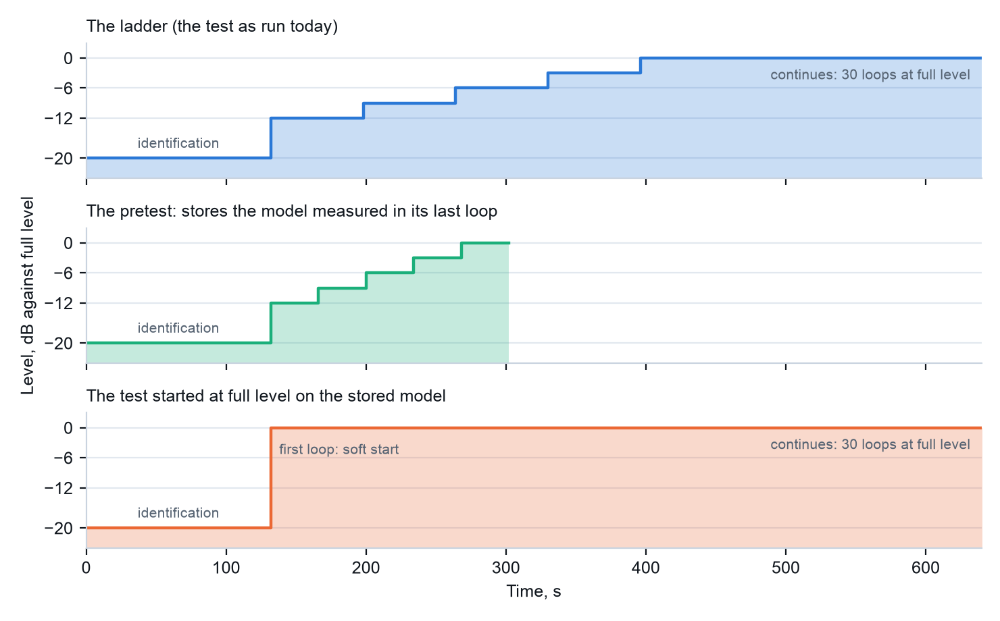

---
# Filled in by the editors at publication.
id: "2026-012"
version: 1
date: 2026-11-25
doi: "10.5281/zenodo.24526655"
doi_latest: "10.5281/zenodo.24526654"
note: First published.

# Filled in by the authors.
title: "A Model Finder for Multi-Shaker Random Vibration Tests: Store the Full-Level Model Once, Check It at Low Level, Start Each Test at Full Level. A Simulation Study"
type: Research Article
evidence: simulator
evidence_note: "Closed-loop runs through Hertzforge's control service on its simulator, on structures of the Open Benchmark Set's MIMO Random suite. No hardware test was made."
authors:
  - name: "Kevin Cross"
    orcid: "https://orcid.org/0009-0002-6608-9426"
    roles: ["Conceptualization", "Methodology", "Software", "Validation", "Formal analysis", "Investigation", "Data curation", "Visualization", "Writing: original draft", "Writing: review and editing"]
implemented_in: ""
benchmarks: "Hertzforge Open Benchmark Set: MIMO Random Suite, version 0.2 (DOI 10.5281/zenodo.24310742), Frames tier."
abstract: >
  A multi-shaker random vibration test is usually started at low level and stepped up, on a
  frequency response measured at low level. This article tests a model finder: the structure's
  frequency response at full level is measured once and stored, each later test checks the stored
  model against its own low-level identification, and then starts at full level on it. Every run is
  closed loop on Hertzforge's simulator, on structures of the Open Benchmark Set; no hardware test
  was made. With the minimum-drive law, a test on the stored model has a lower control error than
  the same test on the ladder in all eight cells run (100 problems), by 1.7 to 3.7 dB on square
  systems, with typical element stress lower or unchanged, provided the stored model's two parts
  share one timing. A model stored during an ordinary ladder test serves nearly as well as one from
  a dedicated pretest. Over ten tests the route takes 60 percent less time outside the dwell and
  about 40 percent less equivalent full-level exposure. The low-level check stopped every structure
  whose mode frequencies had moved 1 percent or more and passed every unchanged one, but it does not
  see a change in how strongly the structure depends on level. Two further hopes were not borne
  out: a rule fixed beforehand did not classify softening and hardening modes from the pretest's
  levels, and interpolating a model for a lower level added nothing: the full-level model used unchanged
  controlled as well or better down to -12 dB.
---

## Summary

A multi-shaker random vibration test is normally started low and stepped up to full level, on a
model of the structure measured at low level. This article tests a different way to run a series
of tests on one structure, called a model finder here. It has three steps:

1. **Store.** The structure's frequency response at full level is measured once and stored, either
   by a short pretest or during the first test of the series run in the ordinary way.
2. **Check.** Each later test begins with the usual low-level identification and compares it with
   the stored one. If the two differ by more than a set amount, the structure has changed and the
   test does not start at full level.
3. **Start at full level.** If the check passes, the test starts at full level on the stored model,
   with no level ladder.

Two further uses of the stored levels were tested: reading from them which modes soften or harden
with level, and interpolating a model for a level that was not measured. Every run is on
Hertzforge's simulator; nothing was tested on hardware.

What held:

- **The stored model beats the ladder.** With the minimum-drive control law, on 100 problems, the
  control error is lower on the stored model in all eight combinations of system and structure
  that were run: by 1.7 to 3.7 dB on square systems (49 of 50 structures) and by 0.25 to 0.6 dB
  where there are more control gauges than shakers (44 of 50). The typical element stress error
  is lower by 0.4 to 3.6 dB on the square systems and unchanged on the others. Four claims written
  beforehand held on 15 structures the study had never run.
- **A previous test can supply the model.** A model stored during the full-level loops of an
  ordinary ladder test, with no pretest, gave 1.96 and 2.78 dB against the ladder on the two
  systems tried (20 of 20 structures), against 2.39 and 3.24 dB for the pretest's model. It is
  nearly as good as the pretest's model, not better.
- **A series of tests sees less.** Outside the scored dwell, ten tests on ladders take 3,960 s and
  1,288 equivalent full-level seconds; ten tests on one stored model take about 1,590 s and 730 to
  770: 60 percent less time and 40 to 43 percent less equivalent exposure. For a single test a
  dedicated pretest costs more than it saves.
- **The low-level check catches a shifted structure.** It passed 20 of 20 unchanged structures and
  stopped 20 of 20 whose mode frequencies had moved by 1 percent, and 20 of 20 at 2 percent.

What did not hold:

- **The low-level check does not see a change in level dependence.** A structure whose softening
  and damping growth were made 1.5 times stronger passed the check on 19 of 20, because at low
  level it is nearly the same structure. Starting at full level on it cost 0.5 to 0.8 dB of
  control error.
- **The pretest's levels did not classify the modes.** A rule fixed beforehand called the
  direction of each mode's change with level correctly on 35 percent of the modes that change,
  and found the one hardening mode on 8 of 20 structures. The measurement itself had the right
  sign on 94 percent; the rule was the weak part. The gauges did not show where on the structure
  the hardening member sits.
- **Interpolation had nothing to add.** A model interpolated to a lower level reproduced the model
  measured there, at -3 dB and at -12 dB, but the full-level model used unchanged controlled as
  well or better at both. One full-level model served every level tried; a set of models indexed
  by level was not needed.

Two things decide whether the method works at all:

- **Timing.** The stored model is part full-level measurement and part low-level identification,
  and the two parts must agree on the signal path's delay. A first form of the pretest that read
  the delay from a correlation peak made the stored model worse than the ladder on two of three
  systems. A delay fitted from the pretest's own data removed the fault. The delay itself turned
  out to be a fault of the simulator, since corrected; with it corrected no timing correction is
  needed.
- **The control law.** Of eight laws, three are not moved by the stored model, four gain 0.8 to
  4.1 dB at the control gauges and pay 1.7 to 3.4 dB in stress, and one, the minimum-drive law,
  gains in both.

## 1. The Problem: The Model Is Measured at the Wrong Level

A multi-shaker random vibration test is run by a controller that holds a model of the structure: a
frequency response matrix, which says how much each response gauge moves, and with what phase, for
a unit of drive at each shaker, at each frequency line. The controller uses the model to work out
the drives that should give the response the test asks for, plays them, measures what came back,
and corrects. Each round of play, measure and correct is called a loop here.

The model is measured before the test, at a low level, so that the structure is not loaded before
anyone knows how it behaves. In this study that identification is about 20 dB below the test
level. A real structure does not behave the same at both levels. Bolted and sliding joints loosen
as the motion grows, which lowers resonant frequencies and adds damping; some members stiffen
instead. A model measured 20 dB down is a model of a slightly different structure from the one
under test at full level.

The usual answer is a level ladder. The test starts well below full level and climbs in steps, here
from -12 dB in 3 dB steps, and the control law corrects the drives at each step from what it
measures. The law is reacting: at every step it first plays a drive worked out from a model that is
no longer right, sees the error, and then corrects. On a strongly level-dependent structure the
first loop at full level can be far off, and the correction that follows starts from a poor model.

The idea tested here turns that around. Before the test, a short pretest takes the structure up to
full level once and measures its frequency response there. That model is stored. The test then
starts at full level on the stored model, with no ladder. The question is whether the test is
better for it, at the control gauges and in the stress the structure sees, and what the pretest
costs in exposure. The idea is the author's, proposed for Hertzforge as a "model finder"
step before a test.

A structure is rarely tested once. A qualification series runs several tests on the same article:
different axes, different spectra, repeats after an inspection. If the stored model is good for
one test it may be good for all of them, and then the series needs one measurement at full level
and not one ladder a test. That raises four further questions, which Sections 6 and 7 take up:

- whether the model can be stored during a test that was going to be run anyway, so that no
  separate pretest is needed;
- how much time and exposure a series of tests saves;
- whether a check at low level can tell, before each test, that the structure is no longer the one
  the model was stored for, since a loosened joint or a crack would make the stored model wrong
  and starting at full level on a wrong model is the risk the ladder exists to avoid;
- whether the models stored at each level say how the structure changes with level, well enough
  to name the modes that soften or harden and to work out a model for a level between the ones
  measured.

Three things could make it fail, and each is examined:

- the pretest itself has to reach full level on the low-level model, so it sees the very start-up
  the idea is meant to avoid, and it loads the structure;
- a model measured in one short loop at full level may be too noisy, or may be measured only in
  the drive directions the pretest happened to excite;
- the gain may belong to some control laws and not others.

## 2. The Method

### 2.1 The Three Runs Compared

Every comparison in this article is between two ways of running the same test on the same
structure with the same control law (@fig-method).

{#fig-method fig-alt="Three step plots of test level against time: the level ladder climbing in four steps to full level, the short pretest climbing in five, and the stored-model test going to full level after one soft-start loop."}

**The ladder.** The low-level identification, then loops at -12, -9, -6 and -3 dB, then 30 loops at
full level. Each loop is 64 frames of 2 s, taken with half overlap, 66 s in all. The model is the
identification's and is held for the whole run. This is the test as it is run today.

**The pretest.** The same identification, then one loop each at -12, -9, -6, -3 and 0 dB, each of
32 frames, 34 s. At each loop the pretest replaces its model with what that loop measured (Section
2.2). The model in force after the full-level loop is stored. The pretest uses the per-line
pseudo-inverse control law at its defaults, whatever law will run the test.

**The test on the stored model.** An identification again (the controller needs it for its own
checks), one soft-start loop, then 30 loops at full level on the stored model, which is held for
the whole run.

In both tests the model is held and not updated during the run. Hertzforge's control service can
update the model during a test; that is a different question, examined in the earlier study
[@randomlaws2026], and is left out here so that the only difference between the two tests is the
model they start from and how they reach full level.

### 2.2 What the Pretest Stores

A loop of random drive does not excite a structure equally in every direction. With several
shakers, the drives the control law plays at one frequency line are close to a few combinations of
the shakers, and the remaining combinations are barely driven. A frequency response measured from
that loop is good in the driven combinations and is noise in the others. Here these are called
the excited and the unexcited drive directions.

The pretest therefore replaces only the excited directions with the loop's measurement and keeps
the unexcited ones from the model it already has. After the full-level loop, the stored model is
the full-level measurement in the directions the test will drive, and the low-level identification
elsewhere.

### 2.3 The Two Parts Must Share One Timing

Keeping part of the model from one measurement and part from another only works if the two parts
agree on timing. A frequency response carries the delay of the whole signal path as a phase that
grows with frequency. If the path's delay is the same in both measurements, the two parts fit
together. If it differs by even a few samples, the stored model is two halves that disagree on
phase, and the drives worked out from it are wrong. A delay common to the whole model does no harm,
because it cancels when the drives are solved; a delay in only some directions does not cancel.

In the version of Hertzforge's simulator used for this study, the path's delay grew by 8 samples
when the closed loop engaged. That was a fault of the simulator, found during this work: drive
queued before a stop was played after the restart. It has since been corrected, and Section 5.1
shows that with the correction the delay is zero. It is kept in this account because it is how
the timing requirement was found, and because real equipment whose delay does change between the
identification and the test would do the same harm. The
first form of the pretest corrected for the delay by reading it again from the peak of a
correlation, and that reading was unreliable: on one system it read between -25 and +36 samples
where the answer was 8. Section 5.1 gives the evidence and what it did to the results.

The pretest used for the results of this article finds the delay from its own data. At each loop
it compares the response it measured with the response its held model predicts for the same
drives, in the excited directions only. If the two differ by a pure delay, their phase difference
is a straight line in frequency, and the slope of the line is the delay. One delay is fitted across
the whole band, each frequency line counting by how well the two agree there, and the loop's
measurement is shifted by it before it is merged. The fit also gives a strength between 0 and 1,
where 1 means every line agrees on one delay. Because the delay belongs to the equipment and not to
the loop, the pretest keeps the delay of the strongest fit so far and applies that. Nothing about
the simulator is supplied to the fit.

### 2.4 The Control Laws

The main results use the minimum-drive law (`min_drive`), one of the laws of the earlier study
[@randomlaws2026], because in a first comparison of eight laws it was the one that gained at the
control gauges without paying in stress (Section 5.4). Section 5.4 gives the other seven: the
band-average law, the per-line pseudo-inverse law, the shape-constrained and buzz-test-matched
laws, and the independent, nearly independent and Broyden congruence laws
[@hunterlaws2026].

### 2.5 A Model Stored During an Ordinary Test

The model need not come from a pretest. A test run on the level ladder also spends loops at full
level, and each of those loops can be merged into a stored model by the same rule: the excited
directions replaced by the loop's measurement, the others kept, with the fitted delay. For Section
6.1 the control service was given an option that builds this model at every loop and stores it
without using it, so the ladder test itself runs exactly as before (its results are identical,
loop for loop, with the option on or off). The stored model is the one built at the test's last
full-level loop.

### 2.6 The Check at Low Level

Every test in this study begins with a low-level identification, about 20 dB below the test level.
The check compares that identification with the one taken when the model was stored. One common
delay is fitted between the two and removed, and at each frequency line the difference between
the two frequency response matrices is divided by the size of the stored one. The check's reading
is the median of that ratio over the lines of the band. A reading of 0.02 means the two
identifications differ by 2 percent at the typical line. The test starts at full level only if the
reading is under a gate. The check costs nothing in exposure, because the identification is run
anyway.

### 2.7 A Map of How Each Mode Changes With Level

The pretest leaves six models of the structure: the identification and one after each of its five
loops, from -12 dB to full level. A resonance that falls in frequency as the level rises belongs to
a softening part of the structure, and one that rises to a hardening part. For Section 7.1 a modal
model was fitted to the identification, and each mode's frequency and damping were then fitted
again at each level, using only the drive directions that level's loop excited. A rule written
before any result was seen calls a mode softening or hardening when its frequency at full level
differs from its frequency at the identification by more than three times the scatter of the fit,
and level-independent otherwise.

### 2.8 A Model for a Level Between Two Measured Ones

Given the models at -6 dB and at full level, a model for -3 dB is worked out element by element:
its amplitude is the geometric mean of the two, which is a straight line in decibels of level, and
its phase is halfway between the two phases. Section 7.2 compares it with the model the pretest
measured at -3 dB.

## 3. The Structures and the Runs

**The structures.** The problems are the MIMO Random suite of the Open Benchmark Set, version 0.2,
Frames tier [@obsdata2026; @obs2026]: a frame article with jointed parts that soften as the level
rises and one member whose mode hardens. Each structure is generated from a whole number. Each is
run as a linear structure (both effects off), at a realistic size of the level effects, and at a
strong size. @fig-setups shows the article and where the shakers and gauges sit in each system.

{#fig-setups fig-alt="Six rendered views of a frame structure: the bare article, then the article mounted on its shakers in five arrangements, with control gauges, held-out gauges and tip gauges marked."}

**The systems.** A system is a count of shakers and control gauges on the frame, written shakers x
gauges. Four are used: two square ones, 6 x 6 and 12 x 12, and two with more control gauges than
shakers, 6 x 12 and 12 x 24. A fifth, 3 x 12, was run in the first pass and is left out of the
main results because the minimum-drive law does not control it on either run (control error above
20 dB with or without the pretest), so it says nothing about the pretest.

**The band and the target.** 20 to 2,000 Hz at 0.5 Hz spacing, 3,961 lines; the target is the
benchmark's full line target, a full spectral matrix with its cross terms at every line, except in
Section 5.4, where each law runs on the benchmark's banded target as in the studies of those laws.

**The checks.** Hertzforge's control service stops a test when its alarm and abort checks are
exceeded. Each comparison is run with the checks widened so that both runs finish and can be
scored; on the square systems the test on the stored model is run again with the checks at their
defaults, and the number of structures that finish is counted for both runs.

**The scores.** Each run is scored by the benchmark's scorer on its last full-level loops. Three
numbers are used, all in decibels, lower being better:

- the control error: the rms, over the control gauges, of the difference between the response and
  the target in third-octave bands;
- the typical element stress error: the rms over the structure's elements of the same difference
  for the stress the simulator computes, a measure of how the whole structure was loaded and not
  only the gauges the controller watches;
- the first full-level loop: the error at the control gauges the first time the run is at full
  level, before any correction at that level.

A comparison is always the difference between the two runs on the same structure, and a cell is
one system at one size of the level effects. Each cell is reported as the median difference over
its structures and the number of structures on which the stored model was better.

**How many structures.** A first pass ran 20 structures in every one of 15 cells. It was that pass
that exposed the timing fault of Section 2.3. The corrected results use a reduced set, sized from
the paired differences of the first pass: 10 structures a cell where the effect was above 1 dB,
which a paired test shows with 4 to 7 structures at the 5 percent level and 90 percent power, and
20 where it was a few tenths of a decibel. The ladder runs are those of the first pass; the code
with the new options off reproduces them exactly (Section 5.1).

The runs of Sections 6 and 7 follow the same rule: 20 structures each, on the 6 x 6 and 12 x 12
systems at the realistic size (and the strong size for Section 7.1), with what each was expected
to show written down before it was run. Where an expectation failed, the article says so.

## 4. What the Pretest Costs

The pretest is not free: it takes the structure to full level once more than the ladder does, and
it does so on the low-level model.

**Time.** Counted from the saved runs of the first pass (297 problems). Before its first scored
full-level loop, a test on the ladder has put 66 s at full level on the structure and 129
equivalent full-level seconds in all, where a second at a lower level counts by its power. The
pretest followed by the test on the stored model has put 134 s at full level and 167 to 169
equivalent seconds. The stored-model route therefore adds 68 s at full level, or 38 to 40
equivalent seconds: about 2 percent of this study's 1,980 s at full level. On a shorter test the
share is larger in proportion.

**Drive.** The pretest of Section 2.1 runs the per-line pseudo-inverse law, and on the square
systems that law reaches full level with far more drive than the minimum-drive test uses: 7 to 11
dB more, at the median, than the test's first full-level loop on the ladder (@fig-pretest-drive).
Where there are more control gauges than shakers the two are within 2 dB. A pretest that runs the
test's own law does not overdrive: its full-level loop is 0.3 to 1.8 dB below the test's. The
stress in the structure during the pretest was not recorded, so the drive is the only measure of
its severity here.

{#fig-pretest-drive fig-alt="Bar chart of the pretest drive relative to the test drive in six cells, for two pretests. The pseudo-inverse pretest is 7 to 11 dB higher on square systems; the minimum-drive pretest is slightly below zero everywhere."}

Whether the model stored by the gentler pretest serves the test as well is not settled. In the one
comparison made, it did not (control error 0.5 to 2.7 dB higher on the six cells), but that
comparison was made with the first form of the timing correction (Section 5.1), and a pretest that
excites fewer drive directions is the case in which that fault costs most. It has not been run
again with the fitted delay. The results below all use the pseudo-inverse pretest.

## 5. Results

### 5.1 The Timing Fault and Its Correction

The first pass of the study (300 problems, 20 structures in each of 15 cells) gave a split
result: the stored model was better than the ladder on the 6 x 6 system and worse on the 12 x 12
and 12 x 24 systems, by 0.9 to 1.9 dB at the median, on linear structures as well as
level-dependent ones. A loss on a linear structure cannot come from level dependence, because a
linear structure has the same frequency response at every level. Its cause was looked for in the
saved runs before anything was run again, with five possible causes written down first.

The stored models were compared with the simulator's true frequency response, direction by
direction. The error was in the strongly driven directions, not in the kept ones: relative error
1.1 to 1.4 with an in-phase gain near zero in the driven directions on the 12 x 12 system, against
0.07 to 0.44 and a gain of 0.92 to 1.0 in the kept ones. In the most strongly driven direction the
magnitude was right and the phase error was a pure delay, equal on every structure to 8 samples
less what the pretest had read as the change of delay. The pretest's reading was within one sample
of the truth on 11 of 20 structures on the 6 x 6 system, 3 of 20 on the 12 x 12 and 6 of 20 on the
12 x 24, and the size of the leftover delay went with the size of the loss (correlation 0.61 to
0.75 across structures).

Three checks confirmed it (@fig-timing):

- told the true delay, the pretest stored a model within 1.1 to 1.6 percent of the true response,
  and the test on it beat the ladder on every structure of the 12 x 12 and 12 x 24 linear cells
  and 19 of 20 on the 6 x 6;
- given the ladder's own model in place of the stored one, the stored-model test came within 0.26
  dB of the ladder, so the two runs differ in nothing but the model;
- with the delay fitted from the pretest's own data (Section 2.3) the result is the same as with
  the delay told: within 0.15 dB at the median in four of the five cells.

{#fig-timing fig-alt="Bar chart of the change in control error against the ladder in five cells for three forms of the pretest. The first form is above zero on the 12 x 12 and 12 x 24 systems; the two corrected forms are below zero in every cell."}

In the fifth cell, the 12 x 12 system at the realistic size, the fit as first built fell short: on
3 of 20 structures the fit at the first full-level loop was right (7.9 to 8.1 samples) and the
fits of later loops drifted, to between -0.2 and 23 samples, as their strength fell to between
0.36 and 0.55. Keeping the strongest fit of the run removed this: the cell went from 17 to 20 of
20 structures better than the ladder, and the 12 x 12 linear cell did not change. Keeping the
strongest fit was chosen after those three structures had been seen. Why the fit weakens after the
first loop on level-dependent structures was not examined.

With the new options off, the code reproduces the first pass exactly: 30 of 30 runs made again
gave the same loop-by-loop results.

**Where the delay came from.** The 8 samples were traced to the simulator: when it was stopped
after the identification and started again, the drive still queued from before the stop was played
first. A hardware station drops its queue on a stop, and the simulator now does the same. With
that correction, on the ten structures of the 12 x 12 linear cell, the delay the pretest fits is
zero (between -0.012 and +0.007 of a sample on every fit), and a pretest that applies no timing
correction at all gives the same result as the fitted one: within 0.18 dB on every structure, and
2.4 dB better than the ladder at the median on 10 of 10. The results of this article were run
before that correction, with the delay removed by the fit; the two routes agree on the one cell
where both were run, and the other cells were not run again. The fitted delay is therefore a
safeguard, for equipment whose delay does change, and not something every pretest needs.

Two points follow for anyone building a pretest of this kind. First, when part of a model is kept
from one measurement and part taken from another, their relative timing has to be measured, and a
single correlation peak is not a safe way to measure it. Second, the cost of getting it wrong grows
with the number of directions kept and with how poorly conditioned the model is: the 12 x 12
system keeps about half of its drive directions (median 53 percent) and has the worst-conditioned
model of the systems here (median condition number 136 against 12 to 25), and it lost the most.

### 5.2 The Stored Model Against the Ladder

With the fitted and held delay, the minimum-drive test started at full level on the stored model
has a lower control error than the same test on the ladder in all eight cells run
(@fig-stored-vs-ladder).

{#fig-stored-vs-ladder fig-alt="Paired bars for eight cells, control error on top and stress error below. The stored-model bar is lower than the ladder bar for control error in every cell, by most on the 12 x 12 system."}

- **Square systems.** The control error falls by 1.7 to 3.7 dB at the median: from 2.8 to 0.9 dB
  on the 6 x 6 linear cell, 3.7 to 1.2 dB on the 12 x 12 linear, and 7.9 to 3.3 dB on the 12 x 12
  at the strong size. It is lower on 49 of the 50 structures. The typical element stress error
  falls as well, by 0.4 to 3.6 dB.
- **More control gauges than shakers.** The gain is smaller: 0.6 dB on the 12 x 24 linear cell (10
  of 10 structures), 0.25 dB on the 12 x 24 realistic (15 of 20) and 0.5 dB on the 6 x 12
  realistic (19 of 20). The stress error does not change (within 0.1 dB).
- **Linear structures gain too.** On a linear structure the full-level model is the same model as
  the low-level one, measured again. The gain there is not from level dependence. The pretest's
  model is measured at a level 20 dB higher, so well above the noise, and in the directions the
  test drives; in those directions it was closer to the true response than the ladder's model
  (1.8 against 2.9 percent on the 12 x 12 system).

**The first full-level loop.** The ladder arrives at full level after four lower loops; the
stored-model test arrives there in one step. Its first full-level loop is nonetheless the closer
of the two in every cell: 0.8 against 1.5 dB (rms over the control gauges) on the 6 x 6 linear
cell, 2.0 against 3.4 dB on the 6 x 6 realistic, 4.8 against 6.5 dB on the 12 x 12 strong, and
0.1 to 0.4 dB closer on the 12 x 12 realistic cell and on the three cells with more control gauges
than shakers. It was the closer on 82 of the 100 structures.

### 5.3 With the Checks at Their Defaults

With the control service's alarm and abort checks at their defaults, many of these tests do not
finish on either run; the benchmark's structures are hard on purpose. On the cells where one of
the runs finishes at all, the stored-model test finishes more often: 8 of 10 structures against 3
on the 6 x 6 linear cell, 4 of 10 against 2 on the 6 x 6 realistic, and 5 of 10 against 2 on the
12 x 12 linear. On the 12 x 12 system at the realistic and strong sizes neither run finished on
any of the 10 structures.

### 5.4 Eight Control Laws

The same pair of runs was made with eight control laws on 20 structures of the 6 x 6 system (the
realistic and strong sizes, 10 each), with the benchmark's banded target, as in the comparison of those
laws on the benchmark [@randomlaws2026; @hunterlaws2026]. The pretest and the stored model are the
same for every law; only the law that runs the test changes (@fig-laws).

{#fig-laws fig-alt="Paired bars for eight control laws, control error on top and stress error below. Four laws fall sharply in control error on the stored model and rise in stress; three barely move; the minimum-drive law falls in both."}

The laws fall into three groups.

- **Laws the model does not move.** The band-average, shape-constrained and independent laws
  change by 0.1 to 0.3 dB at the control gauges and by less than 0.2 dB in stress. Each of these
  laws settles where its own rule puts it, whatever model it starts from. The band-average law has
  the lowest control error on the ladder of the eight (1.8 dB) and is not improved by a pretest.
- **Laws that gain at the gauges and pay in stress.** The per-line pseudo-inverse, buzz-test-matched
  and nearly independent laws fall from between 4.3 and 4.9 dB to about 0.9 dB at the control
  gauges, on all 20 structures, and their typical element stress error rises by 1.7 to 3.4 dB. The
  Broyden congruence law gains 0.8 dB and pays 2.1 dB. A better model lets these laws hold the
  gauges more exactly, and holding a few gauges exactly on a structure with more modes than gauges
  loads the rest of it harder.
- **One law that gains in both.** The minimum-drive law falls from 4.3 to 1.0 dB at the control
  gauges, on all 20 structures, and its stress error falls by 1.8 dB.

The stress penalty of the second group is not a timing effect: it was there with the first form of
the pretest and is the same size with the corrected one. So the value of the pretest depends on
the law it is paired with, and on these structures the pairing that is better on both counts is
the stored model with the minimum-drive law. Against the band-average law on a plain ladder, that
pairing is 0.8 dB lower at the control gauges and 1.4 dB higher in typical element stress.

### 5.5 Structures Held Back

Every structure above is one the study had already run and looked at. The benchmark keeps
structures 20 to 29 back for this purpose, and no run of this study had used them. Four claims
were written down, and then the ladder, the pretest and the stored-model test were run on
structures 20 to 24 in three cells, by a run that changed no setting and looked at no result
until all 15 problems had finished.

| System, realistic size | Ladder | Stored model | Median change | Structures better | Median stress change |
|:---|---:|---:|---:|---:|---:|
| 6 x 6 | 3.69 dB | 1.59 dB | -2.27 dB | 5 of 5 | -1.64 dB |
| 12 x 12 | 5.12 dB | 1.62 dB | -3.48 dB | 5 of 5 | -2.34 dB |
| 12 x 24 | 4.28 dB | 3.88 dB | -0.24 dB | 4 of 5 | +0.12 dB |

: The minimum-drive test on five held-back structures a cell: control error, and the change in
typical element stress error. {#tbl-held-back}

All four claims held: the stored model had the lower median control error in each cell; it was
better on at least 4 of 5 structures on the square systems and at least 3 of 5 on the 12 x 24; the
median stress change was no more than +0.3 dB; and the delay the pretest applied was within one
sample of 8 on at least 14 of the 15 problems (it was between 7.95 and 8.13 on all 15). Two things
the medians do not show: on two of the five 6 x 6 structures the control error fell while the
typical element stress error rose, by 4.4 and 1.7 dB; and one 12 x 24 structure was 0.01 dB worse
on the stored model. Five structures a cell is a check that the pattern holds on structures no one
had looked at. It is not a measure of each cell's spread.

## 6. The Model Finder Across a Series of Tests

### 6.1 A Model Stored During a Previous Test

The ladder test was run with the storing option of Section 2.5, and a second test was then started
at full level on the model it had stored. Ten structures each on the 6 x 6 and 12 x 12 systems,
realistic size, minimum-drive law (@fig-seed).

{#fig-seed fig-alt="Two bar charts, control error and stress error, for the 6 x 6 and 12 x 12 systems. The ladder bar is highest; the pretest-model and previous-test-model bars are both far lower and close to each other."}

- **Against the ladder.** The test on the model from a previous test has the lower control error
  on all 20 structures: by 1.96 dB at the median on the 6 x 6 system (3.77 to 1.57 dB) and by 2.78
  dB on the 12 x 12 (5.76 to 2.41 dB).
- **Against the pretest's model.** It is a little behind: 0.33 dB at the cell median on the 6 x 6
  and 0.14 dB on the 12 x 12. Structure by structure the 6 x 6 difference is larger, 0.61 dB at
  the median, and the pretest's model was the better on 8 of 10.
- **Stress.** The typical element stress error is no higher than with the pretest's model (0.24
  and 0.73 dB lower at the cell medians).

All three expectations written beforehand held: within 0.5 dB of the pretest's model at the cell
median, better than the ladder on at least 8 of 10, and stress no more than 0.5 dB higher.

So a full-level model does not need a dedicated pretest. The first test of a series, run the
ordinary way, can store it. The model it stores is not better than the pretest's, as had been
hoped. A likely reason, not tested: the minimum-drive law plays only one to three combinations of
the shakers at most lines, so the test refreshes only those directions of the model, and the rest
stays the low-level identification. The pretest's law drives more directions.

### 6.2 What a Series of Tests Puts on the Article

How much the article sees outside the scored dwell was counted from the saved runs of the 6 x 6
system (60 problems). Before its first scored loop:

- a test on the ladder takes 396 s, 66 s of it at full level, and 129 equivalent full-level
  seconds, where a second at a lower level counts by its power;
- the pretest takes 271 s, 68 s at full level, 101 equivalent seconds;
- a test started on the stored model takes 132 s, 66 s at full level, 67 equivalent seconds.

@fig-suite adds these up for a series of tests run three ways: a ladder for every test; one
pretest and then every test at full level; and the first test on a ladder with its model stored
(Section 6.1), the rest at full level.

{#fig-suite fig-alt="Two line charts against the number of tests in a series, from 1 to 20. Time and equivalent full-level seconds outside the dwell rise much faster for a ladder every test than for either stored-model route, which nearly coincide."}

- **One test.** A dedicated pretest does not pay: the same time, and 30 percent more equivalent
  exposure than the ladder.
- **Two tests or more.** Both stored-model routes are ahead from the second test. Over ten tests
  the ladders take 3,960 s and 1,288 equivalent seconds; one pretest and ten starts at full level
  take 1,591 s and 768; storing from the first test takes 1,584 s and 729. That is 60 percent less
  time and 40 to 43 percent less equivalent exposure outside the dwell.
- **As a share of the whole test.** The dwell is the same on every route, so the saving shrinks as
  the dwell grows. For ten tests, in equivalent full-level seconds, the series sees 28 to 30
  percent less with a 60 s dwell, 7 to 8 percent less with 600 s, and 2.5 to 2.7 percent less with
  this study's 1,980 s. In clock time the series is 52, 24 and 10 percent shorter.

These counts are of time and level only. The stress in the structure during the climb was not
recorded, so they do not show whether a ladder's low loops or a pretest's are the harder on the
article for their level (Section 4 gives the drive). They also assume the stored model stays
valid from one test to the next, which is what the check of Section 6.3 is for. Separately from
exposure, each test on the stored model also holds its target more closely during the dwell
(Section 5.2).

### 6.3 The Check at Low Level

Starting at full level on a stored model is only safe if the structure is still the one the model
was stored for. The check of Section 2.6 was tested on 20 structures (6 x 6 and 12 x 12,
realistic size). A model was stored for each by the pretest. The stored-model test was then run on
the same structure, and on four changed copies of it:

- every mode frequency below 3,000 Hz moved by a random amount, with a spread of 0.5, 1 or 2
  percent, to stand for a joint that has loosened or a part that has cracked or been refitted;
- the level effects (softening and the growth of damping) made 1.5 times stronger, with the
  low-level structure left as it was.

The gate was set from the unchanged and the 2 percent runs only, halfway (on a log scale) between
the largest reading of the first and the smallest of the second, before the other conditions were
looked at. @fig-reconcile shows every reading and what starting at full level anyway cost.

{#fig-reconcile fig-alt="Left: scatter of the check reading for five conditions on a log scale with a gate at 0.1; unchanged structures are well below it, shifted structures at or above it, and structures with stronger level effects below it. Right: bars of control error lost, growing with the size of the shift."}

- **Unchanged structures pass.** A repeat identification of the same structure, with fresh noise,
  reads 0.013 to 0.044. All 20 passed.
- **Shifted structures are stopped.** At 2 percent the reading is 0.23 to 0.54 and at 1 percent
  0.15 to 0.28; all 40 were stopped. At 0.5 percent the readings sit on the gate and 13 of 20
  were stopped. That is more sensitive than expected; it had been written beforehand that most of
  the 0.5 percent structures would pass.
- **A change in level dependence is not seen.** The structures with stronger level effects read
  0.033 to 0.105, two to three times an unchanged structure but under the gate, and 19 of 20
  passed. This was expected: at low level the two structures are nearly the same. The cost of
  starting at full level on them was 0.84 dB of control error on the 6 x 6 system and 0.52 dB on
  the 12 x 12, with the typical element stress error up by 0.58 and 1.80 dB. It had been written
  beforehand that the cost would be above 1 dB; it was not.
- **What a wrong start costs.** Started at full level regardless, the shifted structures lost
  0.1 to 0.3 dB of control error at 0.5 percent, 0.4 to 0.75 dB at 1 percent and 1.2 to 1.6 dB at
  2 percent. In every condition the stored-model test still ended closer to its target than the
  ladder did on the unchanged structure, by 1.1 to 3.2 dB at the median.
- **The reading is not a measure of the cost.** Across the 60 shifted cases the reading and the
  control error lost rise together (rank correlation 0.67; 0.7 had been written beforehand), but
  among structures with the same size of shift the reading says little about which will lose most
  (0.02 to 0.49).

The check therefore does the first job asked of it. A structure whose resonances have moved by 1
percent or more is caught at low level, before any drive at full level, and an unchanged structure
is not held up. It does not do a second job: it cannot tell that a structure will behave
differently at full level if it still behaves the same at low level. That case needs a check at
level, such as the first full-level loop compared with what the stored model predicts, which was
not built here. One caution on the counts: the gate was set on the same unchanged and 2 percent
runs it is scored on, so those two counts are not an independent test of it.

## 7. What the Stored Levels Say About the Structure

### 7.1 A Map of How Each Mode Changes With Level

The map of Section 2.7 was built for 20 structures (6 x 6 and 12 x 12; realistic and strong sizes)
and compared with the generator's record of how each mode truly changes. Two expectations were
written beforehand: the direction of change called correctly on at least 90 percent of the modes
that change by more than 0.5 percent, and the mode carrying the hardening member found and called
hardening on at least 15 of 20 structures. Both failed.

- **Direction.** Called correctly on 337 of 970 modes, 35 percent.
- **The hardening mode.** Found on 18 of 20 structures and called hardening on 8.
- **Coverage.** The map found 986 of the 1,388 true modes in the band, 71 percent. Most of the
  modes it missed have a neighbour within one bandwidth and cannot be separated by a fit of this
  kind. It also reported 102 modes that match no true one.

{#fig-map fig-alt="Line chart of mode frequency change against pretest level for about 45 modes of one structure. Most lines fall, mostly before the -12 dB loop, then flatten; one thick line rises at the top levels. True changes are marked at the right."}

The failure is in the rule more than in the measurement. Looked at after the scored result, and
so not a test in its own right:

- **The sign is there.** Setting the threshold aside, the measured change has the right sign on
  713 of the 761 tracked modes that truly change, 94 percent. Most of them were called
  level-independent because the threshold, three times the scatter of the fit, came out between
  0.4 and 5.9 percent of frequency, wider than the changes it was meant to detect.
- **The change is not spread over the levels as expected.** More than half of each mode's total
  change (0.54 at the median) appears between the identification and the -12 dB loop, and 0.02
  between -3 dB and full level (@fig-map). A change in proportion to drive amplitude would put
  0.17 in the first step and 0.32 in the last. The cause was not established. The pretest's
  control error is large in its early loops, so the level each mode actually saw may not be the
  nominal one.
- **Where, not only which.** The measured mode shapes are right: the gauge that moves most in the
  hardening mode is the true one on 17 of 18 structures. But that gauge is the one nearest the
  hardening member on only 6 of 18. Six or twelve gauges can say which modes change with level and
  where the article moves most in them. They cannot place a nonlinear part on a stretch of the
  article that carries no gauge.

### 7.2 Interpolating Between Levels

If the model changed smoothly with level, a model for an unmeasured level could be worked out from
its neighbours. The pretest was stopped after its -6 dB loop, after its -3 dB loop and after its
full-level loop on 20 structures, giving a measured model at each, and a model for -3 dB was
interpolated from the other two (Section 2.8). A test at 3 dB below full level was then run on
each of four models (@fig-interp).

{#fig-interp fig-alt="Bar chart of control error for a test at -3 dB on four models, for two systems. The four bars in each group are nearly equal."}

- **The interpolated model is as good as the measured one.** The control error on it is within
  0.03 dB of the test on the model measured at -3 dB, at the median, on both systems.
- **So is the full-level model, unchanged.** It gave 1.24 and 2.29 dB against 1.32 and 2.36 dB
  for the measured -3 dB model, and it was as good as or better than the interpolated model on 17
  of 20 structures.
- **The models are close together.** At the typical line the -6 dB and full-level models differ
  by 5 to 9 percent, and the interpolated model is within 3 to 6 percent of the measured one. It
  was closer to the measured model than both neighbours on 15 of 20 structures (all 10 on the 12
  x 12, 5 of 10 on the 6 x 6); 16 had been written beforehand.

Both expectations written beforehand failed as worded: the count above, and that the interpolated
model would do no worse than the full-level model. The reading is plain. Interpolation works, in
that it reproduces the measured model, but over the top 6 dB there is nothing for it to add: one
full-level model serves the whole span. Section 7.1 found most of the change below -12 dB, so the bottom of the range was tried next.

**Below -12 dB.** A test at 12 dB below full level was run on the same 20 structures, on five
models: the low-level identification, the model the pretest held after its -12 dB loop, a model
interpolated to -12 dB from the identification and the -6 dB model, the -6 dB model, and the
full-level model (@fig-low-span). Four expectations were written beforehand.

{#fig-low-span fig-alt="Bar chart of control error for a test at -12 dB on five models, for two systems. The identification bar is highest; the other four are much lower, with the full-level model lowest."}

- **Interpolation reproduces its target.** The interpolated model was closer to the pretest's
  -12 dB model than both of its neighbours on 20 of 20 structures, and the test on it was within
  0.1 dB of the test on that model. Both expectations held.
- **Any stored model beats the identification.** The pretest's -12 dB model lowered the control
  error of the -12 dB test by 1.3 dB on the 6 x 6 system and 1.9 dB on the 12 x 12. This
  expectation held.
- **The full-level model is the best of the five, even at -12 dB.** It gave 1.83 and 2.53 dB,
  against 1.99 and 3.17 dB for the pretest's -12 dB model and 3.25 and 5.11 dB for the
  identification. It had been written beforehand that the full-level model would be the worse of
  those two by more than 0.3 dB. It was the better.

One weakness of this test was stated beforehand and turned out large. The pretest overshoots its
low loops: its -12 dB loop played about 5 dB (6 x 6) and 8 dB (12 x 12) above that level at the
median. Its "-12 dB model" is therefore a model of somewhere near -7 to -4 dB, and a model truly
measured at -12 dB was not obtained.

Taken together, over the whole range tried, one full-level model controls as well as or better
than a model measured or interpolated for the lower level. On these structures the stored model
does not earn its gain by matching the level of the test. It earns it by being measured with the
loop closed, well above the noise of the low-level identification and in the directions the test
drives, which is also why linear structures gain (Section 5.2). A set of models indexed by level
is not supported by this study; one full-level model is enough.

## 8. Limits

- **Simulation only.** Every run is on Hertzforge's simulator. No test was made on hardware. The structures are those of one generator, with joints that
  soften and a member that hardens by rules chosen for the benchmark. A real joint can do things
  those rules do not: it can change the first time it is taken above its earlier maximum level,
  and its behaviour can depend on how long it has been shaken.
- **The delay.** The delay that made the timing matter here was a simulator fault, since corrected
  (Section 5.1); all results but one check were run before the correction, with the delay fitted
  out. The timing correction assumes one delay, common to every shaker, that does not
  change during a run. That is what the simulator has. Real converters and amplifiers may have
  delays that differ by channel or that are not a fixed number of samples; the fit would need one
  delay a channel, and that was not built or tested. Whether real equipment changes its delay at
  all when the loop engages is not known to the author.
- **The pretest's own safety.** The pretest reaches full level on the low-level model, by a short
  ladder of its own. On the square systems it gets there with 7 to 11 dB more drive than the
  minimum-drive test uses. The stress it puts in the structure was not recorded, and no response
  limit was applied in it. A pretest on the test's own law does not overdrive, but the model it
  stores has not been tested with the corrected timing (Section 4).
- **One target, one arrangement.** Every test in a series here has the same target and the same
  shakers and gauges as the run that stored the model. A series that changes axis, spectrum or
  gauge set between tests was not run, and a model stored for one arrangement does not carry to
  another.
- **The check at low level.** Its gate was set on the runs it is scored on and was not tried on
  others. The changed structures were made by two simple rules, a random shift of every mode and a
  uniform strengthening of the level effects; real damage is local and may look like neither. A
  change that shows only at level passes the check (Section 6.3).
- **The map.** One rule, fixed beforehand, on one kind of fit. That the sign of the change is
  right on 94 percent of modes was found after the rule had failed and has not been tested as a
  rule in its own right. The benchmark's level effects are smooth; a structure with impacts or
  rattles was not tried and is outside what a map of this kind can describe.
- **Interpolation.** The pretest overshoots its low loops by 5 to 8 dB, so the model it holds
  after its -12 dB loop is not a true -12 dB model, and the comparison at -12 dB is against that.
- **Shared structures.** The systems and sizes reuse the same structure numbers, so 20 structures
  across two systems are not 20 independent articles.
- **The model is held.** Neither test updates its model during the run. A law that updates the
  model during the test would close some of the gap by itself, at the price the earlier study
  measured.
- **How much was run.** The corrected results rest on 100 problems (10 or 20 structures a cell),
  one noise draw a problem, with the checks widened. The first pass of 300 problems carried the
  timing fault and is used here only for the ladder runs, the cost counts of Section 4 and the
  diagnosis of Section 5.1. Cells left out of the corrected pass: the strong size on the 6 x 6, 12
  x 24 and 6 x 12 systems, the linear 6 x 12, and the 3 x 12 system.
- **Not examined.** Why the delay fit weakens after the first full-level loop on level-dependent
  structures; why the 12 x 24 system loses more than the 6 x 6 from the same timing error; the
  stress during the pretest.
- **Random only.** Sine and shock tests are not covered.
- **The code.** The correction to the simulator's restart is in Hertzforge's main branch. The
  pretest's options used here (the fitted delay, the stored model, the option that stores a model
  during a test) are research options on a branch of Hertzforge and are not in a release. Sections
  6 and 7 were each run on 20 structures (40 for the map of Section 7.1), beside the 100 problems
  of Section 5.

## How This Was Made

The text, the figures and the code that draws them, the changes to the pretest in Hertzforge's
control service, and the study's runner and analysis scripts were written with Claude Code,
Anthropic's AI coding assistant, under Kevin Cross's direction. The author is responsible for
every word, number and line of code.

## Acknowledgments

The test problems and the scorer are those of the Hertzforge Open Benchmark Set.

## References
