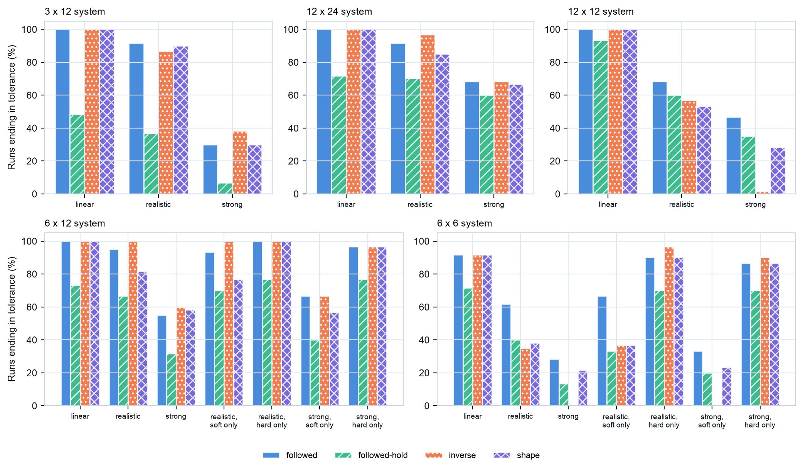
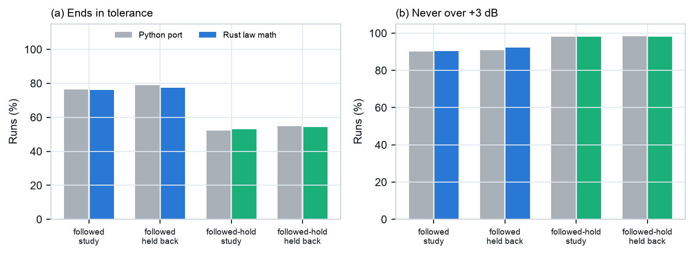

---
# Filled in by the editors at publication.
id: "2026-014"
version: 2
date: "2026-11-25"
doi: "10.5281/zenodo.24538548"
doi_latest: "10.5281/zenodo.24537417"
note: "The data and code READMEs give the DOIs of the suite and of the results record, which version 1 left as to be assigned. Nothing else changed."

# Filled in by the authors.
title: "Five Control Laws for Multi-Shaker Shock Testing: The Laws, Their Build in Hertzforge, and How Each Scores on the MIMO Shock Suite"
type: Research Article
evidence: simulator
evidence_note: "Closed-loop runs of five control laws on the Open Benchmark Set's MIMO Shock suite, draft 0.2: 380 generated structures on five systems with three targets, 1,140 runs a law, one sequence of measurement noise, each finding tested again on 230 held-back problems by an independent audit. Two laws ran as Hertzforge's Rust law mathematics, three as Python ports shown equal to their Rust laws to rounding (inverse and shape on two development structures, paired on six problems of the suite's first draft), all driven by the suite's own harness and simulator, not Hertzforge's control service."
authors:
  - name: "Kevin Cross"
    orcid: "https://orcid.org/0009-0002-6608-9426"
    roles: ["Conceptualization", "Methodology", "Software", "Validation", "Formal analysis", "Investigation", "Data curation", "Visualization", "Writing: original draft", "Writing: review and editing"]
implemented_in: ""
benchmarks: "Hertzforge Open Benchmark Set: MIMO Shock Suite, draft 0.2 (DOI 10.5281/zenodo.24526368): problems frame-12x3, frame-12x6, frame-24x12, frame-6x6 and frame-12x12, SRS, half-sine and sawtooth targets, linear, realistic and strong, structures 0 to 9, 12 to 15, 17, 19 and 32 to 35; softening only and hardening only on frame-12x6 and frame-6x6, structures 0 to 9; held back: structures 70 to 79 on every cell"
abstract: >
  Hertzforge, an open-source structural dynamics suite, has five control laws for shock tests with
  several shakers: three it ships (a waveform law through the regularized inverse, an SRS law that
  shapes each control gauge's target, and a decentralized law that pairs each gauge with one
  shaker) and two that follow a structure softening with level. This article describes each law,
  its build in Hertzforge's Rust law mathematics and how the study ran it, and how each scores on
  the MIMO Shock suite, draft 0.2, under Method 516.8's tolerances: 1,140 runs a law on 380
  structures, each finding tested again on ten held-back structures. No law is best under every
  reading. The followed law ends inside the SRS tolerance most often, 76.1 percent of its runs (77.4 percent held
  back); the followed law with the hold over-tests least, 98.1 percent of its runs never more than 3 dB over,
  but ends in tolerance in 53.0 percent, mostly because it stops at its probes; the inverse and shape laws
  end in tolerance in 69.9 percent each. Near full level, on a pulse at -3 dB or above, the shape law put
  the article more than 3 dB over the full-level target in 116 runs, the followed law in 96, the
  inverse law in 69 and the followed law with the hold in 19. The inverse law put the article more
  than 6 dB over in 204 runs, by up to 80.99 dB, 196 of them on pulses below -3 dB, mostly on square
  systems that soften. On square systems the inverse law meets the classical pulses' time-domain
  tolerance in 58.8 percent of its half-sine runs and 45.6 percent of its sawtooth runs, against 39.4 to 55.6 and
  30.6 to 31.9 percent for the SRS laws; of the runs that reach full level, in 96.9 and 89.0 percent. The
  decentralized law ends in tolerance in no run: on these coupled frames each gauge's own shaker is a
  small part of what moves it. Everything here is simulation.
---

## Summary

A shock test with several shakers plays a pulse on every shaker at once, measures every control
gauge, and corrects the next pulse. The rule that makes the correction is the control law. This
article describes five such laws in Hertzforge, how each is built and how the study ran it, and how
each scores on the MIMO Shock suite of the Open Benchmark Set, draft 0.2, proposed in a companion
article [@shocksuite2026]. The suite gives every law the same 380 problems on five systems, with
SRS, half-sine and sawtooth targets, and reads each run by Method 516.8's tolerances
[@mil810h2019; @mil810h2022] several ways. No law is graded as a whole; each result is stated under
each reading.

- **followed** ends inside the SRS tolerance at full level most often, in 76.1 percent of its 1,140 runs
  (77.4 percent on the held-back structures), and keeps 90.4 percent of its runs within 3 dB of the full-level
  target; 109 of its runs went more than 3 dB over, 96 of them on a pulse at -3 dB or above.
- **followed-hold** over-tests least: 98.1 percent of its runs are never more than 3 dB over, and 2 are
  more than 6 dB over. It ends in tolerance in 53.0 percent, because 428 of its runs stop at its probes
  before the ladder.
- **inverse** and **shape** each end in tolerance in 69.9 percent of their runs. inverse put the article
  more than 6 dB over the full-level target in 204 runs, by up to 80.99 dB, mostly below full level
  on square systems that soften; shape in 66, by up to 18.603 dB.
- **On SRS targets with the effective duration**, the whole of Method 516.8's SRS tolerance, inverse
  ends in tolerance slightly more often than followed, 47.6 against 44.7 percent (52.2 against 45.2 percent held
  back).
- **Over-tests near full level.** On a pulse at -3 dB or above, shape put the article more than
  3 dB over the full-level target in 116 runs, followed in 96, inverse in 69 and followed-hold in 19;
  more than 6 dB over in 14, 7, 8 and 1.
- **On square systems, classical pulses in time**: inverse, which corrects the waveform, meets
  Method 516.8's time-domain tolerance in 58.8 percent of all its half-sine runs and 45.6 percent of its sawtooth
  runs, the SRS laws in 39.4 to 55.6 and 30.6 to 31.9 percent. Of the runs that reach full level, inverse
  meets it in 96.9 and 89.0 percent, the SRS laws in 47.7 to 73.7 and 41.9 to 59.0 percent.
- **paired** ends in tolerance in no run. Each control gauge's own shaker is a median 8.1 to 17.5 percent
  of the sum of the other shakers' paths to it, so on these coupled frames the pairs work against
  each other. This follows from the law's design on these coupled frames, not from its port.
- **Implemented.** The mathematics of all five laws is on Hertzforge's main branch. followed and
  followed-hold were run as the Rust law mathematics, and all five are selectable laws in the
  application.

## 1. The Test and the Laws' Common Frame

A shock test on a shaker does not run continuously. Each pulse starts with the article at rest;
the controller plays a drive record on every shaker, measures every control gauge, and between
pulses computes the next drive. The test climbs a ladder of levels below full level, so that a
wrong drive is found while it is still small, and ends with pulses at full level [@negative2026]. A
law sees the article only through the small-signal frequency response measured before the test and
through the pulses it has played.

All five laws work on the same objects. The model is a stack of complex matrices, one per spectral
line of the record, mapping drive spectra to control spectra. Drives and errors are held at full
level and divided by the pulse's scale, so a step in level is a rescaling and nothing else. Each law
produces the next pulse's drives from the last pulse's records, and none uses a clock, a thread, a
file or a random number, so the same code runs as a native law and as a law file built for
WebAssembly.

## 2. The Five Laws

### 2.1 `inverse`

inverse corrects the waveform. Its first drive is the regularized inverse of the model applied to the
reference: per line, $G = (\hat{H}^{H} \hat{H} + \mu^{2} I)^{-1} \hat{H}^{H}$ with $\mu$ a fraction
(1e-3) of the line's largest singular value, and $D_{0} = s\,G R$ at the level's scale $s$. After each
pulse, with the drive $D$ and the response $Y$ at full level, the error $E = R - Y$ corrects the
drive:

$$
D_{k+1} = D_{k} + g(f)\, G\, E_{k}
$$ {#eq-inverse}

A watchdog keeps the gain $g(f)$ per line. It smooths the error energy over 9 lines; on a line whose
smoothed energy grew by more than 5 percent since the last pulse it halves the gain, and elsewhere it
restores the gain by a factor of 1.2 a pulse, never above 1. This is the standard iterative
frequency-domain correction of time waveform replication with a per-line guard. The law never looks
at the SRS: if it reproduces the reference waveform, the SRS follows.

### 2.2 `shape`

shape corrects the SRS and forms no waveform error at all. It keeps a real, positive gain $C_{c}(f)$
and a delay $\tau_{c}$ per control gauge. After a pulse, with the measured SRS $S_{c}$ and the target
$T_{c}$ at the SRS's natural frequencies,

$$
C_{c}(f) \leftarrow C_{c}(f) \cdot \mathrm{interp}_{f}\!\left[ \left( T_{c} / S_{c} \right)^{w} \right]
$$ {#eq-shape}

with the ratio taken in decibels, limited to ±6 dB a pulse, and carried to the spectral lines by
linear interpolation in log frequency. The next drive is the model's regularized inverse applied to
the shaped references, $D = s\,G\,(C \circ R(\tau))$; the delays are re-estimated from the measured
response by cross-correlation and relaxed by half. The weight $w$ depends on the level just played:
0.5 at -12 dB, 0.72 at -9 dB, 0.82 at -6 dB and 0.85 at -3 dB and above. With one shaker this is the
single-drive practice that Coleman, Smallwood and Skousen describe for Sandia National Laboratories'
controller: the SRS ratio corrects the magnitude of the drive with a weight below 1.0, from about
50 percent at -12 dB to 80 to 90 percent at full level [@coleman2016]. A correction of the targets of several
drives by their SRS ratios with a model measured once is published in a patent application
[@zheng2022]. The model is never updated.

### 2.3 `paired`

paired is the simplest law and the template a contributor copies. Each control gauge is paired with
one shaker; on these systems control gauge $c$ with shaker $c$, for as many gauges as there are
shakers. The first drive inverts that one path, the pair's own frequency response. After each pulse, that
shaker's drive spectrum is scaled per line by the ratio of wanted to measured magnitude at its
gauge, smoothed over 15 lines, raised to the weight 0.8 and limited to 6 dB a pulse. Nothing else of
the model is used, so the law cannot know that a shaker also moves the other gauges. On systems
with more control gauges than shakers, the unpaired gauges have no shaker of their own.

### 2.4 `followed`

followed is shape on a family of models that follows the structure's softening. Instead of the
single measured model it inverts a family: copies of the model with every resonance lowered by none,
half and all of an assumed drop, and the drive is the one least wrong on average over the copies
[@negative2026]. The assumed drop is fitted per octave band from the pulses at each level as the
downward stretch of the model that best explains the pulse; the stretch is found by a warp of the
identification seen at a complex frequency, with no modal fit. The drop is carried to the next level
as a power, at most one, of the response amplitude, times a margin of 1.5, and never more than a
ceiling of 12 percent. It only widens, and changes only on a step up in level. Two probes at -40 and
-34 dB come before the ladder, so the law sees how the article responds before the climb.

### 2.5 `followed-hold`

followed-hold is followed with no ceiling and three additions, each a setting:

- **the probe check**: before each probe, its SRS is predicted through the identification; when the
  prediction plus the measured prediction error, carried in amplitude, is more than 3 dB over, the
  probe is scaled down;
- **the power bound**: a power measured from two levels' drops that are both at least 0.5 percent is
  rounded up by what the fit cannot resolve, half its fine step on each drop, before it is carried
  up in level;
- **the hold**: on a repeat pulse at the same level whose every SRS point at every control gauge is
  within 3 dB of its target, the gains and delays are kept, so the same drive plays again.

The earlier article in this journal that reports ideas for shock control that did not work calls
these two laws the followed family with its ceiling and the hold rule, and reports how they were
developed [@negative2026].

### 2.6 The Screen, and the Law Left Out

A screen chose which candidates entered the study. It ran six laws on 12 problems: structures 0, 1
and 2 on the 6 x 6 and 6 x 12 systems, at the realistic and strong sizes, three targets and one
noise sequence, 36 runs a law. On it followed and followed-hold ended in tolerance in 63.9 and 66.7 percent
of their runs and none of their runs was ever more than 3 dB over; inverse and shape ended in
tolerance in 47.2 percent each and kept 63.9 and 97.2 percent of their runs within 3 dB; paired ended in tolerance
in none and kept none within 3 dB.

The sixth law, srs-design, designs each drive by optimization: per control gauge a gain and a delay
at each SRS point, chosen so that the response the identified model predicts from rest meets the SRS
target, with a check that declines a pulse predicted more than 3 dB over and a stop after a pulse more
than 3 dB over. It hands square systems to followed-hold, so it ran on the 6 x 12 system only, 18
runs. It ended in tolerance in 38.9 percent and kept 88.9 percent within 3 dB. On the realistic size it tied shape;
on the strong size it was the worst law but paired; 11 of its 18 runs were stopped by its own
over-test rule after a first pulse more than 3 dB over; and its median run took 64.77 s against 2.855
to 10.86 s for the others. It was left out of the study and stays a Python research port.

## 3. Their Build in Hertzforge, and How the Study Ran Them

### 3.1 What Is on Hertzforge's Main Branch

The mathematics of all five laws is in Hertzforge's crate `hertzforge-mimo-shock-law-math`: inverse
in `inverse.rs`, shape in `shape.rs`, paired in `paired.rs`, and followed and followed-hold in
`followed.rs`, with the softening family in `softening.rs` and the warp in `warp.rs`. followed and
followed-hold were added by Hertzforge pull request 428, merged to the main branch on 22 November
2026.

The application's shock control service lets the operator choose among the laws it ships: inverse,
shape and paired, and since merge commit `5f5b5d8d5fddcfa891dfdd519c6c9044f301b644` (Hertzforge#462) followed and followed-hold.
The selectable followed and followed-hold call the same law mathematics the study ran.

### 3.2 How the Study Ran Them

The study did not run Hertzforge's control service or its ladder. It ran every law through the
suite's own harness, the Python program that plays the ladder of the suite's specification and the
suite's simulator [@shocksuite2026]:

- **followed and followed-hold** ran as the Rust law mathematics, built into a library that the
  harness calls closed loop. The library is the crate at the commit the study ran on, with a small
  bridge of its own; its SHA-256 hash is recorded in the results record.
- **inverse, shape and paired** ran as Python ports of their Rust laws. Section 3.3 shows that each
  port was shown equal to its Rust law to rounding, and on what.

So the results are of the law mathematics that is on the main branch, run by the suite's harness.
Hertzforge's control service adds what a controller around a law adds: its own ladder, its own
checks before a pulse and the operator's choices. None of that was tested here.

### 3.3 Parity of the Ports With the Rust Laws

**inverse and shape.** Each port was compared with its Rust law closed loop, through a bridge to the
Rust code built from an earlier Hertzforge commit, `50ee56ad` (main's `shape.rs` has since gained a
hold, off by default, which was not compared), on two development structures of the earlier study, `linear` and `moderate` (a structure
whose modes fall by up to 3 percent with level) [@negative2026], with the same identification and ladder and
no measurement noise. The largest relative difference in drive was 2.2e-12 and the largest
difference in a pulse's over-test 1.5e-12 dB: equal to rounding.

**paired.** The port was compared with the Rust law on six problems of the suite's first draft, the
6 x 6 and 6 x 12 systems at each size, through the Rust crate's own law. The largest relative difference in drive
was 1.5e-9.

**followed: the port's own warp choices.** The Python port of followed is a restatement of the
warp, the family and the fit in NumPy. On `moderate` it differed from the Rust law by 0.0811 in
relative drive and 0.2006 dB in over-test; on `linear`, where there is no drop to fit, the two were
equal to rounding (6.4e-14). Read side by side, the two differ in the warp's choices, not in the
method: the port warps on 19 knots from 40 to 2,560 Hz and the Rust law on 36 knots from 40 to
2,280.7 Hz; the port's warped band is wider; and the port fits a delay on each row (up to 0.4688 ms)
where the Rust law fits none. With only the port's warp changed to the Rust choices, the port equals
the Rust law to 3.5e-10 in drive and 2.9e-10 dB in over-test on `moderate`. Changed one at a time, the
knots alone leave 0.0123 and 0.0083 dB, the warped band alone 0.0800 and 0.1971 dB, the delay alone
0.0390 and 0.2060 dB. The difference is the warp choices, all of it.

**followed through the closed-loop library.** The Rust followed, called through the library the
study used, equals the bridge's followed with a largest drive difference of 0 on `moderate`, on
`linear` and on one suite problem. followed-hold equals its Python port with the port's warp changed
to the Rust choices, to 3.5e-10 in drive and 2.9e-10 dB on `moderate`, with the probe check not
firing in that comparison (Section 6).

The study first ran followed and followed-hold as the ports. When the comparison above found that
the port's warp differs, the two laws were run again as the Rust law mathematics. Before the study, the rule was that a Rust build had to
reproduce every port run, the same end and pulse count with every pulse's over-test within 0.05 dB.
It does not: the warp choices change single runs (Section 5.7). The results here are the Rust laws',
which are the laws as implemented.

## 4. The Study

The study ran every law on every problem of the MIMO Shock suite, draft 0.2 [@shocksuite2026;
@shockdata2026], the Random study's matrix [@scores2026]: five systems (3 x 12, 6 x 12 and 12 x 24
with more control gauges than shakers; 6 x 6 and 12 x 12 square), the linear structure and the
realistic and strong sizes of change with level on structures 0 to 9, 12 to 15, 17, 19 and 32 to 35,
and the softening-only and hardening-only variants on the 6 x 12 and 6 x 6 systems on structures 0
to 9. That is 380 structures with three targets each, SRS, an 11 ms half-sine and an 11 ms
terminal-peak sawtooth, 1,140 runs a law and 5,700 runs in all. Every law gets the same ideal
small-signal identification and measurement noise of 1e-3 of the reference's RMS from one noise
sequence (11), and runs at its defaults. Two problems, structure 8 and held-back structure 74 on the
6 x 6 system at the strong size with softening only, were made again after a fix to the suite's
full-level sizing, and every run on them was run again; every number here is from the corrected
problems [@shocksuite2026].

An independent audit ran the same matrix on ten structures held back from the study (70 to 79): 230
problems, 690 runs a law, 3,450 in all, with the same code and settings [@shocksuite2026].

The readings are the suite's [@shocksuite2026]. *Strict* is the seven run criteria of the earlier
study [@negative2026]. *Ends in tolerance* is the last full-level pulse inside Method 516.8's SRS
point tolerance at every control gauge: -1.5/+3 dB on at least 90 percent of the twelfth-octave points from
10 to 2000 Hz, every point within -3/+6 dB. *Ends with TE* adds the effective duration within 0.8 to
1.2 of the target's, by the standard's Annex A, for SRS targets: the whole of Method 516.8's SRS
tolerance. *Ends within -3/+3 dB* holds every point within -3/+3 dB. *Level* is the mean SRS error within 1.5 dB
and no point over +6 dB. *Exposure* is the safety reading: no pulse or probe ever more than 3 dB over
the full-level target. *Time domain* is Method 516.8's tolerance of a classical pulse in time.

The Rust runs of followed and followed-hold took 54 min 43 s for the study and 43 min 55 s for the
audit; the runs with the effective duration by Annex A, of every SRS target, were rerun with every
other reading unchanged [@shocksuite2026].

## 5. Results

### 5.1 How Often Each Law Works

@fig-readings gives each law's share of runs under each reading. On the study's structures followed
ends in tolerance in 76.1 percent of its runs, inverse and shape in 69.9 percent each, followed-hold in 53.0 percent and
paired in none. The order holds on the held-back structures: 77.4, 73.3, 72.9, 54.3 percent and 0. Under
the strict criteria the order is the same, lower: 62.1, 59.2, 59.7, 49.4 and 0 percent (study). The Level
reading gives nearly the shares of ending in tolerance.

The safety reading orders the laws differently. followed-hold keeps 98.1 percent of its runs within 3 dB of
the full-level target, followed 90.4 percent, shape 82.4 percent, inverse 74.8 percent and paired 0.4 percent. The law that
ends in tolerance least often of the four laws that end in tolerance in any run is the one that
over-tests least, and the law that ends in tolerance most often keeps 90.4 percent of its runs within 3 dB
and has 109 runs more than 3 dB over.

The -3/+3 dB reading lowers every law's share and lowers shape's most: followed 69.1 percent, inverse
65.5 percent, shape 62.1 percent, followed-hold 51.7 percent (study).

{#fig-readings fig-alt="Grouped bars, six groups along the horizontal axis (strict criteria; ends in tolerance; ends in tolerance with TE on SRS; ends within minus 3 to plus 3 dB; Level reading; never over plus 3 dB), five bars per group for followed, followed-hold, inverse, shape and paired, share from 0 to 100 percent on the vertical axis, with black diamonds for the held-back structures. Strict: 62, 49, 59, 60 percent, 0. Ends in tolerance: 76, 53, 70, 70 percent, 0. With TE: 73, 52, 68, 67 percent, 0. Within minus 3 to plus 3: 69, 52, 66, 62 percent, 0. Level: 76, 53, 70, 70 percent, 0. Never over plus 3 dB: 90, 98, 75, 82 percent, near 0. The diamonds lie on or a little above the bars." data="data/law_readings.csv"}

### 5.2 Cell by Cell

@fig-cells-law gives the share ending in tolerance in every cell of the matrix for the four laws that
end in tolerance in any run. On the linear structure every one of them ends in tolerance in every run
on most systems, except followed-hold, which stops at its probes in many runs even there (48.3 percent on the
3 x 12 system).

Where the structure changes with level, the laws separate by system. On the square 6 x 6 system at
the realistic size followed ends in tolerance in 61.7 percent of its runs, followed-hold 40.0 percent, shape 38.3 percent
and inverse 35.0 percent; at the strong size 28.3, 13.3, 21.7 and 0 percent; with softening only at the strong
size 33.3, 20.0, 23.3 percent and 0. On the 12 x 12 system at the strong size followed reaches 46.7 percent and
inverse 1.7 percent. inverse ends in tolerance in no run on the strong 6 x 6 cells, and on the same cells
keeps only 5.0 percent (both effects) and 0 (softening only) of its runs within 3 dB.

On systems with more control gauges than shakers inverse ends in tolerance as often as followed or
more often in 9 of the 10 cells that change with level: ahead in 5, by 2 to 5 runs of 30 or 60 (for
example 100 against 95.0 percent on the 6 x 12 system at the realistic size, 96.7 against 91.7 percent on the
12 x 24 system at the realistic size and 38.3 against 30.0 percent on the 3 x 12 system at the strong size),
and tied in 4. followed is ahead on the 3 x 12 system at the realistic size, 91.7 against 86.7 percent.
These differences are a few runs on one noise sequence; the held-back structures agree in
direction.

With hardening only, every law ends close to its linear share: on the 6 x 6 system at the strong size
followed 86.7 percent, followed-hold 70.0 percent, inverse 90.0 percent and shape 86.7 percent. What separates the laws is the
softening.

{#fig-cells-law fig-alt="Five panels of grouped bars, one per system, four bars per cell for followed, followed-hold, inverse and shape. 3 x 12: linear 100, 48, 100, 100 percent; realistic 92, 37, 87, 90 percent; strong 30, 7, 38, 30 percent. 12 x 24: linear 100, 72, 100, 100 percent; realistic 92, 70, 97, 85 percent; strong 68, 60, 68, 67 percent. 12 x 12: linear 100, 93, 100, 100 percent; realistic 68, 60, 57, 53 percent; strong 47, 35, 2, 28 percent. 6 x 12, seven cells: linear 100, 73, 100, 100 percent; realistic 95, 67, 100, 82 percent; strong 55, 32, 60, 58 percent; realistic softening only 93, 70, 100, 77 percent; realistic hardening only 100, 77, 100, 100 percent; strong softening only 67, 40, 67, 57 percent; strong hardening only 97, 77, 97, 97 percent. 6 x 6, seven cells: linear 92, 72, 92, 92 percent; realistic 62, 40, 35, 38 percent; strong 28, 13, 0, 22 percent; realistic softening only 67, 33, 37, 37 percent; realistic hardening only 90, 70, 97, 90 percent; strong softening only 33, 20, 0, 23 percent; strong hardening only 87, 70, 90, 87 percent." data="data/law_cells.csv"}

### 5.3 Safety

An over-test is the article driven harder than the full-level target. The counts below are of runs
in which any pulse or probe put any control gauge more than 3 dB, or more than 6 dB, over the
full-level target (@fig-safety).

- **inverse** over-tested by more than 6 dB in 204 of its 1,140 runs on the study's structures, and
  by more than 3 dB in 287. In 196 of the 204 the pulse was below -3 dB, so that pulse was more than
  9 dB over its own level's target. Of the runs over 3 dB, the median
  largest exposure was 10.891 dB and the largest 80.99 dB. On the held-back structures: 117 runs over
  6 dB, the largest 97.496 dB. The over-tests are concentrated on the square systems where the
  structure softens (Section 5.2). The law corrects the waveform through the small-signal inverse of
  a structure that has since softened, and its watchdog did not stop these runs; where in the loop
  each went wrong was not isolated.
- **shape** over-tested by more than 6 dB in 66 runs and by more than 3 dB in 201, by up to 18.603 dB;
  on the held-back structures 45 and 128, up to 18.124 dB.
- **followed** over-tested by more than 6 dB in 14 runs and by more than 3 dB in 109, by up to
  11.153 dB; held back, 6 and 53, up to 9.509 dB.
- **followed-hold** over-tested by more than 6 dB in 2 runs and by more than 3 dB in 22, by up to
  7.308 dB; held back, 2 and 13, up to 9.509 dB.
- **paired** over-tested by more than 6 dB in 1,131 of its 1,140 runs, with a median largest exposure
  of 25.761 dB and a largest of 57.901 dB; held back, 683 of 690, up to 62.08 dB. Every one of these
  was on a pulse below -3 dB (Section 5.6).

The SRS laws' over-tests are mostly on pulses near full level: 116 of shape's 201 runs over 3 dB and
96 of followed's 109 were on a pulse at -3 dB or above. inverse's more-than-6 dB over-tests are
mostly far below it, 196 of 204, but 69 of its runs were more than 3 dB over on a pulse at -3 dB or
above, more than followed-hold's 22 runs over 3 dB in all.

{#fig-safety fig-alt="Two panels of stacked bars, the five laws along the horizontal axis, runs from 0 to 1,200 on the vertical axis. (a) More than 3 dB over: followed about 109 (96 solid), followed-hold 22 (19 solid), inverse 287 (69 solid, the rest hatched), shape 201 (116 solid), paired 1,136 all hatched. (b) More than 6 dB over: followed 14, followed-hold 2, inverse 204 (8 solid), shape 66 (14 solid), paired 1,131 all hatched. Black diamonds for the held-back structures sit close to the top of each bar." data="data/law_safety.csv"}

### 5.4 How the Misses Miss

A run that does not end in tolerance either reached full level and missed there, or stopped below
full level because six pulses at one level failed to pass. @fig-misses shows which. For each of the
four laws that end in tolerance in any run, almost every miss is a run that stopped short:

- **followed**: 867 runs end in tolerance; 266 stopped below full level, 80 of them at a probe; 7
  missed at full level, by a median 1.31 dB beyond the tolerance and at most 7.19 dB.
- **followed-hold**: 604 end in tolerance; 534 stopped below full level, 428 of them at a probe; 2
  missed at full level, by at most 1.31 dB. Why each of the 428 stopped at a probe was not broken
  down. The median highest level its stopped runs reached is -34 dB, the second probe.
- **inverse**: 797 end in tolerance; 336 stopped below full level; 7 missed at full level, by at most
  3.55 dB.
- **shape**: 797 end in tolerance; 329 stopped below full level; 14 missed at full level, by a median
  0.695 dB and at most 4.93 dB.
- **paired**: every run stopped below full level, the median at -12 dB, the first ladder level.

The median highest level of the stopped runs is -12 dB for followed, inverse and shape: most stop at
the first ladder level. A run that stops short has not over-tested the article by that fact; it has
not tested it. The held-back structures show the same pattern (@fig-misses, lower bars).

{#fig-misses fig-alt="Ten horizontal stacked bars, two per law, share of runs from 0 to 100 percent. followed study: 76 percent in tolerance, about 1 percent at full level outside, 16 percent stopped below full level, 7 percent at a probe; held back about the same. followed-hold study: 53 percent in tolerance, 9 percent stopped below full level, 38 percent at a probe; held back about the same. inverse study: 70 percent in tolerance, 1 percent at full level outside, 29 percent stopped below full level. shape study: 70 percent in tolerance, 1 percent at full level outside, 29 percent stopped below full level. paired: the whole bar stopped below full level." data="data/law_misses.csv"}

### 5.5 By Target: SRS, Effective Duration and the Classical Pulses in Time

**Ending in tolerance by target** (@fig-targets-law a). All four laws do best on half-sines and worst
on SRS targets. On half-sines followed ends in tolerance in 91.3 percent of its runs, shape 89.5 percent, inverse
82.1 percent and followed-hold 77.4 percent; on sawtooths 83.4, 74.2, 75.0 and 66.8 percent; on SRS targets 53.4,
46.1, 52.6 and 14.7 percent. followed-hold's low share on SRS targets is its stops at the probes.

**The effective duration** (@fig-targets-law b). For SRS targets, Method 516.8's tolerance includes
the effective duration. With it, inverse ends in tolerance in 47.6 percent of its SRS runs, followed 44.7 percent,
shape 37.6 percent and followed-hold 12.6 percent (held back 52.2, 45.2, 40.9 and 14.3 percent). Of their runs that
reached full level on SRS targets, inverse kept its TE within tolerance in 90.3 percent, followed 83.7 percent,
shape 79.2 percent and followed-hold 85.7 percent. One reading, not tested: a law that corrects the waveform keeps
the waveform's duration, while a law that corrects only the SRS can meet the SRS with a pulse that
rings longer or shorter. Of the
full-level misses of TE, the median ratio to the target's TE at the furthest control gauge is 1.27
for followed and 1.22 for inverse; inverse's largest is 14.66.

**The classical pulses in time** (@fig-targets-law c). Method 516.8 judges a classical pulse in
time. The suite's companion article shows that on systems with more control gauges than shakers the
projected sawtooth target itself cannot meet the time-domain tolerance, so the reading is reported
here for the square systems only [@shocksuite2026]. There, of the runs with a last full-level pulse,
inverse meets the whole time-domain tolerance at every control gauge in 96.9 percent of its half-sine runs
and 89.0 percent of its sawtooth runs; followed-hold 73.7 and 55.4 percent; followed 65.0 and 41.9 percent; shape 47.7
and 59.0 percent. What the SRS laws miss is the waveform: followed's half-sines are inside the ±20 percent band
around the peak in 67.2 percent of these runs and shape's in 64.4 percent, and shape's compensation pulses inside
their band in 49.2 percent, against 100 and 96.9 percent for inverse. The SRS laws were built to meet an SRS, and
they do; the time history that meets it is not the classical pulse's.

{#fig-targets-law fig-alt="Three panels of grouped bars for followed, followed-hold, inverse and shape. (a) Half-sine 91, 77, 82, 90 percent; sawtooth 83, 67, 75, 74 percent; SRS 53, 15, 53, 46 percent. (b) SRS ends in tolerance 53, 15, 53, 46 percent; and TE within 0.8 to 1.2: 45, 13, 48, 38 percent. (c) Half-sine 65, 74, 97, 48 percent; sawtooth 42, 55, 89, 59 percent. Black diamonds for the held-back structures lie close to the bars." data="data/law_targets.csv data/law_te_srs.csv data/law_classical_time.csv"}

### 5.6 `paired` on Coupled Frames

paired ends in tolerance in no run, and over-tests in nearly every one. This follows from the law's
design on these coupled frames, not from its port. The port equals the Rust law (Section 3.3). On six problems of the suite, one of
each system class and size, the pair's own path is a median 0.081 to 0.175 of the sum of the other
shakers' paths to the same gauge, so a gauge is moved mostly by shakers the law does not account for.
In the frame's own linear model, the law's first drive misses each control gauge's RMS by 10.2 to 50.0 dB
before any pulse is played, and on the 6 x 12 system six of the twelve control gauges have no shaker
of their own. The law leaves coupling out by design, and on these strongly coupled frames it ended
in tolerance in no run.
On a system whose shakers each move mostly their own gauge it could; none is in the suite.

### 5.7 The Rust Laws Against the Python Ports

@fig-port compares the two runs of followed and followed-hold. Overall the laws moved little. On the
study's structures followed ends in tolerance in 76.4 percent of its runs as the port and 76.1 percent as the Rust
law, and is never more than 3 dB over in 90.2 and 90.4 percent; followed-hold in 52.2 and 53.0, and 98.2
and 98.1 percent. On the held-back structures followed goes from 79.0 to 77.4 percent and from 90.9 to 92.3 percent;
followed-hold from 54.8 to 54.3 percent and from 98.3 to 98.1 percent.

Single runs moved more. Of followed's 1,140 study runs, 14 went from ending in tolerance to missing
and 10 the other way; of followed-hold's, 12 and 21. The largest exposure is unchanged in 481 and 623
runs and moved by a median of 0.016 and 0 dB, but by as much as
+18.564 and -29.752 dB in single followed runs and +17.959 and -23.937 dB in single followed-hold
runs. The largest change in a cell's share ending in tolerance is 10 percentage points. A small change in the warp's
choices moves the fitted drop, and on a structure near the edge of what the law can follow, a
different drop is a different run. The shares are stable; single runs are not.

{#fig-port fig-alt="Two panels of paired bars, four groups each (followed study, followed held back, followed-hold study, followed-hold held back), a grey bar for the Python port beside a colored bar for the Rust law mathematics. (a) Ends in tolerance: 76 and 76 percent; 79 and 77 percent; 52 and 53 percent; 55 and 54 percent. (b) Never over plus 3 dB: 90 and 90 percent; 91 and 92 percent; 98 and 98 percent; 98 and 98 percent." data="data/law_port_rust.csv"}

### 5.8 The Audit

The held-back structures keep every finding above. Of the comparisons between two laws in one cell,
214 of 228 kept their sign on the held-back structures, and all 153 the study was large enough to
decide; of the comparisons of the effective-duration share, 117 of 138 [@shocksuite2026].

## 6. What Was Not Tested

- **Hertzforge's control service.** The laws ran in the suite's harness and ladder, not in the
  application. The application's own checks, ladder and operator settings were not run with any of
  the five laws.
- **followed-hold's probe check firing, Rust against port.** The comparison of Section 3.3 is on
  `moderate`, where the probe check did not scale a probe. The study's runs include it as built.
- **Noise.** One sequence of measurement noise at one level, and an ideal identification. Real tests
  identify from a noisy buzz.
- **Settings.** Every law ran at its defaults. No law was tuned on the suite.
- **Hardware.** Simulation only: no converters, amplifiers or shakers, no loopback.
- **Held-out gauges and stress.** The suite reads the control gauges only; what each law does at
  gauges it does not control, or to stress in the article, was not read.
- **Pulse shapes, durations and targets with phase between gauges.** One SRS shape, one classical
  duration, targets in phase at every gauge.
- **srs-design** was screened on 18 runs, not studied.

## Data Availability

The problems are the MIMO Shock suite, draft 0.2, published as a data set,
DOI 10.5281/zenodo.24526368 [@shockdata2026]. The study's and the audit's run records, including the Rust and the port
runs of followed and followed-hold, the effective-duration reruns, the screen, the parity records and
the 230 held-back problems, are published as a results record, DOI 10.5281/zenodo.24526370
[@shockresults2026]. The data behind every figure and the code that draws it are with this article,
in `data/` and `code/`; the code is under the MIT license and the data under CC BY 4.0.

## Contribution Statement

Kevin Cross is the sole author. He chose the laws, directed their design and their implementation in
Hertzforge, the screen, the study and its audit, and their analysis.

## How This Was Made

The text, the figures, the code that draws them, the laws' Rust and Python code, and the study's
runner and analysis scripts were written with Claude Code, an AI coding assistant running
Anthropic's Claude Opus models, under Kevin Cross's direction. The author is responsible for every
word, number and line of code.

## Acknowledgments

The SRS-ratio correction with a weight below 1.0 that rises with level is the published practice of
R. Coleman, D. Smallwood and T. Skousen for the controller of Sandia National Laboratories, credited
here to Sandia National Laboratories. The correction of several drives' targets by SRS ratio with a
model measured once is published by R. Zheng, H. Chen and X. Wei of the Nanjing University of
Aeronautics and Astronautics. The tolerances are those of MIL-STD-810H Method 516.8, a standard of the
U.S. Department of Defense. The computations use NumPy [@harris2020] and the figures Matplotlib
[@hunter2007].

## References

## Implemented In

The five laws' mathematics is in Hertzforge, https://github.com/Hertzforge/Hertzforge, crate
`crates/hertzforge-mimo-shock-law-math`. followed and followed-hold (`src/followed.rs`) were merged to
the main branch as pull request 428, merge commit `6d6e1758f68130dd52f645c75390d369926c7f2a`, whose
parents are `d201caec76d55fd7096684f675a2e42070153eb3` (main) and
`5420d5704d6812d0f017463839f7f025151c80a7` (the pull request's head). The study ran on commit
`25898c9132e5d1f15d6c3cbf4afdffe77ed63afc` (parent `802bad1dc82b6b76cff64746acc62a28d00ece4b`);
between it and the pull request's head the crate's `followed.rs`, `shape.rs`, `softening.rs` and
`warp.rs` are identical, and the only change in the crate is a four-line rewrite in `provider.rs`
taken from main, and the merge commit changes nothing further. inverse, shape and paired are in
`inverse.rs`, `shape.rs` and `paired.rs` of the same crate.

The application's shock control service is the crate `crates/hertzforge-mimo-shock`. On the main
branch its selectable laws are inverse, shape and paired, and followed and followed-hold since merge
commit `5f5b5d8d5fddcfa891dfdd519c6c9044f301b644` (Hertzforge#462) (`builtin.rs`). The suite's harness, the Python ports and the bridge to the Rust law
mathematics are in the suite's code [@shockdata2026], released at commit `045907c8f77ef8345997a12606001b78e5d88fe4`
of the benchmarks repository. The runs were made with earlier states of that code, each identified by
the SHA-256 recorded in every run file: `d6a5989e31be00c0f8c8039aa519f1152d0a11dc695847cbb7c40254ae6ae95d`
for the Rust runs, `eb25ed5f3ff23c5b87908dc6dd51f32e4747a97df90f44052b3dd86968860ec8` for the
effective-duration reruns and `59af1aecf67e45db7c13d0d68656d286fdacf7f61df83760b82c3e0ee6277db0` for
the runs on the two problems made again. The released code, `045907c`, gives the same results as those
states on every recorded field except the code hash, the library's identity and timing (112 runs
compared); its library, built from the main branch at `6d6e1758`, has the SHA-256
`c416aefb2e1bdf4926100fa48c7ba623e2fe72e6af717b774aa0958f28f74b05`. The library the runs called has the SHA-256
`2f543264daa77d39c90d791f47819f9a249a62c2d5c16dbad31418c7fe61be6c`; for the runs on the two problems
made again it was built from the pull request's head, `5420d570`, whose law mathematics equal the
main branch's, with the SHA-256
`f31357a483a4bc449edf7f61f06000d2f1cbd302f3b85ed4172e9971167a1e18`.
The problems are the suite's [@shocksuite2026].
