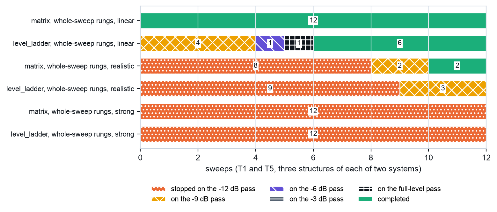

---
# Filled in by the editors at publication.
id: "2026-018"
version: 1
date: "2026-11-27"
doi: "10.5281/zenodo.24595046"
doi_latest: "10.5281/zenodo.24595045"
note: First published.

# Filled in by the authors.
title: "Multi-Shaker Sine Control: Ideas for a Resonance That Moves With Level That Did Not Work in Simulation, and Why"
type: Negative Result
evidence: simulator
evidence_note: "Simulations only. The candidate laws were screened in the Python version of the Open Benchmark Set's MIMO Sine suite, draft 0.1, on 12 structures whose resonances move with level and 6 linear ones as a control: 3 structures of each of two frame systems (6 shakers with 6 controls, and 6 shakers with 12), one run of each law on each case, one sequence of measurement noise. The screens were not audited. The stepped-sine results of two shipped laws come from the study's Hertzforge-version runs on 380 structures, cited by the study's claim ids. Nothing here was run on shakers."
authors:
  - name: "Kevin Cross"
    orcid: "https://orcid.org/0009-0002-6608-9426"
    roles: ["Conceptualization", "Methodology", "Software", "Validation", "Formal analysis", "Investigation", "Data curation", "Visualization", "Writing: original draft", "Writing: review and editing"]
implemented_in: ""
benchmarks: "Hertzforge Open Benchmark Set: MIMO Sine Suite, draft 0.1 (DOI 10.5281/zenodo.24594791; problem format 0.1-draft, scorer 0.1-draft): the screens on frame-6x6 and frame-12x6, linear, realistic and strong, structures 0 to 2; the stepped sine on every study structure"
contents: true
abstract: >
  A sine test with several shakers is controlled from a model of the test article measured at a
  low level. Where the article's resonances move as the level rises, that model is wrong near each
  resonance at full level. This article reports, with numbers, the ideas for following such a
  resonance that were built and screened in simulation and did not work. A model that expects every
  mode to drop 5 percent failed where nothing moves. A ladder of low-level passes
  that predicts each mode's shift stopped on its own low-level passes, and on short rungs it was
  worse than the default law sweeping down. A dither that identifies the response at a dwell cost a
  little over-test and gained nothing. Four predictive variants of the best law found, which follows
  the poles of a fitted modal model, were none better than it: the one with the most completed
  sweeps met the rule on one test and tier where two were needed, and the one that plans the drive
  over a horizon failed at the start of a sweep on a linear structure. Two shipped amplitude laws
  stopped on the stepped sine on almost every structure, linear ones included. The lessons of the
  modal fit and of the loop's delay are given with them. Every result is screen evidence on
  12 simulated structures, and the predictive variants were tuned on
  5 others: what is claimed is that each did not work as built, not that it cannot
  work.
---

## Summary

A sine test drives a test article with a tone that sweeps through a band, steps through it, or
dwells at one frequency, and holds the vibration at each control point to a target amplitude. With
several shakers and several control accelerometers, the controller works out each shaker's drive
from a model of the article, its frequency response from each shaker to each control, measured at a
low level before the test. The test then climbs a short ladder of levels to full level. Bolted
joints and other nonlinear parts change with level: the article's resonances move, mostly down,
and its damping grows. Near each resonance a drive computed from the low-level model is then wrong,
and in a lightly damped structure it can be very wrong.

This article reports the ideas for dealing with that which were built and screened in simulation
and did not work, so that others need not repeat them, and says as far as is known why each
failed. The laws that are in Hertzforge, and the one candidate that entered the study, are described
in a companion article [@sinelaws2026]; the benchmark they ran on is described in
another [@sinesuite2026]. This one describes them only as far as needed to compare.

**What did not work, and how far the evidence goes:**

- **The family inverse, a family of models that expects every mode to drop.** It completed none of the
  6 sweeps up on the linear control, where the default law completed
  every one, and fewer than the default law on the realistic tier. It completed a few more on the
  strong tier.
- **The level ladder, low-level passes that predict each mode's shift.** On ladders of whole sweeps,
  all 24 of its runs on structures that move stopped on a pass below full level. On the
  suite's short rungs it read as the default law sweeping up and was much worse sweeping down.
- **The dither identification, recursive least squares on a dither at the dwell.** It completed every dwell, as the
  default law did, ended in tolerance on one structure fewer on each nonlinear tier, and over-tested
  a little more on all 18 dwells.
- **Four predictive variants of followed poles,** the law that follows the poles of a fitted modal
  model. None was better than followed poles by the rule written before the runs. Extrapolating each pole along its rate, or
  indexing each mode by its own amplitude, lost more sweeps than it gained. Placing a mode's pole
  before the tone arrives gave the most completed sweeps of any law and met the rule against followed
  poles on one test and tier of the two it needed. Planning the drive over a horizon failed at the start of
  the sweep on a linear structure, and so did the same planner on the frozen model.
- **The two shipped amplitude laws on the stepped sine.** `paired` completed 0
  of 380 stepped sines and `ratio` 4, linear structures included;
  on these frames a control's paired shaker is seldom its largest path.
- **The modal fit and the delay.** No fit tried found enough of the frames' modes, and the delay the
  engine measures, taken out of the data, made the fit worse than taking out none.
- **Smaller items from the research round** that teach something: a fixed gain that was too fast
  for the loop's delay, dwell laws in a sweep, a pilot tone in a resonance crossing, and others.

**What they have in common.** A sweep spends seconds in a resonance, and the loop cannot learn a
moved resonance in that time; whatever follows it has to be right before the tone gets there. The
low-level passes that could teach a law the shift do not reach full level on the structures that
move most. Every idea that relied on a modal fit inherited the fit's missing modes. A law that
assumes a shift, or plans over a horizon, has to be checked where nothing moves.

**How far the evidence goes.** This is screen evidence: 12 simulated structures
that move with level and 6 linear ones, one run of each law on each case, in the
suite's Python version, with no audit. The four predictive variants had their settings chosen on
5 development structures at one test and then fixed. So the claim of this article
is that each idea did not work as built, on these structures, at these settings. It is not that
the idea cannot work. The study's claims it cites were audited on held-back structures: of the
63 claims of followed poles against `matrix`,
52 hold, 10 hold weaker and
1 does not hold; of the 96 stepped-sine claims setting
`matrix` against `paired` or `ratio`, 61 hold, 30 hold weaker and
5 do not hold.

## 1. The Problem

A lightly damped resonance has a half-power bandwidth of about $2 \zeta f_r$, where $f_r$ is its
frequency and $\zeta$ its damping ratio. How badly a fixed low-level model serves a resonance at full
level depends on how far the resonance moves measured in that bandwidth. The guide to Hertzforge's
default law states the rule of thumb [@hertzforge2026]: where a resonance moves by less than a
quarter of its half-power bandwidth, the control is as on a linear structure; between a quarter and
one bandwidth, expect errors over 3 dB at that resonance; past about one bandwidth the loop can be
lost.

The screens' structures were built to move. Each mode's frequency change and damping growth at full
level are stated in the structure's own file. In the mode's low-level bandwidth, the median mode of a
realistic-tier structure moves 0.4 to 0.7 bandwidths
(the range over the six structures), and 14 percent of the
426 modes in band move more than one. On the strong tier the median mode
moves 1.2 to 1.7 bandwidths and 70
percent of the modes move more than one, the largest 7.1 (@fig-shift). In
frequency these are small moves: the median mode drops 1.3 to
1.8 percent on the realistic tier and 3.9 to
5.5 percent on the strong tier. They are large only because the modes are
sharp: the median damping ratio is 1.4 to 1.7 percent.

{#fig-shift fig-alt="A strip chart on a logarithmic axis from 0.01 to 10 half-power bandwidths, twelve columns: the six realistic-tier structures (6 x 6 structures 0 to 2, then 6 x 12 structures 0 to 2) and the six strong-tier ones in the same order. Realistic-tier dots spread from about 0.02 to 2 bandwidths with medians between about 0.4 and 0.7. Strong-tier triangles spread from about 0.03 to 7 with medians between about 1.2 and 1.7, above the one-bandwidth line." data="data/fig1_mode_shift.csv"}

There is a second reading. The damping grows too, by a median factor of 1.8
on the realistic tier and 4.1 on the strong tier, so the resonance at full level
is wider than at low level. Measured in its own full-level bandwidth, the median mode moves
0.26 bandwidths on the realistic tier and 0.36 on the
strong tier, and 1 and 6 percent of
the modes move more than one. Which reading matters depends on the law: a law that inverts the
low-level model sees the first, since its model's resonance is the narrow one; a law that has
learned the full-level resonance sees the second. Both say that most modes move far enough to
spoil a frozen model, and that a law that learns the moved mode has an easier target than one that
must guess it.

Time is the other half of the problem. A log sweep at $s$ octaves a minute spends about
$60 / (Q s \ln 2)$ seconds inside a mode's half-power bandwidth, with $Q = 1/(2\zeta)$. At the
screens' median damping ($Q$ about 33), that is 2.6 s at 1 octave a
minute and 0.7 s at 4. The research round found earlier that a loop correcting
the drive from the error it reads cannot be made fast enough to close that gap: its gain must stay
below the rate at which the mode's response settles, or it goes unstable. Its summary was: "The
model has to carry the drive through the resonance; the feedback only trims." And the drive a law
writes reaches the structure 264 samples later, the engine's output pipeline. A law
that reacts to what it reads is reacting to a structure as it was before its last drive took effect.

So the question this article asks is narrow: can a sine controller follow a resonance that moves
with level, in the time a sweep gives it? The ideas below are the attempts, and the evidence that
they did not.

## 2. The Test Model

The structures are the MIMO Sine suite's, draft 0.1 [@sinesuite2026]: simulated frames, built on the
MIMO Random suite's structures, with modes that soften or stiffen with their own amplitude, each
mode's frequency and damping following its own rule. The screens used two systems: a frame with 6
shakers and 6 controls (written 6 x 6) and the same kind of frame with 6 shakers and 12 controls
(6 x 12), at three tiers: linear, realistic and strong. Each tier of each system gave
3 structures, numbered 0 to 2, so 6 structures stand
behind every test and tier. The realistic and strong tiers are the 12 structures
that move; the linear tier, with the same frames, is the control, where nothing moves and a new
idea should read as the law it builds on.

The tests are the suite's five: a log sweep up at 1 octave a minute (T1) and at
4 (T2), a stepped sine at 12 steps an octave (T3), a dwell at the first
resonance (T4), and a sweep down at 1 octave a minute (T5), over 20 to
2000 Hz. Each test climbs a ladder: an identification at -20 dB, then rungs from
-12 dB in steps of 3 dB to full level, 2 s a rung, then one full
pass of the sweep, or the steps or dwell to their end. Only the full-level part is judged. Every
channel read carries measurement noise of 0.1 percent of the full-level amplitude, one sequence a
case, the same for every law.

A law is told the identification (in the Python version, the structure's exact small-signal
frequency response), the reference at each frequency, and the control readings at each update. It
never decides the frequency: the sweep goes on whatever the law does. It is not told the structure's
nonlinear rule.

The screens ran in the suite's Python version, the Python port of the Hertzforge engine's loop with
the engine's 264-sample pipeline restated. They used widened protection: a run is
stopped once a control is more than 20 dB off its target for 100
updates, wider than the engine's defaults, so a law can run far over its target before it is
stopped. That is why the over-tests below are large: the medians by test and tier of the worst over-test on the
nonlinear sweeps and steps ran from 22 to 41 dB for every
law, the default one included.

## 3. How the Ideas Were Judged

Two screens judged the ideas, each with a rule written before its runs.

**The first screen** (344 runs) set three new candidates, and followed poles, against Hertzforge's
default law, `matrix`. Its rule: a candidate enters the study if, on at least one test and tier, it
ends in tolerance on more structures than `matrix` on the same structures, and its worst over-test
is not worse than `matrix`'s by more than 1 dB in the median. "Ends in tolerance" means the run
completed and every control was inside the IEC 60068-2-6 check-point band (within
25 percent up to 500 Hz, 50 percent above) at every judged
update [@iec2007]. The worst over-test is the largest error over the target on the way through any
of the article's resonances, controls and held-out gauges together.

No candidate passed, for a reason the rule did not foresee: on the realistic and strong
tiers no sweep or stepped sine of any law ended in tolerance, `matrix` included
(0 of the nonlinear sweeps and steps). Of all 308
sweeps and steps in the screen only 3 did, `matrix`'s stepped sine on
3 linear structures; only dwells ended in tolerance on structures that
move. So the rule measured nothing on the sweeps, and the screen's other readings carry the
results: completions, the share of the test inside the check-point band, the 95th percentile of the
control error (written p95 below), and the worst over-test, each as a paired difference against
the yardstick on the same structures. On those readings followed poles was the best candidate by far, and
Kevin Cross admitted it to the study after the screen, post hoc, in his words: "Include [followed poles]". It
was not admitted by the rule.

**The second screen** (270 runs) set 4 predictive variants of followed poles
against both `matrix` and followed poles, reusing the first screen's runs of those two. Its rule, written before the runs: a
variant is recommended if, on at least two nonlinear tests and tiers, it completes more structures
than `matrix`, its p95 control error is lower than `matrix`'s on at least 4 of the 6 structures, and
its median worst over-test is not worse than `matrix`'s by more than 1 dB; it is "better than
followed poles" only if it meets the same three conditions against followed poles. Kevin Cross's decision after it: "Don't add any of the four".

**What the evidence is.** It is screen evidence. Each test and tier rests on 6
structures, one run each, one noise sequence; a difference of one or two completions is within what
a different noise sequence could change. The screens ran in the Python version only, and the
audit did not cover them. None of the screen readings in this article is a claim of the study's rule, and none is
marked as one. Where this article cites the study (Section 9, and the results of followed poles), it cites the
study's claims by id; statements that are not claims say so.

So "did not work" here means: did not meet its screen's rule, or failed its own control, as built,
at the settings it was run with, on these structures. Each section says what might change that.

## 4. The Laws Every Idea Was Compared With

**`matrix`** is Hertzforge's default sine law. It corrects the drive through the inverse of the
measured model, and in a sweep it carries the drive from one frequency to the next, so the model,
not the feedback, carries the drive through a resonance. It does not follow anything: its model is
the low-level one throughout.

**Followed poles** sits on the same carried loop but rebuilds the model as it goes. From the
identification it fits a modal model (the M7d fit of Section 10, with the identification's delay
taken out), and during the run it refits the frequency and damping of the modes near the tone from
its last 40 updates, limited to 0.25 bandwidths a refit and anchored to the
low-level values [@sinelaws2026]. It follows; it does not predict.

On the first screen followed poles completed 16 of the 36 nonlinear sweeps against
`matrix`'s 9, and its p95 control error was lower on 30 of
33 paired structures. Its worst over-test was lower on the realistic tier (paired
medians -5.51 to -2.48 dB by test) and higher on the strong tier
(+0.35 to +7.19 dB). In the study, against the Python `matrix`, the
claims say the same: followed poles has the higher IEC share in 25 claims
(R1630 and the rest), the lower worst over-test in
31 (R1619 and the rest) and the
higher in 1 (R2018), and
completes more in 6 (R1673 and the
rest); the full list is in `data/followed_poles_pair_claims.csv`;
on the held-back structures, R1630 and R2018 hold weaker (the direction held and the size fell outside the study's quartiles) and the other 2 hold.
Of all 63 of these claims, on the held-back structures
52 hold, 10 hold weaker (the direction held
and the size fell outside the study's quartiles) and 1 does not hold
(R1850). Followed
poles is the best law found here for structures that move, and it is still far from good: it holds no nonlinear
sweep inside the check-point band.

## 5. The Family Inverse, Which Expects Every Mode to Drop

### 5.1 The Idea

Where the size of a shift is uncertain, build the inverse on several copies of the model with the
moving resonances placed across the expected range, so that no copy is over-driven, and use the
drive that is least wrong on average over the copies. It is the family of models that Hertzforge's MIMO
Shock law `followed` inverts [@shocklaws2026; @negative2026], moved to the sine loop. The copies are one half-power bandwidth apart and span the
expected shift with a margin.

### 5.2 Why It Was Reasonable

On the research round's own four-shaker testbed, before this benchmark, it kept the loop alive
about half the time without needing the shift to be right: given half, the right and double the
true shift it completed 11, 12 and 9 of
20 sweeps, though only 2 to 4 held 3 dB. Its place was
expected to be a fallback, not a law. It was screened to see whether a family alone would do.

### 5.3 What It Was Told

The identification's model and an expected drop of 5 percent on every mode, with the
modal fit the research round had used (the fit called M0 in Section 10).

### 5.4 What Happened

@fig-screen-g shows it test by test. On the linear control it completed none of the sweeps up, the
fast sweeps or the sweeps down, where `matrix` completed all 6 of
each, and 3 of the stepped sines against all of `matrix`'s; its worst
over-test was a paired median 13.0 to 22.3 dB above `matrix`'s
there. On the realistic tier it completed 5 of 24
runs against `matrix`'s 12 (sweeps up 0
against 3, fast sweeps 1 against
5). On the strong tier it completed 3
against `matrix`'s 0: one fast sweep and two stepped sines, with worst
over-test paired medians of -0.81 and -0.45 dB there. Over the
nonlinear structures its p95 error was lower than `matrix`'s on 14 of
43 pairs.

{#fig-screen-g fig-alt="Two panels sharing 27 rows, grouped by candidate: the family inverse on T1, T2, T3 and T5 at three tiers, the level ladder on 2 s rungs on T1 and T5, the level ladder on whole-sweep rungs on T1 and T5, and the dither identification on T4. Panel (a) plots completions from 0 to 6: the family inverse sits at 0 where matrix sits at 6 on the linear rows, and a little above matrix on the strong T2 and T3 rows. The level ladder on 2 s rungs nearly matches matrix on T1 and is below it on T5 realistic. The level ladder on whole-sweep rungs completes 3 of 6 on linear and none elsewhere. The dither identification and matrix both complete 6 of 6 on every dwell row. Panel (b) plots paired median over-test differences: the family inverse from about +13 to +22 dB on linear rows and up to +13 dB on realistic rows; the level ladder near zero; the dither identification just above zero on all three rows." data="data/screen_cells.csv"}

### 5.5 Why It Did Not Work

A family that expects every mode to drop is a wrong model where nothing drops. On the linear
structures each copy but the unshifted one is wrong, and the average drive is wrong at every
resonance; the linear failure shows the family's cost is not small. On the realistic tier, where
the median mode moves less than one low-level bandwidth, an assumed shift of the same size for every
mode is wrong in size for most modes and wrong in sign for the stiffening ones. And the M0 fit it
was given finds only about a fifth of the frames' modes (Section 10), so for most modes the family
had nothing to shift.

### 5.6 Under the Readings

On completions it loses on the linear and realistic tiers and gains a little on the strong tier; on
p95 it loses on most pairs. On over-test it loses heavily on the linear tier (paired medians of
13.0 to 22.3 dB). On the realistic tier it loses on the sweeps,
by 2.5 dB up, 11.0 dB fast and
12.9 dB down, and gains on the stepped sine, where the paired median is
-4.3 dB. On the strong tier it loses on the sweeps up and down
(2.9 and 8.2 dB) and gains a little on the fast sweeps and
stepped sines (-0.81 and -0.45 dB). It did not end in tolerance
on any sweep or stepped sine, nor did any other law on the nonlinear ones.

### 5.7 What Survives

A family as a fallback, entered only where a mode is known to have moved, is not ruled out; it was
not screened with the M7d fit, and its research-round standing as a fallback for followed poles stands untested
here.

## 6. The Level Ladder, Passes That Predict Each Mode's Shift

### 6.1 The Idea

Sine practice already runs passes at lower levels before the full-level one; the ECSS testing
handbook describes the notching process of low level, prediction, intermediate
level and repeat [@ecss2022]. The level ladder makes that the law: where the suite's own ladder
(Section 2) only brings the test up to full level, the level ladder learns from each pass. After each pass it fits each mode's frequency
and damping and that mode's own response amplitude, fits how they change with the mode's
amplitude, predicts the next level, and starts the next pass from the predicted model, with followed
poles running inside each pass. A step rule chooses the levels so that no mode is predicted to move more
than half a bandwidth between passes. Prediction beyond the amplitudes tested was not found
published.

### 6.2 Why It Was Reasonable

On the research round's testbed, given the true low-level poles, it was far ahead of the published
law it was compared with: it completed and held 3 dB at full level on 12 and
13 of 20 structures (up, down) against 8 and 2, and on
7 and 7 of 20 held-back structures against 3 and
1. The testbed also showed what it knew that a law in the software would not:
the true small-signal poles, and through its default exponent the form of the testbed's own
softening rule. Anchored at the poles an identification gives instead, it completed and held 3 dB
on 7 and 10 of 20, no better than the published law sweeping up
and still ahead sweeping down. Its known weakness was the runs that stop in a lower pass.

### 6.3 What It Was Told

The identification, the modal fit of followed poles, and the ladder. It was screened at two rung lengths. On the
suite's own rungs (2 s each), a pass is too short to fit anything, and the level ladder is the
carried loop on its low-level model, as the engine would run it. On rungs of one whole sweep each (one pass
at each rung, from -12 dB in steps of 3 dB to full level), it is the level ladder as designed, compared with
`matrix` on the same whole-sweep rungs.

### 6.4 What Happened

**On whole-sweep rungs** every one of the level ladder's 24 runs on structures that move stopped on
a pass below full level: 21 on the first pass at -12 dB and
3 on the second (@fig-whole-sweep). None reached the level its prediction was for.
`matrix` on the same rungs stopped below full level on 22 of
24 and completed 2, both on one realistic structure. On the linear
control the level ladder completed 3 of 6 on each test
where `matrix` on the same rungs completed every one. Package F's tuning runs before the screen
had already seen the same: 0 of 8 completed, nearly all stopped on the first
pass.

{#fig-whole-sweep fig-alt="Six horizontal stacked bars of twelve sweeps each. matrix on the linear tier: all 12 completed. The level ladder on the linear tier: 4 stopped on the -9 dB pass, 1 on the -6 dB pass, 1 on the full-level pass, 6 completed. matrix on the realistic tier: 8 stopped on the -12 dB pass, 2 on the -9 dB pass, 2 completed. The level ladder on the realistic tier: 9 on the -12 dB pass and 3 on the -9 dB pass. matrix and the level ladder on the strong tier: all 12 stopped on the -12 dB pass." data="data/fig3_whole_sweep_stops.csv"}

**On the suite's short rungs** the level ladder sweeping up read about as `matrix` did: it completed
2 realistic sweeps against 3, with a
paired median p95 +0.7 dB from `matrix`'s, and on the strong tier both completed
none. Sweeping down it was much worse: on the realistic tier its share of the test inside the
check-point band differed from `matrix`'s by a paired median of -53 points
and its p95 by +12.5 dB; on the strong tier by -37 points and
+9.1 dB; it completed none of the sweeps down on either tier. On the linear control
its p95 was lower than `matrix`'s on 12 of 12 pairs: there the
carried loop does what it should.

### 6.5 Why It Did Not Work

A whole pass at -12 dB on a structure that moves is a sweep like any other, and meets
the same places where every law stops: these structures move enough at -12 dB, and
are hard enough at those places, that a plain sweep is already lost there. The level ladder's prediction needs
passes that complete; the passes that would teach it the shift stop before they can. Its
research-round result rested on a testbed where the lower passes completed. Why it is worse than
`matrix` sweeping down on short rungs is not known and was not diagnosed.

### 6.6 What Survives

The level ladder's idea needs a pass that completes at a lower level. On these structures no law
supplies one, and this screen says nothing about a ladder on a structure whose low-level passes
complete.

## 7. The Dither Identification at the Dwell

### 7.1 The Idea and Its Source

At a dwell the loop has time. The dither identification estimates the response matrix recursively from differences of
successive drives and readings, and makes the differences span every direction by giving one drive
at a time a small extra step, in rotation. It is the method of helicopter higher-harmonic control,
published by Johnson of NASA [@johnson1982] and by Chandrasekar, Liu, Patt, Friedmann and Bernstein
[@chandrasekar2004].

### 7.2 Why It Was Reasonable

On the research round's testbed, with the tone held one bandwidth below the low-level resonance
and the mode drifting down through it, the published law it was compared with stopped on
39 of 40 structures once the drift passed about one bandwidth; the dither identification with a
1 percent dither completed 30 of 40 at a drift of 2 bandwidths.

### 7.3 What Happened

On the dwell (T4) it completed 18 of 18, as `matrix` did. It ended in
tolerance on 5 realistic structures against `matrix`'s
6, and on 3 strong ones against
4. Its worst over-test was higher on all 18 paired dwells, by paired
medians of 0.07 to 0.30 dB by tier (@fig-screen-g).

### 7.4 Why It Did Not Work, and What Survives

The suite's dwell sits at the first resonance and the loop has the dwell's whole length to
correct; `matrix` already holds it, and on structures that move it ended in tolerance on
6 realistic and 4 strong structures of 6.
There was nothing left for the dither to gain, and the dither itself costs a little response. The
testbed case the dither identification was built for, a mode drifting through a tone held off the resonance, is not one of
the suite's tests; the screen says nothing about it.

## 8. Predictive Variants of Followed Poles

### 8.1 Why Predict

After the first screen Kevin Cross asked for "something predictive rather than reactive based on the system Id/frf since reactive laws clearly can't handle the nonlinear shifts". A package of work read the
published methods, proposed nine, and built and screened four. Each changes one thing from the
variant before it, and all four sit on followed poles, so followed poles is the comparison for every one of them and
`matrix` the yardstick.

Two observations shaped them. First, with the fitted modal form, a law can compute each mode's own
amplitude from the drive it wrote, so each pole estimate that followed poles already makes can be paired with an
amplitude, giving points on that mode's curve of frequency and damping against amplitude. The
published picture of jointed structures has modes that keep their shape while their frequency and
damping change with modal amplitude [@deaner2015; @roettgen2017]. Second, under control, the
amplitude a mode will have at its resonance is set by the reference, not by the drive, which is the
idea behind response-controlled stepped-sine testing [@karaagacli2021]: the amplitude a mode will
reach can be computed before the sweep gets there.

### 8.2 The Four Variants and the Check Run

- **Pole trajectory, a pole's path extrapolated over the loop's delay.** Followed poles with each fitted pole tracked as a
  value and a rate, and the inverse built from the pole extrapolated to when the drive will act. It
  tests whether removing the lag of followed poles alone matters. Sources: tracking filters [@kalman1960] and
  recursive estimation of structural parameters [@chatzi2009]; no published use in a vibration
  controller was found.
- **Amplitude-indexed poles, a model indexed by each mode's own amplitude.** Each mode's frequency and damping are a
  learned curve in its own amplitude, bounded and with a prior; each update solves for the drive
  whose modal amplitudes give the poles that give the drive, by 3 passes of a fixed
  point. Sources: forced response synthesized from amplitude-dependent modal properties
  [@krack2013], amplitude-dependent modal models of jointed structures [@deaner2015; @roettgen2017;
  @lacayo2019], and backbone curves from measured data [@londono2015].
- **Placed poles, poles placed before the tone arrives.** Amplitude-indexed poles, plus: before the tone reaches a mode, compute
  the amplitude it will have there from the reference and the fitted shapes, and move its pole there
  in advance, using a prior pooled from the modes already passed in this sweep. Sources:
  response-controlled stepped-sine testing [@karaagacli2021] and gain scheduling [@rugh2000];
  pooling across modes was not found published.
- **Preview control, the drive planned over a horizon.** On the model of amplitude-indexed poles, run the law's own model forward in
  time over the next several updates of the declared sweep, with the pipeline delay, and choose the
  drive that minimizes the predicted error over that horizon. Sources: model predictive control
  [@mayne2000], preview control for tracking [@tomizuka1987], and the passage of a sweep through a
  resonance [@markert2001; @gloth2004].
- **Preview on a frozen model, the check run:** the planner of preview control on the low-level
  modal model, nothing followed. Not a
  variant to recommend: it separates the planner from the model under it.

The five others that were proposed and not built, with the reason each was set aside, are in
Section 11.

### 8.3 How They Were Set Up

Their settings were chosen in 49 development runs on 5 structures that
are not in the screen, all at T2, and then fixed. Those runs changed three things. Preview control
as first written went non-finite at 45 Hz on a strong development structure and
stopped at 372 Hz on a linear one where followed poles completes; its model was given four
tracker sections and a correction that fades to nothing at an offset of 0.2 of the
reference, after which it completed the linear one at a p95 of 1.44 dB to 1.48 for followed poles. Pole
trajectory and amplitude-indexed poles at their first settings read worse than followed poles on a realistic development structure (p95
2.40 and 2.89 dB against 1.24 dB), with their fitted poles running
10 to 12 bandwidths; with safer settings they read 1.76 and
1.99 dB, still above followed poles. No variant read clearly better than followed poles on any development
structure, and five structures at one test were judged too few to tune on further.

### 8.4 What Happened

@fig-leads shows the second screen. Of the 36 nonlinear sweeps, followed poles completed
16 and `matrix` 9.

- **Pole trajectory** completed 12 (gaining 3 and losing 7 against followed poles),
  had the lower p95 than followed poles on 12 of 36 pairs, and met the rule
  against `matrix` on 3 tests and tiers, one fewer than followed poles, which met it on 4;
  against followed poles on 0.
- **Amplitude-indexed poles** completed 12 (1 gained, 5 lost), lower p95 than followed poles
  on 10 of 35, the rule against `matrix` on 1 and
  against followed poles on 0. On the realistic sweeps down its worst over-test was a paired
  median 7.6 dB above that of followed poles and 16.5 dB above `matrix`'s. The package
  had expected it to be the most likely to pass.
- **Placed poles** completed 18, the most of any law (5 gained, 3
  lost), with the lower p95 than followed poles on 10 of 35 pairs, and met the
  rule against `matrix` on 3 tests and tiers. Against followed poles it met the rule on
  1, the fast sweep on the strong tier, where it completed 3 to
  2 for followed poles, had the lower p95 on 4 of 6, and a
  worst over-test +0.41 dB from that of followed poles. The rule needed two.
- **Preview control** completed 15 (3 gained, 4 lost), lower p95 than followed poles
  on 12 of 35, the rule against `matrix` on 2 and against
  followed poles on 0. It failed its linear control on the sweep up: its p95 differed from that of followed poles there by a
  paired median of +6.66 dB.
- **Preview on a frozen model** completed 6, fewer than `matrix`, with the lower p95 than `matrix` on
  only 4 of 33 pairs.

On the linear control, pole trajectory, amplitude-indexed poles and placed poles read as followed
poles (paired median p95 within 0.10 dB of it on every test) and
completed all 18 sweeps, as followed poles did.

{#fig-leads fig-alt="Three panels. (a) Bars of nonlinear sweeps completed out of 36: matrix 9, followed poles 16, pole trajectory 12, amplitude-indexed poles 12, placed poles 18, preview control 15, preview on a frozen model 6. (b) Paired bars per variant of the tests and tiers meeting the rule: against matrix, pole trajectory 3, amplitude-indexed poles 1, placed poles 3, preview control 2, preview on a frozen model 0; against followed poles only placed poles has one. (c) Markers for each variant at six nonlinear tests and tiers, p95 difference from followed poles in dB: pole trajectory, amplitude-indexed poles, placed poles and preview control cluster within about 1.3 dB of zero, mostly above it, placed poles below zero on T2 strong; preview on a frozen model lies 1 to 9 dB above." data="data/fig4_leads.csv"}

### 8.5 Where Preview Control Failed

The failure of preview control on the linear sweep up is at the sweep's start (@fig-start). On the linear 6 x 6
structure 0, the largest control error at full level between 30 and 50 Hz was 28.7 dB
for preview control and 20.7 dB for preview on a frozen model, against
0.3 dB for followed poles and
0.3 dB for `matrix`; above 400 Hz the four are alike (largest
16.3, 20.1, 17.5 and 16.1 dB, at
the same resonance). The check run fails the same way, so the planner, not the followed model, is
at fault. On the sweep down preview control read as followed poles (paired median p95 +0.02 dB). The fault
was located and not diagnosed. The development runs were all at T2, where it did not
show.

{#fig-start fig-alt="Two panels with frequency from 20 Hz to 2 kHz on a logarithmic axis and the largest control error in dB. (a) Preview control and preview on a frozen model start near 20 to 29 dB from the start of the sweep to about 45 Hz and fall to near zero after; followed poles stays near zero there. All three share spikes near 90 Hz and 900 Hz. (b) Followed poles and matrix both stay near zero at the start; matrix has the larger spike near 90 Hz, about 48 dB, and a few small ones." data="data/fig5_start_error.csv"}

### 8.6 Why They Did Not Work

As far as the screen shows:

- **Pole trajectory.** The rate of a pole fitted from a short window is mostly the fit's own noise from one
  update to the next, and extrapolating it puts that noise into the model the loop reads. It ran
  with no lead of the fit window, because the development runs read worse with one.
- **Amplitude-indexed poles.** A curve in amplitude has to be learned on the approach to a resonance, from a few points
  on one flank, and extrapolated to the peak; it needs residues good enough to give each mode's
  amplitude, and the fit puts only about half to three quarters of the frames' modes within 10
  percent (Section 10). With a strong prior and tight bounds it moves little and reads close to followed poles;
  with weaker ones it ran away in development.
- **Placed poles.** The modes of one structure need not share a rule, so a prior pooled from passed modes can
  be wrong in size or sign for the next one. That it completed the most sweeps suggests placement
  helps keep a run alive, but it did not lower the error often enough to beat followed poles.
  Placement on plain followed poles, without the curves of amplitude-indexed poles under it, was not
  built.
- **Preview control.** A planner commits harder to its model's errors over a longer horizon; at the start of
  the sweep, with nothing learned, it failed where followed poles does not.

None of these is shown to be the whole cause. Each variant gained some sweeps and lost others, and
each test and tier rests on six structures.

### 8.7 What Survives

Each idea at other settings, which were not explored: tuning on the screen's own structures after
seeing them would not have been a screen. Placement on plain followed poles. A planner that starts as followed poles and
lengthens its horizon only once its model has met the structure.

## 9. `paired` and `ratio` on the Stepped Sine

### 9.1 The Laws

Two of Hertzforge's shipped laws act on amplitude alone. **`paired`** pairs control $i$ with shaker
$i$ and uses nothing of the coupling: every update each shaker's amplitude moves toward its own
control's ratio of wanted to measured amplitude. It is Hertzforge's simplest law, the template a
contributor copies; its guide says it is for structures whose pairs are weakly coupled, each
control dominated by its own shaker [@hertzforge2026]. **`ratio`** is the published amplitude-ratio
law of Zhang, Chen and He [@zhang2015; @sinesurvey2026], moved onto the inverse of the model, with
one factor for each control updated once the reading settles and carried from step to step. Both
run dwells and stepped sines. This section is not about a resonance that moves: it is what the
study found these two laws do on the suite's stepped sine, and it is evidence from the study, not
from a screen.

### 9.2 What Happened

In the study, in the Hertzforge version, `paired` completed 0 of
380 stepped sines, `ratio` 4 and `matrix`
160 (42 percent) (@fig-stepped). On the linear
structures alone, `paired` completed 0 of 100,
`ratio` 1 and `matrix` 81. `paired` stopped
on the first rung at -12 dB on 185 structures, on the middle rungs
on 75 and at full level on 110, there after a median
15 percent of its steps. `ratio` reached full level and stopped there
on 348, after a median 47 percent of its steps.
`matrix` also stops at full level on many stepped sines (203, after a median
46 percent), mostly on the structures that move; the two amplitude
laws stop on the linear ones too. At the dwell the same two laws completed
45 and 90 percent of their runs, against
`matrix`'s 98.

The study's claims say so: in all 96 pair claims on the stepped sine that set
`matrix` against `paired` or `ratio` (R0011 to R1568, listed in
`data/stepped_pair_claims.csv`), `matrix` is on the better side, on completion, the IEC share and the
worst over-test; on the held-back structures, R1568 holds weaker (the direction held and the size fell outside the study's quartiles) and the other one holds. Of all 96, on the
held-back structures 61 hold, 30 hold weaker (the direction held
and the size fell outside the study's quartiles) and 5 do not hold
(R0281, R0282, R0353, R0728 and R0874): in those, `matrix` was not ahead of `paired` or `ratio` by the
rule's threshold on the held-back structures. Earlier, in the engine and in the Python version alike, every stepped sine of the two
laws on the agreement sample's structures had stopped (24 of 24 in
the engine; in the Python version `paired` 12 of 12 and `ratio`
8 to 11 of 12), so the stops are the laws', not the
engine's.

![The stepped sine in the study (Hertzforge version). (a) How each of the 380 stepped sines of matrix, paired and ratio ended: completed, stopped at -12 dB, on the middle rungs, at full level, or held by the identification check before the ladder. (b) For each structure, the share of steps and control-shaker pairs at which a control's paired shaker is its largest path, by system; the bar is one over the number of shakers. Panel (a) is the study's runs; panel (b) is read from the structures and is not a claim of the study's rule.](figures/fig6_stepped.png){#fig-stepped fig-alt="Two panels. (a) Three stacked horizontal bars of 380 runs. matrix: 160 completed, a few stopped on lower rungs, 203 at full level, 10 held. paired: none completed, 185 stopped at -12 dB, 75 on the middle rungs, 110 at full level, 10 held. ratio: 4 completed, a few on lower rungs, 350 at full level, 10 held. (b) A strip chart per system (3 x 12, 6 x 12, 12 x 24, 6 x 6, 12 x 12): each dot a structure's share in percent, from about 3 to 72 percent, mostly clustered near or below the bar for one over the number of shakers: 33, 17, 8, 17 and 8 percent." data="data/fig6_stepped_runs.csv data/fig6_coupling.csv"}

### 9.3 Why They Do Not Work Here

`paired` needs each control dominated by its own shaker. On these frames it is not. Read from the
structures' own models at the stepped sine's frequencies, a control's paired shaker is its largest
path at a median 10 percent of steps on the 6 x 6 frames, where one in six
would be chance (17 percent), and 8 percent on the
12 x 12 frames (8 percent by chance) (@fig-stepped, b; not a claim of the
rule). On the systems with more controls than shakers, half or more of the controls have no shaker
of their own. The suite's controls are not placed at the shakers, so the pairing is a numbering, not
a coupling, and the law's guide says as much. When one shaker moves every control, each pair's
correction disturbs the others, and the loop diverges; how soon is a matter of where along the
steps the coupling is strongest.

`ratio` corrects each control's reference factor through the model's inverse, which takes the
coupling into account, but it updates each factor from that control's own reading alone and carries
the factors from step to step. A single stepped sine shows the pattern (@fig-trace): on the linear 6
x 6 structure 0, `ratio`'s largest control error grows over the steps where `matrix`'s falls, and it
stops at 453 Hz; `paired` stops at 25 Hz on its first steps at
full level. That reading of the mechanism is not a claim of the rule and was not tested further. In
the agreement work the place a run stopped moved with the loop's delay, but the stop itself did not.

{#fig-trace fig-alt="Step frequency from 20 Hz to 2 kHz on a logarithmic axis against the largest control error in dB. matrix stays below about 10 dB throughout and falls to near zero above about 250 Hz, completing at 2 kHz. ratio swings between about 0 and 45 dB below 230 Hz, then rises to 40 to 65 dB and ends near 97 dB at about 450 Hz. paired has a single point near 24 dB at about 25 Hz, where it ended." data="data/fig7_stepped_trace.csv"}

### 9.4 What Survives

Both laws complete most dwells and do what they say on the structures they were meant for. On the
suite's stepped sine they are not usable, and the reason is the suite's coupling, not the level.

## 10. The Modal Fit and the Delay

Every follower here, followed poles and the four variants, rests on a modal model fitted to the identification.
The fit was its own package of work, and its failures were what followed poles inherited.

### 10.1 What Did Not Work in the Fit

- **The research round's fit missed modes, even on exact data.** It found 81 to
  88 percent of the modes on exact data from the research testbed, and
  17 to 19 percent on exact data from the suite's frames. The
  research round had read its results for followed poles as "poles well, residues badly"; the cause was missed and
  traded modes counted as residue errors. Followed poles on it completed 11 and 13 of
  20 testbed sweeps (up, down) against 15 and 14 with the
  true modes. This is the fit called M0 below, the one the family inverse was given.
- **Forcing residues to rank one cannot supply a missed mode.** It halved the median residue error
  (from 0.055 to 0.022 on one testbed structure) and left the modes found
  unchanged at 81 percent; Peeters and co-authors report the same kind of loss from
  forcing a common-denominator fit's residues to rank one [@peeters2004].
- **A whole-band fit misses the low modes.** A pLSCF fit over 30 to 500 Hz in
  one piece missed the modes at 42 to 73 Hz on exact data: about
  9 frequency lines fall in their bandwidth against about 93 at
  390 Hz, so an unweighted fit wanders there. Sub-bands of half an octave fixed it. The
  method is the PolyMAX and pLSCF work of Peeters, Van der Auweraer, Guillaume and Leuridan
  [@peeters2004; @guillaume2003].
- **Real residues need the delay out first.** The identification of the realistic frames carries a
  delay, and a delay turns each mode's residue by an angle that grows with frequency
  (8 degrees at 94 Hz, 88 at 1000 Hz). Fitted straight
  to the realistic frames, the real-residue fits put 0 percent of
  the modes within 10 percent. Complex residues helped less than taking the delay out
  (24 to 57 percent within 10 percent): twice the unknowns on
  the same lines.
- **No fit reached the bar.** The bar set before the work was 95 percent of the modes
  found and 90 percent within 10 percent. The best, M9d, found 72 to
  84 percent and put 54 to 76 percent within
  10 percent; M7d, the one followed poles runs on, 73 to 84 and
  48 to 71 (@fig-fits, a). The misses are near-repeated modes
  less than a bandwidth apart, missed on exact data too (the best fit found 86 to
  93 percent there); the identification costs another 8 to
  13 points. So followed poles on the frames runs on a model that lacks about one mode in five.
  M9d took 4.1 to 40.0 minutes a structure, and followed poles on M9d cost 22
  to 31 times the clock of followed poles on M7d for the same conclusion on the two structures it
  was run on.

{#fig-fits fig-alt="Two panels. (a) Seven fit methods on the horizontal axis (M0, M3, M5, M7, M7c, M7d, M9d), four markers each for the frame sets. Modes found rise from about 20 percent for M0 to 72 to 84 percent for M7d and M9d, all below the 95 percent bar. Modes within 10 percent rise from 2 to 7 percent for M0 to 54 to 76 percent for M9d, below the 90 percent bar; M3, M5 and M7 put none of the realistic frames' modes within 10 percent. (b) Bars of relative in-band model error: with the block's delay or the estimated delay about 0.09 and 0.14; with no delay removed 0.50 and 0.70; with the engine lag less the pipeline 0.56 and 0.78." data="data/fig8_fits.csv data/numbers.csv"}

### 10.2 The Wrong Delay

To port the fit into the screen's harness, the delay to take out had to be named. The screen's
brief named the engine's measured lag less its pipeline: 8 and
14 samples on the two structures checked. That is not the identification's
delay. The engine's lag is the peak of a cross-correlation, and carries the structure's own response
time; the simulator's block delay on those structures is 2 and
4 samples. Fitted with the lag taken out, the model's in-band error was
0.56 and 0.78, worse than taking out nothing
(0.50 and 0.70); with the block's delay
0.09 and 0.14, and with the fit's own estimate of the delay
about the same (0.09 and 0.14) (@fig-fits, b). The count of modes
found does not show it: with the lag the fit found 97 percent on both, more
than with the right delay. The real residues are what the wrong delay breaks. The port takes out
the block's delay, read from the structure file.

## 11. Other Ideas, With Weaker or Narrower Evidence

These come from the research round on its own four-shaker testbed, before the benchmark, from the
tuning work before the first screen, and from the predictive leads that were not built. They are
weaker evidence than the screens: the testbed is not the suite, and some rest on one structure.

- **The published fixed-inverse law at its published gain.** At a gain of 0.5 an update
  and a 10 ms update it stopped on every linear development structure of the testbed,
  and completed 0 of 20 held-back sweeps: the loop was
  faster than the measurement's delay allows. It runs only with a rule that slows it.
- **Dwell laws in a sweep.** Steepest descent, the secant law, the ratio law and a servo for each
  control completed 0 to 5 of
  20 sweeps on the linear testbed structures at one octave a minute. A law
  that learns at the tone has no time in a sweep.
- **Carrying the drive at full weight through a low-level model.** On a structure that moves it was
  worse than the published law, by a median 5.0 dB sweeping up, and sweeping down
  it completed 2 of 20 against the published law's 8.
  The research round's derivation gives the useful weight of the carried drive
  as about $2/(1+r)$ for a damping growth $r$; full weight with damping tripled is as bad as none.
- **A pilot tone to identify during a sweep.** Too little time in a resonance: resolving the tones
  needs about 11 s of drive at 50 Hz and $Q$ 50, against
  1.7 s spent in the resonance at one octave a minute.
- **The level ladder's testbed headline.** Its standing rested on what it knew: the true low-level
  poles and the form of the testbed's softening rule (Section 6.2). With the poles an identification
  gives, it was no better than the published law sweeping up.
- **The smallest notch's own margin.** In the test that seemed to check that it held its limit, a
  backstop was holding the limit. The notch is not safe without it.
- **Plain cyclic projection for the notch.** As first written it over-notched; it is not Dykstra's
  algorithm, which is what the step needs.
- **Followed poles at its testbed settings on the research fit, before the screen.** It completed
  0 of 8 tuning sweeps, as `matrix` did, and ended earlier than `matrix` on
  3; whether the fit or the law was to blame was then unknown. Section 10 says it was
  mostly the fit.
- **The five predictive leads not built.** Learning from pass to pass needs whole passes that
  complete, which these structures do not give (Section 6). Scheduling the model over identifications
  at several levels would have meant changing the harness every law shares, and a broadband
  identification at a higher level is not the response to a tone at that level. A fitted black-box
  nonlinear model is shown on a few modes with rich data, not on dozens of modes, several shakers and one
  sweep. Adaptive feedforward on a tone is the fixed-inverse or steepest-descent loop under another
  name. Phase-locked or continuation methods need the law to set the frequency or the rate, which no
  law here may do.

## 12. What the Failures Have in Common

**A sweep gives too little time in a resonance.** At 2.6 s in a bandwidth at one
octave a minute, and less at the fast sweep, a loop that learns from its errors learns too late. The dither
identification and the dwell laws need time a sweep does not have; pole trajectory and
amplitude-indexed poles must learn a curve from the
approach flank and extrapolate it to the peak. Whatever follows a moving resonance in a sweep has to
be right before the tone arrives, which is why followed poles, which is right sooner, is the best law found, and
why placed poles, which moves each pole before the tone arrives, kept the most runs alive.

**The passes that could teach the shift do not reach full level.** The level ladder, and the pass-to-pass learning
that was not built, need low-level passes that complete. On these structures a whole pass at
-12 dB stops where any sweep stops, for `matrix` as for the level ladder.

**Every follower inherits its modal fit.** The family inverse was given a fit that finds a fifth of the frames'
modes; followed poles and the four variants run on one that finds about four in five and puts barely more than
half within 10 percent, and the variants that need each mode's amplitude need good residues. The
wrong delay showed how quietly a fit can be broken: the count of modes found rose while the model
got worse.

**An assumption has to be checked where nothing moves.** The family inverse assumed a drop on every mode and
failed on the linear structures. Preview control planned over a horizon and failed on a linear structure at the
start of the sweep. The linear control caught both; a screen on nonlinear structures alone would
have read them as merely weak.

**A law that ignores the coupling fails on a coupled structure.** `paired` assumes each control is
its own shaker's; on these frames that is seldom so, and it stops on nearly every stepped sine,
linear or not.

## 13. Limits

- **Screen evidence.** 12 structures that move and 6 linear ones,
  two systems, 6 structures behind each test and tier, one run each, one noise
  sequence. Differences of one to three completions are within what another noise sequence could
  change, and gains and losses on single structures go both ways for every variant.
- **The Python version only.** The screens ran in the suite's Python version, with the exact
  small-signal response as the identification. The Hertzforge engine would hand a law a measured
  identification; that was not screened.
- **Not audited.** The study's audit covers the study's claims on held-back problems; the screens'
  readings are not among them. Sections 4 and 9 give its verdicts on the study's claims this
  article cites. The verdicts are the frozen code's. Elsewhere in the study, 7
  verdicts on paired claims among the Hertzforge laws at the dwell read weaker only because the
  claims file stores the study's quartiles rounded to 6 decimals, where the
  rule's words give holds; none of them is among the claims this article counts.
- **Settings.** The predictive variants were tuned on 5 development structures at
  one test, then fixed; the family inverse, the level ladder and the dither identification ran at their research-round defaults. None was tuned on the
  screen's structures. Each did not work as built, at these settings; other settings, or a law
  tuned on more structures, could read otherwise.
- **Widened protection.** A run was stopped only after 100 updates more than
  20 dB off target. With the engine's own protection runs would stop sooner, which
  changes completions for every law.
- **What a structure that moves is.** The suite's modes follow simulated rules of softening and
  stiffening with amplitude. Real joints may change their character between levels, for instance
  slipping only near full level, which none of these laws was tried on.
- **Simulation only.** Nothing here was run on shakers.

**What would change these conclusions.** A rerun of any of these ideas on more structures, with
more noise sequences, in the Hertzforge version on a measured identification, would show whether a
screen's one-or-two-structure differences hold. A modal fit that finds nearly every mode would
remove the largest handicap every follower here shared. A structure whose low-level passes complete
would let the level ladder be judged as designed. And a test on shakers would show whether the suite's
moving resonances are like those of real articles.

## Data Availability

The problems are the MIMO Sine suite, draft 0.1 [@sinesuite2026], and the screens' run tables, the
study's run records and claims, and the records of what did not work are the benchmark's results
record [@sineresults2026]; both are published as data sets, the suite with DOI 10.5281/zenodo.24594791 and the
results record with DOI 10.5281/zenodo.24594793. The data
behind every figure and every number in this article, and the code that computes and draws them,
are with the article in `data/` and `code/`: the code under the MIT license and the data under
CC BY 4.0. `data/number_sources.csv` names the file each number in the text was read from.

## Contribution Statement

Kevin Cross is the sole author. He chose the candidates and the predictive leads to build, directed
their design and implementation, the screens and their rules, and the analysis, and made the
decisions to admit followed poles and to add none of the predictive variants.

## How This Was Made

The text, the figures, the code that draws them, the candidate laws, the predictive variants and
the screens' scripts were written with Claude Code, an AI coding assistant running Anthropic's
Claude Opus models, under Kevin Cross's direction. The author is responsible for every word, number
and line of code.

## Acknowledgments

The ideas tested rest on the published work of others, credited by name. The level ladder follows the
notching practice of the European Space Agency's ECSS testing handbook. The dither identification follows the
higher-harmonic control of W. Johnson of NASA and of J. Chandrasekar, L. Liu, D. Patt, P. P.
Friedmann and D. S. Bernstein. The predictive variants draw on the tracking filter of R. E. Kalman;
the recursive structural identification of E. N. Chatzi and A. W. Smyth; the forced-response
synthesis of M. Krack, L. Panning-von Scheidt and J. Wallaschek; the amplitude-dependent modal
models of jointed structures of B. Deaner, M. S. Allen and co-authors, of D. R. Roettgen and M. S.
Allen, and of R. M. Lacayo and M. S. Allen, of the University of Wisconsin-Madison and Sandia
National Laboratories; the backbone curves of J. M. Londoño, S. A. Neild and J. E. Cooper; the
response-controlled stepped-sine testing of T. Karaağaçlı and H. N. Özgüven; the gain scheduling of
W. J. Rugh and J. S. Shamma; the model predictive control of D. Q. Mayne, J. B. Rawlings, C. V. Rao
and P. O. M. Scokaert; the preview control of M. Tomizuka; and the studies of passage through
resonance of R. Markert and M. Seidler and of G. Gloth and M. Sinapius. The amplitude-ratio law is
that of Zhang, Chen and He. The modal fits use the PolyMAX and pLSCF work of B. Peeters, H. Van der
Auweraer, P. Guillaume, J. Leuridan and co-authors. The tolerances are those of IEC 60068-2-6. The
computations use NumPy [@harris2020] and the figures Matplotlib [@hunter2007].

## References

## Implemented In

Nothing in this article is in Hertzforge. The family inverse, the level ladder, the dither identification, the four
predictive variants and their check run, followed poles (`FollowedPoles`) and the modal fits are in the MIMO Sine suite's Python
code (`sine/pyloop/`) at the commits the screens ran, with the screens' run tables and records
[@sinesuite2026; @sineresults2026]. The shipped laws `matrix`, `paired` and `ratio` are in Hertzforge,
https://github.com/Hertzforge/Hertzforge [@sinelaws2026].
